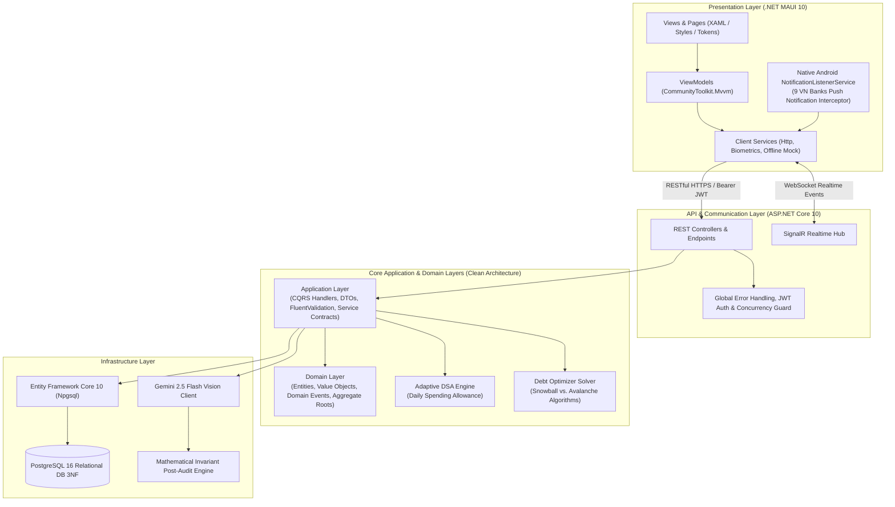
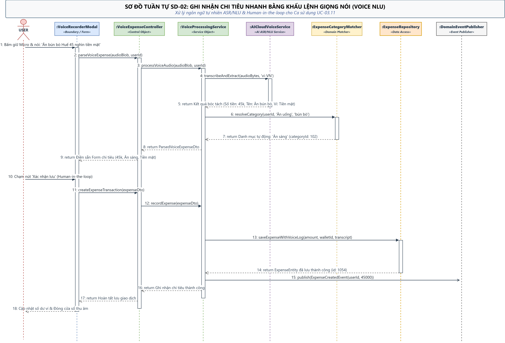
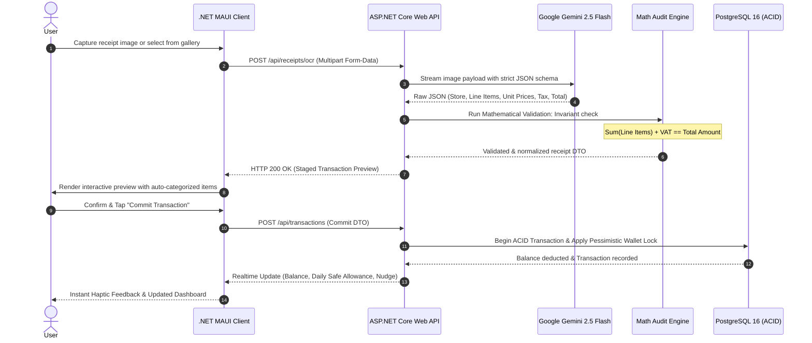
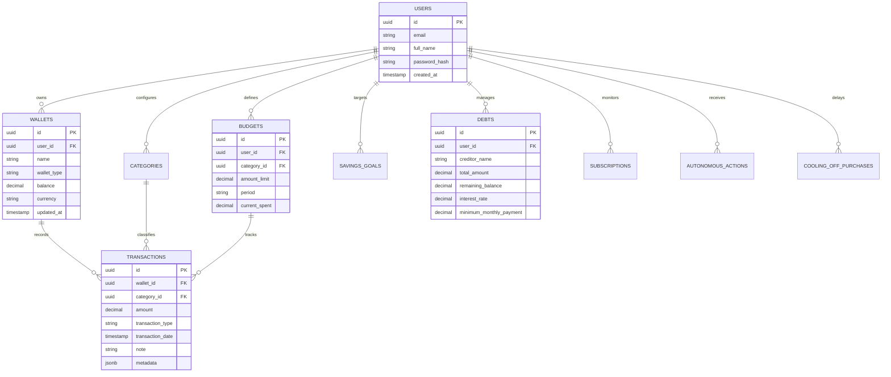
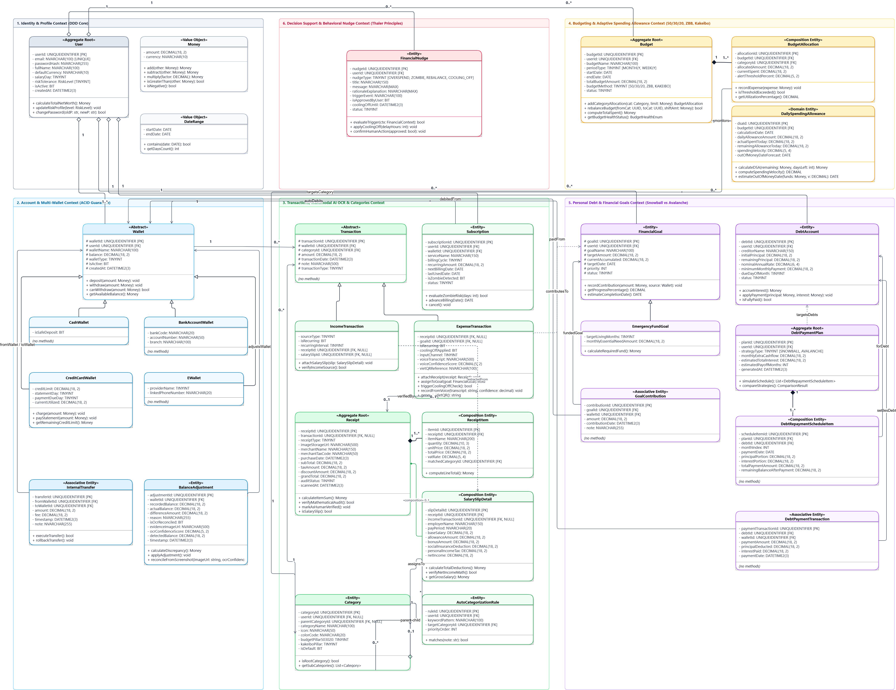

# 💎 DuoNoPro — Smart Personal Finance & AI Financial Planning System

[](https://dotnet.microsoft.com/)
[](https://learn.microsoft.com/en-us/dotnet/csharp/)
[](https://dotnet.microsoft.com/en-us/apps/maui)
[](https://www.postgresql.org/)
[](https://ai.google.dev/)
[-brightgreen?style=for-the-badge&logo=xunit&logoColor=white)](mobile-project/dotnet-maui-ver/backend/tests)
[](LICENSE)

> **DuoNoPro** is an enterprise-grade, cross-platform personal finance management (PFM) and autonomous budgeting ecosystem. Engineered with **.NET 10 Clean Architecture** and **.NET MAUI**, the system eliminates tedious manual bookkeeping and emotional overspending through multimodal AI receipt parsing, real-time banking SMS/notification listeners (supporting 9 major Vietnamese banks), behavioral economics nudges (Cooling-Off periods), and dynamic Daily Spending Allowance (DSA) algorithms.

---

## 📌 Table of Contents
- [Executive Overview](#-executive-overview)
- [Key Engineering Features](#-key-engineering-features)
- [System Architecture & Visual Diagrams](#-system-architecture--visual-diagrams)
  - [1. High-Level Clean Architecture](#1-high-level-clean-architecture)
  - [2. Core AI Receipt OCR & Transaction Workflow](#2-core-ai-receipt-ocr--transaction-workflow)
  - [3. Relational Data Model (3NF ERD)](#3-relational-data-model-3nf-erd)
  - [4. Detailed Domain Class Model](#4-detailed-domain-class-model)
- [Technology Stack Matrix](#-technology-stack-matrix)
- [Automated Testing & Code Quality](#-automated-testing--code-quality)
- [Repository Structure](#-repository-structure)
- [Getting Started & Local Setup](#-getting-started--local-setup)
- [System Analysis & Design Assets](#-system-analysis--design-assets)

---

## 🚀 Executive Overview

Most personal finance applications suffer from high cognitive friction: users abandon manual expense logging within 14 days, impulse buying remains unchecked, and budget limits are static rather than adaptive. **DuoNoPro** addresses these challenges through a three-pillar engineering foundation:

1. **Zero-Friction Transaction Capture:** Multimodal AI Vision OCR with mathematical post-audit and background Android notification listeners for instant, 1-tap transaction staging.
2. **Adaptive Behavioral Budgeting:** Real-time dynamic daily safe spending allowances (DSA), emergency fund burn-rate forecasting, and 24–72 hour impulse cooling-off buffers based on Richard Thaler's Nudge Theory.
3. **Rigorous Financial Integrity:** 3NF normalized PostgreSQL schema with pessimistic concurrency locks, idempotent operations, and zero floating-point rounding errors via immutable decimal arithmetic.

---

## ⚡ Key Engineering Features

| Category | Engineering Capability | Technical Implementation Details |
| :--- | :--- | :--- |
| **💳 Multi-Wallet Engine** | ACID-Compliant Wallet Management | Supports Cash, Bank Accounts, Credit Cards, and E-Wallets (MoMo/ZaloPay). Handles cross-wallet transfers with atomic transactions and pessimistic balance locks (`SELECT FOR UPDATE`). |
| **📸 Multimodal AI OCR** | Automated Receipt & Payslip Breakdown | Powered by **Google Gemini 2.5 Flash Vision**. Extracts store metadata, itemized line items, unit prices, and tax rates. Includes a deterministic **Mathematical Audit Engine** that rejects hallucinations by verifying `Sum(Items) + Tax == Total`. |
| **📲 Banking Interceptor** | Native Android Notification Listener | Background `NotificationListenerService` intercepts push notifications from 9 Vietnamese financial institutions (*Vietcombank, Techcombank, MB Bank, VPBank, ACB, BIDV, Agribank, TPBank, MoMo*), parses amounts/notes offline via regex patterns, and triggers instant staging prompts. |
| **📊 Adaptive DSA Budgeting** | Daily Spending Allowance (DSA) | Dynamically recalculates daily safe discretionary spending: $DSA = \frac{\text{Discretionary Balance}}{\text{Remaining Days in Month}}$. Automatically compresses allowance when spending velocity exceeds safe thresholds. |
| **📉 Debt Optimization** | Dual-Strategy Debt Payoff Solver | Mathematical modeling of **Debt Snowball** (lowest balance first for behavioral momentum) and **Debt Avalanche** (highest interest rate first for minimum total interest paid) with complete amortization schedules. |
| **🧠 Behavioral Nudges** | Cooling-Off Delay & Subscription Audit | Enforces a mandatory 24-72h reflection timer on non-essential purchases above user-configured thresholds. Actively scans recurring transaction cadences to flag zombie subscription traps. |
| **🔐 Fintech Security** | Biometric Auth & Token Rotation | Native biometric fingerprint/FaceID authentication via `Plugin.Fingerprint`, BCrypt password hashing, and short-lived JWT access tokens with secure refresh token rotation. |

---

## 🏛️ System Architecture & Visual Diagrams

### 1. High-Level Clean Architecture

The backend adheres strictly to **Clean Architecture & Domain-Driven Design (DDD)** principles, guaranteeing loose coupling, testability, and technology independence:

```text
┌───────────────────────────────────────────────────────────────────────────────────────────┐
│                           DUONOPRO SYSTEM ARCHITECTURE (.NET 10)                          │
└───────────────────────────────────────────────────────────────────────────────────────────┘
                                              │
                       ┌──────────────────────┴──────────────────────┐
                       │                                             │
                       ▼                                             ▼
┌─────────────────────────────────────────────┐ ┌───────────────────────────────────────────┐
│     CLIENT: .NET MAUI 10 (Android)          │ │    CLIENT: .NET MAUI 10 (Windows Desktop) │
│ - MVVM Architecture (CommunityToolkit)      │ │ - WinUI 3 Native Desktop Interface        │
│ - 20+ Financial Views (Budgets, Debts...)   │ │ - Full Screen Financial Analytics         │
│ - Native Android NotificationListenerService│ │ - Offline-First Local Repository Mock 0ms │
│   (Intercepts 9 VN Banks: VCB, MB, TCB...)  │ │ - Hardware Biometrics Authentication      │
└──────────────────────┬──────────────────────┘ └─────────────────────┬─────────────────────┘
                       │                                              │
                       └──────────────────────┬───────────────────────┘
                                              │ REST HTTPS / JWT Bearer & SignalR WebSocket
                                              ▼
┌───────────────────────────────────────────────────────────────────────────────────────────┐
│                      BACKEND: ASP.NET CORE 10 WEB API (CLEAN ARCHITECTURE)                │
├───────────────────────────────────────────────────────────────────────────────────────────┤
│ [API & Realtime Layer]                                                                    │
│  - RESTful Controllers: /api/wallets, /api/transactions, /api/receipts, /api/debts...    │
│  - Realtime SignalR Hub (Push Nudges, Instant Balance Sync, Alert Broadcasts)             │
│  - Global Error Handling & Pessimistic Concurrency Guard Middleware                       │
├───────────────────────────────────────────────────────────────────────────────────────────┤
│ [Application Layer - Business Orchestration]                                              │
│  - CQRS Commands & Queries | FluentValidation Data Contracts                              │
│  - Adaptive DSA Engine: Recalculates Daily Safe Spending Allowance on Discretionary Burn  │
│  - Debt Solver Engine: Mathematical Optimizations (Snowball vs. Avalanche Amortization)   │
│  - Autonomous Nudge Engine: Cooling-off Period Delay (24-72h) & Zombie Subscription Audit  │
├───────────────────────────────────────────────────────────────────────────────────────────┤
│ [Domain Layer - Pure Enterprise Invariants]                                               │
│  - Aggregate Roots: Wallet, Transaction, Budget, Debt, Subscription, SavingsGoal          │
│  - Value Objects: Immutable Money (Exact Decimal, Zero Float Rounding), DateRange         │
│  - Domain Events: TransactionCommittedEvent, BudgetExceededEvent, NudgeTriggeredEvent     │
├───────────────────────────────────────────────────────────────────────────────────────────┤
│ [Infrastructure Layer - Data Persistence & AI Cloud]                                      │
│  - Entity Framework Core 10 (PostgreSQL 16 Npgsql Provider)                               │
│  - Mathematical Invariant Post-Audit Engine (Reconciles: Sum(Items) + VAT == Total)       │
│  - Google Gemini 2.5 Flash Multimodal Vision API Client (JSON Structured Extraction)       │
└──────────────────────┬──────────────────────────────────────────────┬─────────────────────┘
                       │                                              │
                       ▼                                              ▼
┌─────────────────────────────────────────────┐ ┌───────────────────────────────────────────┐
│        POSTGRESQL 16 RELATIONAL DB          │ │        GOOGLE GEMINI 2.5 FLASH AI         │
│ - Normalized 3NF Schema with Constraints    │ │ - High-speed Multimodal Vision OCR        │
│ - Pessimistic Row Locking (SELECT FOR UPDATE│ │ - Supermarket Bill & Payslip Extraction   │
│ - JSONB Storage for Raw OCR Itemized Trees  │ │ - Automatic 1-Tap Category Classification │
└─────────────────────────────────────────────┘ └───────────────────────────────────────────┘
```

<details>
<summary><b>📐 Click to view interactive Mermaid diagram (GitHub Web)</b></summary>



</details>

---

### 2. Core AI Receipt OCR & Transaction Workflow

The flow below illustrates how an itemized supermarket bill is photographed, processed through Gemini 2.5 Flash, mathematically reconciled against hallucinations, and committed with ACID guarantees:

```text
┌───────────────────────────────────────────────────────────────────────────────────────────┐
│               MULTIMODAL AI RECEIPT OCR & TRANSACTION WORKFLOW (ZERO-FRICTION)            │
└───────────────────────────────────────────────────────────────────────────────────────────┘

  [1. CAPTURE]          [2. AI VISION]             [3. MATH AUDIT]           [4. ACID COMMIT]
 ┌─────────────┐       ┌────────────────┐        ┌─────────────────┐       ┌─────────────────┐
 │ .NET MAUI   │       │ Google Gemini  │        │ Mathematical    │       │ PostgreSQL 16   │
 │ Camera / App│──────►│ 2.5 Flash API  │───────►│ Invariant Engine│──────►│ 3NF Transaction │
 └─────────────┘       └────────────────┘        └─────────────────┘       └─────────────────┘
   Snap receipt          Extract Store,           Deterministic Audit:       Atomic Balance
   photo & send          Line Items,              Sum(Line Items)            Deduction with
   Multipart stream      Prices & Tax             + VAT == Total             Pessimistic Lock
                                                         │                          │
                                                         ▼                          ▼
                                                [RECONCILED DTO]           [REALTIME BROADCAST]
                                                Renders Preview            SignalR notifies
                                                in 1-Tap UI for            Dashboard & updates
                                                Instant User Check         DSA Daily Allowance
```

<p align="center">
  
  <br>
  <em>Figure 2.1: Formal Sequence Diagram of the Multimodal AI Receipt Scanning & Math Audit Pipeline (from <a href="files/SequenceDiagram.drawio">files/SequenceDiagram.drawio</a>)</em>
</p>

<details>
<summary><b>📐 Click to view interactive Mermaid sequence flow (GitHub Web)</b></summary>



</details>

---

### 3. Relational Data Model (3NF ERD)

The database schema is fully normalized to **Third Normal Form (3NF)** with foreign key constraints, index optimization, and audit timestamps:

```text
┌───────────────────────────────────────────────────────────────────────────────────────────┐
│                            3NF RELATIONAL DATABASE SCHEMA (POSTGRESQL)                    │
└───────────────────────────────────────────────────────────────────────────────────────────┘

  ┌────────────────┐           ┌──────────────────┐           ┌────────────────────────┐
  │     USERS      │1         *│     WALLETS      │1         *│      TRANSACTIONS      │
  ├────────────────┤───────────┼──────────────────┤───────────┼────────────────────────┤
  │ PK  id (uuid)  │           │ PK  id (uuid)    │           │ PK  id (uuid)          │
  │     email      │           │ FK  user_id      │           │ FK  wallet_id          │
  │     full_name  │           │     name         │           │ FK  category_id        │
  │     pass_hash  │           │     wallet_type  │           │     amount (decimal)   │
  │     created_at │           │     balance      │           │     tx_type (In/Out)   │
  └───────┬────────┘           │     currency     │           │     tx_date (datetime) │
          │                    └──────────────────┘           │     note               │
          │1                                                  │     metadata (jsonb)   │
          ├────────────────────────┬──────────────────────┐   └────────────────────────┘
          │*                       │*                     │*
  ┌───────┴────────┐       ┌───────┴──────────┐   ┌───────┴──────────┐
  │   CATEGORIES   │       │     BUDGETS      │   │      DEBTS       │
  ├────────────────┤       ├──────────────────┤   ├──────────────────┤
  │ PK  id (uuid)  │       │ PK  id (uuid)    │   │ PK  id (uuid)    │
  │ FK  user_id    │       │ FK  user_id      │   │ FK  user_id      │
  │     name       │       │ FK  category_id  │   │     creditor     │
  │     icon       │       │     amount_limit │   │     total_amount │
  │     is_income  │       │     current_spent│   │     rem_balance  │
  └────────────────┘       │     period       │   │     apr_rate     │
                           └──────────────────┘   │     min_monthly  │
                                                  └──────────────────┘
```

<details>
<summary><b>📐 Click to view interactive Mermaid ERD (GitHub Web)</b></summary>



</details>

---

### 4. Detailed Domain Class Model

<p align="center">
  
  <br>
  <em>Figure 4.1: Clean Architecture Domain Class Diagram (from <a href="files/ClassDiagram.drawio">files/ClassDiagram.drawio</a>)</em>
</p>

---

## 🛠️ Technology Stack Matrix

| Domain | Technology / Library | Version | Technical Purpose & Rationale |
| :--- | :--- | :--- | :--- |
| **Backend Framework** | ASP.NET Core Web API | .NET 10.0 | High-throughput async REST API with Native AOT readiness |
| **Language** | C# | 14.0 | Pattern matching, records, primary constructors, strict nullability |
| **ORM & Data Access** | Entity Framework Core / Npgsql | 10.0 | Code-First migrations, compiled queries, connection pooling |
| **Database** | PostgreSQL | 16.0 | ACID relational engine with JSONB support for OCR metadata |
| **Mobile & Desktop UI** | .NET MAUI | 10.0 | Unified cross-platform codebase targeting Android (API 26–35) & Windows Desktop (WinUI 3) |
| **MVVM Architecture** | CommunityToolkit.Mvvm | 8.4+ | Source generators for `[ObservableProperty]`, `[RelayCommand]` |
| **Realtime Engine** | ASP.NET Core SignalR | 10.0 | Low-latency duplex WebSocket communication for push nudges |
| **AI Vision & NLP** | Google Gemini 2.5 Flash API | v1beta | High-speed multimodal vision OCR and structured receipt parsing |
| **QR & Barcodes** | ZXing.Net.MAUI | Latest | Offline scanning and generation of National VietQR payment standards |
| **Biometrics** | Plugin.Fingerprint | Latest | Hardware-backed biometric authentication (Fingerprint / FaceID) |
| **Containerization** | Docker & Docker Compose | Latest | Reproducible local PostgreSQL & database migration container |
| **Testing Suite** | xUnit, Moq, FluentAssertions | Latest | Unit testing, domain invariant validation, and mocking |

---

## 🧪 Automated Testing & Code Quality

The comprehensive test suite encompasses **516 automated tests** executing with a **100% pass rate** across Domain, Application, and Client ViewModel layers:

```text
================================================================================
Test Execution Summary (.NET 10 xUnit Suite)
================================================================================
Passed!  - Failed: 0, Passed: 113, Skipped: 0, Total: 113 - ExpenseTracker.Domain.UnitTests.dll
Passed!  - Failed: 0, Passed: 264, Skipped: 0, Total: 264 - ExpenseTracker.Application.UnitTests.dll
Passed!  - Failed: 0, Passed: 139, Skipped: 0, Total: 139 - ExpenseTracker.Maui.UnitTests.dll
--------------------------------------------------------------------------------
TOTALS:  516 Passed / 0 Failed (100% Success Rate)
================================================================================
```

### Test Coverage Highlights:
- **Domain Invariants (113 tests):** Wallet balance non-negativity checks, transaction sign validations, immutable Money value object arithmetic, debt payoff schedule boundaries.
- **Application Services (264 tests):** Dynamic DSA recalculation algorithms, Debt Snowball vs. Avalanche payment allocators, Cooling-off expiration rules, and Hybrid Data Import validators.
- **Frontend MAUI Client (139 tests):** ViewModel state lifecycle, offline Mock Repository contracts, regex bank notification parsers, biometric authentication flow, and OTP validations.
- **AI Math Reconciliation:** Deterministic tests asserting that receipt line items with tax/discounts match header totals within $\pm 0.01$ margin.

---

## 📂 Repository Structure

```text
analyze-system-subject/
├── files/                              # System Analysis & Design Engineering Assets
│   ├── ActivityDiagram.drawio          # Activity diagrams (3 detailed workflows)
│   ├── ClassDiagram.drawio             # Comprehensive domain class model
│   ├── DatabaseERD.drawio              # Full 3NF relational entity-relationship model
│   ├── SequenceDiagram.drawio          # Sequence diagrams for 5 core system flows
│   ├── StateDiagram.drawio             # Lifecycle state transition models
│   ├── UCD-DuoNoPro.drawio             # Complete Use Case diagram suite (UC00 - UC09)
│   └── images/                         # Exported high-resolution UML/ERD PNG assets
│
├── mobile-project/
│   └── dotnet-maui-ver/                # Production .NET 10 Implementation
│       ├── ExpenseTracker.slnx         # Solution file
│       ├── RUN_WINDOWS.bat             # 1-Click launcher for Windows Desktop (WinUI 3)
│       ├── RUN_ANDROID.bat             # 1-Click launcher for Android Emulator
│       ├── CLEAN_AND_RUN_ANDROID.bat   # Deep-clean & deploy script for Android
│       ├── TEST_API.bat                # Automated REST API & Integration test runner
│       │
│       ├── backend/                    # ASP.NET Core 10 Clean Architecture Web API
│       │   ├── ExpenseTracker.Domain/          # Entities, Value Objects, Domain Enums
│       │   ├── ExpenseTracker.Application/     # CQRS, DTOs, Business Services, Validators
│       │   ├── ExpenseTracker.Infrastructure/  # EF Core, PostgreSQL DbContext, Gemini AI
│       │   ├── ExpenseTracker.WebApi/          # Controllers, Middlewares, SignalR Hubs
│       │   ├── tests/                          # 377 automated xUnit test suites
│       │   ├── docker-compose.yml              # Local PostgreSQL 16 container definition
│       │   └── Dockerfile                      # Production container build specification
│       │
│       └── frontend/
│           └── ExpenseTracker.Maui/    # Cross-Platform Client (Android & Windows)
│               ├── Views/              # 20+ feature pages (Wallets, Debts, OCR, Budgets...)
│               ├── ViewModels/         # MVVM ViewModel layer (CommunityToolkit)
│               ├── Services/           # API Client, SignalR Listener, Biometrics
│               ├── Platforms/Android/  # Native Android NotificationListenerService
│               └── Resources/          # Design tokens, SVG icons, Fintech styles
│
├── .gitignore                          # Clean repository ignore configuration
└── README.md                           # Project technical documentation
```

---

## 💻 Getting Started & Local Setup

### Prerequisites
- [.NET 10.0 SDK](https://dotnet.microsoft.com/download/dotnet/10.0) or higher
- [Docker Desktop](https://www.docker.com/products/docker-desktop/) *(for PostgreSQL database)*
- [Visual Studio 2022 / 2026 Preview](https://visualstudio.microsoft.com/) with `.NET MAUI` workload installed
- *(Optional for Android)* Android SDK & Android Emulator (API 34+)

---

### Option A: 1-Click Launchers (Recommended for Windows)

Navigate to `mobile-project/dotnet-maui-ver/` and double-click the corresponding batch script:

1. **Windows Desktop App:** Double-click `RUN_WINDOWS.bat`  
   *Automatically starts PostgreSQL, launches the backend Web API, compiles the WinUI 3 desktop client, and displays the app.*
2. **Android Emulator App:** Double-click `RUN_ANDROID.bat`  
   *Configures virtual drive mapping (eliminating `MAX_PATH` limitations), boots the Android emulator, and deploys the APK.*
3. **Run Backend Integration Tests:** Double-click `TEST_API.bat`  
   *Executes comprehensive API test scenarios and seeds demo financial data.*

---

### Option B: Manual CLI Execution

#### 1. Start Database & Backend API
```powershell
# Navigate to backend directory
cd mobile-project/dotnet-maui-ver/backend

# Start PostgreSQL 16 container
docker compose up -d

# Run Web API (Swagger UI available at http://localhost:5018/swagger)
dotnet run --project ExpenseTracker.WebApi
```

> **Note:** If Docker is not running, the Web API automatically falls back to an **In-Memory Storage Provider**, allowing full evaluation of application features without database setup.

#### 2. Run Automated Unit Tests
```powershell
cd mobile-project/dotnet-maui-ver/backend
dotnet test ExpenseTracker.slnx --nologo
```

#### 3. Run .NET MAUI Client
```powershell
cd mobile-project/dotnet-maui-ver/frontend/ExpenseTracker.Maui

# Run on Windows Desktop
dotnet build -t:Run -f net10.0-windows10.0.19041.0

# Run on Android Device / Emulator
dotnet build -t:Run -f net10.0-android
```

---

## 📐 System Analysis & Design Assets

All formal engineering artifacts adhering to IEEE standards are preserved in the [`files/`](files/) directory:

- 📊 **Entity Relationship Diagram (ERD):** [`files/DatabaseERD.drawio`](files/DatabaseERD.drawio)
- 🏗️ **Class Diagram:** [`files/ClassDiagram.drawio`](files/ClassDiagram.drawio)
- 🔄 **Sequence Diagrams:** [`files/SequenceDiagram.drawio`](files/SequenceDiagram.drawio)
  - `SD-01`: Multi-Wallet Transfer & Atomic Balance Reconciliation
  - `SD-02`: Multimodal AI Receipt Scanning & Math Post-Audit
  - `SD-03`: Dynamic Daily Spending Allowance (DSA) Recalculation
  - `SD-04`: Debt Repayment Optimization (Snowball vs. Avalanche)
  - `SD-05`: Autonomous Banking Notification Staging & Quick Commit
- 🔀 **Activity Diagrams:** [`files/ActivityDiagram.drawio`](files/ActivityDiagram.drawio)
- 🔁 **State Transition Diagrams:** [`files/StateDiagram.drawio`](files/StateDiagram.drawio)
- 🎯 **Use Case Diagrams:** [`files/UCD-DuoNoPro.drawio`](files/UCD-DuoNoPro.drawio)
- 🖼️ **High-Resolution PNG Exports:** Browse [`files/images/`](files/images/)

---

## 📄 License

This project is licensed under the **MIT License** — see the [LICENSE](LICENSE) file for details.
