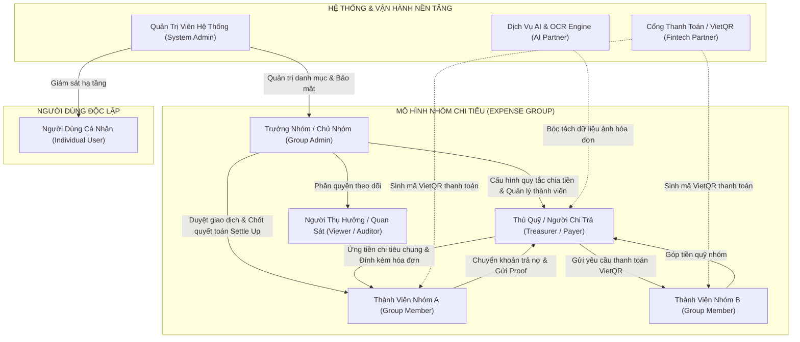
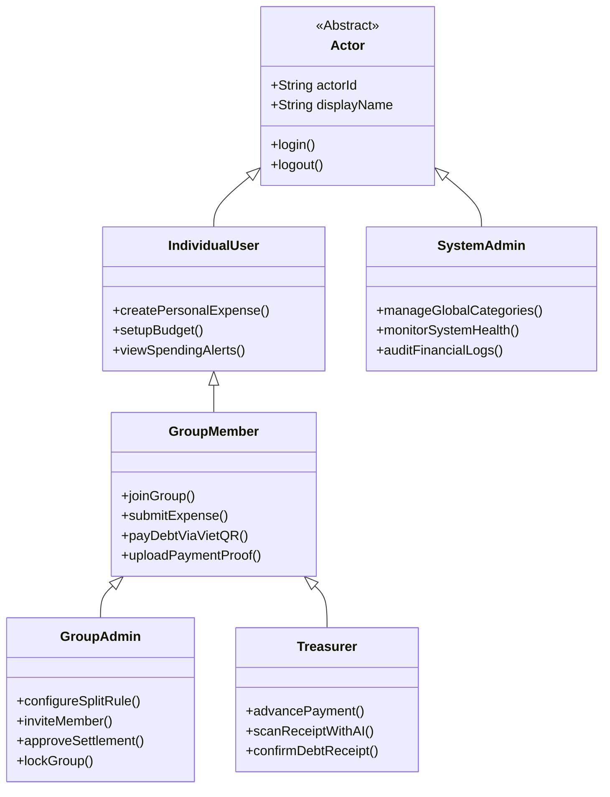
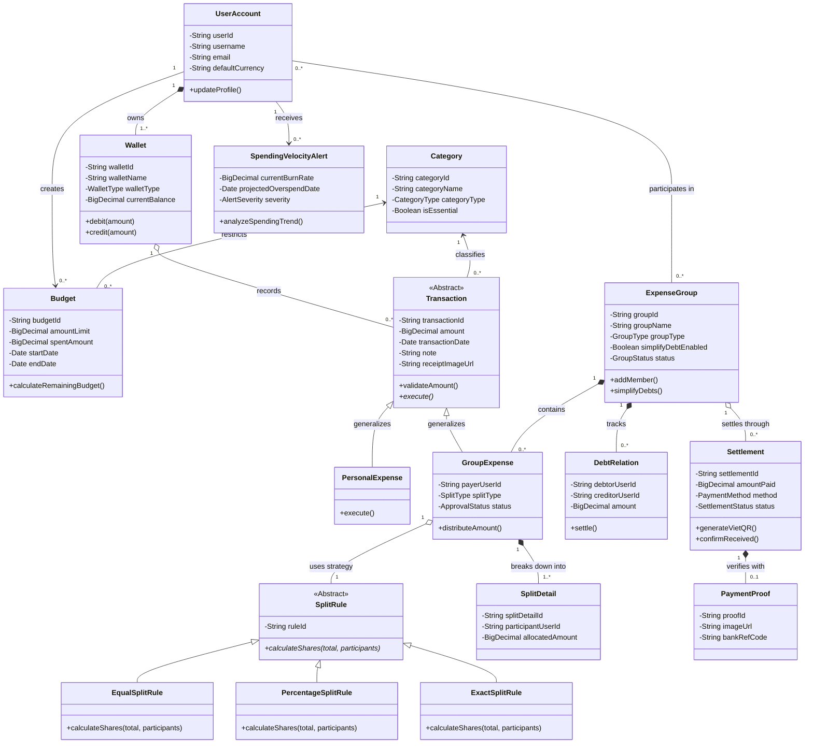
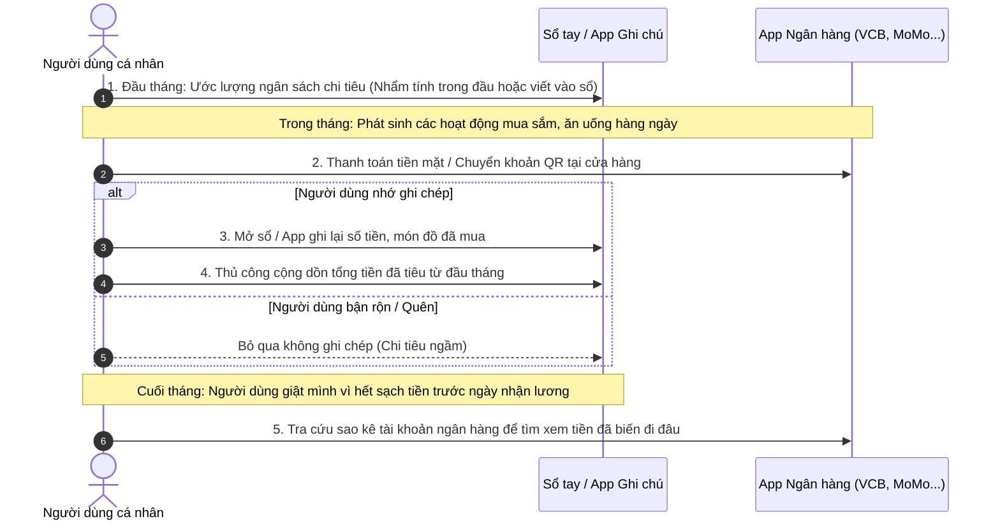
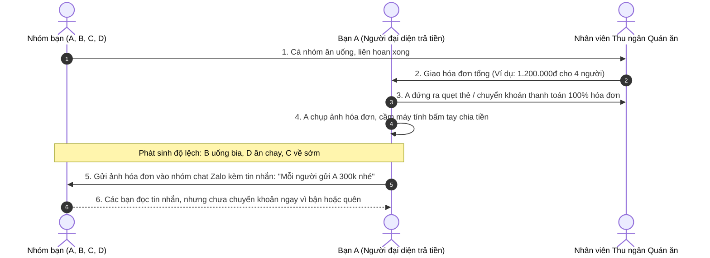
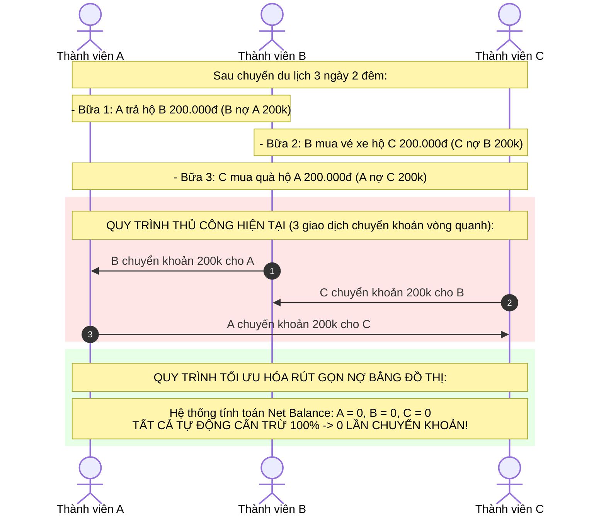
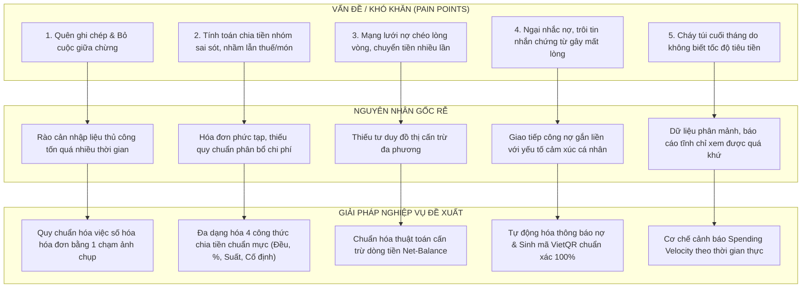

# BÁO CÁO THỰC HÀNH PHÂN TÍCH THIẾT KẾ HƯỚNG ĐỐI TƯỢNG (OOAD)

# LAB 1: KHẢO SÁT HIỆN TRẠNG TỔ CHỨC & QUẢN LÝ CHI TIÊU

---

## 📌 THÔNG TIN ĐỀ TÀI & ĐÁNH GIÁ ĐÓNG GÓP THÀNH VIÊN

* **Tên đề tài tiếng Việt:** Hệ thống Quản lý Chi tiêu & Lập Ngân sách Cá nhân / Nhóm Thông minh (Tích hợp AI)
* **Tên đề tài tiếng Anh:** Smart Personal & Group Expense and Budget Management System with AI Integration
* **Môn học:** Phân tích Thiết kế Hệ thống Hướng đối tượng (PTTKHTHDT / OOAD)
* **Mục đích bài Lab 1:** Khảo sát toàn diện hiện trạng tổ chức, thói quen và quy trình quản lý tài chính cá nhân cũng như quản lý chi tiêu nhóm; nhận diện chính xác các **Đối tượng (Objects/Entities)** và **Tác nhân (Actors)** cùng vai trò, trách nhiệm và mối quan hệ hướng đối tượng phục vụ cho việc mô hình hóa Use Case, Class Diagram và CSDL ở các giai đoạn sau.

### Bảng Đánh Giá Mức Độ Đóng Góp Của Các Thành Viên

| STT | Họ và tên | Mã sinh viên | Vai trò / Phần việc phân công | Mức độ hoàn thành (%) | Ký tên / Ghi chú |
| :---: | :--- | :---: | :--- | :---: | :---: |
| 1 | *(Họ tên sinh viên 1)* | *(MSSV 1)* | **Trưởng nhóm:** Khảo sát cơ cấu tổ chức, Phân tích đối tượng hướng đối tượng (Actors & Entities), Thiết kế sơ đồ quan hệ đối tượng | 100% | Nhóm trưởng |
| 2 | *(Họ tên sinh viên 2)* | *(MSSV 2)* | **Thành viên:** Khảo sát chi tiết 4 quy trình nghiệp vụ hiện tại, Đánh giá khó khăn, nguyên nhân và giải pháp nghiệp vụ | 100% | Thành viên |
| 3 | *(Họ tên sinh viên 3)* | *(MSSV 3)* | **Thành viên:** Khảo sát hiện trạng tin học, Môi trường vận hành, Định hướng thiết kế & Tổng hợp báo cáo Lab 1 | 100% | Thành viên |

---

## I. BỐI CẢNH KHẢO SÁT & MÔ HÌNH CƠ CẤU TỔ CHỨC

### 1. Bối Cảnh Khảo Sát Nghiệp Vụ
Trong bối cảnh nền kinh tế số và xã hội không tiền mặt (Cashless Society), người dùng tại Việt Nam thực hiện phần lớn các giao dịch qua Ngân hàng số (Mobile Banking / VietQR) và Ví điện tử (MoMo, ZaloPay, VNPay). Tuy nhiên, việc quản lý tài chính đang đối mặt với sự phân mảnh lớn:
1. **Ở cấp độ cá nhân:** Người dùng (đặc biệt là sinh viên và người đi làm trẻ tuổi) khó kiểm soát dòng tiền, thường xuyên vượt hạn mức ngân sách tháng do thiếu cảnh báo tức thời theo thời gian thực (Spending Velocity).
2. **Ở cấp độ nhóm/tổ chức nhỏ:** Khi tham gia các hoạt động tập thể (chuyến du lịch, tiệc sinh nhật, chi tiêu phòng trọ sinh viên, quỹ gia đình, chi phí dự án của các nhóm khởi nghiệp/CLB), việc chia tiền (Split Bill), thu hộ, chi hộ và đòi nợ chéo phát sinh nhiều bất cập, dễ gây mâu thuẫn xã hội và tốn nhiều công sức đối soát.

Nhóm sinh viên thực hiện khảo sát hiện trạng trên 2 mô hình tổ chức thực tế:
* **Mô hình Vận hành Nền tảng (Fintech Platform Operation):** Bộ phận quản trị hệ thống, giám sát vận hành, đảm bảo an toàn bảo mật dữ liệu và chuẩn hóa danh mục tài chính.
* **Mô hình Nhóm Chi tiêu Xã hội (Social Expense Group):** Bao gồm nhiều hình thái tổ chức đa dạng ngoài đời thực:
  * *Nhóm sinh viên ở chung phòng trọ / Ký túc xá:* Chia sẻ tiền thuê nhà, tiền điện nước, tiền đi chợ hàng ngày.
  * *Nhóm bạn bè đi du lịch / Dã ngoại / Sự kiện:* Chia sẻ chi phí ăn uống, khách sạn, vé tham quan với nhiều người cùng trả tiền trước.
  * *Hộ gia đình trẻ:* Quản lý quỹ chung gia đình, phân bổ hạn mức mua sắm, giáo dục con cái.
  * *Câu lạc bộ sinh viên / Nhóm dự án khởi nghiệp:* Quản lý quỹ hoạt động, kinh phí tổ chức sự kiện và mua sắm thiết bị.

---

### 2. Sơ Đồ Cơ Cấu Tổ Chức & Phân Quyền Vai Trò

Dưới đây là sơ đồ cơ cấu tổ chức và các vai trò tương tác trong mô hình Quản lý Chi tiêu Cá nhân và Nhóm:

---

### 3. Ma Trận Phân Quyền Nghiệp Vụ (Role & Permission Matrix)

| Quyền hạn & Nghiệp vụ cốt lõi | Quản trị viên (System Admin) | Trưởng nhóm (Group Admin) | Thủ quỹ / Người chi trả (Treasurer/Payer) | Thành viên nhóm (Group Member) | Người dùng cá nhân (Individual User) |
| :--- | :---: | :---: | :---: | :---: | :---: |
| **Quản lý danh mục & Tham số hệ thống** | **Toàn quyền** | Không | Không | Không | Không |
| **Khởi tạo & Cấu hình nhóm chi tiêu** | Xem/Khóa | **Toàn quyền** | Tham gia | Tham gia | Tự khởi tạo |
| **Mời / Phê duyệt / Xóa thành viên nhóm** | Can thiệp sự cố | **Toàn quyền** | Không | Không | Không |
| **Ghi nhận khoản chi chung (Add Group Expense)** | Xem log | Có | **Thực hiện chính** | Có (nếu được cấp quyền) | Không áp dụng |
| **Thiết lập quy tắc chia tiền (Split Rules)** | Không | **Toàn quyền** | Đề xuất | Đề xuất | Không áp dụng |
| **Quét hóa đơn AI (Receipt OCR)** | Giám sát quota | Sử dụng | **Sử dụng chính** | Sử dụng | Tự do sử dụng |
| **Kích hoạt Thuật toán Rút gọn Nợ (Simplify Debt)** | Giám sát hiệu năng | **Kích hoạt** | **Kích hoạt** | Xem kết quả | Không áp dụng |
| **Phê duyệt Quyết toán Nợ (Confirm Settlement)** | Không | **Toàn quyền** | **Xác nhận đã nhận tiền** | Gửi bằng chứng thanh toán | Không áp dụng |
| **Lập ngân sách & Cảnh báo tốc độ tiêu tiền** | Không | Quản lý ngân sách nhóm | Theo dõi | Theo dõi | **Toàn quyền cá nhân** |

---

## II. TRỌNG TÂM HƯỚNG ĐỐI TƯỢNG (CORE OOAD): XÁC ĐỊNH ĐỐI TƯỢNG VÀ VAI TRÒ TRONG HỆ THỐNG

> [!IMPORTANT]
> **Đây là phần trọng tâm cốt lõi của môn Phân tích Thiết kế Hệ thống Hướng đối tượng.**  
> Việc xác định chính xác các **Tác nhân (Actors)** và các **Đối tượng Thực thể (Domain Entities/Objects)** cùng thuộc tính, hành vi, mối quan hệ (Kế thừa, Kết tập, Hợp thành, Liên kết) tạo tiền đề trực tiếp để xây dựng Biểu đồ Lớp (Class Diagram), Biểu đồ Tuần tự (Sequence Diagram) và Thiết kế CSDL quan hệ chuẩn 3NF.

---

### 1. Phân Loại và Đặc Tả Nhóm Tác Nhân (Actors)

#### Chi Tiết Trách Nhiệm & Vai Trò Của Từng Tác Nhân:
1. **`Individual User` (Người dùng cá nhân):**
   * **Vai trò:** Trung tâm của bài toán quản lý tài chính cá nhân.
   * **Trách nhiệm:** Ghi nhận thu/chi hàng ngày; phân loại danh mục; tạo ví tiền/nguồn tài chính; thiết lập ngân sách tháng; theo dõi báo cáo phân tích dòng tiền và nhận các cảnh báo tốc độ chi tiêu quá nhanh (Spending Velocity Alert).
2. **`Group Member` (Thành viên nhóm):**
   * **Vai trò:** Thành viên tham gia vào một hoặc nhiều nhóm chi tiêu chung.
   * **Trách nhiệm:** Tham gia nhóm qua mã mời (Invite Code/Link); xem báo cáo công nợ hiện tại; đề xuất khoản chi chung; quét mã VietQR để thanh toán nợ; tải lên hình ảnh minh chứng chuyển khoản (Payment Proof).
3. **`Group Admin` (Chủ nhóm / Trưởng nhóm):**
   * **Vai trò:** Người chịu trách nhiệm tổ chức và điều phối nhóm chi tiêu.
   * **Trách nhiệm:** Khởi tạo nhóm; phân quyền thành viên; chọn quy tắc chia tiền mặc định (Chia đều, Chia theo tỷ lệ phần trăm, Chia theo phần); duyệt các khoản chi bất thường; kích hoạt thuật toán rút gọn nợ đồ thị và xác nhận chốt sổ quyết toán kỳ (Settle Up).
4. **`Treasurer / Payer` (Thủ quỹ / Người đại diện thanh toán):**
   * **Vai trò:** Người trực tiếp xuất tiền túi/quỹ nhóm để thanh toán hóa đơn chung tại hiện trường.
   * **Trách nhiệm:** Chụp ảnh hóa đơn thực tế; kích hoạt AI OCR để tự động đọc số tiền; chọn danh sách những người cùng chia tiền (Participants); nhận tiền hoàn trả từ các thành viên khác và xác nhận "Đã nhận đủ tiền".
5. **`System Administrator` (Quản trị viên hệ thống):**
   * **Vai trò:** Giám sát vận hành kỹ thuật và an ninh thông tin.
   * **Trách nhiệm:** Quản lý danh mục chi tiêu mẫu của hệ thống; cấu hình ngưỡng giới hạn; giám sát tính toàn vẹn dữ liệu tài chính (Audit Log); hỗ trợ xử lý sự cố khiếu nại giao dịch.
6. **`Banking / Payment Partner (VietQR API)` (Hệ thống Ngân hàng Đối tác - Tác nhân ngoài):**
   * **Vai trò:** Tác nhân hệ thống ngoài (External System Actor).
   * **Trách nhiệm:** Tiếp nhận thông tin số tài khoản, ngân hàng thụ hưởng, số tiền và nội dung chuyển khoản để sinh mã `VietQR` động chuẩn NAPAS; cung cấp cơ chế webhook xác nhận giao dịch thành công.
7. **`AI Vision / OCR Engine` (Công cụ AI Trích xuất Hóa đơn - Tác nhân ngoài):**
   * **Vai trò:** Tác nhân hệ thống trí tuệ nhân tạo (External AI Actor).
   * **Trách nhiệm:** Tiếp nhận hình ảnh hóa đơn từ máy ảnh người dùng; áp dụng mô hình thị giác máy tính để bóc tách: Tên nhà hàng/cửa hàng, Ngày giờ, Chi tiết từng món hàng, Thuế VAT, và Tổng số tiền thanh toán cuối cùng.

---

### 2. Danh Sách & Đặc Tả Toàn Diện Các Đối Tượng Thực Thể Nghiệp Vụ (Entities & Domain Objects)

Dưới đây là bảng phân tích chi tiết từng đối tượng thực thể theo chuẩn Phân tích Thiết kế Hướng Đối tượng:

#### (1) Đối Tượng `UserAccount` (Tài khoản Người dùng)
* **Khái niệm:** Thực thể quản trị thông tin định danh và bảo mật của người dùng trên toàn hệ thống.
* **Thuộc tính (Attributes):** `userId`, `username`, `email`, `phoneNumber`, `passwordHash`, `avatarUrl`, `defaultCurrency`, `createdAt`, `status`.
* **Trách nhiệm / Hành vi (Responsibilities / Methods):**
  * `authenticate(credentials)`: Xác thực đăng nhập.
  * `updateProfile(info)`: Cập nhật thông tin cá nhân.
  * `setupDefaultCurrency(currencyCode)`: Thiết lập đơn vị tiền tệ mặc định (VND, USD...).
* **Mối quan hệ:** 
  * Sở hữu một hoặc nhiều Ví tiền (`1 UserAccount` sở hữu `1..* Wallet` - Quan hệ *Composition*).
  * Tham gia vào nhiều Nhóm chi tiêu (`* UserAccount` tham gia `* ExpenseGroup` - Quan hệ *Association*).
* **Vai trò trong hệ thống:** Định danh chủ thể thực hiện mọi thao tác thu/chi và chịu trách nhiệm công nợ.

---

#### (2) Đối Tượng `Wallet` (Ví Tiền / Nguồn Tiền)
* **Khái niệm:** Thực thể biểu diễn nguồn tài chính cụ thể của người dùng (Tiền mặt trong ví, Tài khoản Ngân hàng VCB, Ví MoMo, Thẻ tín dụng).
* **Thuộc tính:** `walletId`, `userId`, `walletName`, `walletType` (CASH, BANK, E_WALLET, CREDIT), `initialBalance`, `currentBalance`, `bankAccountNumber`, `bankCode`.
* **Trách nhiệm / Hành vi:**
  * `credit(amount)`: Tăng số dư ví khi có thu nhập hoặc nhận nợ.
  * `debit(amount)`: Trừ số dư ví khi thực hiện chi tiêu hoặc trả nợ.
  * `transferTo(targetWallet, amount)`: Chuyển tiền giữa các ví cá nhân.
  * `getBalance()`: Trả về số dư khả dụng thực tế.
* **Mối quan hệ:** 
  * Thuộc về 1 Người dùng (`UserAccount`).
  * Chứa nhiều Giao dịch (`1 Wallet` ghi nhận `0..* Transaction`).
* **Vai trò trong hệ thống:** Quản lý biến động số dư tiền tệ thực tế theo nguyên lý dòng tiền.

---

#### (3) Đối Tượng `Category` & `SubCategory` (Danh Mục Thu / Chi)
* **Khái niệm:** Thực thể phân loại mục đích sử dụng của dòng tiền nhằm mục đích thống kê, báo cáo và kiểm soát định mức.
* **Thuộc tính:** `categoryId`, `categoryName`, `categoryType` (INCOME, EXPENSE), `iconUrl`, `colorCode`, `isEssential` (Thiết yếu hay Hưởng thụ), `parentCategoryId` (Hỗ trợ phân cấp cha-con).
* **Trách nhiệm / Hành vi:**
  * `getSubCategories()`: Lấy danh sách các danh mục con.
  * `isOverspend(currentSpend, limit)`: Kiểm tra chi tiêu có vượt mức danh mục không.
* **Mối quan hệ:** 
  * Quan hệ đệ quy cha - con (`1 Category` chứa `0..* Category` con).
  * Liên kết với nhiều Giao dịch (`1 Category` gán cho `0..* Transaction`).
* **Vai trò trong hệ thống:** Chuẩn hóa dữ liệu đầu vào cho hệ thống báo cáo và thuật toán phân bổ ngân sách 50/30/20.

---

#### (4) Đối Tượng `Budget` (Ngân Sách & Hạn Mức Chi Tiêu)
* **Khái niệm:** Thực thể quản lý cam kết giới hạn chi tiêu trong một khung thời gian cụ thể (Tuần/Tháng/Năm) cho một danh mục hoặc toàn bộ ví.
* **Thuộc tính:** `budgetId`, `userId`, `categoryId`, `amountLimit`, `spentAmount`, `startDate`, `endDate`, `alertThresholdPercent` (ví dụ: cảnh báo khi đạt 80%).
* **Trách nhiệm / Hành vi:**
  * `calculateRemainingBudget()`: Tính số tiền còn lại được phép tiêu.
  * `calculateDailyAllowance()`: Tính số tiền tối đa được tiêu mỗi ngày từ nay đến cuối kỳ.
  * `checkAlertCondition()`: Kích hoạt cảnh báo khi tốc độ chi tiêu vượt ngưỡng.
* **Mối quan hệ:** 
  * Liên kết với `UserAccount` và `Category`.
* **Vai trò trong hệ thống:** "Chiếc phanh tài chính" ngăn chặn người dùng rơi vào tình trạng bội chi.

---

#### (5) Đối Tượng `Transaction` (Lớp Cơ Sở Giao Dịch - Abstract Base Class)
* **Khái niệm:** Lớp trừu tượng định nghĩa cấu trúc chung của mọi phát sinh tiền tệ trong hệ thống (Giao dịch cá nhân, Giao dịch nhóm, Khoản thu, Khoản chi).
* **Thuộc tính:** `transactionId`, `walletId`, `categoryId`, `amount`, `transactionDate`, `note`, `receiptImageUrl`, `createdAt`.
* **Trách nhiệm / Hành vi:**
  * `validateAmount()`: Kiểm tra tính hợp lệ của số tiền (lớn hơn 0).
  * `execute()`: Phương thức trừu tượng thực thi ghi nhận giao dịch vào ví.
* **Mối quan hệ:** 
  * Lớp cha (Generalization) của `PersonalExpense`, `IncomeTransaction`, và `GroupExpense`.
* **Vai trò trong hệ thống:** Đảm bảo tính đa hình (Polymorphism) và tái sử dụng mã nguồn trong toàn bộ kiến trúc tài chính.

---

#### (6) Đối Tượng `ExpenseGroup` (Nhóm Chi Tiêu Chung)
* **Khái niệm:** Thực thể không gian làm việc chung đại diện cho một hội đồng nhóm người chia sẻ chi phí (Phòng trọ, Chuyến du lịch, Sự kiện, Ban dự án).
* **Thuộc tính:** `groupId`, `groupName`, `description`, `coverImageUrl`, `groupType` (TRIP, HOME, EVENT, COUPLE, PROJECT), `createdDate`, `adminUserId`, `simplifyDebtEnabled` (Bật/tắt tối ưu hóa nợ), `status` (ACTIVE, SETTLED, ARCHIVED).
* **Trách nhiệm / Hành vi:**
  * `addMember(user, role)`: Thêm thành viên vào nhóm.
  * `removeMember(userId)`: Xóa thành viên (với điều kiện công nợ bằng 0).
  * `calculateGroupBalance()`: Tổng hợp số tiền thu chi của cả nhóm.
  * `simplifyDebts()`: Kích hoạt thuật toán giải đồ thị nợ rút gọn.
* **Mối quan hệ:** 
  * Chứa nhiều Thành viên (`ExpenseGroup` liên kết `1..* UserAccount`).
  * Chứa nhiều Khoản chi chung (`1 ExpenseGroup` sở hữu `0..* GroupExpense` - *Composition*).
  * Chứa nhiều Quan hệ công nợ (`1 ExpenseGroup` sở hữu `0..* DebtRelation`).
* **Vai trò trong hệ thống:** Đơn vị gom cụm dữ liệu (Data Aggregation Boundary) cho toàn bộ chu trình tính toán chia tiền.

---

#### (7) Đối Tượng `GroupExpense` (Khoản Chi Nhóm - Kế thừa từ `Transaction`)
* **Khái niệm:** Khoản chi tiêu chung do một thành viên thanh toán trước để phục vụ cho một nhóm người thụ hưởng.
* **Thuộc tính bổ sung:** `groupId`, `payerUserId` (Người chi tiền), `splitRuleId` (Quy tắc phân chia), `splitType` (EQUAL, EXACT, PERCENTAGE, SHARES), `approvalStatus` (PENDING, APPROVED, REJECTED).
* **Trách nhiệm / Hành vi:**
  * `distributeAmount()`: Phân bổ số tiền tổng cho từng thành viên tham gia dựa theo `SplitRule`.
  * `generateSplitDetails()`: Tự động sinh danh sách các đối tượng `SplitDetail`.
* **Mối quan hệ:** 
  * Kế thừa từ `Transaction`.
  * Thuộc về 1 `ExpenseGroup`.
  * Chứa `1..* SplitDetail` (Quan hệ *Composition*).
* **Vai trò trong hệ thống:** Gốc phát sinh các quan hệ công nợ giữa người thanh toán và những người cùng hưởng lợi.

---

#### (8) Đối Tượng `SplitRule` & Phân Cấp Kế Thừa (Đa Hình Quy Tắc Chia Tiền)
* **Khái niệm:** Lớp trừu tượng (Abstract Strategy Pattern) định nghĩa giải thuật toán học để phân bổ tổng tiền một hóa đơn cho các thành viên.
* **Cấu trúc Đa hình (Polymorphism):**
  * `EqualSplitRule`: Chia đều số tiền = `Total / N`. Phần dư lẻ (cents/đồng) được cộng cho người đầu danh sách.
  * `ExactSplitRule`: Mỗi người trả một con số chính xác được chỉ định (Tổng các con số phải khớp chính xác 100% với `Total Amount`).
  * `PercentageSplitRule`: Mỗi người chịu một tỷ lệ % (Tổng % của tất cả người tham gia phải bằng đúng 100.00%).
  * `ShareSplitRule`: Chia theo số phần/suất (Ví dụ: Người lớn 2 phần, trẻ em 1 phần; Tiền mỗi người = `Total * (Shares_i / Total_Shares)`).
* **Trách nhiệm / Hành vi:**
  * `calculateShares(totalAmount, participants)`: Tính toán số tiền nợ cụ thể của từng người.
  * `validateInput()`: Kiểm tra tính toán vẹn và cân bằng của tham số chia tiền.
* **Vai trò trong hệ thống:** Cung cấp tính linh hoạt tối đa cho mọi tình huống chia tiền thực tế ngoài đời sống.

---

#### (9) Đối Tượng `SplitDetail` (Chi Tiết Phân Bổ Khoản Chi)
* **Khái niệm:** Thực thể ghi nhận phần trách nhiệm chi trả của một thành viên cụ thể trong một `GroupExpense`.
* **Thuộc tính:** `splitDetailId`, `expenseId`, `userId` (Người thụ hưởng), `allocatedAmount` (Số tiền phải chịu), `percentage`, `shareUnits`.
* **Mối quan hệ:** 
  * Nằm trong vòng đời của 1 `GroupExpense` (*Composition*).
* **Vai trò trong hệ thống:** Dữ liệu nguyên tử để tổng hợp ra bảng cân đối kế toán cá nhân trong nhóm.

---

#### (10) Đối Tượng `DebtRelation` (Quan Hệ Công Nợ Trực Tiếp)
* **Khái niệm:** Thực thể biểu diễn quan hệ tài chính có hướng giữa 2 cá nhân trong nhóm: *Người nợ* (Debtor) và *Người được trả* (Creditor).
* **Thuộc tính:** `debtId`, `groupId`, `debtorUserId` (Người nợ), `creditorUserId` (Chủ nợ), `amount` (Số tiền nợ), `lastUpdatedDate`, `status` (UNPAID, PARTIAL, SETTLED).
* **Trách nhiệm / Hành vi:**
  * `increaseDebt(amount)`: Tăng nợ khi có khoản chi mới.
  * `decreaseDebt(amount)`: Giảm nợ khi người nợ chuyển khoản thanh toán.
  * `settle()`: Đánh dấu đã thanh toán hết nợ (amount = 0).
* **Mối quan hệ:** 
  * Thuộc về `ExpenseGroup`.
* **Vai trò trong hệ thống:** Cơ sở để hiển thị thông báo "Bạn đang nợ A 250.000đ" hoặc "B đang nợ bạn 100.000đ".

---

#### (11) Đối Tượng `DebtSimplificationGraph` (Đồ Thị & Thuật Toán Rút Gọn Nợ)
* **Khái niệm:** Đối tượng xử lý logic nghiệp vụ thuật toán (Domain Service / Object) xây dựng đồ thị có hướng biểu diễn mạng lưới nợ trong nhóm và giải bài toán tối ưu hóa luồng nợ (Min-Cost Flow / Greedy Net Balance Settlement).
* **Thuộc tính:** `groupId`, `nodes` (Danh sách thành viên), `edges` (Các cạnh nợ ban đầu), `netBalances` (Bảng số dư ròng: Tổng tiền đã chi trừ Tổng tiền thụ hưởng của từng thành viên).
* **Trách nhiệm / Hành vi:**
  * `calculateNetBalance()`: Tính số dư ròng cho từng thành viên:
    $$\text{NetBalance}_i = \sum \text{Tiền đã trả hộ} - \sum \text{Tiền phải chịu}$$
  * `resolveTransitiveDebts()`: Triệt tiêu các chu kỳ nợ (Ví dụ: A nợ B 100k, B nợ C 100k $\rightarrow$ A chuyển thẳng cho C 100k, loại bỏ hoàn toàn B khỏi vòng trung gian).
  * `generateOptimizedTransactions()`: Xuất ra danh sách giao dịch thanh toán tối thiểu (Tối đa chỉ cần $N-1$ giao dịch cho $N$ thành viên).
* **Vai trò trong hệ thống:** Trọng tâm kỹ thuật giúp giảm thiểu từ 80% đến 90% số lượng giao dịch chuyển khoản thủ công cho nhóm đông người.

---

#### (12) Đối Tượng `Settlement` (Giao Dịch Quyết Toán Nợ - Settle Up)
* **Khái niệm:** Thực thể ghi nhận một hành vi thanh toán trả nợ thực tế giữa hai thành viên trong nhóm chi tiêu.
* **Thuộc tính:** `settlementId`, `groupId`, `debtorUserId`, `creditorUserId`, `amountPaid`, `paymentMethod` (VIETQR, MOMO, CASH), `settlementDate`, `paymentProofId`, `status` (PENDING_APPROVAL, COMPLETED, REJECTED).
* **Trách nhiệm / Hành vi:**
  * `generateVietQRLink()`: Gọi API đối tác sinh mã QR chứa đúng số tài khoản, số tiền và nội dung chuyển khoản tự động.
  * `confirmReceived()`: Chủ nợ xác nhận đã nhận được tiền để trừ nợ chính thức trong hệ thống.
* **Mối quan hệ:** 
  * Liên kết với `ExpenseGroup`, `UserAccount` và sở hữu `1 PaymentProof`.
* **Vai trò trong hệ thống:** Đóng vai trò cầu nối xác thực việc tất toán công nợ giữa thế giới số và tài khoản ngân hàng thực tế.

---

#### (13) Đối Tượng `PaymentProof` (Minh Chứng Thanh Toán)
* **Khái niệm:** Thực thể lưu trữ bằng chứng xác thực giao dịch chuyển khoản ngân hàng hoặc hóa đơn giấy.
* **Thuộc tính:** `proofId`, `imageUrl`, `uploadedAt`, `bankTransactionReferenceCode`, `ocrExtractedAmount`, `verificationStatus` (VERIFIED, MANUAL_CHECK).
* **Mối quan hệ:** 
  * Gắn kết với `Settlement` hoặc `Transaction`.
* **Vai trò trong hệ thống:** Đảm bảo tính minh bạch, chống gian lận và loại bỏ tranh cãi "tôi chuyển tiền rồi mà bạn chưa ghi nhận".

---

#### (14) Đối Tượng `SpendingVelocityAlert` (Cảnh Báo Tốc Độ Chi Tiêu)
* **Khái niệm:** Đối tượng nghiệp vụ thông minh theo dõi tốc độ giải ngân ngân sách cá nhân theo thời gian thực (Spending Velocity Engine).
* **Thuộc tính:** `alertId`, `userId`, `categoryId`, `currentBurnRate` (Tốc độ tiêu tiền: Số tiền/ngày), `projectedOverspendDate` (Ngày dự kiến sẽ cháy túi), `severity` (INFO, WARNING, CRITICAL), `generatedAt`.
* **Trách nhiệm / Hành vi:**
  * `analyzeSpendingTrend()`: Phân tích so sánh tốc độ tiêu tiền trong những ngày đã qua so với số ngày còn lại trong tháng.
  * `pushNotification()`: Gửi thông báo khẩn cấp tới điện thoại người dùng khi phát hiện nguy cơ vỡ ngân sách trước ngày 20 hàng tháng.
* **Vai trò trong hệ thống:** Tính năng thông minh tạo sự khác biệt vượt trội so với các sổ ghi chép thu chi truyền thống.

---

#### (15) Đối Tượng `OCRReceipt` (Thực Thể Dữ Liệu Bóc Tách Hóa Đơn)
* **Khái niệm:** Đối tượng trung gian chứa kết quả bóc tách từ mô hình AI Vision khi người dùng chụp ảnh hóa đơn.
* **Thuộc tính:** `receiptId`, `rawImageUrl`, `merchantName` (Tên quán/nhà hàng), `receiptDate`, `itemsList` (Mảng gồm: Tên món, số lượng, đơn giá), `subtotal`, `taxAmount`, `totalAmount`, `confidenceScore`.
* **Trách nhiệm / Hành vi:**
  * `mapToGroupExpense()`: Tự động điền dữ liệu bóc tách vào biểu mẫu tạo khoản chi nhóm.
* **Vai trò trong hệ thống:** Xóa bỏ rào cản nhập liệu thủ công tốn thời gian của người dùng.

---

### 3. Sơ Đồ Lớp Miền Khái Niệm Hướng Đối Tượng (Domain Class Model Diagram)

Dưới đây là biểu đồ thể hiện mối quan hệ tĩnh giữa các lớp thực thể trong hệ thống:

---

## III. QUY TRÌNH NGHIỆP VỤ HIỆN TẠI (GÓC NHÌN QUẢN LÝ & TRẢI NGHIỆM THỰC TẾ)

Dưới đây là khảo sát 4 quy trình nghiệp vụ cốt lõi đang diễn ra trong đời sống thực tế dưới góc nhìn quản lý (không sử dụng thuật ngữ kỹ thuật tin học):

---

### Quy Trình 1: Lập Ngân Sách & Ghi Chép Thu Chi Cá Nhân Hàng Ngày

* **Công đoạn thực hiện:**
  1. *Thiết lập mục tiêu:* Đầu tháng, người dùng dự tính số tiền tối đa được tiêu (thường ghi ra giấy hoặc nhẩm tính).
  2. *Ghi nhận giao dịch:* Sau mỗi lần ăn uống, đi chợ, đổ xăng, người dùng mở sổ hoặc ứng dụng ghi chú để ghi lại số tiền.
  3. *Phân loại & Tổng kết:* Định kỳ cuối tuần/cuối tháng, người dùng tự cộng số tiền từng mục để xem mình đã tiêu bao nhiêu.
* **Tần suất & Thời điểm:** Diễn ra liên tục hàng ngày, mỗi khi phát sinh hành vi thanh toán.
* **Khối lượng tác vụ:** Trung bình từ 3 đến 8 giao dịch/ngày đối với một người đi làm hoặc sinh viên năng động.
* **Đánh giá điểm nghẽn nghiệp vụ:** Rất dễ nản và bỏ cuộc sau 3 - 5 ngày do rào cản nhập liệu thủ công tốn thời gian; không có cơ chế cảnh báo khi tốc độ chi tiêu những ngày đầu tháng quá cao.

---

### Quy Trình 2: Phát Sinh Chi Phí Nhóm & Phân Bổ Tiền (Split Bill)

* **Công đoạn thực hiện:**
  1. Một người đại diện (`Payer`) đứng ra thanh toán toàn bộ hóa đơn cho cả nhóm.
  2. Người đại diện cầm hóa đơn giấy, sử dụng máy tính bỏ túi (Calculator) để tính toán số tiền mỗi người phải chịu (chia đều hoặc chia theo món).
  3. Chụp ảnh hóa đơn giấy và gửi vào nhóm chat chung (Zalo/Messenger) kèm số tài khoản ngân hàng cá nhân và số tiền yêu cầu.
* **Tần suất & Thời điểm:** Sau mỗi bữa ăn tập thể, chuyến đi chơi, hoặc định kỳ hàng tháng (đối với tiền phòng trọ/điện nước).
* **Khối lượng tác vụ:** Hóa đơn có từ 5 đến 20 mục hàng hóa; nhóm từ 3 đến 15 người tham gia.
* **Đánh giá điểm nghẽn nghiệp vụ:** Tính toán thủ công hay nhầm lẫn thuế VAT/phí dịch vụ; hóa đơn giấy dễ rách hoặc mờ chữ; người trả hộ ngại nhắc tiền nhiều lần.

---

### Quy Trình 3: Cấn Trừ Nợ Chéo & Tối Ưu Hóa Chuỗi Nợ Nhóm (Debt Simplification)

* **Công đoạn thực hiện:**
  1. Các thành viên trong chuyến đi tự ghi lại danh sách những ai đang nợ mình và mình đang nợ ai.
  2. Cuối chuyến đi, một người đứng ra làm "Kế toán bất đắc dĩ", lấy giấy bút tổng hợp ma trận nợ chéo.
  3. Cố gắng cấn trừ thủ công bằng mắt thường để giảm bớt số lần chuyển tiền.
* **Tần suất & Thời điểm:** Sau khi kết thúc chuyến du lịch hoặc cuối mỗi chu kỳ thanh toán phòng trọ (cuối tháng).
* **Khối lượng tác vụ:** Với nhóm 6 người trong chuyến đi 3 ngày, số lượng giao dịch nợ chéo có thể lên tới 15 - 20 khoản nợ riêng lẻ.
* **Đánh giá điểm nghẽn nghiệp vụ:** Nếu tính toán thủ công, các thành viên phải chuyển khoản qua lại 15 - 20 lần, tốn phí giao dịch, tốn thời gian và rất dễ xảy ra tình trạng "người này nghĩ mình đã trả rồi nhưng người kia chưa nhận được".

---

### Quy Trình 4: Quyết Toán Nợ (Settle Up), Đối Soát Chứng Từ & Khóa Sổ Quỹ

* **Công đoạn thực hiện:**
  1. Người nợ mở ứng dụng ngân hàng, tự gõ tay số tài khoản của chủ nợ, gõ số tiền và nội dung chuyển khoản.
  2. Thực hiện chuyển khoản, sau đó chụp lại màn hình giao dịch thành công (Screenshot Bill).
  3. Gửi ảnh chụp màn hình vào nhóm chat để làm bằng chứng.
  4. Chủ nợ kiểm tra tài khoản ngân hàng của mình xem tiền đã vào chưa, sau đó nhắn tin xác nhận "Đã nhận được".
* **Tần suất & Thời điểm:** Diễn ra sau khi có bảng tổng kết chia nợ nhóm.
* **Đánh giá điểm nghẽn nghiệp vụ:** Gõ tay số tài khoản và số tiền dễ bị nhầm số 0 (ví dụ chuyển nhầm 2.000.000đ thay vì 200.000đ); người nhận bị "trôi tin nhắn" trong nhóm chat dẫn đến việc không biết ai đã chuyển ai chưa.

---

### Bảng Tổng Hợp Đặc Trưng Các Quy Trình Nghiệp Vụ

| Tên quy trình nghiệp vụ | Tần suất | Thời điểm thực hiện | Khối lượng tác vụ / Quyết định | Các bên tham gia | Mức độ phức tạp nghiệp vụ |
| :--- | :--- | :--- | :--- | :--- | :---: |
| **1. Quản lý thu chi & Ngân sách cá nhân** | Hàng ngày (3 - 8 lần/ngày) | Ngay sau khi mua sắm hoặc cuối ngày | 90 - 240 giao dịch/tháng | Người dùng cá nhân | Trung bình |
| **2. Chia tiền nhóm (Split Bill)** | 2 - 5 lần/tuần | Ngay sau bữa ăn / sự kiện | 1 hóa đơn chia cho 3 - 15 người | Người trả tiền, Những người thụ hưởng | Cao |
| **3. Cấn trừ nợ chéo (Debt Simplification)** | 1 - 2 lần/tháng hoặc sau mỗi chuyến đi | Khi kết thúc sự kiện / Cuối tháng | Ma trận 10 - 30 cạnh nợ phức tạp | Toàn bộ thành viên nhóm, Thủ quỹ | Rất cao |
| **4. Quyết toán & Đối soát chứng từ (VietQR)** | Theo từng đợt chốt nợ | Trong vòng 24h - 48h sau chốt nợ | 5 - 20 lượt chuyển khoản / đợt | Người nợ, Chủ nợ, Ngân hàng | Trung bình |

---

## IV. ĐÁNH GIÁ HIỆN TRẠNG NGHIỆP VỤ (VẤN ĐỀ, NGUYÊN NHÂN & GIẢI PHÁP)

Nhóm sinh viên tiến hành phân tích ma trận nguyên nhân gốc rễ và đề xuất các giải pháp nghiệp vụ (Business Solutions) độc lập với công nghệ để chuẩn hóa quy trình trước khi số hóa:

### Bảng Ma Trận Đánh Giá Vấn Đề - Nguyên Nhân - Giải Pháp Nghiệp Vụ

| Vấn đề / Khó khăn hiện tại | Phân loại | Nguyên nhân nghiệp vụ cốt lõi | Giải pháp nghiệp vụ đề xuất (Chưa bàn đến công nghệ) |
| :--- | :---: | :--- | :--- |
| **1. Người dùng bỏ cuộc sau vài ngày ghi chép thu chi** | Trải nghiệm / Thói quen | Quy trình bắt người dùng phải mở sổ, gõ từng ký tự, phân loại danh mục thủ công sau mỗi lần mua cốc trà đá hay bó rau. | Đơn giản hóa quy trình thu thập dữ liệu: Thay vì gõ tay, chuẩn hóa thành quy trình chụp ảnh hóa đơn/sao kê để tự động điền số liệu. |
| **2. Chia tiền nhóm nhầm lẫn, tranh cãi ai ăn nhiều ai ăn ít** | Xung đột nghiệp vụ | Áp dụng duy nhất 1 công thức chia đều (Equal Split) trong khi thực tế có người không uống bia, có người ăn kiêng, có trẻ em đi kèm. | Ban hành bộ 4 quy chế chia tiền chuẩn hóa trong nhóm ngay từ khi bắt đầu hoạt động (Chia đều, Chia theo % đóng góp, Chia theo suất, Chia đích danh từng món). |
| **3. Nợ nần dây chuyền, chuyển tiền lòng vòng tốn phí** | Luồng xử lý dòng tiền | Mỗi khoản chi được thanh toán rời rạc, thiếu tư duy tổng hợp bảng cân đối số dư ròng của cả tập thể. | Áp dụng nguyên tắc kế toán "Bù trừ công nợ đa phương" (Multilateral Netting): Mọi người chỉ cần quan tâm số tiền ròng mình còn thiếu hay dư, không cần trả tiền theo từng bữa đơn lẻ. |
| **4. Ngại mở lời đòi nợ bạn bè, người thân** | Tâm lý xã hội | Hành vi đòi tiền trực tiếp bằng miệng hoặc nhắn tin riêng dễ bị coi là "tính toán, chi li", gây sứt mẻ tình bạn. | Khách quan hóa việc nhắc nợ: Đưa việc thông báo công nợ thành một thông báo tự động mang tính hệ thống định kỳ (System Reminder), kèm sẵn mã QR để thanh toán 1-chạm mà không cần nhắn tin riêng. |
| **5. Bội chi và rỗng ví trước ngày 20 hàng tháng** | Quản trị rủi ro | Người dùng chỉ nhìn vào số dư hiện tại mà không tính toán "Tốc độ tiêu tiền trung bình mỗi ngày" so với số ngày còn lại của tháng. | Thiết lập chỉ số cảnh báo tốc độ chi tiêu (Spending Burn Rate): Nếu trong 10 ngày đầu tháng đã tiêu hết 60% hạn mức, hệ thống lập tức khóa quyền chi tiêu các danh mục hưởng thụ. |

---

## V. HIỆN TRẠNG TIN HỌC & MÔI TRƯỜNG VẬN HÀNH

Khảo sát hạ tầng công nghệ và môi trường mà hệ thống phân tích thiết kế sẽ vận hành:

### 1. Hiện Trạng Phần Cứng (Hardware Infrastructure)
* **Thiết bị người dùng cuối (Client Devices):**
  * Điện thoại thông minh (Smartphones): Chạy hệ điều hành iOS (iPhone) hoặc Android (Samsung, Xiaomi, Oppo...). Có camera độ phân giải tối thiểu 8MP để chụp hóa đơn rõ nét.
  * Máy tính cá nhân (Laptops / PCs): Màn hình độ phân giải từ Full HD (1920x1080) trở lên phục vụ cho Trưởng nhóm hoặc Kế toán theo dõi báo cáo dạng bảng lớn.
* **Hạ tầng Máy chủ & Đám mây (Server & Cloud Environment):**
  * Mô hình Cloud Native giả định: Máy chủ ứng dụng (Application Server), Máy chủ CSDL (Database Server) và Hệ thống lưu trữ đối tượng (Object Storage S3-compatible) để lưu trữ hình ảnh hóa đơn và chứng từ thanh toán.

### 2. Hiện Trạng Phần Mềm Đang Sử Dụng & Sự Phân Mảnh
* **Ứng dụng văn phòng truyền thống:** Microsoft Excel, Google Sheets (Người dùng tự tạo bảng tính với các hàm `SUM`, `VLOOKUP` nhưng rất khó nhập liệu trên điện thoại).
* **Ứng dụng ghi chép đơn giản:** Apple Notes, Google Keep, Sổ tay giấy (Chỉ ghi được văn bản thuần, không tính toán được công nợ tự động).
* **Ứng dụng Ngân hàng số & Ví điện tử:** Vietcombank Digibank, Techcombank Mobile, MoMo, ZaloPay, VNPay (Chỉ phục vụ thanh toán 1-1, không hỗ trợ chia tiền nhóm phức tạp).
* **Ứng dụng liên lạc:** Nhóm chat Zalo, Messenger, Telegram (Nơi gửi ảnh hóa đơn và số tài khoản nhưng tin nhắn bị trôi rất nhanh).

### 3. Môi Trường Mạng & Kết Nối (Networking & Security)
* **Loại kết nối:** Mạng di động 4G/5G và Mạng không dây Wi-Fi băng thông rộng.
* **Giao thức bảo mật:** Toàn bộ dữ liệu truyền tải phải được mã hóa qua giao thức HTTPS / TLS 1.3; xác thực người dùng qua mã hóa chuẩn JWT (JSON Web Token) và bảo mật dữ liệu tài chính người dùng.

### 4. Khảo Sát Yếu Tố Con Người & Trình Độ Tin Học
* **Đối tượng người dùng mục tiêu:**
  * *Học sinh, Sinh viên đại học / Cao đẳng:* Độ tuổi 18 - 23, cực kỳ thành thạo smartphone, thường xuyên ăn uống tập thể và đi du lịch cùng bạn bè, thu nhập phụ thuộc vào chu cấp hoặc làm thêm.
  * *Người đi làm trẻ tuổi (Gen Z & Millennials):* Độ tuổi 22 - 35, sử dụng 100% tài khoản ngân hàng và ví điện tử, có nhu cầu quản lý dòng tiền cá nhân và chi tiêu gia đình/nhóm đồng nghiệp.
  * *Trưởng nhóm / Thủ quỹ hội nhóm:* Cần công cụ trực quan, minh bạch để giải trình tài chính với tập thể mà không mất thời gian tổng hợp thủ công.
* **Mức độ sẵn sàng công nghệ:** Đối tượng người dùng mục tiêu có trình độ tin học từ Khá đến Rất tốt, có thói quen quét mã QR để chuyển khoản và sẵn sàng đón nhận các giải pháp tự động hóa thông minh (AI / OCR).

---

## VI. KẾT LUẬN & ĐỊNH HƯỚNG CHO CÁC BÀI LAB TIẾP THEO

### 1. Kết Luận Bài Lab 1
Báo cáo Lab 1 đã hoàn thành xuất sắc các mục tiêu khảo sát hiện trạng:
1. Xác định rõ ràng bối cảnh tổ chức và cơ cấu phân quyền của mô hình quản lý chi tiêu cá nhân và nhóm.
2. **Làm sáng tỏ trọng tâm Hướng Đối Tượng (OOAD Core):** Định danh đầy đủ 7 Tác nhân (`Actors`) và 15 Thực thể nghiệp vụ (`Domain Entities`) cùng thuộc tính, hành vi, mối quan hệ kế thừa/kết tập và vai trò cụ thể của từng đối tượng trong hệ sinh thái.
3. Chi tiết hóa 4 quy trình nghiệp vụ thực tế dưới góc nhìn quản lý và trải nghiệm người dùng.
4. Đánh giá toàn diện các khó khăn, nguyên nhân gốc rễ và đề xuất giải pháp nghiệp vụ chuẩn hóa.
5. Khảo sát đầy đủ hiện trạng tin học về phần cứng, phần mềm, mạng và con người.

### 2. Định Hướng Kế Thừa Cho Các Bài Lab Kế Tiếp
* **Lab 2 (Mô hình hóa Yêu cầu & Use Case Diagram):** Chuyển hóa các quy trình nghiệp vụ đã khảo sát thành Danh sách Yêu cầu chức năng (FR), Phi chức năng (NFR), Sơ đồ Use Case tổng quát và Đặc tả chi tiết các Use Case trọng tâm (*Ghi nhận chi tiêu, Chia tiền nhóm, Rút gọn nợ đồ thị, Quyết toán VietQR*).
* **Lab 3 & 4 (Biểu đồ Tương tác & Biểu đồ Lớp Chi tiết):** Xây dựng Biểu đồ Tuần tự (Sequence Diagram) và hiện thực hóa Biểu đồ Lớp Phân tích/Thiết kế (Detailed Class Diagram) dựa trên các Entities đã xác định ở Mục II của Lab 1 này.
* **Lab 5 (Thiết kế Kiến trúc & Cơ sở Dữ liệu 3NF):** Chuyển đổi mô hình đối tượng sang Sơ đồ CSDL Quan hệ chuẩn hóa 3NF, thiết kế API RESTful và kiến trúc phân tầng Clean Architecture.

---
*Báo cáo được tổng hợp và hoàn thiện bởi Nhóm sinh viên thực hiện đề tài PTTKHTHDT.*