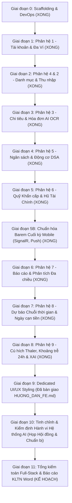

# 🗺️ BẢN ĐỒ LỘ TRÌNH XÂY DỰNG TOÀN DIỆN DỰ ÁN (MASTER PROJECT ROADMAP)
## HỆ THỐNG QUẢN LÝ CHI TIÊU & HOẠCH ĐỊNH TÀI CHÍNH CÁ NHÂN THÔNG MINH (PFM)
### (.NET MAUI 10 + ASP.NET Core 10 + PostgreSQL 16 + SQLite Offline-First)

> **Dự án:** Smart Personal Expense and Financial Planning Management System with AI Integration  
> **Nguyên tắc triển khai:** Full-Stack Vertical Slice (Khép kín từng phân hệ), Backend-First & Wireframe Frontend, Incremental Unit Testing, 100% PFM không chia nhóm.  
> **Quy mô bao quát:** 10 Sơ đồ Use Case (**chính xác 63 Ca sử dụng chi tiết từ UC-01.01 đến UC-09.05 theo chuẩn IEEE 29148**), 6 Bounded Contexts DDD.  
> **Tài liệu căn cứ:** [`TECHNICAL_ARCHITECTURE_SPEC.md`](TECHNICAL_ARCHITECTURE_SPEC.md), [`DESIGN.md`](DESIGN.md), [`PRODUCT.md`](PRODUCT.md), [Quy chế Kiểm toán Dòng-đối-dòng Quyết định 109](../../project_context/decisions_and_changes_log.md#L2339-L2354).

---

## 1. QUY ƯỚC CẤU TRÚC THƯ MỤC CHÍNH THỨC (REPOSITORY STRUCTURE)

Thống nhất phân định rạch ròi 2 thư mục gốc **`backend/`** và **`frontend/`** bên trong phân hệ .NET MAUI:

```text
mobile-project/dotnet-maui-ver/
├── backend/                                  # Toàn bộ mã nguồn máy chủ Backend (ASP.NET Core 10)
│   ├── ExpenseTracker.Domain/               # Core Domain: Rich Entities, Value Objects, Enums
│   ├── ExpenseTracker.Application/          # Use Cases: Commands/Queries, DTOs, FluentValidation
│   ├── ExpenseTracker.Infrastructure/       # Data Access: EF Core PostgreSQL, SignalR, External Services
│   ├── ExpenseTracker.WebApi/               # Presentation: Controllers, Auth Middlewares, HealthChecks
│   ├── tests/                               # Kiểm thử tự động Backend
│   │   ├── ExpenseTracker.Domain.UnitTests/
│   │   └── ExpenseTracker.Application.UnitTests/
│   ├── docker-compose.yml                   # Khởi chạy PostgreSQL 16 Local trong 1 click
│   └── ExpenseTracker.slnx                  # Solution file điều phối toàn bộ Solution
│
├── frontend/                                 # Toàn bộ mã nguồn ứng dụng di động (.NET MAUI 10)
│   ├── ExpenseTracker.Maui/                 # Ứng dụng di động Clean MVVM
│   │   ├── Views/                           # Giao diện XAML Pages & Custom ContentView Cards
│   │   ├── ViewModels/                      # Reactive ViewModels (CommunityToolkit.Mvvm)
│   │   ├── Services/                        # Refit Client, Local SecureStorage, SignalR
│   │   ├── Resources/                       # Design System: Colors.xaml, Styles.xaml
│   │   └── Platforms/                       # Native platform code (Windows Desktop, Android)
│   └── tests/
│       └── ExpenseTracker.Maui.UnitTests/   # Unit Tests cho ViewModels & Local Services
│
├── MASTER_PROJECT_ROADMAP.md                 # Tài liệu này: Lộ trình và bảng theo dõi tiến độ tổng thể
├── TECHNICAL_ARCHITECTURE_SPEC.md           # Đặc tả kiến trúc, REST API Endpoints, DDL CSDL PostgreSQL
├── DESIGN.md                                # Quy chuẩn thẩm mỹ Impeccable UI, Typography, Spacing 8pt
├── PRODUCT.md                               # Sứ mệnh sản phẩm, chân dung người dùng PFM
└── README.md                                # Hướng dẫn cài đặt và khởi chạy hệ thống
```

---

## 2. BẢN ĐỒ PHÂN KỲ TRIỂN KHAI THEO PHÂN HỆ NGHIỆP VỤ (MODULE-DRIVEN ROADMAP)

Để đảm bảo việc thi công được triển khai triệt để, kiểm soát chất lượng dòng-đối-dòng và không bỏ sót bất kỳ luồng ngoại lệ nào trong tài liệu đặc tả IEEE 29148, toàn bộ dự án được phân rã thành **12 Giai đoạn chuẩn hóa (từ Giai đoạn 0 đến Giai đoạn 11)**:



---

### GIAI ĐOẠN 0: KHỞI TẠO BỘ KHUNG HẠ TẦNG (SCAFFOLDING & DEVOPS)
- **Trạng thái:** `HOÀN THÀNH 100%` (Kế hoạch [`PLAN-31`](../../project_context/plans/plans-mobile-app/2026-10-22_plan_31_giai_doan_0_scaffolding_ha_tang.md))
- **Mục tiêu:** Dựng khung Solution Clean Architecture ASP.NET Core 10, .NET MAUI 10, PostgreSQL 16 trên Docker.
- **Kết quả nghiệm thu:** `dotnet build` đạt 0 Error, 0 Warning; Container Docker chạy ổn định.

---

### GIAI ĐOẠN 1: PHÂN HỆ 1 — TÀI KHOẢN, HỒ SƠ & QUẢN LÝ ĐA VÍ ACID
- **Trạng thái:** `HOÀN THÀNH 100%` (Kế hoạch [`PLAN-32`](../../project_context/plans/plans-mobile-app/2026-10-22_plan_32_giai_doan_1a_auth_va_user_profile.md), [`PLAN-33`](../../project_context/plans/plans-mobile-app/2026-10-22_plan_33_giai_doan_1b_da_vi_acid.md), [Quyết định 108](../../project_context/decisions_and_changes_log.md#L2319-L2336))
- **Phạm vi Use Cases (10 Use Cases):** `UC-01.01` đến `UC-01.10`
  - Đăng ký tự động tạo "Ví Tiền Mặt" mặc định số dư 0 VND (`UC-01.01`).
  - Đăng nhập JWT Refresh Token Rotation, Xem hồ sơ, Đổi mật khẩu, Quên mật khẩu (`UC-01.02` - `UC-01.06`).
  - Quản lý đa ví (Tiền mặt, Ngân hàng, Thẻ tín dụng), chống trùng tên ví trong cùng tài khoản (`UC-01.07 E1`), chặn xóa ví khi số dư $> 0$ (`UC-01.07`).
  - Chuyển tiền nội bộ giữa các ví, lưu vết lịch sử bất biến `wallet_transfers` (`UC-01.08`).
  - Cân chỉnh số dư ví với bộ 3 ràng buộc: chặn chênh lệch = 0, chặn số dư âm, bắt buộc nhập lý do (`UC-01.09 E1, E2, E3`).
  - Bóc tách ảnh chụp số dư ví (`UC-01.10`).
- **Chất lượng kiểm thử:** **42/42 Tests Passed 100%** (Domain + Application).

---

### GIAI ĐOẠN 2: PHÂN HỆ 4 & 2 — CÂY DANH MỤC PHÂN CẤP & SỔ THU NHẬP CÁ NHÂN
- **Trạng thái:** `HOÀN THÀNH 100%` (Kế hoạch [`PLAN-34`](../../project_context/plans/plans-mobile-app/2026-10-22_plan_34_khoi_dong_giai_doan_2_danh_muc_va_thu_nhap.md), [`PLAN-35`](../../project_context/plans/plans-mobile-app/2026-10-22_plan_35_tai_cau_truc_chien_luoc_trien_khai_backend_first_va_wireframe_frontend.md), [`PLAN-36`](../../project_context/plans/plans-mobile-app/2026-10-22_plan_36_trien_khai_giai_doan_2b_thu_nhap_dinh_ky_va_ai_ocr_phieu_luong.md), [Quyết định 110](../../project_context/decisions_and_changes_log.md#L2357-L2388), [Quyết định 111](../../project_context/decisions_and_changes_log.md#L2389-L2425))
- **Phạm vi Use Cases (15 Use Cases):**
  * **Phân hệ 4 (7 UCs):** Cây danh mục phân cấp cha-con đệ quy (`UC-04.01`), phân loại Income/Expense (`UC-04.02`), gán nhãn 50/30/20 & Kakeibo (`UC-04.03`), danh mục tùy chỉnh (`UC-04.04`), chống xóa danh mục đang có giao dịch (`UC-04.05`), quy tắc từ khóa thông minh (`UC-04.06`), nạp danh mục chuẩn Việt Nam (`UC-04.07`).
  * **Phân hệ 2A (6 UCs):** Ghi nhận thu nhập cộng tiền ví ACID (`UC-02.01`), lịch sử giao dịch lọc đa tiêu chí (`UC-02.02`), chi tiết thu nhập (`UC-02.03`), chỉnh sửa thu nhập điều chỉnh số dư ví (`UC-02.04`), xóa thu nhập hoàn tác số dư ví (`UC-02.05`), phân loại nguồn thu chủ động/thụ động/đột xuất Windfall (`UC-02.06`).
  * **Phân hệ 2B (2 UCs):** 
    - Quản lý thu nhập định kỳ `UC-02.07`: Căn chỉnh tháng ngắn 28/29/30 cho ngày 31 (`E1`), Bật/tắt kích hoạt (`A1`), Tự động quét sinh giao dịch khi đến hạn AutoRecord (`A2`).
    - Bóc tách phiếu lương AI Vision OCR `UC-02.08`: Trích xuất Gross, BHXH 8%, BHYT 1.5%, BHTN 1%, Thuế TNCN, Allowances, Net Salary; Thuật toán hậu kiểm toán số học $\Delta \le 1000$ VND; Cảnh báo sai lệch số học màu vàng (`E2`); Lưu chi tiết `salary_slip_details`; Cập nhật ngược mức lương cho lịch thu định kỳ (`A1`).
- **Chất lượng kiểm thử:** Tăng lũy tiến từ 42 lên **78/78 Tests Passed 100%**. Frontend Wireframe: `CategoriesPage`, `IncomesPage`, `RecurringIncomesPage`, `PayslipOcrPage` build thành công 0 Warning, 0 Error.

---

### GIAI ĐOẠN 3: PHÂN HỆ 3 — QUẢN LÝ CHI TIÊU CÁ NHÂN & BÓC TÁCH HÓA ĐƠN MULTIMODAL AI OCR
- **Trạng thái:** `HOÀN THÀNH 100%` (Kế hoạch [`PLAN-37`](../../project_context/plans/plans-mobile-app/2026-10-22_plan_37_giai_doan_3_chi_tieu_va_ai_ocr_hoa_don.md), [Quyết định 114](../../project_context/decisions_and_changes_log.md#L2453-L2476), [Quyết định 115](../../project_context/decisions_and_changes_log.md#L2477-L2512))
- **Hạng mục Chặng 3A ĐÃ HOÀN THÀNH:**
  - `UC-04.07`: Đặt quy tắc phân loại tự động (`AutoCategorizationRule`, `AutoCategorizationService`, so khớp từ khóa / regex thời gian thực).
  - `UC-03.01`: Ghi nhận chi tiêu khấu trừ ví ACID (chặn số dư âm ví tiền mặt/ngân hàng, kiểm soát hạn mức thẻ tín dụng).
  - `UC-03.02`: Xem lịch sử chi tiêu theo dòng thời gian (Timeline) đa bộ lọc.
  - `UC-03.03`: Xem chi tiết khoản chi và danh sách món hàng (`ReceiptItems`).
  - `UC-03.04`: Chỉnh sửa khoản chi (tự động điều chỉnh delta số dư ví cũ và mới).
  - `UC-03.05`: Xóa khoản chi (hoàn tác cộng lại tiền vào ví).
  - Wireframe MAUI: `ExpensesPage`, `AutoRulesPage` tích hợp gợi ý từ khóa thời gian thực.
- **Hạng mục Chặng 3B ĐÃ HOÀN THÀNH:**
  - `UC-03.07`: Bóc tách hóa đơn siêu thị/bán lẻ bằng Multimodal AI Vision OCR (`ReceiptOcrService`, bóc tách từng dòng món hàng con).
  - `UC-03.08`: Hậu kiểm toán công thức số học ($|SubTotal + Tax - Discount - TotalAmount| \le 1,000$ VND), tự động gán danh mục món hàng qua `AutoCategorizationService` và vòng lặp học tập liên tục (`RememberRules = true`).
  - `UC-03.09`: Phát hiện bẫy đăng ký định kỳ (Subscription Trap Detection) với thuật toán cảnh báo rò rỉ dòng tiền hàng năm Richard Thaler Nudge (`SubscriptionDetectorService`).
  - `UC-03.10`: Tạo mã chuyển khoản VietQR chuẩn Napas 247 tức thời kèm số tiền và nội dung (`VietQrService`).
  - `UC-03.11`: Bóc tách câu khẩu lệnh giọng nói tiếng Việt STT thành giao dịch chi tiêu (`VoiceExpenseParserService`).
  - Wireframe MAUI: `ReceiptOcrPage` (Human-in-the-loop review, cảnh báo sai lệch màu vàng) & `SmartUtilitiesPage` (rà soát bẫy thuê bao, tạo mã VietQR Napas 247).
- **Chất lượng kiểm thử:** Tăng lũy tiến từ 78 lên **113/113 Tests Passed 100%** (42 Domain + 71 Application). Frontend MAUI biên dịch đạt **0 Warning, 0 Error**.

---

### GIAI ĐOẠN 4: PHÂN HỆ 5 — HOẠCH ĐỊNH NGÂN SÁCH ĐA PHƯƠNG PHÁP & ĐỘNG CƠ HẠN MỨC DSA
- **Trạng thái:** `HOÀN THÀNH 100%` (Kế hoạch [`PLAN-38`](../../project_context/plans/plans-mobile-app/2026-10-22_plan_38_giai_doan_4_ngan_sach_va_dsa_thich_ung.md), [Quyết định 117](../../project_context/decisions_and_changes_log.md#L2528-L2562))
- **Phạm vi Use Cases (6 Use Cases):** `UC-05.01` đến `UC-05.06`
  - `UC-05.01`: Thiết lập ngân sách tổng thể và phân bổ danh mục theo các quy tắc chuẩn mực (50/30/20, Zero-Based Budgeting, Kakeibo).
  - `UC-05.02`: Theo dõi tiến độ tiêu xài ngân sách thời gian thực với biểu đồ nhiệt.
  - `UC-05.03`: Cảnh báo nguy cơ bội chi theo các mốc 80%, 90%, 100%.
  - `UC-05.04`: **Động cơ tính toán Hạn mức Chi tiêu Mỗi ngày (Adaptive Daily Spending Allowance - DSA):** Tự động điều chỉnh hạn mức ngày tiếp theo dựa trên số tiền còn lại và số ngày còn lại trong chu kỳ, nhân hệ số tiêu xài cuối tuần ($w_{\text{weekend}} = 1.3$).
  - `UC-05.05`: Đo lường Tốc độ tiêu tiền 7 ngày gần nhất (Spending Velocity Tracker) và phát hiện bất thường.
  - `UC-05.06`: Tái cân đối ngân sách linh hoạt giữa các nhóm danh mục (Budget Rollover & Rebalancing).
- **Chất lượng kiểm thử:** Tăng lũy tiến từ 113 lên **136/136 Tests Passed 100%**. Frontend MAUI: `BudgetsPage` và `CreateBudgetPage` biên dịch đạt **0 Warning, 0 Error**.

---

### GIAI ĐOẠN 5: PHÂN HỆ 6 — QUỸ MỤC TIÊU TÍCH LŨY THÔNG MINH & HŨ TÀI CHÍNH
- **Trạng thái:** `HOÀN THÀNH 100%` (Kế hoạch [`PLAN-39`](../../project_context/plans/plans-mobile-app/2026-10-23_plan_39_giai_doan_5_muc_tieu_tich_luy_va_hu_tai_chinh.md), [Quyết định 118](../../project_context/decisions_and_changes_log.md#L2565-L2600))
- **Phạm vi Use Cases (5 Use Cases):** `UC-06.01` đến `UC-06.05`
  - `UC-06.01`: Khởi tạo và quản lý mục tiêu tích lũy (Quỹ khẩn cấp, Mua sắm lớn, Đầu tư, Học tập, Du lịch), tính toán số tiền nạp hàng tháng `(Target - Current) / Months`.
  - `UC-06.02`: Nạp tiền vào quỹ tích lũy, tự động trừ số dư ví nguồn và ghi sổ cái `savings_goal_contributions` bất biến.
  - `UC-06.03`: Rút tiền khỏi quỹ tích lũy kèm **Cú hích ma sát nhận thức Richard Thaler Nudge** (bắt buộc nhập lý do), hoàn tiền về ví đích.
  - `UC-06.04`: Đánh giá tính khả thi theo phương pháp 50/30/20 (`EvaluateGoalFeasibilityAsync`) và cấu hình trích nạp tự động (`ConfigureAutoDepositAsync`).
  - `UC-06.05`: Thống kê Hũ tài chính Kakeibo (`GetJarsSummaryAsync`) với 4 nhóm hũ: Thiết yếu, Tùy chọn, Học tập & Văn hóa, Quỹ bất ngờ/khẩn cấp.
- **Chất lượng kiểm thử:** Tăng lũy tiến từ 136 lên **159/159 Tests Passed 100%** (69 Domain + 90 Application). Frontend MAUI: `SavingsGoalsPage` và `CreateSavingsGoalPage` biên dịch đạt **0 Warning, 0 Error**.

---

### GIAI ĐOẠN 5B: CHUẨN HÓA BAREM ĐIỂM CUỐI KỲ LẬP TRÌNH MOBILE (MVVM REPOSITORIES, SIGNALR & PUSH NOTIFICATIONS)
- **Trạng thái:** `HOÀN THÀNH 100%` (Kế hoạch [`PLAN-41`](../../project_context/plans/plans-mobile-app/2026-10-23_plan_41_chuan_hoa_cuoi_ky_mvvm_signalr_push_notifications.md), [Quyết định 120](../../project_context/decisions_and_changes_log.md#L2672-L2725))
- **Căn cứ yêu cầu môn học:** Đáp ứng trọn vẹn barem điểm của Giảng viên ([`yeucau-cuoiky.txt`](yeucau-cuoiky.txt)):
  1. **Kiến trúc MVVM 3 Tầng Repositories & ViewModel Testing (Phần B3 - 2.0đ):**
     - Tách tầng `Repositories/`: `IWalletRepository`, `ITransactionRepository`, `IBudgetRepository`, `INotificationRepository` (gồm Api thật & Mock in-memory).
     - Decouple hoàn toàn ViewModels khỏi HTTP clients, cho phép hoán đổi 1 dòng trong `MauiProgram.cs`.
     - Dự án kiểm thử độc lập `ExpenseTracker.Maui.UnitTests` (.NET 10 cross-platform) với **14 Unit Tests** cho ViewModels.
  2. **Cổng Thời Gian Thực SignalR Realtime Hub (Điểm cộng B2 - +1.0đ):**
     - Backend: `FinancialHub.cs` với `[Authorize]`, JWT handshake qua Query Token `access_token`, phát sự kiện `ReceiveBalanceUpdate` và `ReceiveBudgetAlert` khi chi tiêu / vượt ngân sách $\ge 80\%$.
     - Frontend MAUI: `SignalRRealtimeService.cs` tự động reconnect, `WalletsViewModel` tự động cập nhật số dư **0ms** không cần reload trang; Thanh trạng thái Dot chỉ báo kết nối realtime (Xanh/Vàng/Xám) trên `WalletsPage.xaml`.
  3. **Push Notifications & Local Scheduled Reminder (Phần A - Bắt buộc 2.0đ):**
     - Backend: Thực thể `InAppNotification` & `DevicePushToken`, `NotificationService` và `NotificationsController` nhận push token và lưu lịch sử thông báo.
     - Frontend MAUI: `LocalNotificationService` lên lịch nhắc nhở cục bộ cố định **21:00 hàng ngày** ("Nhắc ghi chép chi tiêu cuối ngày bảo vệ DSA").
     - Màn hình `NotificationHistoryPage.xaml`: Danh sách phân loại icon Type, badge chưa đọc, Deep Linking mở đúng trang chi tiết, tích hợp sẵn nút Demo Test Trigger phục vụ chấm thi.
- **Chất lượng kiểm thử:** **104/104 Unit Tests PASSED 100%** (90 Backend tests + 14 Mobile tests). Toàn bộ WebApi và MAUI đạt **0 Warning, 0 Error**.

---

### GIAI ĐOẠN 6: PHÂN HỆ 7 — BÁO CÁO & PHÂN TÍCH TÀI CHÍNH ĐA CHIỀU
- **Trạng thái:** `HOÀN THÀNH 100%` (Kế hoạch [`PLAN-40`](../../project_context/plans/plans-mobile-app/2026-10-23_plan_40_giai_doan_6_bao_cao_va_phan_tich_tai_chinh_da_chieu.md), [Quyết định 121](../../project_context/decisions_and_changes_log.md))
- **Phạm vi Use Cases (5 Use Cases):**
  - `UC-07.01`: Báo cáo Thu - Chi theo thời gian với tốc độ tăng trưởng MoM/YoY và phòng vệ chia cho 0.
  - `UC-07.02`: Báo cáo Giá trị Tài sản ròng (Net Worth = Tổng tài sản ví/quỹ - Nợ thẻ tín dụng), lưu snapshot lịch sử và cảnh báo rủi ro âm.
  - `UC-07.03`: Báo cáo Dòng tiền ròng (Net Cashflow), tỷ lệ tiết kiệm (Savings Rate) với 4 ngưỡng đánh giá và phân rã 5 bước Thác nước (Waterfall flow).
  - `UC-07.04`: Phân tích cơ cấu danh mục theo 3 góc nhìn (Sub-category, Nhóm quy tắc 50/30/20, Sổ Kakeibo 4 Cột trụ) và phát cờ cảnh báo danh mục chiếm > 30% tổng chi.
  - `UC-07.05`: Phân tích xu hướng và phát hiện đột biến bằng kiểm định thống kê định lượng Z-Score Outlier ($\text{Z-Score} > 2.0$), xử lý an toàn khi $\sigma = 0$.
- **Kiến trúc MVVM Repositories & Wireframe MAUI:**
  - `IAnalyticsReportRepository` gồm `ApiAnalyticsReportRepository` và `MockAnalyticsReportRepository` (cung cấp dữ liệu mẫu phong phú chạy offline phục vụ UI designer).
  - `ReportsViewModel` độc lập HTTP client và trang Wireframe `ReportsPage.xaml` gắn sẵn Data Binding chuẩn mực.
- **Chất lượng kiểm thử:** Nâng tổng số test lên **189 / 189 Tests Passed 100%** (73 Domain + 98 Application + 18 Mobile ViewModel Tests). Toàn bộ Backend và Frontend MAUI đạt **0 Warning, 0 Error**.

---

### GIAI ĐOẠN 7: PHÂN HỆ 8 — DỰ BÁO TÀI CHÍNH & RADAR RỦI RO THÂM HỤT
- **Trạng thái:** `HOÀN THÀNH 100%` (Kế hoạch [`PLAN-43`](../../project_context/plans/plans-mobile-app/2026-10-23_plan_43_giai_doan_7_du_bao_va_radar_rui_ro_tham_hut.md), [Quyết định 123 & 124](../../project_context/decisions_and_changes_log.md))
- **Phạm vi Use Cases (4 Use Cases):** `UC-08.01` đến `UC-08.04`
  - `UC-08.01`: Dự báo tổng chi tiêu cuối chu kỳ bằng mô hình chuỗi thời gian (Time-Series Forecasting) phân tách vận tốc Weekday/Weekend và loại trừ Outlier Z-Score.
  - `UC-08.02`: Dự phóng Ngày cạn tiền khả dụng (Out-of-Money Date Forecast) dựa trên Tốc độ tiêu tiền 7 ngày gần nhất và kích hoạt cờ Báo động đỏ khủng hoảng thanh khoản trước kỳ lương tới.
  - `UC-08.03`: Radar quét nguy cơ thâm hụt danh mục thiết yếu và dự báo ngày cạn sạch hạn mức phân bổ.
  - `UC-08.04`: Phòng thí nghiệm tài chính mô phỏng kịch bản giả định What-If Sandbox in-memory 0ms (Mua sắm lớn, Vay trả góp tính toán lại DTI, Sụt giảm thu nhập).
- **Kiến trúc MVVM Repositories & Wireframe MAUI:**
  - *Chặng 7A (Backend):* Persistence, Forecasting Domain Services, DTOs, Controllers `api/forecasting/` và TDD Unit Tests.
  - *Chặng 7B (Frontend Wireframe):* `IForecastingRepository` (Api & Mock in-memory), `ForecastingViewModel`, Wireframe `ForecastingPage.xaml` sẵn sàng Data Binding.
- **Chất lượng kiểm thử:** Nâng tổng số test lên **203 / 203 Tests Passed 100%** (73 Domain + 108 Application + 22 Mobile ViewModel Tests). Toàn bộ Backend và Frontend MAUI đạt **0 Warning, 0 Error**.

---

### GIAI ĐOẠN 8: PHÂN HỆ 9 — CÚ HÍCH TÂM LÝ HÀNH VI THALER, KHOẢNG TRỄ 24H & XAI
- **Trạng thái:** `HOÀN THÀNH 100%` (Kế hoạch [`PLAN-44`](../../project_context/plans/plans-mobile-app/2026-10-23_plan_44_giai_doan_8_cu_hich_thaler_nudge_khoang_tre_24h_va_tro_ly_xai.md), [Quyết định 125 & 126](../../project_context/decisions_and_changes_log.md))
- **Phạm vi Use Cases (5 Use Cases):** `UC-09.01` đến `UC-09.05`
  - `UC-09.01`: Nhận diện giao dịch mua sắm bốc đồng/xa xỉ và sinh Cú hích hành vi thông minh (Nudge Alert: Vượt hạn mức DSA 85%, Lệch chuẩn Kakeibo Hưởng thụ 20%, Chi tiêu lớn bất thường).
  - `UC-09.02`: Giải trình lý do tài chính bằng ngôn ngữ tự nhiên (Explainable AI - XAI): Thấu hiểu tâm lý, đồng cảm (Empathetic Finance), diễn giải tường minh tác động tới DSA và dự báo ngày cạn tiền khả dụng.
  - `UC-09.03`: Đề xuất tái cân đối tài chính để bù đắp khoản chi tiêu lớn (Cắt giảm chi tiêu không thiết yếu, trích từ Quỹ dự phòng tự do hoặc chia nhỏ kế hoạch chi tiêu).
  - `UC-09.04`: Cơ chế phê duyệt của người dùng (Human-in-the-loop Approval): Đồng ý hoãn, Hủy giao dịch hoặc Bỏ qua cảnh báo để tiếp tục (ghi nhận lý do tâm lý).
  - `UC-09.05`: **Khoảng trễ tâm lý (Cooling-off Period 24h-48h):** Tạm hoãn giao dịch mua sắm xa xỉ để kích hoạt tư duy lý trí System 2, giảm thiểu chi tiêu tùy tiện. Tích hợp tạo mã VietQR chuẩn Napas 247 khi hết thời gian khoảng trễ và người dùng quyết định tiếp tục thanh toán.
- **Kiến trúc MVVM Repositories & Wireframe MAUI:**
  - *Chặng 8A (Backend):* Enums, Entities (`FinancialNudge`, `CoolingOffTransaction`), Services (`NudgeEngineService`, `CoolingOffService`), WebApi controllers (`api/nudges/`, `api/cooling-off/`), Migration `AddBehavioralNudgesAndCoolingOff`, kèm 18 Unit Tests TDD Backend.
  - *Chặng 8B (Frontend Wireframe):* `INudgeRepository` (Api & Mock in-memory), `ICoolingOffRepository` (Api & Mock in-memory), `NudgeFeedViewModel`, `CoolingOffHubViewModel`, Wireframe `NudgeFeedPage.xaml` và `CoolingOffHubPage.xaml` sẵn sàng 100% Data Binding, kèm 10 Unit Tests Mobile ViewModel.
- **Chất lượng kiểm thử:** Nâng tổng số test toàn hệ thống lên **233 / 233 Tests Passed 100%** (83 Domain + 118 Application + 32 Mobile ViewModel Tests). Toàn bộ Backend và Frontend MAUI đạt **0 Warning, 0 Error**.

---

### GIAI ĐOẠN 9: DEDICATED FRONTEND ART DIRECTION & UI/UX STYLING (BẠN CÙNG NHÓM PHỤ TRÁCH)
- **Trạng thái:** `ĐÃ HOÀN TẤT BÀN GIAO KỸ THUẬT (KÈM TÀI LIỆU HUONG_DAN_FE.md)`
- **Mục tiêu & Hiện trạng:**
  1. Đã bàn giao tài liệu kỹ thuật chuyên biệt [`HUONG_DAN_FE.md`](HUONG_DAN_FE.md) cho bạn cùng nhóm: mô tả chi tiết ViewModel Contracts, Data Bindings, cơ chế hoán đổi 1 dòng Mock/Real Repository, xử lý trạng thái Loading/Empty/Error cho toàn bộ 20 màn hình mà hoàn toàn không can thiệp vào thẩm mỹ hay phong cách thiết kế của bạn cùng nhóm.
  2. Toàn bộ 20 Views Wireframe đã hoàn thành khép kín, kiểm thử độc lập với Mock in-memory data, cho phép bạn cùng nhóm bắt tay ngay vào thiết kế giao diện (Design System, Styles, Dark/Light Theme, Haptics, Animation) mà không cần chờ Backend.
  3. Bạn cùng nhóm phụ trách thiết kế giao diện tiếp quản toàn bộ hệ thống Wireframe Pages (đã gắn sẵn 100% Data Binding và Repositories):
     - Nạp trọn vẹn Design System tại `Resources/Styles/` (Bảng màu Slate & Warm Charcoal, Double   6. **Kiến trúc An ninh Bảo mật Khóa API (Zero-Leak GitIgnore Protocol):**
      - Phân tầng cấu hình an toàn qua `appsettings.Local.json` và biến môi trường, bảo vệ tuyệt đối không làm lộ khóa API lên Git.
   7. **Mở Rộng Chặng 10.5 (PLAN-47 / Quyết Định 135) - Động Cơ Hành Động Tự Hành & Ngưỡng Xác Suất Jev:**
      - *Mục tiêu:* Thu hẹp rào cản "sự trung thực của người dùng" bằng Passive Reality Capture (bắt thông báo ngân hàng) và Server-Driven Action Protocol.
      - *Phân tầng xác suất Jev:* $\ge 0.85$ (Lưu nhanh 1-chạm), $0.50 - 0.85$ (Jev Choice 2 lựa chọn), $< 0.50$ (Im lặng không spam rác).
      - *Quy cách Frontend:* Chỉ dựng Wireframe `SmartActionCard.xaml` và khay `ActionInboxView` trên Dashboard (không styling), cập nhật tài liệu kỹ thuật [`HUONG_DAN_FE.md`](HUONG_DAN_FE.md).
- **Kiến trúc MVVM Repositories & UI MAUI:**
   - *Backend:* `GeminiApiClient`, Controllers `api/voice-agent/`, `api/data-import/`, `api/actions/`, endpoint `api/analytics-reports/export-excel`.
   - *Frontend:* `IVoiceAgentRepository`, `IDataImportRepository`, `IAutonomousActionRepository`, Views Wireframe `VoiceMicModalPage.xaml`, `ImportPreviewPage.xaml`, `SmartActionCardView.xaml`.
- **Chất lượng kiểm thử:** Nâng tổng số test toàn hệ thống lên **276 / 276 Tests Passed 100%** (83 Domain + 155 Application + 38 Mobile ViewModel Tests). Toàn bộ Backend (`ExpenseTracker.slnx`) và Frontend MAUI (`ExpenseTracker.Maui.csproj`) biên dịch đạt **0 Warning, 0 Error**.

---

### GIAI ĐOẠN 11: TỔNG KIỂM TOÁN FULL-STACK, SCRIPT 1-CLICK DEMO, BÁO CÁO CUỐI KỲ, ÔN TẬP VẤN ĐÁP Q&A & ĐÓNG GÓI APK
- **Trạng thái:** `ĐANG TRIỂN KHAI (ĐÃ CHỐT HOÀN THÀNH CHẶNG 1)` (Căn cứ kế hoạch gốc [`PLAN-48`](../../project_context/plans/plans-mobile-app/2026-10-25_plan_48_giai_doan_11_tong_kiem_toan_bao_cao_va_on_tap_qa.md), [Quyết định 143 & 161](../../project_context/decisions_and_changes_log.md), [`PLAN-54`](../../project_context/plans/plans-mobile-app/2026-10-27_plan_54_giai_doan_11_chang_1_kiem_toan_va_nang_cap_bao_cao_docx.md), [Quyết định 180](../../project_context/decisions_and_changes_log.md))
- **Điều chỉnh phạm vi (Họp Hội đồng theo chỉ đạo Người dùng):**
  - **Tạm thời BỎ QUA bước quay/dựng Video Demo thành phẩm**, tập trung tối đa nguồn lực vào việc trang bị kịch bản demo trực tiếp, bộ cẩm nang ôn tập vấn đáp cá nhân 1.5đ, tối ưu script 1-Click và đóng gói APK Android Release.
- **Phân kỳ Lộ trình Tái Cấu Trúc của Giai đoạn 11 (Mô hình 4-3-Họp Backend-5-2):**
  1. **Chặng 1 — Báo cáo Cuối kỳ môn Di động [`BaoCao.docx`](../BaoCao.docx) (`HOÀN THÀNH 100% - ĐÃ CHỐT`):**
     - Khớp 100% barem điểm môn Lập trình Mobile ([`yeucau-cuoiky.txt`](../yeucau-cuoiky.txt)): Đăng ký B3 (MVVM) + B2 (SignalR +1.0đ) + Phần A (Push Notification); 22 bảng CSDL 3NF; Thuyết minh Native Android Notification Engine (Killed State AlarmManager 21:00); Minh chứng 363 Tests; Bottom Nav & Voice FAB; 6 Kịch bản kiểm thử trên máy ảo.
  2. **Chặng 2 Mới (Cũ là 4) — Chuẩn Hóa Bộ Script 1-Click Khởi Chạy Tự Động & Kiểm Thử Toàn Diện E2E (`HOÀN THÀNH 100% - ĐÃ CHỐT`):**
     - Chuẩn hóa bộ script PowerShell [`quick-run-scripts/run_android.ps1`](../quick-run-scripts/run_android.ps1), [`quick-run-scripts/run_windows.ps1`](../quick-run-scripts/run_windows.ps1) và [`quick-run-scripts/test_api_suite.ps1`](../quick-run-scripts/test_api_suite.ps1) để Giảng viên và nhóm chỉ cần 1 click là tự động hóa toàn trình: Docker PostgreSQL $\rightarrow$ WebApi Backend $\rightarrow$ Android Emulator $\rightarrow$ Deploy .NET MAUI App $\rightarrow$ E2E Validation. Trang bị 3 shortcut `.bat` ở thư mục gốc (`RUN_ANDROID.bat`, `RUN_WINDOWS.bat`, `TEST_API.bat`).
  3. **Chặng 3 Mới (Cũ là 3) — Cẩm Nang Ôn Tập - Bộ Câu Hỏi Q&A Thông Hiểu Mã Nguồn & Công Nghệ (`HOÀN THÀNH 100% - ĐÃ CHỐT`):**
     - Biên soạn hoàn tất [`BO_CAU_HOI_ON_TAP_VAN_DAP_CUOI_KY.md`](BO_CAU_HOI_ON_TAP_VAN_DAP_CUOI_KY.md) gồm 6 chuyên đề lớn & 15 câu hỏi sát sườn thường bị Giảng viên chất vấn nhất (Clean MVVM 3 tầng, Zero Code-Behind, Unit Tests độc lập, SignalR 2 chiều, Push Notifications / AlarmManager Killed State, PostgreSQL ACID Pessimistic Locking, và Gemini AI Multimodal / Jev Protocol), kèm bảng phân công thuyết minh chi tiết cho 2 thành viên ăn trọn 1.5đ vấn đáp cá nhân.
  4. **Chặng 3.5 (MỚI) — Phiên Họp Hội Đồng Xử Lý Hạ Tầng Backend Cho Bản Phát Hành APK (HOÀN THÀNH 100% - ĐÃ CHỐT PHƯƠNG ÁN 1):**
     - Đã họp Hội đồng Đa tác tử phân tích 4 phương án (Kế hoạch [PLAN-56](../../project_context/plans/plans-mobile-app/2026-10-27_plan_56_bien_ban_phien_hop_ha_tang_backend_cho_apk.md), Quyết định 183 & 184).
     - Chủ tọa chính thức lựa chọn **Phương án 1 (Mô hình Kiềng 3 Chân)** theo [PLAN-57](../../project_context/plans/plans-mobile-app/2026-10-27_plan_57_ke_hoach_trien_khai_phuong_an_1_kieng_3_chan_demo_apk.md): APK mặc định nạp Offline Mock Repositories 0ms an toàn 100% không sợ crash + Nút gạt Live Backend API và ô nhập Server URL linh hoạt trong màn hình Cài đặt + Bộ công cụ 1-Click RUN_TUNNEL.bat (Cloudflare Tunnel HTTPS) để demo trực tiếp khi cần đối soát dữ liệu với Giảng viên. Hạng mục này phục vụ riêng cho công tác demo, không ghi vào báo cáo cuối kỳ.
  5. **Chặng 4 Mới (Cũ là 5) — Đóng Gói Bản Cài Đặt APK Android Release (`net10.0-android`):**
     - Cấu hình Keystore, chạy lệnh xuất bản `dotnet publish -f net10.0-android -c Release`, đóng gói file `ExpenseTracker.apk` độc lập theo phương án hạ tầng đã chốt kèm tài liệu hướng dẫn cài đặt [`HUONG_DAN_CAI_DAT_APK.md`](HUONG_DAN_CAI_DAT_APK.md).
  6. **Chặng 5 Mới (Cũ là 2) — Kịch Bản Demo & Hướng Dẫn Trình Diễn Tính Năng Thực Tế Cuối Kỳ (User Story Journey):**
     - Thực hiện sau cùng khi bạn cùng nhóm đã hoàn thiện 100% giao diện Frontend Immersive/Styling.
     - Biên soạn [`KICH_BAN_DEMO_THUC_TE_CUOI_KY.md`](KICH_BAN_DEMO_THUC_TE_CUOI_KY.md) hướng dẫn trình diễn trực tiếp 5 phân cảnh đắt giá dựa trên đúng giao diện thực tế hoàn thiện trước Giảng viên.

---

## 3. BẢNG THEO DÕI TIẾN ĐỘ TỔNG THỂ (PROGRESS TRACKER MATRIX)

| Giai Đoạn | Tên Phân Hệ & Phạm Vi Nghiệp Vụ | Use Cases Phụ Trách | Mã Nguồn Backend | Mã Nguồn Frontend | Trạng Thái Kiểm Thử / Nghiệm Thu |
| :--- | :--- | :--- | :--- | :--- | :--- |
| **Giai đoạn 0** | Khởi tạo Solution Scaffolding & DevOps | Nền tảng hạ tầng | `backend/` | `frontend/` | `HOÀN THÀNH (0 Error, 0 Warning)` |
| **Giai đoạn 1** | Phân hệ 1: Tài khoản, Đa Ví & Sync ACID | `UC-01.01` $\rightarrow$ `UC-01.10` (10 UCs) | `backend/` | `frontend/ (Wireframe)` | `HOÀN THÀNH (42/42 Tests Passed 100%)` |
| **Giai đoạn 2** | Phân hệ 4 & 2: Cây Danh mục & Sổ Thu nhập (Kèm AI OCR Phiếu Lương) | `UC-04.01` $\rightarrow$ `UC-04.07` & `UC-02.01` $\rightarrow$ `UC-02.08` (15 UCs) | `backend/` | `frontend/ (Wireframe)` | `HOÀN THÀNH (78/78 Tests Passed 100%)` |
| **Giai đoạn 3** | Phân hệ 3: Chi tiêu Cá nhân & Bóc tách Hóa đơn Multimodal AI OCR | `UC-03.01` $\rightarrow$ `UC-03.11` (11 UCs) | `backend/` | `frontend/ (Wireframe)` | `HOÀN THÀNH (113/113 Tests Passed 100%)` |
| **Giai đoạn 4** | Phân hệ 5: Hoạch định Ngân sách & Hạn mức DSA Thích ứng | `UC-05.01` $\rightarrow$ `UC-05.06` (6 UCs) | `backend/` | `frontend/ (Wireframe)` | `HOÀN THÀNH (136/136 Tests Passed 100%)` |
| **Giai đoạn 5** | Phân hệ 6: Quỹ Mục tiêu Tích lũy Thông minh & Hũ Tài Chính Kakeibo | `UC-06.01` $\rightarrow$ `UC-06.05` (5 UCs) | `backend/` | `frontend/ (Wireframe)` | `HOÀN THÀNH (159/159 Tests Passed 100%)` |
| **Giai đoạn 5B** | Chuẩn hóa Barem Cuối kỳ Mobile: MVVM Repositories, SignalR Hub & Push Notifications | Toàn bộ tiêu chí chấm thi Mobile | `backend/` | `frontend/` | `HOÀN THÀNH (104/104 Tests: 90 Backend + 14 Mobile ViewModel Tests, 0 Warning/Error)` |
| **Giai đoạn 6** | Phân hệ 7: Báo cáo & Phân tích Tài chính Đa chiều (Z-Score Outlier & Net Worth) | `UC-07.01` $\rightarrow$ `UC-07.05` (5 UCs) | `backend/` | `frontend/ (Wireframe)` | `HOÀN THÀNH (189/189 Tests Passed 100%, 0 Warning/Error)` |
| **Giai đoạn 7** | Phân hệ 8: Dự báo Tài chính Chuỗi Thời Gian & Radar Rủi Ro Thâm Hụt | `UC-08.01` $\rightarrow$ `UC-08.04` (4 UCs) | `backend/` | `frontend/ (Wireframe)` | `HOÀN THÀNH (203/203 Tests Passed 100%, 0 Warning/Error)` |
| **Giai đoạn 8** | Phân hệ 9: Cú hích Hành vi Thaler Nudge, Khoảng trễ 24h & VietQR | `UC-09.01` $\rightarrow$ `UC-09.05` (5 UCs) | `backend/` | `frontend/ (Wireframe)` | `HOÀN THÀNH (233/233 Tests Passed 100%, 0 Warning/Error)` |
| **Giai đoạn 9** | Dedicated Frontend Art Direction & UI/UX Styling | Toàn bộ 63 Use Cases | Giữ nguyên | `frontend/ (Bạn cùng nhóm phụ trách)` | `ĐÃ BÀN GIAO KỸ THUẬT (Sẵn sàng 20 Wireframe Views & HUONG_DAN_FE.md)` |
| **Giai đoạn 10** | Tinh Chỉnh AI Toàn Diện, Voice Router, Multi-Import & Server-Driven Actions (Jev) | Toàn bộ các cấu phần AI/ML/STT (UC-03.07, UC-02.08, UC-03.11, UC-07.01 A1, UC-07.06, UC-09.02, UC-09.05, Action Engine) | `backend/` & Gemini 2.5 Flash | `frontend/` (Voice Agent, Preview & Action Card Wireframe) | `HOÀN THÀNH TOÀN DIỆN (363/363 Tests Passed 100%)` |
| **Giai đoạn 11** | Tổng kiểm toán Full-Stack, Script 1-Click Demo & Báo cáo Khóa luận Word | Toàn bộ 63 Use Cases | `backend/` | `frontend/` | `ĐÃ CHỐT HOÀN THÀNH CHẶNG 1 (BaoCao.docx chuẩn 100% Barem)` |


