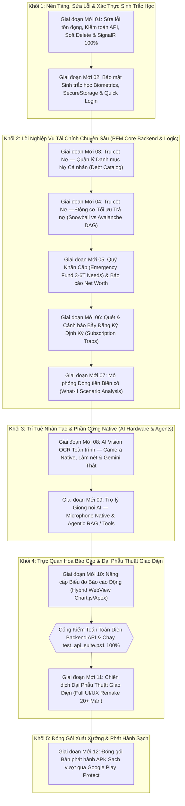

# 🗺️ BẢN ĐỒ LỘ TRÌNH XÂY DỰNG TOÀN DIỆN DỰ ÁN (MASTER PROJECT ROADMAP)
## HỆ THỐNG QUẢN LÝ CHI TIÊU & HOẠCH ĐỊNH TÀI CHÍNH CÁ NHÂN THÔNG MINH (PFM)
### (.NET MAUI 10 + ASP.NET Core 10 Clean Architecture + PostgreSQL 16 ACID + SignalR WebSocket)

> **Dự án:** Smart Personal Expense and Financial Planning Management System with AI Integration  
> **Tầm nhìn:** Hệ thống Quản lý Tài chính Cá nhân Chuyên sâu (100% Personal Finance Management, Không Chia Nhóm), Phục vụ Môn học Phân Tích Thiết Kế Hệ Thống Thông Tin (PTTKHTTT) & Khóa Luận Tốt Nghiệp Cử nhân CNTT/HTTT.  
> **Nguyên tắc kỹ nghệ:** Băm thật nhỏ từng mục thành 1 giai đoạn độc lập (Micro-Stage Architecture), Triển khai khép kín Vertical Slice (DB $\rightarrow$\rightarrow$\rightarrow$ Backend $\rightarrow$\rightarrow$\rightarrow$ TDD Tests $\rightarrow$\rightarrow$\rightarrow$ SignalR $\rightarrow$\rightarrow$\rightarrow$ Mobile UI), 0 Hard Delete, Bảo mật FinTech Ledger.  
> **Tài liệu căn cứ:** [`TECHNICAL_ARCHITECTURE_SPEC.md`](TECHNICAL_ARCHITECTURE_SPEC.md), [`DESIGN.md`](DESIGN.md), [`PRODUCT.md`](PRODUCT.md), [`API_CONTRACT_SPECIFICATION.md`](API_CONTRACT_SPECIFICATION.md), Kế hoạch [`PLAN-60`](../../project_context/plans/plans-mobile-app/2026-10-28_plan_60_master_roadmap_redesign_va_giai_doan_1_api_audit_soft_delete_signalr.md), [Quyết định 107](../../project_context/decisions_and_changes_log.md).

---

## 1. QUY ƯỚC CẤU TRÚC THƯ MỤC CHÍNH THỨC (REPOSITORY STRUCTURE)

Phân định rạch ròi 2 thư mục gốc **`backend/`** và **`frontend/`** bên trong phân hệ .NET:

```text
mobile-project/dotnet-maui-ver/
├── backend/                                  # Toàn bộ mã nguồn máy chủ Backend (ASP.NET Core 10 Clean Architecture)
│   ├── ExpenseTracker.Domain/               # Core Domain: Rich Entities, Value Objects, Enums, ISoftDeletable
│   ├── ExpenseTracker.Application/          # Use Cases: Commands/Queries, DTOs, FluentValidation, Services
│   ├── ExpenseTracker.Infrastructure/       # Data Access: EF Core PostgreSQL, SignalR Hub, Gemini AI Client
│   ├── ExpenseTracker.WebApi/               # Presentation: Controllers, Auth Middlewares, Global Exception Filter
│   ├── tests/                               # Kiểm thử tự động Backend (300+ Unit & Integration Tests)
│   │   ├── ExpenseTracker.Domain.UnitTests/
│   │   └── ExpenseTracker.Application.UnitTests/
│   ├── docker-compose.yml                   # Khởi chạy PostgreSQL 16 Local trong 1 click
│   └── ExpenseTracker.slnx                  # Solution file điều phối toàn bộ Solution
│
├── frontend/                                 # Toàn bộ mã nguồn ứng dụng di động (.NET MAUI 10)
│   ├── ExpenseTracker.Maui/                 # Ứng dụng di động Clean MVVM
│   │   ├── Views/                           # Giao diện XAML Pages & Custom ContentView Cards
│   │   ├── ViewModels/                      # Reactive ViewModels (CommunityToolkit.Mvvm)
│   │   ├── Services/                        # Refit Client, Local SecureStorage, SignalR, Biometrics
│   │   ├── Resources/                       # Design System: Colors.xaml, Styles.xaml
│   │   └── Platforms/                       # Native platform code (Android 14+, Windows Desktop)
│   └── tests/
│       └── ExpenseTracker.Maui.UnitTests/   # Unit Tests cho ViewModels & Local Services (80+ Tests)
│
├── implement-docs/                           # Tài liệu kỹ thuật triển khai dự án
│   ├── MASTER_PROJECT_ROADMAP.md            # Tài liệu này: Lộ trình và bảng theo dõi tiến độ tổng thể
│   ├── API_CONTRACT_SPECIFICATION.md        # Đặc tả hợp đồng API 22 Controllers, Req/Res & Error Codes
│   ├── TECHNICAL_ARCHITECTURE_SPEC.md       # Đặc tả kiến trúc, REST API Endpoints, DDL CSDL PostgreSQL
│   ├── DESIGN.md                            # Quy chuẩn thẩm mỹ Impeccable UI, Typography, Spacing 8pt
│   ├── PRODUCT.md                           # Sứ mệnh sản phẩm, chân dung người dùng PFM
│   └── README.md                            # Hướng dẫn cài đặt và khởi chạy hệ thống
```

---

## 2. TỔNG QUAN PHÂN KỲ: HAI CHƯƠNG LỚN CỦA DỰ ÁN

Lộ trình phát triển được phân chia rạch ròi thành 2 Chương lớn:
* **CHƯƠNG 1 (GIAI ĐOẠN 0 ĐẾN 11): PHẠM VI MÔN HỌC THIẾT BỊ DI ĐỘNG**  
  *Trạng thái:* `HOÀN THÀNH 100% & ĐÃ ĐÓNG GÓI LƯU TRỮ (COMPLETED & ARCHIVED)`  
  *Ghi nhận:* Đã hoàn tất nộp bài thi ngày 28/10/2026 với 11 giai đoạn ban đầu, 363 Unit Tests tự động, báo cáo chuẩn mực, đáp ứng đầy đủ yêu cầu của môn học.
* **CHƯƠNG 2: LỘ TRÌNH KỸ NGHỆ TOÀN DIỆN PFM ENTERPRISE & KHÓA LUẬN TỐT NGHIỆP**  
  *Trạng thái:* `CHÍNH THỨC KHỞI ĐỘNG (ACTIVE)`  
  *Chiến lược:* Gồm **12 Giai đoạn Băm nhỏ Tự chủ (Self-Contained Micro-Stages)**, đi sâu vào từng tính năng, loại bỏ hard delete, cắm SignalR toàn trình, nâng cấp AI Vision OCR camera, trợ lý giọng nói RAG, phân hệ nợ Snowball/Avalanche và chiến dịch Full UI Remake.

---

## 3. CHƯƠNG 2: BẢN ĐỒ 12 GIAI ĐOẠN BĂM NHỎ TỰ CHỦ (MICRO-STAGES ROADMAP)



---

### BẢNG THEO DÕI TIẾN ĐỘ CHƯƠNG 2 (CHƯƠNG MỚI)

| Mã Giai Đoạn | Tên Giai Đoạn Băm Nhỏ | Trọng Tâm Kỹ Thuật & Nghiệp Vụ | Use Cases Phụ Trách | Trạng Thái |
| :---: | :--- | :--- | :---: | :---: |
| **Giai đoạn Mới 01** | **Sửa lỗi tồn đọng, Kiểm toán API, Soft Delete & SignalR 100%** | Kiểm toán 22 Controllers, xuất bản `API_CONTRACT_SPECIFICATION.md`, xóa bỏ Hard Delete, gắn `ISoftDeletable` + EF Global Query Filter, đảm bảo 100% Create/Update/Archive đều bắn SignalR về Mobile tức thì 0ms. | Toàn hệ thống | `HOÀN THÀNH 100% (VERIFIED)` |
| **Giai đoạn Mới 02** | **Bảo mật Sinh trắc học Biometrics, SecureStorage & Quick Login** | Tích hợp vân tay/FaceID qua Android BiometricPrompt API, lưu trữ phần cứng `SecureStorage` AES-256, Quick Login 0.1s (không đóng modal khi quét sai), quy tắc Đăng xuất Logout triệt tiêu phiên. | `UC-01.02`, `UC-01.06` | `HOÀN THÀNH 100% (VERIFIED)` |
| **Giai đoạn Mới 03** | **Trụ cột Nợ — Quản lý Danh mục Nợ Cá nhân (Debt Catalog)** | CSDL 3NF bảng `debts`, `debt_transactions`, lãi suất %/năm, kỳ hạn sao kê, khoản trả tối thiểu, hạch toán trả nợ tự động trừ ví. | `UC-06.05`, `UC-06.07` | `HOÀN THÀNH 100% (VERIFIED)` |
| **Giai đoạn Mới 04** | **Trụ cột Nợ — Động cơ Tối ưu Trả nợ (Snowball vs Avalanche DAG)** | Thuật toán mô phỏng tối ưu trả nợ của Agent 06: Debt Snowball vs Debt Avalanche, Cẩm nang bình dân hóa tài chính, Ước lượng ngân sách an toàn, Trắc nghiệm tâm lý 1 chạm. | `UC-06.06` | `HOÀN THÀNH 100% (VERIFIED)` |
| **Giai đoạn Mới 05** | **Quỹ Khẩn Cấp (Emergency Fund) & Báo cáo Net Worth** | Thuật toán xác định Quỹ Khẩn Cấp chuẩn 3 - 6 tháng chi phí thiết yếu (Needs), cơ chế khóa quỹ tách biệt chi tiêu, Báo cáo Net Worth (Tài sản - Nợ). | `UC-06.04`, `UC-07.02` | `HOÀN THÀNH 100% (VERIFIED)` |
| **Giai đoạn Mới 06** | **Quét & Cảnh báo Bẫy Đăng Ký Định Kỳ (Subscription Traps)** | Entity CSDL Subscription độc lập, cơ chế phát hiện các khoản trừ tiền lặp lại hàng tháng (Netflix, Spotify, Cloud, Adobe...), cảnh báo gia hạn âm thầm. | `UC-03.09` | `HOÀN THÀNH 100% (VERIFIED)` |
| **Giai đoạn Mới 07** | **Mô phỏng Dòng tiền Biến cố (What-If Scenario Analysis)** | Thuật toán mô phỏng kịch bản giả định: Giảm thu nhập, mất việc, mua sắm lớn trả góp, dự báo tác động tới Ngày cạn tiền khả dụng (Runway Date). | `UC-08.04` | `CHỜ TRIỂN KHAI` |
| **Giai đoạn Mới 08** | **AI Vision OCR Toàn trình — Camera Native, Làm nét & Gemini Thật** | Tích hợp MediaPicker mở Camera điện thoại chụp trực tiếp, cắt viền làm nét, kích hoạt Gemini 2.5 Flash Vision thật, hỗ trợ hóa đơn siêu thị + điện/nước. | `UC-03.07`, `UC-03.08` | `CHỜ TRIỂN KHAI` |
| **Giai đoạn Mới 09** | **Trợ lý Giọng nói AI — Microphone Native & Agentic RAG / Tools** | Thu âm Native Speech-to-Text, xây dựng Agentic Tool Calling & RAG truy vấn CSDL tài chính thực tế và tự hành ghi nhận giao dịch theo khẩu lệnh tiếng Việt. | `UC-03.11` | `CHỜ TRIỂN KHAI` |
| **Giai đoạn Mới 10** | **Nâng cấp Biểu đồ Báo cáo Động (Hybrid WebView Chart.js/ApexCharts)** | Thay thế CollectionView tĩnh bằng Hybrid WebView; nhúng biểu đồ tròn Donut 50/30/20, biểu đồ thác nước Dòng tiền (Waterfall Cashflow), biểu đồ cột chồng theo Quyết định 106. | UC-07.01 → UC-07.05 | CHỜ TRIỂN KHAI |
| **Cổng Kiểm Toán Backend** | **Tổng Kiểm Toán API, Cập Nhật API_CONTRACT_SPECIFICATION, test_api_suite.ps1 & EF Migration PostgreSQL** | **CHỐT CHẶN BẮT BUỘC SAU KHI XONG TOÀN BỘ BACKEND:** (1) Cập nhật đồng bộ toàn bộ tài liệu đặc tả API; (2) Mở rộng script `test_api_suite.ps1` kiểm thử tự động toàn diện Happy/Sad Paths (400, 401, 404, 422); (3) Chạy `dotnet ef migrations add` và kiểm thử `database update` trên PostgreSQL thực tế để đồng bộ toàn bộ bảng mới (`debts`, `debt_transactions`, `net_worth_snapshots`, `subscriptions`), triệt tiêu triệt để nguy cơ schema mismatch / outdated database trước khi chuyển sang làm UI. | Toàn bộ API & CSDL Backend | `CHỜ TRIỂN KHAI` |
| **Giai đoạn Mới 11** | **Chiến dịch Đại Phẫu Thuật Giao Diện (Full UI/UX Remake)** | Phiên họp chuyên biệt với Brad Frost, Julian Garnier, Dan Abramov: Đập đi xây lại toàn bộ 20+ màn hình MAUI chuẩn Design System Fintech cao cấp quốc tế khi toàn bộ backend và dữ liệu đã sẵn sàng. | Toàn bộ 63 Use Cases | `CHỜ TRIỂN KHAI` |
| **Giai đoạn Mới 12** | **Đóng Gói Bản Phát Hành APK Sạch Vượt Qua Google Play Protect** | Làm sạch Android Manifest (loại bỏ quyền nhạy cảm gây báo động đỏ), cấu hình Keystore chính quy chuẩn Android Release, chữ ký số SHA-256 xác thực, kiểm tra cài đặt trên thiết bị thật trước khi xuất xưởng. | Hạ tầng Release & Xuất Xưởng | `CHỜ TRIỂN KHAI` |

---

## 4. CHI TIẾT GIAI ĐOẠN MỚI 01: SỬA LỖI TỒN ĐỌNG, KIỂM TOÁN API, SOFT DELETE & SIGNALR 100%

- **Trạng thái:** `HOÀN THÀNH 100% (VERIFIED)` (Kế hoạch [`PLAN-60`](../../project_context/plans/plans-mobile-app/2026-10-28_plan_60_master_roadmap_redesign_va_giai_doan_1_api_audit_soft_delete_signalr.md), [Quyết định 107](../../project_context/decisions_and_changes_log.md))
- **Mục tiêu then chốt:**
  1. **Kiểm toán 22 Controller API:**
     - Rà soát toàn bộ 22 Controllers và 100+ Endpoints trong WebApi.
     - Xuất bản tài liệu hợp đồng chính thức [`API_CONTRACT_SPECIFICATION.md`](API_CONTRACT_SPECIFICATION.md): Quy định cấu trúc phong bì nhất quán `ApiResponse<T>`, đặc tả chi tiết mọi trường hợp mã lỗi (400 Bad Request kèm danh sách `errors` chi tiết từng trường, 401 Unauthorized, 403 Forbidden, 404 Not Found, 409 Conflict, 422 Unprocessable Entity, 500 Server Error) để khi lập trình viên Mobile viết Refit Interface hoặc ViewModel bắt buộc phải tuân thủ đúng 100%.
  2. **Triệt tiêu Hard Delete — Áp dụng Xóa mềm (Soft Delete) toàn hệ thống:**
     - Định nghĩa Interface `ISoftDeletable` (`bool IsDeleted`, `DateTime? DeletedAt`, `Guid? DeletedBy`).
     - Gắn `ISoftDeletable` vào các thực thể: `Transaction`, `Wallet`, `Category`, `Budget`, `SavingsGoal`, `AutoCategorizationRule`, `RecurringIncome`, `ReceiptItem`.
     - Cấu hình EF Core Global Query Filter `builder.Entity<T>().HasQueryFilter(e => !e.IsDeleted)` trên toàn bộ `ApplicationDbContext`.
     - Chuyển đổi các endpoint `HttpDelete` sang `HttpPost .../archive` trả về `ApiResponse<bool>`.
  3. **Khắc phục dứt điểm Sự cố SignalR Drop (100% Realtime Event Broadcast):**
     - Mọi hành vi Create, Update, và Archive (Soft Delete) trong `TransactionService`, `WalletService`, `CategoryService`, `BudgetService`, `SavingsGoalService` **BẮT BUỘC phải gọi `IFinancialRealtimeNotifier`**.
     - Bổ sung các event: `OnTransactionArchived`, `OnWalletBalanceChanged`, `OnCategoryArchived`, `OnBudgetUpdated`.
     - Phía Client Mobile MAUI: Lắng nghe sự kiện SignalR, loại bỏ item khỏi `ObservableCollection` ngay trên bộ nhớ (0ms latency), nhảy số dư ví tức thì mà không cần kéo vuốt refresh trang.
- **Tiêu chuẩn nghiệm thu:** 100% Unit Tests Backend và Mobile Tests Passed, biên dịch 0 Warning, 0 Error.

---

## 4B. CHI TIẾT GIAI ĐOẠN MỚI 02: BẢO MẬT SINH TRẮC HỌC BIOMETRICS, SECURESTORAGE & ĐĂNG NHẬP NHANH QUICK LOGIN

- **Trạng thái:** `HOÀN THÀNH 100% (VERIFIED)` (Kế hoạch [`PLAN-61`](../../project_context/plans/plans-mobile-app/2026-10-29_plan_61_giai_doan_2_biometrics_securestorage_quicklogin.md), [Quyết định 109](../../project_context/decisions_and_changes_log.md))
- **Mục tiêu then chốt đã hoàn tất:**
  1. **Hạ tầng Lưu trữ Mã hóa SecureStorage:**
     - Nâng cấp `ITokenStorageService` và `SecureStorageTokenService.cs`: Quản lý an toàn `AccessToken`, `RefreshToken`, `UserSession` và cờ trạng thái `has_active_session`, `quick_login_enabled` qua Android Keystore phần cứng AES-256.
  2. **Dịch vụ Sinh trắc học Native BiometricAuthService:**
     - Tích hợp trực tiếp `AndroidX.Biometric.BiometricPrompt` và `BiometricManager` chính quy của Google.
     - Quy chuẩn xử lý lỗi: Khi quét sai ngón tay, modal của Android **GIỮ NGUYÊN TRẠNG THÁI** (rung haptic, báo đỏ "Không nhận diện được vân tay"), không tự ý đóng modal để người dùng thử lại; chỉ thoát khi người dùng chạm ra ngoài hoặc chọn "Sử dụng Mật khẩu".
  3. **Màn hình & ViewModel Đăng Nhập Nhanh (QuickLoginPage & QuickLoginViewModel):**
     - Giao diện Fintech sang trọng: Avatar người dùng, lời chào theo buổi ("Chào buổi sáng ☀️"), nút chạm quét vân tay phát sáng nhịp thở.
     - Vào thẳng Dashboard trong 0.1 giây khi xác thực thành công.
     - Cơ chế dự phòng (Fallback): Nút "Đăng Nhập Bằng Mật Khẩu" và "Đổi Tài Khoản Khác" điều hướng mượt mà về `LoginPage` truyền thống.
  4. **Quy tắc Đăng xuất (Logout Purge):**
     - Bổ sung nút Đăng xuất đỏ viền mờ trong `SettingsPage`. Khi bấm Đăng xuất: Xóa sạch token, đặt `has_active_session = false`.
     - Lần mở app sau: **100% bắt buộc vào LoginPage thường, TUYỆT ĐỐI KHÔNG HIỆN Quick Login**.
- **Tiêu chuẩn nghiệm thu:** 283/283 Unit Tests Passed (194 Backend + 89 Mobile), biên dịch 0 Warning, 0 Error.

---


## 4C. CHI TIẾT GIAI ĐOẠN MỚI 03: TRỤ CỘT NỢ — QUẢN LÝ DANH MỤC NỢ CÁ NHÂN (DEBT CATALOG)

- **Trạng thái:** `HOÀN THÀNH 100% (VERIFIED)` (Kế hoạch `PLAN-62`, Quyết định 111)
- **Mục tiêu then chốt đã hoàn tất:**
  1. **CSDL PostgreSQL 3NF & Rich Domain Model:**
     - Thực thể `Debt`: Quản lý nợ cá nhân (`debts`), hỗ trợ 4 phân loại (Vay cá nhân, Thẻ tín dụng, Mua trả góp, Vay ngân hàng thế chấp), lãi suất %/năm, khoản trả tối thiểu/tháng, ngày đến hạn sao kê (1-31).
     - Thực thể `DebtTransaction`: Nhật ký giao dịch thanh toán nợ (`debt_transactions`) phân định minh bạch phần gốc (`PrincipalPaid`) và phần lãi (`InterestPaid`).
     - Tự động tất toán: Khi dư nợ về 0, hệ thống tự động đổi trạng thái `PaidOff` và phát thông báo In-App chúc mừng.
  2. **Hạch toán Trả Nợ & Ràng buộc ACID:**
     - Sử dụng `wallet.Debit(amount)` đảm bảo kiểm tra số dư ví, ném ngoại lệ vi phạm nếu không đủ tiền.
     - Khóa bi quan `GetWalletForUpdateAsync` tránh tranh chấp ghi đồng thời.
     - Kiểm tra trần thanh toán: Tiền gốc trả không được vượt quá số dư nợ hiện tại.
  3. **Hợp đồng API & SignalR Realtime:**
     - Xuất bản `DebtsController` với đầy đủ 6 endpoints: `GET /api/debts`, `GET /api/debts/summary`, `GET /api/debts/{id}`, `POST /api/debts`, `PUT /api/debts/{id}`, `POST /api/debts/{id}/payments`, `POST /api/debts/{id}/archive`.
     - Đồng bộ SignalR realtime: Khi thanh toán nợ, phát `ReceiveBalanceUpdate` cập nhật số dư ví tức thì 0ms về Mobile và `ReceiveNotification` khi tất toán nợ.
  4. **Kiến trúc MVVM Mobile & Repository Pattern:**
     - Khai báo Refit Client `IDebtsApi` tại `IApiClients.cs`.
     - Xây dựng `IDebtRepository`, `ApiDebtRepository` và `MockDebtRepository` (seed sẵn dữ liệu trả góp Macbook, thẻ tín dụng VIB).
     - Đăng ký `DynamicRepositoryProxy<IDebtRepository>` cho phép chuyển đổi 0ms giữa Live API và Offline Mock mode.
- **Tiêu chuẩn nghiệm thu:**
  - Toàn bộ **413 / 413 Unit Tests PASSED 100%** (104 Domain + 213 Application + 96 Mobile Tests).
  - Đã gia cố triệt để 4 chốt chặn logic gãy tài chính:
    1. Giao dịch kế toán ACID Transaction bọc BeginTransactionAsync & CommitAsync.
    2. Chặn tuyệt đối trích tiền từ ví đã bị vô hiệu hóa/lưu trữ (WalletStatus != Active).
    3. Cô lập SignalR Realtime Resilience: Chống rollback oan nghiệp vụ kế toán khi rớt mạng WebSocket.
    4. Tự động nhận diện & chuyển trạng thái Quá hạn (Overdue) khi quá ngày tất toán dự kiến.
  - Biên dịch 0 Error trên toàn bộ Solution Backend và Mobile.

---


## 4D. CHI TIẾT GIAI ĐOẠN MỚI 04: TRỤ CỘT NỢ — ĐỘNG CƠ TỐI ƯU TRẢ NỢ & TRỢ LÝ HƯỚNG DẪN BÌNH DÂN HÓA TÀI CHÍNH

- **Trạng thái:** HOÀN THÀNH 100% (VERIFIED) (Kế hoạch PLAN-63, Quyết định 193)
- **Mục tiêu then chốt đã hoàn tất:**
  1. **Trung Tâm Hướng Dẫn Bình Dân Hóa Tài Chính (Layman Educational Guide):**
     - Loại bỏ toàn bộ biệt ngữ kinh tế khó hiểu. Đặt tên phụ đời thường: Snowball (*Hòn Tuyết Lăn — Ưu tiên xóa sạch món nợ nhỏ để nhẹ đầu*), Avalanche (*Tuyết Lở — Ưu tiên đè bẹp món nợ lãi cao nhất để đỡ tốn tiền*).
     - Bổ sung bộ câu hỏi trắc nghiệm tâm lý 1 chạm (Tự động đề xuất phương pháp phù hợp dựa trên trạng thái cảm xúc: Cần giải tỏa stress hay Muốn tiết kiệm tiền).
  2. **Bộ Ước Lượng Ngân Sách Trả Thêm An Toàn (Safe Extra Budget Estimator):**
     - Tự động phân tích thặng dư thu chi hàng tháng của người dùng và đề xuất 3 mức Chip chọn nhanh: Thận trọng (10%), Khuyên dùng (30%), Quyết liệt (50%).
     - Chặn và cảnh báo an toàn không dồn 100% tiền dư vào trả nợ để tránh cháy túi khi gặp biến cố.
  3. **Động Cơ Mô Phỏng Lãi Suất Dư Nợ Giảm Dần & Bẫy Nợ Khấu Hao Âm:**
     - Mô phỏng chính xác từng tháng theo chuẩn Thông tư 14/2017/TT-NHNN bằng kiểu decimal, làm tròn số nguyên VND.
     - Tự động phát hiện bẫy nợ **Khấu hao âm (Negative Amortization)** khi số tiền trả nhỏ hơn tiền lãi phát sinh và bật cảnh báo đỏ.
     - Khóa an toàn tối đa 360 tháng (30 năm) chống vòng lặp vô hạn.
  4. **Quy Tắc Cú Hích Hành Vi (Richard Thaler Nudge):**
     - Nếu Avalanche tiết kiệm được $\ge 1.000.000 tiền lãi $
ightarrow$ Hệ thống khuyên chọn Avalanche để bảo vệ túi tiền.
     - Nếu chênh lệch ít hơn 1.000.000đ $
ightarrow$ Hệ thống khuyên chọn Snowball để nhanh chóng xóa bớt chủ nợ và nhẹ đầu.
  5. **Kiến Trúc Offline-First Resilience:**
     - Cài đặt toàn bộ thuật toán mô phỏng và dữ liệu hướng dẫn tiếng Việt trong MockDebtRepository và DebtOptimizerViewModel, đảm bảo app chạy offline mượt mà 0ms.
- **Tiêu chuẩn nghiệm thu:**
  - Toàn bộ **430 / 430 Unit Tests PASSED 100%** (104 Domain + 225 Application + 101 Mobile Tests).
  - Biên dịch 0 Error trên toàn bộ Solution Backend và Mobile.

---

## 4E. CHI TIẾT GIAI ĐOẠN MỚI 05: QUỸ KHẨN CẤP (EMERGENCY FUND) & BÁO CÁO TÀI SẢN RÒNG (NET WORTH)

- **Trạng thái:** HOÀN THÀNH 100% (VERIFIED) (Kế hoạch PLAN-64, Quyết định 194)
- **Mục tiêu then chốt đã hoàn tất:**
  1. **Quỹ Dự Phòng Khẩn Cấp Chuẩn Mực (Emergency Fund Protection — UC-06.04):**
     - Tự động phân tích lịch sử chi tiêu thiết yếu (Needs: Ăn uống, Thuê nhà, Điện nước, Y tế) trong 90 ngày để đề xuất 3 mức chuẩn: Cơ bản (3 tháng), An toàn (6 tháng — Khuyên dùng), Pháo đài (12 tháng cho Freelancer).
     - Cơ chế Khóa Tiêu Lạm (Anti-Impulse Lock): Số dư Quỹ Khẩn Cấp được neo giữ tách biệt khỏi số dư khả dụng chi tiêu hàng ngày trên Dashboard.
     - Cú hích Ma sát Nhận thức (Richard Thaler Nudge): Rút tiền bắt buộc chọn lý do khẩn cấp chính đáng và nhập giải trình chi tiết (tối thiểu 10 ký tự), đồng thời phát sinh FinancialNudge cảnh báo hoàn quỹ.
  2. **Báo Cáo Tài Sản Ròng Đa Chiều (Net Worth Breakdown & Financial Health — UC-07.02):**
     - Công thức kế toán chuẩn mực: $\\text{Net Worth} = \\text{Total Assets} - \\text{Total Liabilities}$.
     - Assets: Số dư tiền mặt, ngân hàng, ví điện tử (Wallets) + Tiết kiệm và Quỹ khẩn cấp (SavingsGoals).
     - Liabilities: Dư nợ các khoản nợ cá nhân (Debts) + Dư nợ âm thẻ tín dụng (CreditCard).
     - Tỷ lệ Nợ trên Tài sản (Debt-to-Asset Ratio) và xếp hạng sức khỏe 3 ngưỡng: Lành mạnh ($< 30\\%$), Cần lưu ý (\\% - 50\\%$), Rủi ro cao / Báo động đỏ ($> 50\\%$ hoặc Net Worth âm).
     - Chỉ số Tháng sinh tồn khả dụng (Survival Runway): Cho biết duy trì được bao nhiêu tháng nếu ngày mai mất nguồn thu.
     - Ghi nhận và truy vấn lịch sử điểm ảnh (Snapshots) tự động làm mới trong ngày.
  3. **Kiến Trúc Full-Stack & Clean MVVM:**
     - Backend: IEmergencyFundService, EmergencyFundService, INetWorthService, NetWorthService, DTOs, WebApi controllers EmergencyFundsController và NetWorthController.
     - Mobile MAUI: Refit clients IEmergencyFundApi, INetWorthApi, repositories IEmergencyFundRepository, ApiEmergencyFundRepository, MockEmergencyFundRepository, INetWorthRepository, ApiNetWorthRepository, MockNetWorthRepository, và 2 ViewModel EmergencyFundViewModel, NetWorthViewModel.
- **Tiêu chuẩn nghiệm thu:**
  - Toàn bộ **448 / 448 Unit Tests PASSED 100%** (104 Domain + 239 Application + 105 Mobile Tests).
  - Biên dịch 0 Error trên toàn bộ Solution Backend và Mobile.

---

## 4F. CHI TIẾT GIAI ĐOẠN MỚI 06: QUÉT & CẢNH BÁO BẪY ĐĂNG KÝ ĐỊNH KỲ (SUBSCRIPTION TRAPS)

- **Trạng thái:** HOÀN THÀNH 100% (VERIFIED) (Kế hoạch PLAN-65, Quyết định 195)
- **Mục tiêu then chốt đã hoàn tất:**
  1. **Thực Thể CSDL Subscription Độc Lập (UC-03.09):**
     - Xây dựng thực thể Subscription kế thừa BaseEntity (hỗ trợ Soft-delete, Global Query Filter).
     - Quản lý đầy đủ chu kỳ thanh toán SubscriptionBillingCycle (Weekly, Monthly, Quarterly, Yearly), trạng thái SubscriptionStatus (Active, Cancelled, Paused, FreeTrial), ngày gia hạn kế tiếp NextBillingDate, cài đặt số ngày nhắc trước RemindDaysBefore.
     - Tự động nhảy chu kỳ tiếp theo qua method RenewToNextCycle().
  2. **Động Cơ Kiểm Toán Bẫy Thuê Bao Đa Tầng (Multi-tier Audit Engine):**
     - **Tầng 1 (Catalog Match):** Nhận diện nhanh các dịch vụ số thông dụng (Netflix, Spotify, iCloud, YouTube Premium, ChatGPT Plus, Adobe CC, Canva Pro, Microsoft 365, VieON, FPT Play...).
     - **Tầng 2 (Heuristic Recurring Clustering):** Nhóm các khoản chi tiêu cùng số tiền xuất hiện có chu kỳ lặp lại 25-35 ngày (tiền phòng trọ, gói cước di động).
     - **Tầng 3 (Free Trial Trap Warning):** Phát hiện và báo động đỏ các gói dùng thử miễn phí sắp hết hạn trong 3 ngày tới trước khi bị trừ tiền thật.
  3. **Cú Hích Hành Vi (Richard Thaler Nudge):**
     - Tính toán quy đổi trực quan AnnualCost (Hao tổn hàng năm) để kích thích hành vi hủy dịch vụ lãng phí.
  4. **Kiến Trúc Full-Stack & Clean MVVM:**
     - Backend: ISubscriptionService, SubscriptionService, DTOs, controller SubscriptionsController.
     - Mobile MAUI: Refit ISubscriptionApi, ISubscriptionRepository, ApiSubscriptionRepository, MockSubscriptionRepository (Offline 0ms), SubscriptionsViewModel.
- **Tiêu chuẩn nghiệm thu:**
  - Toàn bộ **469 / 469 Unit Tests PASSED 100%** (113 Domain + 247 Application + 109 Mobile Tests).
  - Biên dịch 0 Error trên toàn bộ Solution Backend và Mobile.

---

## 4G. CHI TIẾT GIAI ĐOẠN MỚI 07: MÔ PHỎNG DÒNG TIỀN BIẾN CỐ & THỬ NGHIỆM SỨC CHỊU ĐỰNG TÀI CHÍNH (WHAT-IF SCENARIO ANALYSIS & STRESS TESTING — UC-08.04)

- **Trạng thái:** HOÀN THÀNH 100% (VERIFIED) (Kế hoạch PLAN-66, Quyết định 196)
- **Mục tiêu then chốt đã hoàn tất:**
  1. **Động cơ Mô phỏng What-If In-Memory Toàn Trình (Sandbox Isolation):**
     - Mở rộng Enum WhatIfScenarioType đủ 4 kịch bản trọng yếu: (1) Mua sắm lớn trả một lần (LumpSumExpense); (2) Vay mua trả góp định kỳ (InstallmentLoan); (3) Sụt giảm thu nhập (IncomeReduction); (4) Cú sốc biến cố khẩn cấp (EmergencyShock).
     - Tích hợp số liệu nợ thực tế từ danh mục Debts: Lấy chính xác MinimumPayment và CurrentBalance để tính tỷ số nợ trên thu nhập DTI (Before vs After), cảnh báo rủi ro khi  > 40\%$.
     - Tích hợp Quỹ Khẩn Cấp thực tế từ SavingsGoals (IsEmergencyFund): Stress-test số tháng sinh tồn trước và sau biến cố ($\text{RunwayMonthsBefore}$ vs $\text{RunwayMonthsAfter}$), cảnh báo nguy cơ cạn kiệt thanh khoản khi $\text{Runway} < 3$ tháng.
     - Xử lý Luồng ngoại lệ E1: Cảnh báo đỏ tức thời khi số tiền mua sắm trả thẳng vượt quá tổng tiền mặt thanh khoản hiện có trong ví (isLiquidDeficitRisk = true).
  2. **Luồng Phụ A1 — Cú Hích Thaler Chuyển Đổi Sang Mục Tiêu Tích Lũy:**
     - Endpoint POST /api/forecasting/what-if/convert-to-goal: Cho phép người dùng 1-chạm chuyển khoản mua sắm lớn giả định sang mục tiêu tích lũy SavingsGoal thực tế kèm gợi ý hạn mức tiết kiệm hàng tháng MonthlyCommitment.
     - Giúp kiềm chế tâm lý mua sắm bốc đồng, biến dự định tiêu dùng thành hành vi tích lũy tài sản dài hạn.
  3. **Mobile MAUI Client & Tương Tác Thanh Trượt 0ms:**
     - Cập nhật ForecastingModels.cs, IForecastingRepository, ApiForecastingRepository, MockForecastingRepository (hỗ trợ mô phỏng offline 0ms).
     - Cập nhật ForecastingViewModel.cs bổ sung kịch bản EmergencyShock, các tham số biến cố và lệnh ConvertToSavingsGoalCommand.
     - Nâng cấp giao diện ForecastingPage.xaml: Bổ sung 4 nút chọn kịch bản, hiển thị thẻ đối chiếu Runway, và thẻ Cú hích Thaler chuyển đổi thành mục tiêu tích lũy.
- **Tiêu chuẩn nghiệm thu:**
  - Toàn bộ **475 / 475 Unit Tests PASSED 100%** (113 Domain + 251 Application + 111 Mobile Tests).
  - Biên dịch 0 Error trên toàn bộ Solution Backend và Mobile.

---
## 5. LƯU TRỮ LỊCH SỬ CHƯƠNG 1 (GIAI ĐOẠN 0 ĐẾN GIAI ĐOẠN 11 — PHẠM VI MÔN DI ĐỘNG)

> **Ghi chú Lưu trữ (Archived Record):**  
> Toàn bộ 11 giai đoạn ban đầu đã hoàn thành xuất sắc vai trò làm bệ phóng vững chắc, phục vụ báo cáo và nộp bài môn Di động thành công vào ngày 28/10/2026. Lịch sử chi tiết được lưu giữ nguyên trạng dưới đây để làm bằng chứng tiến độ học thuật:

<details>
<summary><b>📂 Bấm vào đây để mở rộng xem lại Lịch sử 11 Giai đoạn Chương 1 (Đã hoàn thành)</b></summary>

### Giai đoạn 0: Scaffolding & Hạ tầng DevOps
- Hoàn thành thiết lập Solution .NET 10, EF Core PostgreSQL, Docker Compose, xUnit Test Suite.

### Giai đoạn 1: Phân hệ 1 — Tài khoản & Đa Ví ACID
- Hoàn thành đăng ký, đăng nhập JWT, quản lý đa ví (Tiền mặt, Ngân hàng, Thẻ tín dụng, MoMo), chuyển tiền nội bộ, khóa tranh chấp ví.

### Giai đoạn 2: Phân hệ 4 & 2 — Cây Danh mục & Sổ Thu nhập
- Hoàn thành cây danh mục 2 cấp, quy tắc phân loại tự động (AutoRules), sổ thu nhập, thu nhập định kỳ, OCR Phiếu lương.

### Giai đoạn 3: Phân hệ 3 — Chi tiêu Cá nhân & Bóc tách Hóa đơn Multimodal AI OCR
- Hoàn thành ghi chép chi tiêu, bóc tách hóa đơn siêu thị đa dòng bằng Gemini AI Vision, đối soát số học, tạo mã VietQR chuẩn Napas 247.

### Giai đoạn 4: Phân hệ 5 — Hoạch định Ngân sách & Hạn mức DSA Thích ứng
- Hoàn thành ngân sách chu kỳ, hạn mức chi tiêu mỗi ngày (DSA), giám sát tốc độ tiêu tiền (Spending Velocity), cảnh báo vượt hạn mức.

### Giai đoạn 5: Phân hệ 6 — Quỹ Mục tiêu Tích lũy Thông minh & Hũ Tài Chính Kakeibo
- Hoàn thành quản lý mục tiêu tích lũy, cơ chế đóng góp nạp tiền từ ví vào quỹ, tính toán tính khả thi ngày về đích, quản lý 6 chiếc hũ.

### Giai đoạn 5B: Chuẩn hóa Barem Cuối kỳ Mobile (SignalR, Push Notifications, MVVM Repositories)
- Hoàn thành Refit Client, Dynamic Repository Factory hoán đổi 0ms Mock/Real API, SignalR WebSockets, Push Notifications qua Native AlarmManager khi tắt app.

### Giai đoạn 6: Phân hệ 7 — Báo cáo & Phân tích Tài chính Đa chiều
- Hoàn thành báo cáo Thu - Chi MoM/YoY, Dòng tiền thác nước, Cơ cấu danh mục 50/30/20 & Kakeibo, Radar Z-Score phát hiện chi tiêu đột biến.

### Giai đoạn 7: Phân hệ 8 — Dự báo Tài chính Chuỗi Thời Gian & Radar Rủi Ro Thâm Hụt
- Hoàn thành dự báo chi tiêu cuối tháng (Linear Regression), dự báo Ngày cạn tiền khả dụng (Runway Date), cảnh báo thâm hụt danh mục.

### Giai đoạn 8: Phân hệ 9 — Cú hích Hành vi Thaler Nudge, Khoảng trễ 24h & Trợ lý XAI
- Hoàn thành cảnh báo cú hích chi tiêu bốc đồng Thaler Nudge, Khoảng trễ tâm lý Cooling-off 24h-48h, trợ lý giải trình ngôn ngữ tự nhiên XAI.

### Giai đoạn 9: Dedicated Frontend Art Direction & UI/UX Styling
- Bàn giao kỹ thuật 20 Views Wireframe kèm tài liệu `HUONG_DAN_FE.md`.

### Giai đoạn 10: Tinh Chỉnh AI Toàn Diện, Voice Router, Multi-Import & Server-Driven Actions (Jev)
- Hoàn thành Gemini API Client, Voice Intent Router, ClosedXML Multi-Source Import Preview, Động cơ hành động tự hành với phân tầng xác suất Jev.

### Giai đoạn 11: Tổng kiểm toán Full-Stack, Script 1-Click Demo, Báo cáo Cuối kỳ & Đóng gói APK
- Hoàn thành Báo cáo `BaoCao.docx` chuẩn barem, Bộ câu hỏi vấn đáp Q&A, Script 1-Click `RUN_ANDROID.bat`, Đóng gói bản cài đặt APK ký số Release.

</details>

---

*Tài liệu được bảo trì và quản trị bởi Hội đồng Đa tác tử (Council Orchestrator). Mọi sửa đổi quy trình phải được ghi nhận tại `project_context/decisions_and_changes_log.md`.*
