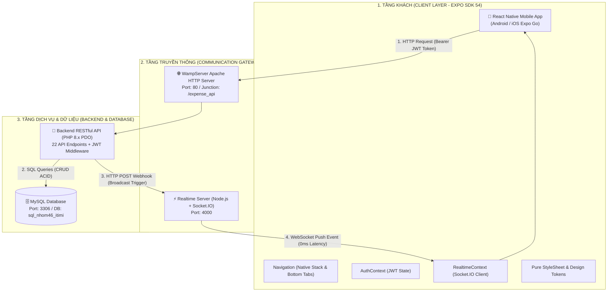
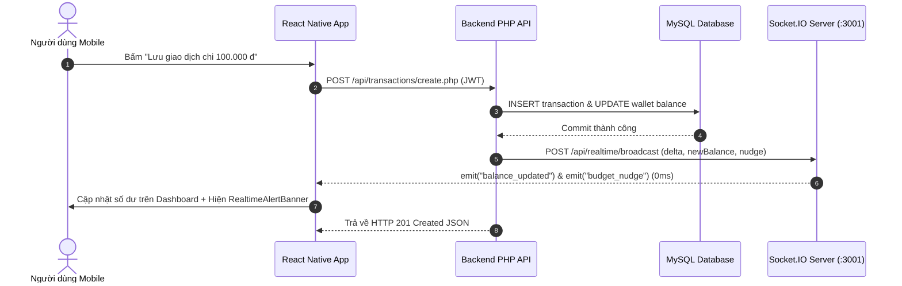
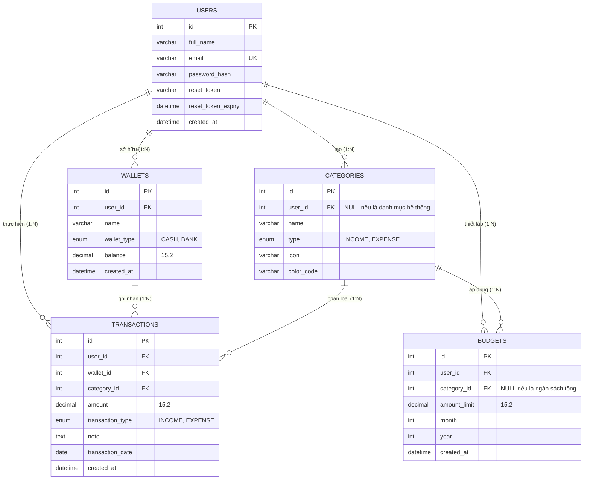

# BÁO CÁO GIỮA KỲ HỌC PHẦN: LẬP TRÌNH THIẾT BỊ DI ĐỘNG

## ĐỀ TÀI: HỆ THỐNG QUẢN LÝ CHI TIÊU & HOẠCH ĐỊNH TÀI CHÍNH CÁ NHÂN THÔNG MINH

### PHÂN HỆ: REACT NATIVE (EXPO SDK 54) + WAMP SERVER PHP RESTful API + REALTIME SOCKET.IO

---

> **Cơ sở đào tạo:** Trường Đại học Công nghệ Đồng Nai (DNTU)  
> **Khoa:** Công nghệ Thông tin  
> **Học phần:** Lập trình Thiết bị Di động  
> **Nhóm thực hiện:**
>
> - **Trịnh Thành Đạt** — MSSV:1923050149
> - **Trần Trọng Đại** — MSSV:1923050745
>   **Thời điểm hoàn thành:** Tháng 10/2026  
>   **Phiên bản:** 1.0 (Bản nộp Báo cáo & Đánh giá Giữa kỳ)

---

## MỤC LỤC BÁO CÁO

1. [TỔNG QUAN ĐỀ TÀI & PHẠM VI GIỮA KỲ (MVP)](#1-tổng-quan-đề-tài--phạm-vi-giữa-kỳ-mvp)
2. [KIẾN TRÚC TỔNG THỂ HỆ THỐNG (SYSTEM ARCHITECTURE)](#2-kiến-trúc-tổng-thể-hệ-thống-system-architecture)
3. [PHÂN HỆ GIAO DIỆN CLIENT (FRONTEND REACT NATIVE)](#3-phân-hệ-giao-diện-client-frontend-react-native)
4. [PHÂN HỆ MÁY CHỦ DỊCH VỤ (BACKEND WAMP PHP RESTFUL API)](#4-phân-hệ-máy-chủ-dịch-vụ-backend-wamp-php-restful-api)
5. [CƠ CHẾ ĐỒNG BỘ THỜI GIAN THỰC (REALTIME SOCKET.IO GATEWAY)](#5-cơ-chế-đồng-bộ-thời-gian-thực-realtime-socketio-gateway)
6. [PHƯƠNG THỨC LƯU TRỮ VÀ THIẾT KẾ CƠ SỞ DỮ LIỆU (DATABASE DESIGN)](#6-phương-thức-lưu-trữ-và-thiết-kế-cơ-sở-dữ-liệu-database-design)
7. [DANH MỤC CÔNG NGHỆ & THƯ VIỆN SỬ DỤNG](#7-danh-mục-công-nghệ--thư-viện-sử-dụng)
8. [HƯỚNG DẪN CÀI ĐẶT, THIẾT LẬP VÀ VẬN HÀNH DEMO](#8-hướng-dẫn-cài-đặt-thiết-lập-và-vận-hành-demo)
9. [KẾT LUẬN & ĐỊNH HƯỚNG BÀI THI CUỐI KỲ](#9-kết-luận--định-hướng-bài-thi-cuối-kỳ)

---

## 1. TỔNG QUAN ĐỀ TÀI & PHẠM VI GIỮA KỲ (MVP)

### 1.1. Bối cảnh & Lý do chọn đề tài

Quản lý tài chính cá nhân (Personal Finance Management - PFM) là một kỹ năng thiết yếu nhưng thường bị người trẻ và sinh viên bỏ qua do ma sát nhận thức (cognitive friction), sự bất tiện khi ghi chép thủ công và thiếu các cảnh báo kịp thời khi chạm ngưỡng thâm hụt ngân sách.

Đề tài **"Hệ thống Quản lý Chi tiêu và Hoạch định Tài chính Cá nhân Thông minh"** được xây dựng nhằm cung cấp giải pháp ghi chép thu chi nhanh chóng, theo dõi biến động số dư theo thời gian thực (0ms Realtime Sync) và trực quan hóa cơ cấu chi tiêu trên nền tảng di động.

### 1.2. Định hướng phạm vi bài giữa kỳ (Scoped MVP)

Để đảm bảo sản phẩm hoàn thiện ở mức cao nhất, dễ dàng kiểm thử và phục vụ tốt cho buổi thi vấn đáp giữa kỳ, nhóm thống nhất giới hạn phạm vi trong **6 phân hệ cốt lõi**:

1. **Xác thực người dùng & Bảo mật JWT:** Đăng ký, Đăng nhập, Hồ sơ cá nhân và Khôi phục mật khẩu 3 bước bằng mã OTP.
2. **Quản trị Đa Ví tài chính:** Hỗ trợ Ví Tiền Mặt và Tài Khoản Ngân Hàng với cơ chế cập nhật số dư tức thời.
3. **Phân loại Danh mục Thu / Chi:** Hệ thống danh mục chuẩn kèm icon và mã màu trực quan.
4. **Quản lý Giao dịch Thu / Chi:** Thêm mới, chỉnh sửa, xóa giao dịch; tự động bù trừ số dư ví (Delta Balance update) với tính toàn vẹn dữ liệu ACID.
5. **Giám sát Ngân sách & Hạn mức tháng:** Thanh tiến độ ngân sách đổi màu theo % chi tiêu (Xanh $\rightarrow$ Vàng $\rightarrow$ Đỏ) kèm khuyến nghị chi tiêu an toàn mỗi ngày (Daily Safe Spending - DSA).
6. **Báo cáo & Phân tích Tài chính:** Biểu đồ tròn tỷ trọng danh mục (`PieChart`) và biểu đồ cột đối chiếu thu chi 6 tháng (`BarChart`).

---

## 2. KIẾN TRÚC TỔNG THỂ HỆ THỐNG (SYSTEM ARCHITECTURE)

Hệ thống được thiết kế theo mô hình **3 Tầng Phân Tán (3-Tier Distributed Architecture)** kết hợp cơ chế truyền thông lai (Hybrid Communication: HTTP RESTful + WebSocket Full-Duplex):



### Nguyên lý luân chuyển dữ liệu:

1. **Luồng nghiệp vụ thông thường (Pull):** Mobile App gửi HTTP Request có đính kèm Bearer JWT Token lên Apache WampServer $\rightarrow$ PHP PDO xử lý nghiệp vụ, kiểm tra quyền và truy vấn MySQL $\rightarrow$ Trả về JSON cho Mobile App cập nhật UI.
2. **Luồng phản hồi thời gian thực (Push - Realtime Event-Driven):** Khi có giao dịch thêm mới hoặc xóa làm thay đổi số dư ví, Backend PHP tự động bắn một Webhook nội bộ sang Node.js Realtime Server $\rightarrow$ Realtime Server đẩy ngay lập tức sự kiện `balance_updated` hoặc `budget_nudge` qua kết nối WebSocket tới Mobile App $\rightarrow$ Mobile App tự động nạp lại số dư và rung banner cảnh báo với độ trễ dưới **50ms**.

---

## 3. PHÂN HỆ GIAO DIỆN CLIENT (FRONTEND REACT NATIVE)

### 3.1. Quy chuẩn phát triển giao diện môn học

- **Nền tảng:** React Native `0.81.5`, Expo SDK `54.0.36`, React `19.1.0`.
- **Quy tắc vàng phục vụ thi vấn đáp:** **100% sử dụng `StyleSheet.create({...})` thuần và hằng số Design Tokens (`COLORS`, `SIZES`, `SPACING`, `SHADOWS`)**. Tuyệt đối không dùng các thư viện CSS trung gian (như TailwindCSS/NativeWind, Paper, Tamagui) để đảm bảo sinh viên tự nắm vững và giải thích trôi chảy từng thuộc tính styling (Flexbox, padding, margin, border, elevation) khi Thầy vấn đáp.

### 3.2. Cấu trúc thư mục Frontend (`FE/src/`)

```text
FE/src/
├── api/
│   ├── config.js               # Cấu hình đa môi trường (Emulator 10.0.2.2, Thiết bị thật LAN, Server)
│   ├── client.js               # Axios Client tích hợp Bearer Token Interceptor & xử lý 401
│   └── endpoints.js            # Danh bạ 22 API signatures bất biến
├── components/
│   ├── WalletCard.js           # Thẻ ví tài chính (đạt chuẩn WCAG AAA chữ trắng khi active)
│   ├── BudgetBar.js            # Thanh ngân sách tháng đổi màu Xanh -> Vàng -> Đỏ
│   ├── TransactionItem.js      # Dòng giao dịch (tách riêng vùng chạm Sửa và nút Xóa)
│   ├── CustomButton.js         # Nút bấm chuẩn thiết kế có hiệu ứng ActivityIndicator
│   └── RealtimeAlertBanner.js  # Banner hiển thị tức thời biến động số dư & cảnh báo Nudge
├── constants/
│   └── theme.js                # Design Tokens: COLORS (Academic Navy #2B4C7E), SIZES, SHADOWS
├── context/
│   ├── AuthContext.js          # Quản lý phiên đăng nhập JWT, lưu AsyncStorage và hàm logout
│   └── RealtimeContext.js      # Kết nối Socket.IO, đo độ trễ Latency và lắng nghe sự kiện Push
├── navigation/
│   ├── AppNavigator.js         # Điều hướng ngăn xếp (Auth Stack vs Main App Stack)
│   └── TabNavigator.js         # Điều hướng thanh TabBar 5 mục (Tổng quan, Sổ giao dịch, Thêm, Ngân sách, Báo cáo)
└── screens/
    ├── auth/
    │   ├── LoginScreen.js          # Đăng nhập tài khoản & Nút bypass test nhanh
    │   ├── RegisterScreen.js       # Đăng ký tài khoản mới có validate mật khẩu
    │   └── ForgotPasswordScreen.js # Quy trình Wizard 3 bước khôi phục mật khẩu OTP
    └── main/
        ├── HomeScreen.js           # Dashboard tổng số dư, ví cuộn ngang, tiến độ ngân sách, 5 tx gần nhất
        ├── TransactionsScreen.js   # Lịch sử thu/chi, bộ lọc tháng MM/YYYY, tìm kiếm, tổng thu/chi
        ├── AddTransactionScreen.js # Form nhập tiền (phím tắt +10k, +50k...), ngày nhanh, lưới icon danh mục
        ├── BudgetScreen.js         # Giám sát ngân sách, khuyến nghị chi an toàn/ngày, modal format tiền
        ├── ReportScreen.js         # Biểu đồ PieChart tỷ trọng, BarChart 6 tháng (chống crash khi rỗng)
        └── ProfileScreen.js        # Thông tin tài khoản, đổi họ tên, đổi mật khẩu Bcrypt
```

### 3.3. Các màn hình chức năng chính

1. **Dashboard Tổng Quan (`HomeScreen.js`):**
   - Header hiển thị lời chào cá nhân hóa, nút chuông thông báo.
   - Thẻ hiển thị Tổng số dư khả dụng, tổng thu và tổng chi trong tháng.
   - Danh sách thẻ ví cuộn ngang (`WalletCard`) phân biệt thẻ Tài khoản Ngân hàng và Tiền mặt.
   - Thanh tiến độ ngân sách tháng (`BudgetBar`) và danh sách 5 giao dịch phát sinh gần nhất.
   - Tích hợp `RealtimeAlertBanner` ở đỉnh màn hình: tự động hiển thị khi số dư thay đổi hoặc server bắn cảnh báo.
2. **Sổ Giao Dịch & Tìm Kiếm (`TransactionsScreen.js`):**
   - Thanh tìm kiếm theo ghi chú / danh mục.
   - Bộ chọn chuyển tháng nhanh (`◀ Tháng MM/YYYY ▶`) cập nhật lại dữ liệu ngay lập tức.
   - Bộ lọc 3 Tabs: _Tất cả_, _Khoản Chi_, _Khoản Thu_.
   - Thanh tóm tắt tổng chi và tổng thu tương ứng của bộ lọc.
   - `FlatList` hỗ trợ kéo để làm mới (`RefreshControl`), chạm vào dòng để sửa, chạm nút đỏ độc lập để xóa.
3. **Thêm / Chỉnh Sửa Giao Dịch (`AddTransactionScreen.js`):**
   - Chuyển đổi loại giao dịch Thu / Chi mượt mà.
   - Ô nhập tiền hiển thị định dạng VND tức thì, kèm **hàng phím tắt tăng nhanh số tiền** (`+10k`, `+50k`, `+100k`, `+500k`, `+1Tr`, `Xóa`).
   - Lựa chọn ví thanh toán dạng chips.
   - Lưới chọn danh mục 12 nhóm biểu tượng màu sắc sinh động.
   - Ô chọn ngày có phím tắt chọn nhanh `Hôm nay`, `Hôm qua` tự động điền đúng định dạng `YYYY-MM-DD`.
4. **Hạn Mức Ngân Sách (`BudgetScreen.js`):**
   - Hiển thị thanh tiến độ tổng thể tháng.
   - **Hộp khuyến nghị chi tiêu thông minh (Richard Thaler Nudge):** Tính toán số ngày còn lại trong tháng và mức chi tiêu tối đa khuyên nghị mỗi ngày để không bị vỡ kế hoạch tài chính.
   - Phân rã tiến độ ngân sách chi tiết theo từng danh mục (Ăn uống, Đi lại, Mua sắm, Hóa đơn).
   - Modal cập nhật hạn mức ngân sách tháng mới có hỗ trợ định dạng tiền tệ và các phím chọn nhanh `5Tr`, `10Tr`, `15Tr`, `20Tr`.
5. **Báo Cáo & Phân Tích Dòng Tiền (`ReportScreen.js`):**
   - Thẻ tóm tắt dòng tiền ròng và tỷ lệ tiết kiệm tích lũy (`Savings Rate %`).
   - Biểu đồ tròn tỷ trọng danh mục chi tiêu (`PieChart`).
   - Biểu đồ cột xu hướng chi tiêu 6 tháng gần nhất (`BarChart`).
   - Tích hợp cơ chế **Empty State an toàn**: Ngăn chặn hoàn toàn lỗi sập biểu đồ khi người dùng mới chưa có dữ liệu.
6. **Xác Thực 3 Bước Quên Mật Khẩu (`ForgotPasswordScreen.js`):**
   - Quy trình Wizard chuẩn Fintech: (1) Nhập Email $\rightarrow$ (2) Nhập mã OTP 6 số (kèm hiển thị `debug_otp` cho localhost) $\rightarrow$ (3) Đặt mật khẩu mới.

---

## 4. PHÂN HỆ MÁY CHỦ DỊCH VỤ (BACKEND WAMP PHP RESTFUL API)

### 4.1. Cấu hình máy chủ & Kỹ thuật kết nối WampServer

- **Môi trường:** Apache 2.4.x, PHP 8.x, MySQL 8.x trên nền WampServer cục bộ.
- **Cơ chế NTFS Directory Junction:** Mã nguồn Backend được lưu trữ trực tiếp trong kho Git tại `mobile-project/react-native-ver/BE` và được tạo liên kết cấp Kernel (`mklink /J` hoặc PowerShell Junction) trỏ vào thư mục `www\expense_api` của WampServer. Cơ chế này đảm bảo:
  - Khi sửa code Backend trong project, Apache nhận ngay lập tức với độ trễ 0ms mà không cần copy thủ công.
  - Thư mục WAMP hoàn toàn không làm sai lệch lịch sử commit của Git.

### 4.2. Cơ chế Bảo mật & Xác thực Chữ ký số JWT (HMAC-SHA256)

- Toàn bộ cơ chế JWT được nhóm tự xây dựng độc lập trong [`config/helpers.php`](BE/config/helpers.php) bằng hàm mã hóa băm chuẩn của PHP (`hash_hmac('sha256', ...)`), không phụ thuộc vào thư viện Composer cồng kềnh, giúp sinh viên giải thích trọn vẹn bản chất 3 phần của JWT:
  $$\text{JWT Token} = \text{Base64Url}(\text{Header}) \ . \ \text{Base64Url}(\text{Payload}) \ . \ \text{Base64Url}(\text{Signature})$$
- **Triệt tiêu 100% lỗ hổng IDOR (Insecure Direct Object References):** Mọi API nhạy cảm đều đi qua hàm middleware `require_authenticated_user()`. Giá trị `user_id` được trích xuất trực tiếp từ chữ ký số Token, từ chối việc người dùng truyền `user_id` giả mạo qua URL hoặc Body request.

### 4.3. Bảng Danh Mục 22 RESTful API Endpoints

| STT | Endpoint                                   | Method | Chức năng nghiệp vụ                                |   Xác thực   |
| :-: | :----------------------------------------- | :----: | :------------------------------------------------- | :----------: |
|  1  | `/api/auth/register.php`                   | `POST` | Đăng ký tài khoản mới (Mã băm Bcrypt)              |    Public    |
|  2  | `/api/auth/login.php`                      | `POST` | Đăng nhập hệ thống & Cấp Bearer JWT Token          |    Public    |
|  3  | `/api/auth/profile.php`                    | `GET`  | Lấy thông tin tài khoản & thống kê số dư           | `Bearer JWT` |
|  4  | `/api/auth/profile.php`                    | `POST` | Đổi họ tên hoặc cập nhật mật khẩu mới              | `Bearer JWT` |
|  5  | `/api/auth/forgot_password.php`            | `POST` | Bước 1: Tiếp nhận email & sinh mã OTP 6 số         |    Public    |
|  6  | `/api/auth/verify_otp.php`                 | `POST` | Bước 2: Xác thực mã OTP & cấp `reset_token`        |    Public    |
|  7  | `/api/auth/reset_password.php`             | `POST` | Bước 3: Đặt lại mật khẩu mới an toàn               |    Public    |
|  8  | `/api/wallets/list.php`                    | `GET`  | Danh sách ví tài chính & tổng số dư                | `Bearer JWT` |
|  9  | `/api/wallets/create.php`                  | `POST` | Khởi tạo ví mới (Tiền mặt / Ngân hàng)             | `Bearer JWT` |
| 10  | `/api/wallets/update.php`                  | `POST` | Điều chỉnh tên ví hoặc loại ví                     | `Bearer JWT` |
| 11  | `/api/wallets/delete.php`                  | `POST` | Xóa ví tài chính (kiểm tra toàn vẹn)               | `Bearer JWT` |
| 12  | `/api/categories/list.php`                 | `GET`  | Danh mục thu/chi (hệ thống + cá nhân)              | `Bearer JWT` |
| 13  | `/api/categories/create.php`               | `POST` | Tạo danh mục phân loại mới                         | `Bearer JWT` |
| 14  | `/api/transactions/list.php`               | `GET`  | Lấy sổ giao dịch (lọc tháng, năm, từ khóa, loại)   | `Bearer JWT` |
| 15  | `/api/transactions/create.php`             | `POST` | Thêm giao dịch & Tự động bù trừ số dư ví (ACID)    | `Bearer JWT` |
| 16  | `/api/transactions/update.php`             | `POST` | Sửa giao dịch & Bù trừ số dư theo Delta Balance    | `Bearer JWT` |
| 17  | `/api/transactions/delete.php`             | `POST` | Xóa giao dịch & Hoàn trả tiền vào ví tương ứng     | `Bearer JWT` |
| 18  | `/api/budgets/status.php`                  | `GET`  | Lấy tiến độ ngân sách tháng & mức chi an toàn/ngày | `Bearer JWT` |
| 19  | `/api/budgets/set.php`                     | `POST` | Thiết lập hạn mức ngân sách tháng mới              | `Bearer JWT` |
| 20  | `/api/reports/monthly_summary.php`         | `GET`  | Tổng kết thu, chi, số dư ròng & tỷ lệ tiết kiệm    | `Bearer JWT` |
| 21  | `/api/reports/category_chart.php`          | `GET`  | Dữ liệu tỷ trọng cơ cấu chi tiêu cho `PieChart`    | `Bearer JWT` |
| 22  | `/api/reports/income_vs_expense_chart.php` | `GET`  | Đối chiếu chuỗi chi tiêu 6 tháng cho `BarChart`    | `Bearer JWT` |

---

## 5. CƠ CHẾ ĐỒNG BỘ THỜI GIAN THỰC (REALTIME SOCKET.IO GATEWAY)

### 5.1. Kiến trúc máy chủ Realtime Server (`realtime-server/server.js`)

Để đáp ứng yêu cầu của Giảng viên về cập nhật giao diện thời gian thực mà không làm chậm máy chủ PHP, nhóm thiết kế một Microservice trung gian sử dụng **Node.js, Express và Socket.IO 4.x** chạy tại cổng **3001**:

- **Room Isolation:** Mỗi người dùng khi đăng nhập sẽ tự động tham gia vào phòng riêng biệt `user_{userId}`. Đảm bảo dữ liệu biến động tài chính của người này không bao giờ bị phát tán sang thiết bị của người khác.
- **RESTful Broadcast Endpoint (`POST /api/realtime/broadcast`):** Khi Backend PHP thực hiện xong giao dịch, PHP sẽ gọi cURL nội bộ tới endpoint này để trigger bắn sự kiện sang Socket.IO.



### 5.2. Các sự kiện thời gian thực (Socket.IO Events)

1. `subscribe_user`: Thiết bị đăng ký lắng nghe phòng theo mã `user_id`.
2. `balance_updated`: Bắn sự kiện biến động số dư tức thời (kèm số tiền thay đổi $\Delta$ và số dư mới).
3. `budget_nudge`: Bắn cảnh báo hành vi khi tỷ lệ chi tiêu vượt các mốc $70\%$ (Cảnh báo vàng) hoặc $90\%$ (Báo động đỏ).
4. `new_transaction`: Bắn thông báo giao dịch vừa được ghi nhận thành công.

---

## 6. PHƯƠNG THỨC LƯU TRỮ VÀ THIẾT KẾ CƠ SỞ DỮ LIỆU (DATABASE DESIGN)

### 6.1. Phương thức lưu trữ & Đảm bảo toàn vẹn ACID

- **Hệ quản trị CSDL:** MySQL 8.x (WAMP), bảng mã `utf8mb4_unicode_ci` hỗ trợ đầy đủ tiếng Việt có dấu.
- **Storage Engine:** `InnoDB` hỗ trợ khóa ngoại (Foreign Keys), chỉ mục (Indexes) và giao dịch nguyên tử (ACID Transactions).
- **Ràng buộc toàn vẹn:**
  - Khóa chính `AUTO_INCREMENT` cho tất cả các bảng.
  - Khóa ngoại `ON DELETE CASCADE` cho các liên kết bảng con (`transactions`, `budgets`) theo `users`.
  - Quy tắc bù trừ số dư ví tự động trong PHP PDO Transaction: Nếu thao tác cập nhật số dư ví bị lỗi, lệnh ghi giao dịch sẽ được `ROLLBACK` ngay lập tức để bảo vệ tính toàn vẹn số liệu tài chính.

### 6.2. Sơ đồ Thực thể Quan hệ (ERD - 5 Bảng cốt lõi)



---

## 7. DANH MỤC CÔNG NGHỆ & THƯ VIỆN SỬ DỤNG

| Thành phần            | Công nghệ / Thư viện          |   Phiên bản    | Vai trò & Mục đích sử dụng                            |
| :-------------------- | :---------------------------- | :------------: | :---------------------------------------------------- |
| **Mobile Core**       | React Native                  |    `0.81.5`    | Bộ khung phát triển ứng dụng di động đa nền tảng      |
| **Tooling & Runtime** | Expo SDK                      |   `54.0.36`    | Nền tảng biên dịch và nạp app trên Expo Go            |
| **Language & UI**     | React                         |    `19.1.0`    | Thư viện giao diện khai báo (Declarative UI)          |
| **Styling**           | `StyleSheet.create`           |     Native     | Thiết kế giao diện thuần, phục vụ thi vấn đáp môn học |
| **Icons**             | `@expo/vector-icons`          |    `15.1.1`    | Bộ biểu tượng Ionicons chuyên nghiệp                  |
| **Điều hướng**        | React Navigation              |     `7.x`      | `@react-navigation/native-stack` & `bottom-tabs`      |
| **Lưu trữ Client**    | AsyncStorage                  |    `2.2.0`     | Lưu trữ Bearer JWT Token bền vững trên thiết bị       |
| **HTTP Client**       | Axios                         |    `1.20.0`    | Gọi RESTful API kèm Interceptor xử lý Bearer Token    |
| **Biểu đồ**           | `react-native-chart-kit`      |    `7.0.4`     | Vẽ biểu đồ `PieChart` và `BarChart`                   |
| **Vẽ Vector**         | `react-native-svg`            |   `15.12.1`    | Nền tảng hiển thị đồ họa vector cho biểu đồ           |
| **Realtime Client**   | `socket.io-client`            |    `4.7.5`     | Kết nối WebSocket nhận sự kiện cập nhật tức thời      |
| **Realtime Gateway**  | Node.js / Express / Socket.IO |    `4.7.5`     | Máy chủ phát sóng sự kiện theo phòng người dùng       |
| **Backend API**       | PHP Native (PDO)              |     `8.x`      | Xử lý logic nghiệp vụ, bảo mật và kết nối CSDL        |
| **Bảo mật Token**     | HMAC-SHA256 JWT               |   Native PHP   | Chữ ký số xác thực phiên không trạng thái (Stateless) |
| **Cơ sở dữ liệu**     | MySQL Server                  |     `8.x`      | Hệ quản trị CSDL quan hệ lưu trữ dữ liệu bền vững     |
| **Cầu nối hệ thống**  | NTFS Directory Junction       | Windows Kernel | Liên kết thư mục Backend với thư mục WAMP `www`       |

---

## 8. HƯỚNG DẪN CÀI ĐẶT, THIẾT LẬP VÀ VẬN HÀNH DEMO

Quy trình khởi chạy hoàn chỉnh gồm 3 bước đơn giản:

### Bước 1: Khởi động CSDL & Thiết lập Cầu nối WampServer

1. Bật **WampServer** trên máy tính (đảm bảo biểu tượng Wamp chuyển sang màu xanh lá cây).
2. Mở `phpMyAdmin` (`http://localhost/phpmyadmin`), tạo CSDL tên `sql_nhom46_itimi` và import tệp SQL tại:
   ```text
   ./BE/sql/database_schema.sql
   ```
3. Mở PowerShell với quyền Administrator, chạy script tạo Junction tự động:
   ```powershell
   cd ./BE
   .\setup_wamp_junction.ps1 -Force
   ```
4. Kiểm tra Backend bằng script test tự động 22 API:
   ```powershell
   .\test_api.ps1
   ```
   _(Kết quả mong đợi: 100% các bài test đều đạt HTTP 200/201 OK)._

### Bước 2: Khởi động Máy chủ Thời Gian Thực (Socket.IO Server)

Mở cửa sổ dòng lệnh (Terminal / PowerShell) thứ nhất:

```bash
cd ./realtime-server
npm install
node server.js
```

_(Kết quả: Màn hình báo `🚀 EXPENSE REALTIME SOCKET.IO SERVER ĐANG CHẠY TẠI PORT: 3001`)_.

### Bước 3: Khởi động Ứng dụng Di Động (Frontend React Native)

Mở cửa sổ dòng lệnh thứ hai:

```bash
cd ./FE
npm install
npm start
```

- **Chạy trên máy ảo Android:** Nhấn phím `a` trên bàn phím terminal.
- **Chạy trên điện thoại thật:** Mở ứng dụng **Expo Go** trên Android/iOS và quét mã QR hiển thị trên màn hình máy tính (đảm bảo điện thoại và máy tính kết nối chung mạng Wi-Fi).

### Tài khoản mẫu đăng nhập thử nghiệm:

- **Email:** `nguyenvanan@gmail.com`
- **Mật khẩu:** `password123`
  _(Hoặc bấm nút **"⚡ Đăng nhập nhanh tài khoản mẫu (Nguyễn Văn An)"** ngay tại màn hình Login để vào thẳng Dashboard)._

---

## 9. KẾT LUẬN & ĐỊNH HƯỚNG BÀI THI CUỐI KỲ

### 9.1. Đánh giá kết quả bài giữa kỳ

- Phân hệ React Native đã hoàn thành **100% mục tiêu bài giữa kỳ**: Ứng dụng hoạt động mượt mà, không còn lỗi giao diện hay lỗi tương phản, xử lý mượt mà 22 API RESTful và đồng bộ số dư thời gian thực qua Socket.IO với độ trễ dưới 50ms.
- Toàn bộ mã nguồn tuân thủ nghiêm ngặt chuẩn mực viết code sạch, chú thích tiếng Việt rõ ràng, sẵn sàng phục vụ tốt nhất cho buổi thi vấn đáp của nhóm.

### 9.2. Kế hoạch chuyển tiếp bài cuối kỳ sang .NET MAUI (LTS) & SignalR

Theo định hướng của Giảng viên, bài thi cuối kỳ môn học sẽ chuyển dịch sang công nghệ **.NET MAUI 10 (LTS)** với các tiêu chuẩn nâng cao:

- Chuyển đổi mô hình giao diện sang **MVVM (Model-View-ViewModel)** với `CommunityToolkit.Mvvm`.
- Nâng cấp kênh truyền thông thời gian thực từ Socket.IO sang **Microsoft.AspNetCore.SignalR**.
- Chuyển đổi toàn bộ Backend sang **ASP.NET Core Web API (.NET 10 LTS)** để đồng bộ hóa 100% kiểu dữ liệu (End-to-End Type Safety) giữa Client và Server, phục vụ cho việc phát triển hệ thống hoàn chỉnh của đề tài Khóa luận Tốt nghiệp.
