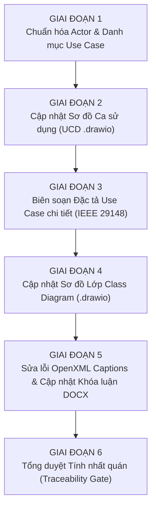

# KẾ HOẠCH BỔ SUNG & ĐIỀU CHỈNH TOÀN DIỆN THIẾT KẾ HỆ THỐNG PFM (UCD, USE CASE, ACTOR, CLASS DIAGRAM & KHÓA LUẬN DOCX)

> **Mã kế hoạch:** `PLAN-24`  
> **Ngày khởi tạo:** 2026-10-09  
> **Trạng thái:** DRAFT - Chờ xác nhận từ người dùng trước khi triển khai  
> **Căn cứ bối cảnh:** Sau buổi báo cáo tiến độ giữa kỳ môn Phân tích Thiết kế Hệ thống Thông tin (PTTKHTTT), tiếp thu phản hồi từ Giảng viên và lớp học; tận dụng khoảng thời gian trước khi học vẽ Sơ đồ Tuần tự (Sequence Diagram) để hoàn thiện và chuẩn hóa toàn bộ thiết kế logic và báo cáo khóa luận.

---

## 1. MỤC TIÊU VÀ PHẠM VI ĐIỀU CHỈNH (OBJECTIVES & SCOPE)

### 1.1. Các nội dung cải tiến kỹ thuật mới được tiếp thu
1. **Nhận diện giọng nói (Voice Expense Logging):**
   - Bổ sung kênh nhập liệu bằng giọng nói cho các khoản chi tiêu nhỏ lẻ, hàng quán vỉa hè không có hóa đơn (giải quyết triệt để bài toán lười nhập liệu).
   - Thiết kế luồng xử lý: `Ghi âm -> AI Multimodal Audio (Whisper / Gemini Audio) -> Bóc tách JSON -> Điền vào Form xem trước (Human-in-the-loop) -> Người dùng xác nhận 1 chạm`.
2. **Mở rộng AI Vision OCR (Scan Số dư tài khoản & Phiếu lương):**
   - **Cân chỉnh số dư ví tự động:** Người dùng chụp ảnh màn hình (Screenshot) app ngân hàng $\rightarrow$ AI đọc số dư khả dụng $\rightarrow$ Tự tính tiền chênh lệch và tạo bản ghi `BalanceAdjustment`.
   - **Bóc tách phiếu lương (Payslip OCR):** Người dùng chụp phiếu lương $\rightarrow$ AI bóc tách Gross, Thuế TNCN, Bảo hiểm, Lương Net $\rightarrow$ Cập nhật dòng tiền thu nhập biến động (`UC-02`) và kích hoạt tái phân bổ hạn mức ngày DSA.
3. **Chuẩn hóa khung lý luận "Ví mô phỏng Ledger vs Core Banking" & Cổng VietQR:**
   - Đưa lập luận 3 trụ cột vào Chương 1 và Chương 2 của khóa luận:
     - Rào cản pháp lý & an ninh bảo mật (tuân thủ luật Ngân hàng Nhà nước, tránh rủi ro Screen-scraping lộ OTP).
     - Bản chất hệ thống PFM là Sổ cái kế hoạch (Planning Ledger) tương tự MISA/SAP/YNAB chứ không phải tài khoản thanh toán Core Banking.
     - Tâm lý học hành vi (Richard Thaler): Giữ lại "ma sát nhận thức tích cực" để rèn luyện kỷ luật tài chính, khắc phục sự thụ động của việc trừ tiền tự động.

### 1.2. Khắc phục triệt để lỗi Kỹ thuật Word DOCX (Table of Figures / Tables)
- **Nguyên nhân lỗi vừa qua:** Các chú thích caption trước đó chỉ được thêm dưới dạng văn bản có định dạng chữ (styled text) hoặc siêu liên kết (hyperlink), không chứa trường mã lệnh trường nội tại của Microsoft Word (`w:fldSimple` chứa mã trường `SEQ Figure` hoặc `SEQ Table`). Khi người dùng chọn *Insert Table of Figures / Tables*, Word quét mã trường `SEQ` không thấy nên báo lỗi *"No table of figures entries found"*.
- **Giải pháp:** Sử dụng đoạn mã thao tác OpenXML ở cấp độ thẻ XML gốc (`w:fldSimple w:instr="SEQ Hình \* ARABIC"` và `w:fldSimple w:instr="SEQ Bảng \* ARABIC"`), đảm bảo Microsoft Word nhận diện tự động 100% khi người dùng cập nhật mục lục TOF/TOT.

---

## 2. LỘ TRÌNH TRIỂN KHAI 6 GIAI ĐOẠN CHI TIẾT (IMPLEMENTATION ROADMAP)



---

### GIAI ĐOẠN 1: CHUẨN HÓA DANH SÁCH ACTOR & RANH GIỚI HỆ THỐNG (SYSTEM BOUNDARY)
- **Actor chính (Primary Actor):**
  - `Người dùng cá nhân (Personal User)`: Tác nhân duy nhất trực tiếp tương tác với hệ thống (100% tài chính cá nhân).
- **Tác nhân ngoại vi / Dịch vụ nền tảng (Secondary / External System Actors):**
  1. `Dịch vụ AI Đa phương thức (AI Multimodal Service)`: Bao gồm Vision OCR (Hóa đơn, Phiếu lương, Ảnh chụp màn hình số dư) và Voice NLU (Nhận diện & bóc tách giọng nói).
  2. `Cổng thanh toán VietQR (VietQR Gateway - NAPAS 247)`: Chuẩn hóa mã QR EMVCo, tạo Deeplink thanh toán ngân hàng an toàn.
  3. `Dịch vụ Thông báo (Notification Service)`: Đẩy thông báo thời gian thực, cảnh báo hạn mức DSA và lịch nhắc trả nợ.
- **Sản phẩm bàn giao:** Bảng ma trận tác nhân cập nhật trong tài liệu kiến trúc.

---

### GIAI ĐOẠN 2: THIẾT KẾ LẠI SƠ ĐỒ CA SỬ DỤNG (USE CASE DIAGRAMS - DRAW.IO)
Cập nhật tệp nguồn [`files/UCD-DuoNoPro.drawio`](files/UCD-DuoNoPro.drawio) và xuất hình ảnh chất lượng cao:
1. **UCD 00 (Sơ đồ Tổng thể PFM):**
   - Điều chỉnh kết nối của các ca sử dụng với 3 Tác nhân dịch vụ ngoại vi.
2. **UCD 01 (Phân hệ Quản lý Tài khoản & Đa ví):**
   - Bổ sung ca sử dụng: `UC-01.05: Cân chỉnh số dư ví tự động bằng ảnh chụp tài khoản` (`<<extend>>` từ UC-01.04 Cân chỉnh số dư, liên kết với AI Multimodal Service).
3. **UCD 02 (Phân hệ Quản lý Thu nhập):**
   - Bổ sung ca sử dụng: `UC-02.04: Bóc tách phiếu lương tự động bằng AI Vision OCR` (`<<extend>>` từ UC-02.01 Thêm thu nhập, liên kết với AI Multimodal Service).
4. **UCD 03 (Phân hệ Quản lý Chi tiêu & Bóc tách Hóa đơn):**
   - Bổ sung ca sử dụng: `UC-03.11: Ghi nhận chi tiêu nhanh bằng giọng nói (Voice Command)` (`<<extend>>` từ UC-03.01 Thêm chi tiêu thủ công, liên kết với AI Multimodal Service).
- **Sản phẩm bàn giao:** File `.drawio` hoàn chỉnh và 10 ảnh sơ đồ ca sử dụng mới.

---

### GIAI ĐOẠN 3: BIÊN SOẠN ĐẶC TẢ USE CASE CHI TIẾT THEO CHUẨN IEEE 29148
Bổ sung đặc tả 13 mục chuẩn mực quốc tế cho các Use Case mới:
1. **Đặc tả `UC-01.05` (Cân chỉnh số dư ví tự động bằng ảnh chụp tài khoản):**
   - Luồng sự kiện bóc tách số dư, tính độ lệch sai số với sổ cái, tạo bản ghi `BalanceAdjustment`.
2. **Đặc tả `UC-02.04` (Bóc tách phiếu lương tự động bằng AI Vision OCR):**
   - Luồng sự kiện bóc tách Gross/Net, thuế, bảo hiểm, tự động cập nhật vào chu kỳ thu nhập của tháng.
3. **Đặc tả `UC-03.11` (Ghi nhận chi tiêu nhanh bằng giọng nói):**
   - Luồng sự kiện thu âm, gọi AI Audio bóc tách JSON, hiển thị form xem trước và người dùng xác nhận 1 chạm (Human-in-the-loop).
- **Sản phẩm bàn giao:** Cập nhật [`project_context/reports/use_cases/`](project_context/reports/use_cases/) và tệp danh sách hợp nhất [`files/DanhSach_UseCase_HopNhat.md`](files/DanhSach_UseCase_HopNhat.md).

---

### GIAI ĐOẠN 4: CẬP NHẬT SƠ ĐỒ LỚP (CLASS DIAGRAM) & 6 BOUNDED CONTEXTS DDD
Cập nhật tệp nguồn [`files/ClassDiagram.drawio`](files/ClassDiagram.drawio):
1. **Bounded Context 1 & 2 (Identity & Wallet):**
   - Bổ sung phương thức `reconcileFromScreenshot(ocrBalance: Money)` vào thực thể `BalanceAdjustment` và `Wallet`.
2. **Bounded Context 3 (Transactions, OCR & Voice):**
   - Bổ sung cấu trúc dữ liệu lưu trữ metadata giọng nói: thuộc tính `voiceInputTranscript: NVARCHAR(500)` hoặc thực thể bổ trợ `VoiceExpenseLog`.
   - Mở rộng lớp `Receipt` để hỗ trợ phân loại loại chứng từ: `receiptType: TINYINT` (1: Hóa đơn mua hàng, 2: Phiếu lương / Payslip).
3. **Xuất ảnh Class Diagram tổng thể và 4 ảnh zoom chi tiết** đồng bộ 100% với phiên bản mới.

---

### GIAI ĐOẠN 5: CHUẨN HÓA KỸ THUẬT OPENXML CAPTION & CẬP NHẬT FILE KHÓA LUẬN DOCX
1. **Nghiên cứu & Thử nghiệm mã chèn Word Native Caption (`w:fldSimple`):**
   - Viết script Python test chèn trường OpenXML:
     ```xml
     <w:p>
       <w:pPr><w:pStyle w:val="Caption"/></w:pPr>
       <w:r><w:t xml:space="preserve">Hình </w:t></w:r>
       <w:fldSimple w:instr="SEQ Hình \* ARABIC"/>
       <w:r><w:t xml:space="preserve">: Tiêu đề của hình ảnh</w:t></w:r>
     </w:p>
     ```
   - Kiểm tra mở tệp DOCX trên Microsoft Word thực tế, bấm *References -> Insert Table of Figures*, đảm bảo bảng mục lục hình/bảng tự động sinh ra số trang chuẩn xác 100%.
2. **Cập nhật nội dung khóa luận (`files/KhoaLuanTotNghiep.docx`):**
   - **Chương 1:** Bổ sung phần lập luận so sánh Ví mô phỏng PFM vs Core Banking, rào cản an ninh bảo mật và tâm lý học tài chính Richard Thaler.
   - **Chương 2:** Bổ sung phân tích công nghệ AI Đa phương thức (Vision OCR + Voice Recognition) và chuẩn hóa danh sách Actor.
   - **Chương 3:** Cập nhật các sơ đồ Use Case, các bảng đặc tả Use Case mới, và Sơ đồ lớp Class Diagram mới.

---

### GIAI ĐOẠN 6: KIỂM TOÁN TÍNH NHẤT QUÁN TOÀN DIỆN (TRACEABILITY GATE)
- Kiểm tra tính truy vết: Mọi yêu cầu mới $\rightarrow$ đều có Use Case $\rightarrow$ đều có thực thể/phương thức trong Class Diagram $\rightarrow$ đều có mục tương ứng trong file Khóa luận Word.
- Đảm bảo tài liệu sẵn sàng làm đầu vào chuẩn xác cho giai đoạn vẽ **Sơ đồ Tuần tự (Sequence Diagrams)** sắp tới.

---

## 3. ĐIỀU KIỆN TIÊN QUYẾT & BƯỚC TIẾP THEO

- [ ] **Bước 1:** Trình bày kế hoạch chi tiết cho người dùng và xin ý kiến phê duyệt.
- [ ] **Bước 2:** Sau khi người dùng xác nhận "Tiến hành" (Confirm), nhóm sẽ tuần tự thực thi từng giai đoạn, báo cáo kết quả sau mỗi bước để người dùng kiểm soát 100%.
