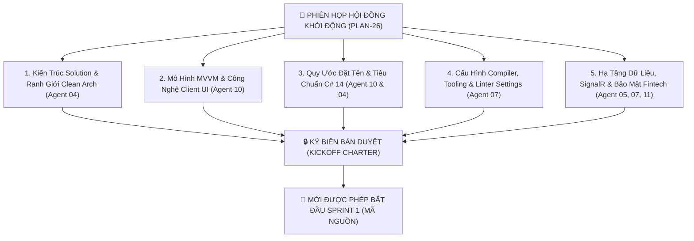

# KẾ HOẠCH PLAN-26: QUY CHUẨN KHỞI ĐỘNG DỰ ÁN .NET MAUI & ASP.NET CORE ENTERPRISE
## PHIÊN HỌP THIẾT LẬP NGUYÊN TẮC PHÁT TRIỂN & CHUẨN MỰC KỸ NGHỆ (KICKOFF GOVERNANCE SESSION)

---

> **Mã kế hoạch:** `PLAN-26`  
> **Ngày ban hành:** 14/10/2026  
> **Phân loại:** Kế hoạch Khởi động & Quản trị Kiến trúc (Architecture Governance & Kickoff Protocol)  
> **Phạm vi áp dụng:** Phân hệ Doanh nghiệp `mobile-project/dotnet-maui-ver/` (Bao gồm **Bài Thi Cuối Kỳ Môn Mobile** và **Hệ Thống Lớn Toàn Diện Cho Khóa Luận Tốt Nghiệp / PTTKHTTT**)  
> **Chủ trì thẩm định:** Hội đồng Đa Tác tử (Agent 00 Orchestrator, Agent 04 Eric Evans, Agent 10 Dan Abramov, Agent 05 Martin Kleppmann, Agent 07 Werner Vogels, Agent 11 Bruce Schneier, Agent 12 Kent Beck)  
> **Mục tiêu tối thượng:** Thiết lập lệnh phong tỏa phát triển (*Zero-Code Freeze*): Bắt buộc tiến hành **Phiên họp Hội đồng toàn diện** để thống nhất bộ quy chuẩn kiến trúc, quy tắc đặt tên, cấu trúc code, tiêu chuẩn C# 14, cấu hình compiler/linter và các settings bắt buộc trước khi lập trình viên bắt tay viết dòng code đầu tiên.

---

## 1. NGUYÊN TẮC ĐỊNH HƯỚNG CỐT TỬ (CORE DIRECTIVE)

Khác biệt hoàn toàn với phân hệ React Native ở bài giữa kỳ (chỉ mang tính chất Scoped MVP thử nghiệm mô hình trong phạm vi môn học 10–15 tuần), phân hệ **.NET MAUI 10 (LTS) & ASP.NET Core Web API** là **dự án cấp doanh nghiệp (Enterprise-Grade)**, là bộ mặt khoa học và kỹ thuật của toàn bộ đề tài Khóa luận Tốt nghiệp Đại học:

```text
┌──────────────────────────────────────────────────────────────────────────────────┐
│                         NGUYÊN TẮC KHỞI ĐỘNG BẤT BIẾN                             │
│                                                                                  │
│  "KHI NÀO BẮT TAY LÀM PROJECT .NET MAUI, VIỆC ĐẦU TIÊN BẮT BUỘC PHẢI LÀM LÀ:     │
│   TRIỆU TẬP PHIÊN HỌP HỘI ĐỒNG THIẾT LẬP NGUYÊN TẮC XÂY DỰNG (KICKOFF SESSION)    │
│   TUYỆT ĐỐI KHÔNG CODE TÙY TIỆN KHI CHƯA KHÓA BỘ QUY CHUẨN PHÁT TRIỂN!"        │
│                                                                                  │
│  - Không làm kiểu "thử nghiệm" hay "chơi chơi" như bài giữa kỳ.                  │
│  - Phải tuân thủ nghiêm ngặt Clean Architecture, DDD, MVVM và C# 14 LTS.         │
│  - Mọi lập trình viên tham gia phải nắm rõ 100% settings trước khi code.         │
└──────────────────────────────────────────────────────────────────────────────────┘
```

---

## 2. NỘI DUNG NGHỊ TRÌNH CỦA PHIÊN HỌP HỘI ĐỒNG KHỞI ĐỘNG (KICKOFF AGENDA)

Khi phiên họp khởi động được kích hoạt, Hội đồng Đa tác tử và Đội ngũ phát triển phải thảo luận và biểu quyết thông qua 5 Trụ cột Quy chuẩn kỹ thuật:



---

### TRỤ CỘT 1: KIẾN TRÚC SOLUTION & PHÂN LỚP CLEAN ARCHITECTURE (AGENT 04 - ERIC EVANS)

1. **Ranh giới phụ thuộc bất biến (Dependency Inversion Principle):**
   - Tầng `Domain` nằm ở trung tâm tuyệt đối, không phụ thuộc vào bất kỳ thư viện ngoài nào (kể cả EF Core hay MAUI).
   - Tầng `Application` chỉ phụ thuộc vào `Domain`, tổ chức Use Cases theo mô hình **CQRS (Command Query Responsibility Segregation)** kết hợp MediatR.
   - Tầng `Infrastructure` hiện thực các Interfaces (Database Repositories, AI Vision OCR Service, SignalR Hub, Cryptography).
   - Tầng `Presentation` gồm 2 dự án: `ExpenseApp.Api` (ASP.NET Core REST/SignalR) và `ExpenseApp.Maui` (Mobile/Desktop Client).
2. **Cấu trúc Solution `ExpenseApp.sln` chuẩn mực:**
   ```text
   ExpenseApp.sln
   ├── src/
   │   ├── 01.Core/
   │   │   ├── ExpenseApp.Domain/               # Entities, Value Objects, Enums, Domain Events
   │   │   └── ExpenseApp.Application/          # Commands, Queries, Handlers, Validators, DTOs
   │   │
   │   ├── 02.Infrastructure/
   │   │   ├── ExpenseApp.Infrastructure/       # EF Core 10, Repositories, Database Migrations
   │   │   ├── ExpenseApp.Infrastructure.Realtime/ # SignalR Hubs & Push Gateway
   │   │   └── ExpenseApp.Infrastructure.AI/    # Vision OCR Pipeline & Math Auditing
   │   │
   │   ├── 03.Presentation/
   │   │   ├── ExpenseApp.Api/                  # ASP.NET Core Web API Host (.NET 10 LTS)
   │   │   └── ExpenseApp.Maui/                 # .NET MAUI Client (Android, iOS, Windows 11)
   │   │
   │   └── 04.Shared/
   │       └── ExpenseApp.Contracts/            # Shared DTOs, API Interfaces (Refit), SignalR Events
   └── tests/
       ├── ExpenseApp.Domain.UnitTests/
       ├── ExpenseApp.Application.UnitTests/
       └── ExpenseApp.IntegrationTests/
   ```

---

### TRỤ CỘT 2: MÔ HÌNH MVVM & QUY CHUẨN CLIENT .NET MAUI (AGENT 10 - DAN ABRAMOV)

1. **Bộ công cụ cốt lõi:**
   - Sử dụng chính thức **`CommunityToolkit.Mvvm`** (phiên bản mới nhất).
   - Tận dụng tối đa Roslyn Source Generators:
     - `[ObservableProperty]` cho các biến trạng thái màn hình.
     - `[RelayCommand]` cho các hành vi nút bấm (tự động xử lý `CanExecute` và `async/await`).
     - `[NotifyCanExecuteChangedFor]` để kiểm soát bật/tắt nút bấm realtime.
2. **Quy tắc View - ViewModel:**
   - 100% XAML Pages (`*Page.xaml`) phải gắn liền với một ViewModel tương ứng (`*ViewModel.cs`).
   - Tuyệt đối **không viết logic nghiệp vụ vào Code-behind (`*Page.xaml.cs`)**. Code-behind chỉ được chứa logic khởi tạo view hoặc animation thuần túy nếu XAML không hỗ trợ.
   - Sử dụng `Compiled Bindings` (`x:DataType="vm:DashboardViewModel"`) trên tất cả các XAML Views để tối ưu hóa hiệu năng AOT và bắt lỗi gõ sai thuộc tính ngay khi biên dịch (compile-time).

---

### TRỤ CỘT 3: QUY ƯỚC ĐẶT TÊN & TIÊU CHUẨN LẬP TRÌNH C# 14 (AGENT 10 & AGENT 04)

Hội đồng quy định bảng quy ước đặt tên bắt buộc cho toàn bộ giải pháp:

| Đối tượng mã nguồn | Quy tắc đặt tên | Ví dụ chuẩn mực | Ghi chú cấm đoán |
| :--- | :--- | :--- | :--- |
| **Interfaces** | PascalCase, tiền tố `I` | `IWalletRepository`, `ITransactionService` | Cấm bỏ chữ `I` đầu |
| **Entities** | PascalCase, danh từ số ít | `Wallet`, `Transaction`, `Budget` | Cấm đặt số nhiều (`Wallets`) |
| **Value Objects** | PascalCase, danh từ mô tả | `Money`, `DateRange`, `AuditMetadata` | Phải là `record struct` bất biến |
| **DTOs** | PascalCase, hậu tố `Dto`/`Request`/`Response` | `CreateTransactionRequest`, `WalletBalanceResponse` | Phải là C# `record` |
| **Commands & Queries** | Động từ + Danh từ + Hậu tố | `CreateTransactionCommand`, `GetBudgetStatusQuery` | Tuân thủ CQRS |
| **ViewModels** | Tên màn hình + `ViewModel` | `DashboardViewModel`, `AddTransactionViewModel` | Cấm đặt `DashboardVM` |
| **Views / Pages** | Tên màn hình + `Page` | `DashboardPage.xaml`, `TransactionsPage.xaml` | Cấm đặt chung chung |
| **Async Methods** | PascalCase, hậu tố `Async` | `GetBalanceAsync()`, `ExecutePaymentAsync()` | Mọi hàm async bắt buộc có `Async` |
| **Private Fields** | camelCase, tiền tố `_` | `_walletRepository`, `_signalRClient` | Cấm dùng `this.walletRepository` |

#### Các tính năng C# 14 bắt buộc áp dụng:
- **File-scoped namespaces:** `namespace ExpenseApp.Domain.Entities;` (không lùi lề thừa thãi).
- **Nullable Reference Types kích hoạt:** `<Nullable>enable</Nullable>` (diệt trừ hoàn toàn `NullReferenceException`).
- **Primary Constructors:** Dùng primary constructor trực tiếp trên Class/Record cho Dependency Injection gọn gàng.
- **Pattern Matching & Switch Expressions:** Thay thế toàn bộ các chuỗi `if-else if` lồng nhau phức tạp.
- **`Money` Value Object:** Tuyệt đối dùng kiểu `decimal` cho tiền tệ, cấm dùng `double` hoặc `float`.

---

### TRỤ CỘT 4: THIẾT LẬP COMPILER, BUILD PROPS & LINTER SETTINGS (AGENT 07 - WERNER VOGELS)

Trước khi code, đội ngũ phải tạo sẵn 3 tệp cấu hình cấp gốc để áp đặt luật chơi cho toàn bộ máy lập trình viên:

#### 1. Tệp `Directory.Build.props` (Cấu hình chung toàn bộ Projects):
```xml
<Project>
  <PropertyGroup>
    <TargetFramework>net10.0</TargetFramework>
    <LangVersion>14</LangVersion>
    <Nullable>enable</Nullable>
    <ImplicitUsings>enable</ImplicitUsings>
    <!-- Nghiêm ngặt: Xem mọi Cảnh báo như Lỗi biên dịch -->
    <TreatWarningsAsErrors>true</TreatWarningsAsErrors>
    <EnforceCodeStyleInBuild>true</EnforceCodeStyleInBuild>
    <AnalysisLevel>latest-recommended</AnalysisLevel>
  </PropertyGroup>
</Project>
```

#### 2. Tệp `Directory.Packages.props` (Central Package Management - CPM):
- Tập trung hóa toàn bộ phiên bản NuGet Packages vào 1 tệp duy nhất.
- Đảm bảo Client và Server dùng chung chính xác cùng một phiên bản thư viện, không bị lệch version gây xung đột runtime.

#### 3. Tệp `.editorconfig` (Đồng bộ hóa IDE Visual Studio / Rider / Antigravity):
- Thụt lề chuẩn 4 spaces (XAML 2 spaces).
- Tự động xóa unused using directives.
- Yêu cầu `var` khi kiểu dữ liệu đã rõ ràng hiển nhiên, và kiểu tường minh khi cần nhấn mạnh.

---

### TRỤ CỘT 5: HẠ TẦNG DỮ LIỆU, SIGNALR REALTIME & BẢO MẬT FINTECH (AGENT 05, 07, 11)

1. **Cơ sở dữ liệu & ORM (Agent 05 - Martin Kleppmann):**
   - **Backend Server:** PostgreSQL hoặc SQL Server, quản lý qua **Entity Framework Core 10 Migrations**.
   - **Client Local Storage:** **SQLite-net-pcl** hoặc **EF Core SQLite** kết hợp thư viện mã hóa **SQLCipher (AES-256)** để bảo vệ dữ liệu khi thiết bị bị mất.
   - Giao dịch cập nhật số dư đa ví bắt buộc dùng Pessimistic Locking hoặc Isolation Level `Serializable` để chống race conditions.
2. **Kênh Thời Gian Thực SignalR (Agent 07 - Werner Vogels):**
   - Xây dựng Strongly-typed Hub: `Hub<IExpenseHubClient>`.
   - Kết nối tự động khôi phục mạng (*Automatic Reconnect*) với thuật toán lùi lũy thừa (*Exponential Backoff*).
   - Tối ưu hóa giao thức truyền tải bằng nhị phân **MessagePack Protocol** thay vì chuỗi JSON thô.
3. **Bảo mật Cấp Ngân Hàng (Agent 11 - Bruce Schneier):**
   - Lưu trữ Refresh Token và Secret Key trong **MAUI SecureStorage** (tích hợp phần cứng Android KeyStore & iOS Keychain).
   - Tuyệt đối cấm hardcode chuỗi kết nối Database, API Secret hay API Keys trong source code (bắt buộc dùng `appsettings.json` + User Secrets hoặc Environment Variables).
   - Tích hợp xác thực sinh trắc học vân tay / Face ID khi mở app.

---

## 3. CHECKLIST ĐIỀU KIỆN TIÊN QUYẾT TRƯỚC KHI BẮT ĐẦU SPRINT 1

Lập trình viên chỉ được phép gõ dòng code tính năng đầu tiên khi đã tích đủ **7/7 tiêu chí tiên quyết**:

- [ ] **Tiêu chí 1:** Đã triệu tập phiên họp và thống nhất bản cam kết PLAN-26.
- [ ] **Tiêu chí 2:** Tệp `ExpenseApp.sln` đã được khởi tạo với cấu trúc 4 nhóm thư mục Clean Architecture.
- [ ] **Tiêu chí 3:** Tệp `Directory.Build.props` và `Directory.Packages.props` đã được cấu hình với `<TreatWarningsAsErrors>true</TreatWarningsAsErrors>`.
- [ ] **Tiêu chí 4:** Tệp `.editorconfig` đã được kích hoạt trên repository.
- [ ] **Tiêu chí 5:** Thư viện `ExpenseApp.Contracts` (Shared) đã định nghĩa xong `Money` struct và các DTOs nền tảng.
- [ ] **Tiêu chí 6:** Kênh giao tiếp SignalR Hub Interface đã được ký kết contract giữa FE và BE.
- [ ] **Tiêu chí 7:** Bộ kiểm thử mẫu `UnitTests` đã chạy thử nghiệm thành công trên CI/Local runner.

---

## 4. KẾT LUẬN & HIỆU LỰC

Bản kế hoạch `PLAN-26` này là **kim chỉ nam tối cao** cho toàn bộ quá trình phát triển phân hệ .NET MAUI và ASP.NET Core Enterprise. Khi nhóm hoàn thành bảo vệ bài giữa kỳ môn Lập trình Mobile bằng phân hệ React Native, toàn bộ trọng tâm kỹ thuật sẽ được kích hoạt theo đúng quy chuẩn tại văn bản này.
