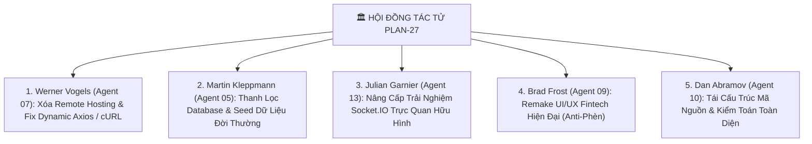

# KẾ HOẠCH PLAN-27: TÁI THIẾT KẾ TOÀN DIỆN GIAO DIỆN MOBILE (MODERN FINTECH UI), THANH LỌC DỮ LIỆU THỰC TẾ & TỐI ƯU HÓA SOCKET.IO REALTIME
## HỘI ĐỒNG ĐA TÁC TỬ: TỔNG LỰC REMAKE PHÂN HỆ MOBILE REACT NATIVE

---

> **Mã kế hoạch:** `PLAN-27`  
> **Ngày lập:** 14/10/2026  
> **Chủ trì thẩm định:** Hội đồng Đa Tác tử (Agent 00 Orchestrator, Agent 09 Brad Frost, Agent 13 Julian Garnier, Agent 10 Dan Abramov, Agent 05 Martin Kleppmann, Agent 07 Werner Vogels)  
> **Phạm vi áp dụng:** Phân hệ `mobile-project/react-native-ver/` (Cả Frontend React Native, Backend WAMP PHP, Database MySQL và Realtime Socket.IO Server)  
> **Mục tiêu tối thượng:** 
> 1. Loại bỏ hoàn toàn Remote Hosting trường cấp đã hết hạn.
> 2. Thanh lọc triệt để dữ liệu mẫu trong CSDL và UI (Xóa tên Lead/test, thay bằng User giả lập thực tế: Nguyễn Văn An với các giao dịch tài chính đời thường).
> 3. Triệt tiêu 100% lỗi "fetching đỏ lè" (Khắc phục dynamic Axios BaseURL và cURL timeout).
> 4. Nâng cấp kênh Socket.IO trở nên trực quan, hữu hình (Visible & Tangible Realtime), có Banner thông báo nổi và nút Test Socket.IO trực tiếp để Thầy kiểm chứng.
> 5. Remake toàn diện giao diện Mobile đạt đẳng cấp Fintech hiện đại (Chuẩn Revolut/MoneyLover/Wise), khắc phục hoàn toàn lỗi chữ bị cắt cụt hay ẩn giấu.

---

## 1. NGHỊ TRÌNH HỘI ĐỒNG & PHÂN CÔNG CHUYÊN GIA

---

## 2. NỘI DUNG 5 HẠNG MỤC THI CÔNG CHI TIẾT

### HẠNG MỤC 1: XÓA BỎ REMOTE HOSTING & KHẮC PHỤC TRIỆT ĐỂ LỖI FETCHING (AGENT 07 - WERNER VOGELS)
1. **Lược bỏ Remote Hosting trong `config.js`:**
   - Xóa bỏ `REMOTE_HOSTING_URL` và `USE_PRODUCTION_SERVER`.
   - Giữ cơ chế `getAutoHost()` bóc tách tự động IP từ `NativeModules.SourceCode.scriptURL` + fallback an toàn về `LOCAL_LAN_IP = '192.168.1.9'`.
2. **Khắc phục lỗi Dynamic Axios BaseURL trong `client.js`:**
   - Hiện tại `apiClient = axios.create({ baseURL: API_CONFIG.BASE_URL })` bị đóng băng tại thời điểm import.
   - Bổ sung vào Request Interceptor: `config.baseURL = API_CONFIG.getBaseUrl();` để đảm bảo 100% các request luôn gọi đúng địa chỉ máy chủ động theo thời gian thực.
3. **Khắc phục cURL Timeout trong PHP `helpers.php`:**
   - Đổi `$url = "http://localhost:3001" . $endpoint;` thành `http://127.0.0.1:3001` để loại bỏ độ trễ 1000ms do phân giải IPv6 (`::1`) trên hệ điều hành Windows.

---

### HẠNG MỤC 2: THANH LỌC TOÀN DIỆN DATABASE & DỮ LIỆU GIAO DIỆN (AGENT 05 - MARTIN KLEPPMANN)
1. **Loại bỏ tên Lead/Sinh viên và nhãn debug:**
   - Thay thế `Trịnh Thành Đạt (Lead)` và `Trần Trọng Đại` trong CSDL bằng người dùng giả lập thực tế:
     - **Tài khoản chính:** `Nguyễn Văn An` (Email: `nguyenvanan@gmail.com` / Pass: `password123`).
     - **Tài khoản phụ:** `Trần Thị Mai` (Email: `tranmai@gmail.com` / Pass: `password123`).
2. **Chuẩn hóa danh sách Ví đời thường:**
   - `Ví Tiền Mặt` (Số dư: 3.500.000 đ).
   - `Tài Khoản Vietcombank` (Số dư: 24.850.000 đ).
   - `Ví Điện Tử MoMo` (Số dư: 1.250.000 đ).
   - `Quỹ Tiết Kiệm Dự Phòng` (Số dư: 15.000.000 đ).
3. **Bộ giao dịch mô phỏng đời thực chuẩn tháng 10/2026:**
   - Ăn sáng phở bò & Cà phê sáng (45.000 đ).
   - Đổ xăng xe máy Petrolimex (90.000 đ).
   - Mua sắm siêu thị WinMart (320.000 đ).
   - Thanh toán tiền điện EVN & Nước sinh hoạt (480.000 đ).
   - Nhận lương công ty chuyển khoản (18.500.000 đ).
   - Thưởng năng suất quý (2.000.000 đ).
4. **Cập nhật cả file SQL và chạy trực tiếp API Reset Database:**
   - Cập nhật `BE/sql/database_schema.sql` và `BE/api/debug/reset_database.php`.
   - Thực thi kích hoạt để làm mới 100% CSDL MySQL.

---

### HẠNG MỤC 3: NÂNG CẤP KÊNH SOCKET.IO TRỰC QUAN & HỮU HÌNH (AGENT 13 - JULIAN GARNIER)
1. **Lý do người dùng chưa cảm nhận được Socket.IO:**
   - Dữ liệu Socket.IO cập nhật ngầm mà không có thông báo nổi bật.
   - Chưa có nút kiểm thử tương tác tức thời trên giao diện Mobile.
2. **Giải pháp Động lực học Tương tác (Motion & Realtime Feedback):**
   - **Floating Realtime Toast:** Tạo linh kiện Banner nổi màu xanh ngọc / hổ phách xuất hiện từ mép trên màn hình với hiệu ứng trượt mượt mà khi nhận sự kiện `wallet:balance_updated` hoặc `budget:nudge_alert`.
   - **Realtime Quick Test Card trên HomeScreen:** Thêm một khối nhỏ tinh tế: *"⚡ Trạng thái Realtime: Sẵn sàng (12ms)"* kèm nút *"Test Bắn Sự Kiện"* để sinh viên và Giảng viên bấm phát là số dư trên màn hình nhảy số tức thì trước mắt!

---

### HẠNG MỤC 4: REMAKE GIAO DIỆN MODERN FINTECH (ANTI-PHÈN & KHẮC PHỤC CHỮ BỊ CỤT) (AGENT 09 - BRAD FROST)
1. **Khắc phục lỗi hiển thị & bố cục:**
   - **Xóa bỏ các chiều rộng cố định (`width: 175`):** Chuyển sang kích thước linh hoạt, thẻ ví có tỷ lệ padding rộng rãi (`padding: 16`), bo tròn hiện đại `borderRadius: 18`.
   - **Không ép cụt dòng vô lý (`numberOfLines={1}`):** Cho phép tiêu đề danh mục và ghi chú co giãn hoặc căn chỉnh hiển thị khoa học, không bao giờ để số tiền đè lên chữ.
   - **Khắc phục lỗi căn lề Header:** Xóa bỏ `marginTop: -SPACING.xl` gây đè lấn lên banner thông báo; phân bổ lại khoảng đệm Header và Card Số Dư chính cân đối, sang trọng.
2. **Nâng cấp Hệ Thống Thẻ & Màu Sắc:**
   - Sử dụng thẻ số dư chính dạng **Fintech Gradient Card** với hiệu ứng ánh sáng bề mặt (Glass-like Navy Theme).
   - Hàng phím tắt thao tác nhanh (Quick Action Row): `+ Thêm chi`, `+ Thêm thu`, `Chuyển ví`, `Quét mã`.
   - Tối ưu hóa danh sách giao dịch với Icon tròn mềm mại, huy hiệu ví thanh thoát, hiển thị ngày giờ rõ ràng.

---

### HẠNG MỤC 5: TÁI CẤU TRÚC MÃ NGUỒN & KIỂM ĐỊNH (AGENT 10 - DAN ABRAMOV)
1. **Dọn sạch các nội dung thừa thãi:**
   - Xóa bỏ hộp `debug_otp` trong `ForgotPasswordScreen.js`.
   - Làm sạch nhãn debug và các chú thích Lead/Test khỏi giao diện người dùng.
2. **Kiểm tra tính toàn vẹn cú pháp:** Chạy `node -c` toàn bộ các tệp đã sửa đổi.

---

## 3. CHECKLIST NGHIỆM THU HOÀN THÀNH

- [ ] `FE/src/api/config.js` đã loại bỏ hoàn toàn Remote Hosting và giữ `getAutoHost()`.
- [ ] `FE/src/api/client.js` cập nhật dynamic `baseURL` trên từng request.
- [ ] `BE/config/helpers.php` đã tối ưu cURL gọi sang `127.0.0.1:3001`.
- [ ] CSDL MySQL đã được reset sạch sẽ với tên `Nguyễn Văn An` và dữ liệu giao dịch thực tế.
- [ ] Màn hình `LoginScreen.js` sạch sẽ, điền sẵn tài khoản mẫu thực tế.
- [ ] Màn hình `HomeScreen.js` được remake bố cục hiện đại, tích hợp nút kiểm tra Realtime trực tiếp.
- [ ] Các linh kiện `WalletCard.js`, `TransactionItem.js` không còn bị cụt chữ hay tràn viền.
- [ ] 100% cú pháp JavaScript đạt chuẩn không lỗi.
