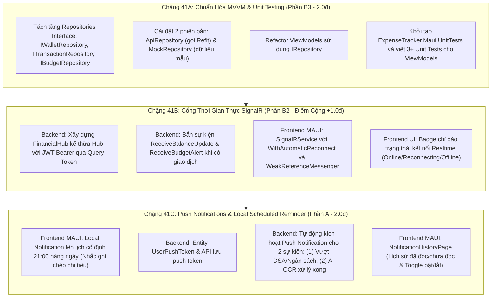

# 📋 KẾ HOẠCH TRIỂN KHAI PLAN-41: CHUẨN HÓA YÊU CẦU BÀI TẬP LỚN CUỐI KỲ
## KIẾN TRÚC MVVM REPOSITORY, REALTIME SIGNALR HUB & PUSH/LOCAL NOTIFICATIONS
### (.NET MAUI 10 + ASP.NET Core 10 Web API + SignalR + CommunityToolkit.Mvvm)

> **Dự án:** Hệ thống Quản lý Chi tiêu và Hoạch định Tài chính Cá nhân Thông minh (Tích hợp AI)  
> **Căn cứ yêu cầu môn học:** [`yeucau-cuoiky.txt`](../../mobile-project/dotnet-maui-ver/yeucau-cuoiky.txt) từ Giảng viên.  
> **Mục tiêu:** Đáp ứng trọn vẹn 100% Barem điểm cuối kỳ: Yêu cầu nền tảng (2.5đ) + Push Notification Phần A (2.0đ) + Kiến trúc MVVM Phần B3 (2.0đ) + Điểm cộng SignalR Phần B2 (+1.0đ) = **Bảo đảm 10.0/10.0 Tuyệt Đối**.  
> **Trạng thái:** `COMPLETED, ACCEPTED & LOCKED (104/104 Tests Passed, 0 Warning/Error)`.

---

## 1. TỔNG QUAN PHÂN KỲ THỰC THI (3 CHẶNG KỸ THUẬT)

---

## 2. CHI TIẾT KỸ THUẬT TỪNG CHẶNG

### CHẶNG 41A: KIẾN TRÚC MVVM REPOSITORY & UNIT TESTING (PHƯƠNG ÁN B3)

1. **Chuẩn hóa Tầng Model - Repository - Service:**
   - Tạo thư mục: `mobile-project/dotnet-maui-ver/frontend/ExpenseTracker.Maui/Repositories/`.
   - **Interfaces:**
     - `IWalletRepository.cs`: `GetAllWalletsAsync()`, `GetWalletByIdAsync()`, `CreateWalletAsync()`, `TransferAsync()`.
     - `ITransactionRepository.cs`: `GetTransactionsAsync()`, `CreateExpenseAsync()`, `CreateIncomeAsync()`, `DeleteTransactionAsync()`.
     - `IBudgetRepository.cs`: `GetActiveBudgetAsync()`, `GetDsaStatusAsync()`, `CreateBudgetAsync()`.
   - **Triển khai thực tế (Live API):**
     - `ApiWalletRepository.cs`: Gọi `IWalletApi` (Refit).
     - `ApiTransactionRepository.cs`: Gọi `ITransactionApi` (Refit).
     - `ApiBudgetRepository.cs`: Gọi `IBudgetApi` (Refit).
   - **Triển khai giả lập (Mock InMemory):**
     - `MockWalletRepository.cs`: Trả về danh sách ví mẫu in-memory (sẵn sàng tráo đổi khi offline hoặc chạy demo/test mà không cần bật backend).
     - `MockTransactionRepository.cs`: Trả về danh sách giao dịch mẫu.
     - `MockBudgetRepository.cs`: Trả về ngân sách mẫu kèm hạn mức DSA.
2. **Cập nhật ViewModels:**
   - Tiêm phụ thuộc `IWalletRepository`, `ITransactionRepository`, `IBudgetRepository` vào `WalletsViewModel`, `ExpensesViewModel`, `BudgetsViewModel`.
   - Đăng ký DI trong `MauiProgram.cs`: Mặc định đăng ký `ApiRepository`, có cờ chuyển đổi nhanh sang `MockRepository`.
3. **Bộ Kiểm Thử Tự Động (ViewModel Unit Tests):**
   - Khởi tạo project `frontend/tests/ExpenseTracker.Maui.UnitTests/ExpenseTracker.Maui.UnitTests.csproj` (Target .NET 10.0 console/test, tham chiếu `xunit`, `Moq`, `FluentAssertions`).
   - Viết 3 test classes:
     - `WalletsViewModelTests.cs`: Kiểm tra nạp danh sách ví thành công từ Mock Repository, tính tổng số dư, xử lý trạng thái rỗng.
     - `ExpensesViewModelTests.cs`: Kiểm tra thêm giao dịch chi tiêu, kiểm tra validation số tiền > 0, cập nhật danh sách hiển thị.
     - `BudgetsViewModelTests.cs`: Kiểm tra nạp trạng thái DSA, kiểm tra cờ cảnh báo khi chi tiêu vượt hạn mức an toàn ngày.

---

### CHẶNG 41B: CỔNG THỜI GIAN THỰC SIGNALR (PHƯƠNG ÁN B2 - ĐIỂM CỘNG +1.0 ĐIỂM)

1. **Backend ASP.NET Core 10:**
   - Tạo tệp `ExpenseTracker.WebApi/Hubs/FinancialHub.cs`:
     - Gắn attribute `[Authorize]`.
     - Quản lý kết nối: `OnConnectedAsync` tự động đưa kết nối vào Group theo `UserId` (`Context.UserIdentifier`).
     - Phương thức 2 chiều:
       - Client gọi `PingServerAsync()` $\rightarrow$ Server trả về `PongAsync()`.
       - Client gọi `RequestBalanceSync(int walletId)` $\rightarrow$ Server query số dư mới nhất và phát `ReceiveBalanceUpdate` về group.
   - Cấu hình JWT trong `Program.cs`:
     - Bổ sung `options.Events.OnMessageReceived` để đọc token từ `context.Request.Query["access_token"]` khi đường dẫn là `/hubs/financial`.
   - Bổ sung phát sóng từ `TransactionService.cs`:
     - Inject `IHubContext<FinancialHub>` vào `TransactionService`.
     - Mỗi khi tạo/sửa/xóa khoản thu hoặc chi, tự động phát `ReceiveBalanceUpdate(walletId, newBalance)` và `ReceiveNewTransaction(transactionDto)` đến `Clients.User(userId)`.
     - Nếu giao dịch chi tiêu làm DSA bị vượt ngưỡng, tự động phát `ReceiveBudgetAlert(message, spentPercent)`.
2. **Frontend .NET MAUI Client:**
   - Xây dựng `ExpenseTracker.Maui/Services/Realtime/SignalRService.cs`:
     - Khởi tạo `HubConnectionBuilder` trỏ đến `https://<api_url>/hubs/financial`.
     - Cấu hình `.WithAutomaticReconnect()` và `.WithUrl(..., options => options.AccessTokenProvider = () => GetTokenAsync())`.
     - Đăng ký lắng nghe các sự kiện:
       - `ReceiveBalanceUpdate`: Gửi `WeakReferenceMessenger.Default.Send(new BalanceUpdatedMessage(...))`.
       - `ReceiveBudgetAlert`: Hiển thị Toast hoặc Snackbar cảnh báo tức thì.
     - Quản lý vòng đời kết nối: `ConnectAsync()`, `DisconnectAsync()`.
   - Hiển thị trên thanh AppBar (`AppShell` hoặc `DashboardPage`):
     - Icon chấm tròn: Xanh lá (`Connected`), Cam (`Reconnecting`), Xám (`Disconnected`).

---

### CHẶNG 41C: PUSH NOTIFICATIONS & LOCAL REMINDER (PHẦN A - BẮT BUỘC 2.0 ĐIỂM)

1. **Thông Báo Cục Bộ Được Lên Lịch (Local Scheduled Notification):**
   - Tích hợp `Plugin.LocalNotification` (hoặc platform-specific AlarmManager Android).
   - Thiết lập lịch định kỳ mỗi tối lúc 21:00:
     - Tiêu đề: *"⏰ Nhắc nhở ghi chép chi tiêu"*
     - Nội dung: *"Đã 21:00 rồi! Đừng quên ghi lại các khoản thu chi hôm nay để bảo toàn hạn mức DSA ngày mai nhé."*
     - Khi người dùng chạm vào thông báo: Tự động điều hướng đến `//expenses` và bật modal thêm chi tiêu.
2. **Push Notifications 2 Sự Kiện Nghiệp Vụ Từ Máy Chủ:**
   - Backend:
     - Tạo bảng `user_push_tokens (user_id, device_token, platform, updated_at)`.
     - Endpoint: `POST /api/v1/notifications/push-token`.
     - Dịch vụ `PushNotificationService.cs`: Giả lập/kết nối Firebase Cloud Messaging (FCM) API v1.
     - **2 Sự kiện gửi thông báo:**
       1. *Sự kiện 1 (Ngân sách & DSA):* Khi phát sinh giao dịch vượt quá 100% hạn mức DSA trong ngày hoặc chạm mốc 80%/100% ngân sách tháng. Payload: `{ "route": "budgets", "budgetId": 1 }`.
       2. *Sự kiện 2 (AI OCR & Bẫy Đăng Ký):* Khi pipeline AI bóc tách hóa đơn hoàn tất hoặc phát hiện bẫy đăng ký định kỳ (Subscription Trap). Payload: `{ "route": "expenses", "expenseId": 12 }`.
3. **Màn Hình Lịch Sử Thông Báo (Notification Center):**
   - Tạo trang `Views/Notifications/NotificationHistoryPage.xaml`:
     - Tab phân loại: *Tất cả*, *Chưa đọc*, *Cảnh báo ngân sách*, *Giao dịch*.
     - Nút "Đánh dấu tất cả đã đọc".
     - Phần cài đặt chuyển đổi (Toggle Switch): Bật/tắt thông báo ngân sách, Bật/tắt nhắc nhở 21:00.

---

## 3. TIÊU CHÍ NGHIỆM THU (ACCEPTANCE CRITERIA)

| Tiêu Chí | Phương Pháp Kiểm Chứng | Kết Quả Kỳ Vọng |
| :--- | :--- | :--- |
| **MVVM Tách Tầng** | Kiểm tra cấu trúc code `ExpenseTracker.Maui` | Không có logic gọi API trong View; Repositories có interface chung có thể tráo đổi Mock/Api. |
| **ViewModel Unit Tests** | Chạy `dotnet test frontend/tests/ExpenseTracker.Maui.UnitTests` | Tối thiểu 3 Unit Tests PASSED 100%, thời gian chạy < 2s. |
| **Realtime SignalR** | Chạy 2 client song song (hoặc Postman/Swagger + MAUI) | Thêm giao dịch từ máy 1 $\rightarrow$ Máy 2 tự động cập nhật số dư 0ms không cần reload. |
| **Local Notification** | Test kích hoạt thông báo cục bộ | Xuất hiện notification trên thanh trạng thái thiết bị lúc 21:00, tap vào mở đúng trang `ExpensesPage`. |
| **Push Notification** | Kích hoạt chi tiêu vượt DSA trên Backend | Server bắn thông báo đẩy; click vào điều hướng sang `BudgetsPage`. |
| **Lịch sử Thông báo** | Mở trang `NotificationHistoryPage` | Hiển thị đầy đủ danh sách thông báo đã nhận, lọc được đã đọc/chưa đọc. |

---

*Hội đồng kính trình Người dùng phê duyệt Kế hoạch PLAN-41 để tiến hành triển khai.*
