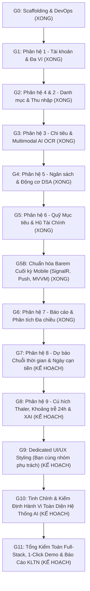

# KẾ HOẠCH PLAN-42: TÁI CẤU TRÚC LỘ TRÌNH DỰ ÁN (ROADMAP REFACTORING) — TÁCH ĐỘC LẬP PHÂN HỆ 8, PHÂN HỆ 9 VÀ THIẾT LẬP GIAI ĐOẠN CHUYÊN BIỆT KIỂM ĐỊNH HÀNH VI HỆ THỐNG AI

> **Ngày khởi tạo:** 2026-10-23  
> **Người đề xuất:** Council Orchestrator (Agent 00) cùng Hội Đồng Chuyên Gia (Agent 08 Andrew Ng, Agent 03 Cockburn BA, Agent 04 Eric Evans).  
> **Căn cứ chỉ đạo từ Người dùng:**  
> 1. Không gộp 2 phân hệ vào 1 giai đoạn; tách độc lập Phân hệ 8 và Phân hệ 9 thành 2 giai đoạn kế tiếp theo quy tắc Vertical Slice.  
> 2. Giai đoạn UI kế tiếp là chặng bàn giao để bạn cùng nhóm phụ trách "đổ áo" giao diện (UI Re-skinning) từ các Wireframe đã gắn Data Binding.  
> 3. Bắt buộc bổ sung một giai đoạn chuyên biệt ngay sau giai đoạn làm UI để kiểm toán, tinh chỉnh và đánh giá hành vi toàn diện hệ thống AI (AI Behavioral Alignment, Prompt Tuning, Evaluation Harness, End-to-End Multimodal AI Pipeline).

---

## 1. BỐI CẢNH & NGUYÊN TẮC THIẾT KẾ MỚI

1. **Nguyên tắc "Đơn phân hệ - Đơn giai đoạn" (Strict Single-Module Phases):**
   - Không nén ép hoặc gộp các phân hệ phức tạp. Phân hệ 8 (Dự báo chuỗi thời gian & Radar rủi ro thâm hụt) và Phân hệ 9 (Cú hích hành vi Thaler, Khoảng trễ 24h & XAI) đều chứa hàm lượng thuật toán và nghiệp vụ rất lớn, cần tách biệt để kiểm toán độc lập theo đúng quy chuẩn Quyết định 116.
2. **Nguyên tắc phân công nhân sự (Team Collaboration Boundary):**
   - Giai đoạn làm UI/UX cao cấp (Giai đoạn 9) được chuẩn bị sẵn sàng toàn bộ Wireframe Pages và Mock Repositories để bạn cùng nhóm có thể tập trung 100% vào việc thiết kế thị giác, styling, theme, chart controls và micro-animations mà không bị vướng mắc mã backend.
3. **Nguyên tắc kiểm định trí tuệ nhân tạo (Data-Centric AI & Behavioral Alignment):**
   - Triển khai AI không chỉ dừng lại ở việc dựng hạ tầng API hay gọi model, mà cốt lõi là kiểm soát **hành vi của AI (AI Behavior)**: độ chính xác bóc tách, khả năng tự học quy tắc, giọng điệu phản hồi đồng cảm, tính giải trình minh bạch (Explainability), loại bỏ hoàn toàn hiện tượng ảo giác (Zero-Hallucination) và đối soát xem giải pháp có giải quyết đúng bài toán chi tiêu cá nhân thực tế hay không.

---

## 2. LỘ TRÌNH CẢI TIẾN 12 GIAI ĐOẠN TOÀN DIỆN (G0 ĐẾN G11)

---

## 3. NỘI DUNG CHI TIẾT CÁC GIAI ĐOẠN TIẾP THEO

### GIAI ĐOẠN 7: PHÂN HỆ 8 — DỰ BÁO TÀI CHÍNH & RADAR RỦI RO THÂM HỤT
- **Phạm vi Use Cases:** `UC-08.01` đến `UC-08.04` (4 Ca sử dụng IEEE 29148)
  - `UC-08.01`: Dự báo tổng chi tiêu cuối chu kỳ bằng mô hình chuỗi thời gian (Time-Series Forecasting) kết hợp trọng số ngày thường và ngày cuối tuần (Weekday/Weekend Effect).
  - `UC-08.02`: Dự phóng Ngày cạn tiền khả dụng (Out-of-Money Date Forecast) và cảnh báo nguy cơ cạn kiệt thanh khoản trước kỳ lương tới.
  - `UC-08.03`: Dự báo nguy cơ thâm hụt danh mục thiết yếu.
  - `UC-08.04`: Mô phỏng kịch bản thu chi giả định (Sandbox What-If Analysis).
- **Phân kỳ chặng:**
  - *Chặng 7A (Backend):* Domain Services, thuật toán hồi quy/chuỗi thời gian, WebApi endpoints `api/forecasting/`.
  - *Chặng 7B (Frontend):* MVVM Repositories (`IForecastingRepository`), `ForecastingViewModel`, Wireframe `ForecastingPage.xaml`.

### GIAI ĐOẠN 8: PHÂN HỆ 9 — CÚ HÍCH TÂM LÝ HÀNH VI THALER, KHOẢNG TRỄ 24H & XAI
- **Phạm vi Use Cases:** `UC-09.01` đến `UC-09.05` (5 Ca sử dụng IEEE 29148)
  - `UC-09.01`: Nhận diện giao dịch mua sắm bốc đồng/xa xỉ và sinh Cú hích hành vi thông minh (Nudge Alert).
  - `UC-09.02`: Giải trình lý do tài chính bằng ngôn ngữ tự nhiên (Explainable AI - XAI).
  - `UC-09.03`: Đề xuất tái cân đối tài chính để bù đắp khoản chi tiêu lớn.
  - `UC-09.04`: Cơ chế phê duyệt của người dùng (Human-in-the-loop Approval).
  - `UC-09.05`: Khoảng trễ tâm lý Cooling-off 24h-48h & Tích hợp tạo mã VietQR Napas 247.
- **Phân kỳ chặng:**
  - *Chặng 8A (Backend):* Nudge Engine, Cooling-off Manager, WebApi endpoints `api/nudges/`.
  - *Chặng 8B (Frontend):* MVVM Repositories (`INudgeRepository`), `NudgesViewModel`, Wireframe `NudgesPage.xaml`.

### GIAI ĐOẠN 9: DEDICATED FRONTEND ART DIRECTION & UI/UX STYLING (BẠN CÙNG NHÓM PHỤ TRÁCH)
- **Mục tiêu:** Bạn cùng nhóm phụ trách thiết kế giao diện tiếp quản toàn bộ hệ thống Wireframe Pages (đã gắn sẵn 100% Data Binding và Repositories):
  - Áp dụng Design Tokens, Typography Plus Jakarta Sans, Color Palettes Slate & Warm Charcoal.
  - Hoàn thiện giao diện Dark Mode / Light Mode, Double-Bezel viền kép cao cấp.
  - Tích hợp điều khiển biểu đồ trực quan (Charts controls) và hiệu ứng chuyển động tương tác.

### GIAI ĐOẠN 10: TINH CHỈNH, KIỂM ĐỊNH HÀNH VI & HOÀN THIỆN TOÀN DIỆN HỆ THỐNG AI (AI BEHAVIORAL ALIGNMENT & MULTIMODAL PIPELINE AUDIT)
- **Chuyên gia chủ trì:** Agent 08 Andrew Ng (AI Pioneer) & Agent 01 Richard Thaler (Behavioral Economics).
> [!IMPORTANT]
> **QUY CHẾ HỌP HỘI ĐỒNG & NGƯỜI DÙNG BẮT BUỘC:** Khi tiến trình dự án chạm đến Giai đoạn 10, Toàn thể Hội đồng Đa tác tử (đặc biệt là Agent 08 Andrew Ng, Agent 01 Richard Thaler, Agent 03 Cockburn BA và Agent 00 Orchestrator) sẽ cùng Người dùng tổ chức một **Phiên Họp Hội Đồng Toàn Diện (Special AI Council Session)** để bàn bạc kỹ lưỡng, mổ xẻ hành vi thực tế của các mô hình AI/Prompt, thiết lập các bộ kịch bản kiểm thử hành vi thực tế và thống nhất định hướng tinh chỉnh trước khi bắt tay thực hiện.
- **Mục tiêu:** Tập trung giải quyết triệt để và toàn diện mọi khía cạnh về AI đã tích hợp từ các giai đoạn trước:
  1. **Kiểm toán Hành vi & Tinh chỉnh Định hướng (Behavioral Alignment):**
     - Đánh giá văn phong và thái độ của Cú hích Thaler Nudge và Trợ lý giải trình XAI: Ngôn từ phải mang tính xây dựng, đồng cảm (Empathetic Finance), không phán xét tiêu cực người dùng, thúc đẩy hành động khắc phục thực tế.
  2. **Tối ưu hóa Prompts & Pipeline Multimodal AI OCR (Prompt Engineering & Eval Harness):**
     - Đánh giá khả năng bóc tách ảnh/PDF hóa đơn và phiếu lương với các mẫu hóa đơn thực tế (hóa đơn siêu thị Co.opmart, WinMart, hóa đơn nhòe, nghiêng góc).
     - Loại bỏ triệt để ảo giác (Zero-Hallucination) thông qua Strict JSON Schema & Mathematical Cross-checking.
  3. **Khép kín Vòng lặp Học tập Thực tế (Continuous Learning Loop):**
     - Kiểm tra tính hiệu quả của cơ chế tự động ghi nhớ quy tắc danh mục (`AutoCategorizationRules`) khi người dùng chỉnh sửa thủ công.
  4. **Kiểm thử Độ nhạy Thuật toán Thống kê & Chuỗi Thời Gian:**
     - Kiểm thử mô hình Z-Score Outlier và Mô hình chuỗi thời gian ngoại suy với các tập dữ liệu biên (Edge cases: chi tiêu đột biến lớn, chu kỳ không có thu nhập, tất cả các giao dịch bằng tiền nhau).
  5. **Tối ưu Độ trễ & Thông báo Tiến trình (Latency & Async Progress UX):**
     - Kiểm soát tiến trình xử lý ảnh theo đúng tiêu chí Đề tài 23 trong barem môn học: `Đã nhận ảnh` $\rightarrow$ `Đang xử lý` $\rightarrow$ `Có kết quả`, thông báo đẩy khi hoàn tất.

### GIAI ĐOẠN 11: TỔNG KIỂM TOÁN FULL-STACK, 1-CLICK DEMO & BÁO CÁO KHÓA LUẬN
- Kiểm toán hồi quy Full-Stack E2E, rà soát rò rỉ RAM và kiểm thử tải k6.
- Script PowerShell 1-Click khởi chạy toàn bộ Backend, Database Docker và MAUI app phục vụ chấm thi.
- Đồng bộ toàn văn số liệu, ảnh chụp màn hình ứng dụng thật vào file Word `KhoaLuanTotNghiep.docx`.
