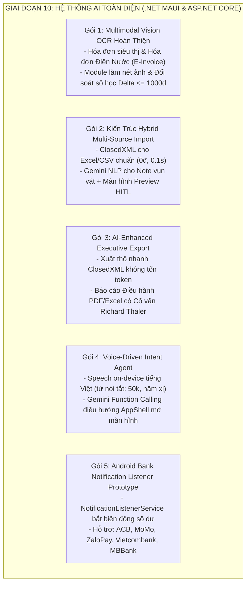
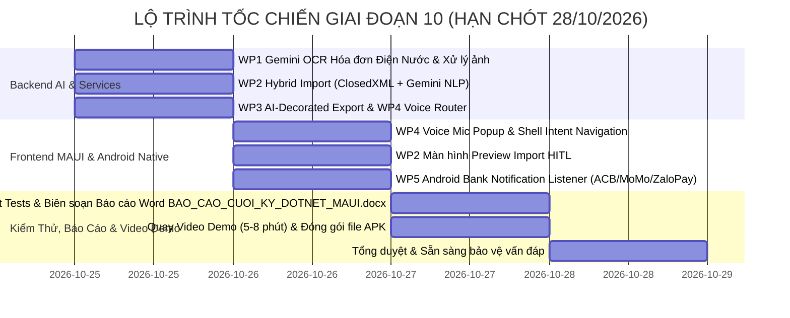

# KẾ HOẠCH PLAN-45: TRIỂN KHAI GIAI ĐOẠN 10 — HỆ THỐNG AI TOÀN DIỆN (MULTIMODAL VISION OCR, VOICE INTENT AGENT, HYBRID IMPORT/EXPORT & ANDROID BANK NOTIFICATION LISTENER PROTOTYPE)

> **Dự án:** Hệ thống Quản lý Chi tiêu và Hoạch định Tài chính Cá nhân Thông minh (Tích hợp AI)  
> **Giai đoạn:** Giai đoạn 10 / 12 Giai đoạn chuẩn hóa (Lộ trình [`PLAN-42`](2026-10-23_plan_42_dieu_chinh_roadmap_tach_phan_he_ai_va_giai_doan_kiem_dinh_ai.md) & [Quyết định 128](../../decisions_and_changes_log.md#L2911))  
> **Căn cứ pháp lý & kỹ thuật:** 
> - Toàn văn Biên bản Phiên họp Hội đồng Toàn diện ngày 24/10/2026 ([`00_bien_ban_hop_hoi_dong_toan_dien_ai.md`](../../sessions/session_giai_doan_10_ai_comprehensive_audit/00_bien_ban_hop_hoi_dong_toan_dien_ai.md)) & Verbatim Q-A ([`01_toan_van_hoi_thoai_qa_phien_hop_giai_doan_10.md`](../../sessions/session_giai_doan_10_ai_comprehensive_audit/01_toan_van_hoi_thoai_qa_phien_hop_giai_doan_10.md));
> - Barem chấm thi cuối kỳ môn Mobile ([`yeucau-cuoiky.txt`](../../mobile-project/dotnet-maui-ver/yeucau-cuoiky.txt) & [`huongdanvietbaocao.txt`](../../mobile-project/react-native-ver/huongdanvietbaocao.txt));
> - Tài liệu bàn giao PTTKHTTT ([`HuongDan_BanGiao_SuaDoi_TaiLieu_PTTKHTTT_AI_MoRong.md`](../../reports/HuongDan_BanGiao_SuaDoi_TaiLieu_PTTKHTTT_AI_MoRong.md)).  
> **Chuyên gia bảo trợ:** Toàn thể Hội đồng Đa tác tử (Agent 08 Andrew Ng - AI Lead, Agent 01 Richard Thaler - Behavioral Lead, Agent 03 Cockburn BA, Agent 04 Eric Evans - DDD Lead, Agent 07 Werner Vogels - DevOps/Realtime Lead, Agent 10 Dan Abramov - Clean MVVM, Agent 11 Bruce Schneier - Security Lead, Agent 12 Kent Beck - TDD Quality Gate).  
> **Mục tiêu tối thượng:** Tập trung toàn lực hoàn thành sản phẩm Ứng dụng Di động .NET MAUI để kịp nộp Video Demo, Báo cáo Word [`BAO_CAO_CUOI_KY_DOTNET_MAUI.docx`](../../mobile-project/dotnet-maui-ver/BAO_CAO_CUOI_KY_DOTNET_MAUI.docx) (sau đó xuất PDF), File APK vào **Thứ Tư, ngày 28/10/2026 (Deadline 1)**.

---

## 1. MỤC TIÊU & PHẠM VI 5 GÓI KỸ THUẬT CỐT LÕI (WORK PACKAGES)



### Gói 1 (WP1): Multimodal Vision OCR Hoàn Thiện (Hóa Đơn Siêu Thị + Điện Nước E-Invoice)
* **Bản chất kỹ thuật:**
  - Kết nối thật vào REST endpoint Google Gemini 2.5 Flash qua AI Gateway Backend (API Key bảo mật trong `appsettings.json`, Free Tier 1.500 req/ngày).
  - Tích hợp module tiền xử lý ảnh (Image Pre-processing: Tăng tương phản Grayscale, căn chỉnh góc nghiêng nhẹ).
  - Hỗ trợ bóc tách 2 loại hóa đơn:
    1. *Hóa đơn bán lẻ siêu thị / quán ăn:* Tên merchant, ngày, từng món, đơn giá, thuế VAT, tổng tiền.
    2. *Hóa đơn Tiền Điện (EVN) & Hóa đơn Nước điện tử (E-Invoice):* Mã danh bộ, kỳ tiêu thụ, chỉ số cũ/mới, sản lượng tiêu thụ ($m^3, kWh$), đơn giá bậc thang, tự động gán danh mục "Hóa đơn & Tiện ích" (50% thiết yếu) và lưu sản lượng vào ghi chú.
  - Thuật toán hậu kiểm toán số học tự động ($\Delta = |\sum ItemTotals + Tax - Discount - TotalAmount| \le 1.000$ đ).
  - Giao diện Review HITL trên MAUI hiển thị nhãn cảnh báo vàng nếu số liệu bị mờ để người dùng xác nhận trước khi lưu.

### Gói 2 (WP2): Kiến Trúc Hybrid Multi-Source Import (Excel Chuẩn & Note Vụn Vặt)
* **Bản chất kỹ thuật:**
  - Giải quyết triệt để vấn đề người dùng có file Excel điện nước nhưng cũng có người chỉ ghi chép vụn vặt vào file note tự do.
  - *Luồng A (Structured Excel/CSV):* Dùng thư viện `ClosedXML` đọc trực tiếp các cột cấu trúc trong 0.1 giây, tốn 0đ, 0 token.
  - *Luồng B (Unstructured Text / Note vụn vặt / Ảnh ghi chép):* Gửi vào Gemini 2.5 Flash với System Prompt suy luận ngữ cảnh (Contextual NLP reasoning) bóc tách các dòng ("15/10: cafe 35k, đổ xăng 50k") thành mảng JSON.
  - *Giao diện MAUI:* Cả 2 luồng đều đổ về **Màn hình Preview HITL (`ImportPreviewPage.xaml`)** dạng bảng danh sách; người dùng có thể chạm sửa nhanh số tiền, đổi danh mục, bỏ chọn dòng rác rồi bấm "Nhập tất cả vào sổ cái" (Bulk ACID Insert).

### Gói 3 (WP3): AI-Enhanced Executive Export (Xuất Báo Cáo Có AI Trang Hoàng)
* **Bản chất kỹ thuật:**
  - Thực thi Luồng phụ A1 của `UC-07.01` với 2 chế độ xuất file:
    1. *Chế độ Xuất thô nhanh (Raw Data Export):* Dùng `ClosedXML` xuất file `.xlsx` danh sách giao dịch và phân bổ 50/30/20 nhanh chóng, không tốn token AI.
    2. *Chế độ Báo cáo Điều hành Thông minh (Smart Executive Report):* Backend tổng hợp các chỉ số tháng (Tổng thu, tổng chi, Savings Rate, Net Worth, Z-Score Outliers, DSA) gửi vào Gemini. AI đóng vai Cố vấn tài chính Richard Thaler viết một đoạn **Nhận định Điều hành (Executive Commentary)** 3-5 câu (đánh giá sức khỏe tài chính, tuyên dương 1 điểm sáng tích lũy, khuyến nghị hành vi).
  - Đoạn nhận định này được trang hoàng trang trọng ở đầu trang PDF hoặc Sheet đầu file Excel (`⭐ TongQuan_CoVanAI`).

### Gói 4 (WP4): Voice-Driven Intent Agent (Nghe, Hiểu Ý Định & Điều Hướng Thao Tác)
* **Bản chất kỹ thuật:**
  - *Voice $\rightarrow$ Text:* MAUI gọi Android Native Speech API (`Android.Speech.SpeechRecognizer`) nhận diện tiếng Việt on-device cực nhanh, miễn phí, nhận diện tốt từ nói tắt ("50k", "50 ka", "năm xị", "2 trẹo rưỡi").
  - *Text $\rightarrow$ Intent Action:* Gửi text vào Gemini Function Calling (Free Tier). Gemini phân loại ý định và trả về JSON:
    + `add_transaction`: Trích xuất số tiền, ví, danh mục để ghi chép nhanh hoặc mở popup xác nhận.
    + `navigate_to`: Trả về Route AppShell (ví dụ: `CreateCategoryPage?name=Nuôi mèo&type=Expense`).
  - MAUI AppShell thực thi lệnh `Shell.Current.GoToAsync(...)` chuyển ngay sang màn hình tạo mới, điền sẵn thông tin và dừng ở nút Lưu chờ người dùng xác nhận (HITL).
  - Tích hợp nút Mic nổi bật trên thanh AppBar và hỗ trợ App Shortcuts (nhấn giữ icon app để nói nhanh).

### Gói 5 (WP5): Android Bank Notification Listener Prototype (ACB, MoMo, ZaloPay, VCB, MBBank)
* **Bản chất kỹ thuật:**
  - Tạo Android Native Service kế thừa `Android.Service.Notification.NotificationListenerService` trong `Platforms/Android/Services/`.
  - Bộ lọc Regex nhận diện tin nhắn trừ tiền từ 5 ứng dụng mục tiêu:
    + ACB: `com.acb.mobile`
    + MoMo: `com.mservice.momotransfer`
    + ZaloPay: `vn.com.vng.zalopay`
    + Vietcombank: `com.VCB`
    + MBBank: `com.mbmobile`
  - Bóc tách số tiền trừ, đơn vị thụ hưởng, và gửi Local Notification: *"Phát hiện Bạn vừa chi tiêu {Số_tiền} VND từ {Tên_App}. Chạm để ghi vào sổ cái!"*.
  - Chạm vào thông báo sẽ mở ngay form lưu chi tiêu với dữ liệu đã điền sẵn 100%.

---

## 2. KIẾN TRÚC KỸ THUẬT & DANH MỤC TẬP TIN XÂY DỰNG

```
mobile-project/dotnet-maui-ver/
├── backend/
│   ├── ExpenseTracker.Application/
│   │   ├── DTOs/
│   │   │   ├── AiAgent/
│   │   │   │   ├── VoiceIntentDtos.cs                  # DTOs: VoiceCommandRequest, VoiceIntentResultDto (Action, Route, PrefillData)
│   │   │   │   └── ExecutiveReportDtos.cs              # DTOs: ExecutiveCommentaryDto, SmartExportRequestDto
│   │   │   └── ImportExport/
│   │   │       ├── HybridImportDtos.cs                 # DTOs: BulkImportRequestDto, ParsedImportRowDto, ImportPreviewResultDto
│   │   │       └── ExportFileDtos.cs                   # DTOs: ExportResultDto (FileBytes, ContentType, FileName)
│   │   ├── Interfaces/
│   │   │   ├── IVoiceIntentRouterService.cs            # Hợp đồng phân loại ý định giọng nói & function calling
│   │   │   ├── IHybridDataImportService.cs             # Hợp đồng nhập khẩu dữ liệu đa nguồn (Excel ClosedXML + Gemini NLP)
│   │   │   ├── IReportExportService.cs                 # Hợp đồng xuất file số liệu (ClosedXML Raw Data + AI Executive Report)
│   │   │   └── IImagePreProcessingService.cs           # Hợp đồng xử lý tiền kỳ ảnh hóa đơn (làm nét, tăng tương phản)
│   │   └── Services/
│   │       ├── ReceiptOcrService.cs                    # NÂNG CẤP: Cắm Gemini Vision thật, hỗ trợ Hóa đơn Điện Nước E-Invoice
│   │       ├── VoiceIntentRouterService.cs             # MỚI: Động cơ Gemini Function Calling bóc tách intent & route
│   │       ├── HybridDataImportService.cs              # MỚI: Động cơ nhập khẩu Hybrid (ClosedXML + Gemini NLP)
│   │       ├── ReportExportService.cs                  # MỚI: Động cơ xuất Excel/PDF kèm lời bình Cố vấn Richard Thaler
│   │       └── ImagePreProcessingService.cs            # MỚI: Module tiền xử lý làm nét ảnh trước khi gửi LLM
│   ├── ExpenseTracker.WebApi/
│   │   └── Controllers/
│   │       ├── ReceiptsController.cs                   # CẬP NHẬT: Upload ảnh hóa đơn điện nước & tiền xử lý
│   │       ├── VoiceAgentController.cs                 # MỚI: api/voice-agent/parse-intent
│   │       ├── DataImportController.cs                 # MỚI: api/data-import/preview & api/data-import/commit-bulk
│   │       └── ReportsController.cs                    # CẬP NHẬT: api/reports/export (raw vs smart executive)
│   └── tests/
│       └── ExpenseTracker.Application.UnitTests/
│           └── Services/
│               ├── ReceiptOcrServiceTests.cs           # Tests OCR hóa đơn điện nước E-Invoice & kiểm toán số học
│               ├── VoiceIntentRouterServiceTests.cs    # Tests phân loại intent: add_transaction vs navigate_to prefill
│               ├── HybridDataImportServiceTests.cs     # Tests import Excel ClosedXML & Text note vụn vặt Gemini
│               └── ReportExportServiceTests.cs         # Tests xuất file ClosedXML & AI Executive Commentary
│
└── frontend/
    ├── ExpenseTracker.Maui/
    │   ├── Models/
    │   │   ├── AiAgent/
    │   │   │   ├── VoiceIntentModels.cs                # Client models: VoiceIntentModel, PrefillDataModel
    │   │   │   └── ExecutiveReportModels.cs            # Client models: ExecutiveReportModel
    │   │   └── ImportExport/
    │   │       └── HybridImportModels.cs               # Client models: ImportPreviewRowModel, BulkCommitModel
    │   ├── Services/
    │   │   ├── Api/
    │   │   │   └── IApiClients.cs                      # Bổ sung Refit contracts: IVoiceAgentApi, IDataImportApi, IReportsExportApi
    │   │   └── Speech/
    │   │       ├── ISpeechRecognitionService.cs        # Interface nhận diện giọng nói on-device
    │   │       └── SpeechRecognitionService.cs         # Implementation gọi Android.Speech.SpeechRecognizer
    │   ├── Platforms/Android/Services/
    │   │   └── BankNotificationListenerService.cs      # MỚI: Service nền Android bắt thông báo ACB, MoMo, ZaloPay, VCB, MBBank
    │   ├── Repositories/
    │   │   ├── ImportExport/
    │   │   │   ├── IDataImportRepository.cs            # Repository Preview & Bulk Commit
    │   │   │   ├── ApiDataImportRepository.cs
    │   │   │   └── MockDataImportRepository.cs         # Mock data phục vụ thiết kế UI độc lập
    │   │   └── VoiceAgent/
    │   │       ├── IVoiceAgentRepository.cs            # Repository gọi intent routing
    │   │       ├── ApiVoiceAgentRepository.cs
    │   │       └── MockVoiceAgentRepository.cs
    │   ├── ViewModels/
    │   │   ├── ImportExport/
    │   │   │   └── ImportPreviewViewModel.cs           # ViewModel quản lý bảng preview, sửa dòng, bulk commit
    │   │   └── VoiceAgent/
    │   │       └── VoiceFloatingMicViewModel.cs        # ViewModel popup mic nói nhanh, nhận diện intent và điều hướng
    │   └── Views/
    │       ├── ImportExport/
    │       │   └── ImportPreviewPage.xaml & .cs        # Wireframe View xem trước danh sách import HITL
    │       └── Popups/
    │           └── VoiceMicModalPopup.xaml & .cs       # Wireframe Modal Popup mic nghe giọng nói và phản hồi haptics
    └── tests/
        └── ExpenseTracker.Maui.UnitTests/
            ├── ImportPreviewViewModelTests.cs          # Tests nạp preview, chỉnh sửa số tiền, bulk commit
            └── VoiceFloatingMicViewModelTests.cs       # Tests xử lý giọng nói, điều hướng AppShell sang tạo danh mục
```

---

## 3. DANH MỤC TDD UNIT TESTS DỰ KIẾN (NÂNG TỪ 233 LÊN $\ge 255$ TESTS)

| STT | Tập Tin Test | Tên Test Case | Kịch Bản & Khẳng Định Kiểm Thử |
| :---: | :--- | :--- | :--- |
| 1 | `ReceiptOcrServiceTests.cs` | `ParseReceipt_WhenUtilityBillEvnWater_ShouldExtractKwhM3AndAssignUtilityCategory` | Nhận diện hóa đơn điện nước E-Invoice, trích xuất sản lượng $m^3/kWh$ và gán đúng danh mục Thiết yếu 50%. |
| 2 | `ReceiptOcrServiceTests.cs` | `ParseReceipt_WhenMathematicalDifferenceWithin1000Vnd_ShouldPassValidation` | Kiểm toán số học $\Delta \le 1.000$ đ đạt chuẩn hợp lệ. |
| 3 | `VoiceIntentRouterServiceTests.cs` | `RouteVoiceTranscript_WhenSpendingCommand_ShouldReturnAddTransactionIntent` | Khẩu lệnh "Ăn trưa 45k tiền mặt" trả về intent `add_transaction` với Amount 45.000 đ. |
| 4 | `VoiceIntentRouterServiceTests.cs` | `RouteVoiceTranscript_WhenNavigationCommand_ShouldReturnNavigateToCategoryPrefill` | Khẩu lệnh "Tạo danh mục mới Nuôi Mèo" trả về intent `navigate_to` với Route `CreateCategoryPage` và PrefillData "Nuôi Mèo". |
| 5 | `HybridDataImportServiceTests.cs` | `ImportFromSpreadsheet_WhenStandardExcelFile_ShouldParseRowsWithoutTokenCost` | Đọc file Excel cấu trúc qua `ClosedXML` trả về đúng danh sách các dòng giao dịch (0 token). |
| 6 | `HybridDataImportServiceTests.cs` | `ImportFromUnstructuredText_WhenNoteFragment_ShouldExtractNormalizedTransactions` | Bóc tách đoạn text ghi chú tự do ("cafe 35k, đổ xăng 50k") thành các dòng chuẩn hóa. |
| 7 | `ReportExportServiceTests.cs` | `ExportRawExcel_ShouldGenerateValidXlsxWorkbookStream` | Xuất file Excel thô chuẩn định dạng `.xlsx` qua `ClosedXML`. |
| 8 | `ReportExportServiceTests.cs` | `ExportSmartExecutiveReport_ShouldContainExecutiveCommentarySheet` | Xuất Báo cáo Điều hành chứa Sheet nhận định của Cố vấn AI Richard Thaler. |
| 9 | `ImportPreviewViewModelTests.cs` | `CommitBulkCommand_WhenConfirmed_ShouldCallRepositoryAndNavigateSuccess` | Xác nhận lưu hàng loạt gọi Repository và điều hướng về trang thành công. |
| 10 | `VoiceFloatingMicViewModelTests.cs` | `ExecuteVoiceCommand_WhenNavigateIntent_ShouldInvokeShellGoToAsync` | Thực thi khẩu lệnh giọng nói kích hoạt điều hướng MAUI Shell sang trang tạo mới. |

---

## 4. LỘ TRÌNH THỰC THI TỐC CHIẾN (CHIẾN DỊCH DEADLINE 28/10/2026)

Vì chỉ còn **3 ngày** trước Deadline nộp sản phẩm Mobile (28/10/2026), Hội đồng thiết lập lịch trình thi công nghiêm ngặt từng giai đoạn:



* **Ngày 1 (Chủ Nhật, 25/10/2026 - Hôm nay):**
  - Hiện thực toàn bộ Backend Giai đoạn 10: `ReceiptOcrService` (Hóa đơn điện nước), `HybridDataImportService` (ClosedXML + Gemini), `ReportExportService` (Xuất báo cáo Cố vấn AI), `VoiceIntentRouterService` (Function Calling).
  - Viết và chạy xanh toàn bộ Unit Tests Backend mới $\rightarrow$ Bảo đảm Backend 100% Passed.
* **Ngày 2 (Thứ Hai, 26/10/2026):**
  - Hiện thực Frontend MAUI: Màn hình `ImportPreviewPage.xaml`, Modal `VoiceMicModalPopup.xaml`, Android Native `BankNotificationListenerService.cs`.
  - Tích hợp điều hướng Shell và Repositories Mock/Real.
  - Viết và chạy Unit Tests Frontend MAUI $\rightarrow$ Đạt $\ge 255$ Tests Passed 100%.
* **Ngày 3 (Thứ Ba, 27/10/2026):**
  - Hỗ trợ Người bạn cùng nhóm rà soát UI hoàn chỉnh.
  - Biên soạn nội dung Báo cáo Word [`BAO_CAO_CUOI_KY_DOTNET_MAUI.docx`](../../mobile-project/dotnet-maui-ver/BAO_CAO_CUOI_KY_DOTNET_MAUI.docx) theo đúng barem [`yeucau-cuoiky.txt`](../../mobile-project/dotnet-maui-ver/yeucau-cuoiky.txt) và [`huongdanvietbaocao.txt`](../../mobile-project/react-native-ver/huongdanvietbaocao.txt) (Người dùng sẽ xuất sang PDF sau).
  - Chuẩn bị Kịch bản Quay Video Demo (5-8 phút) thể hiện: Background Push Notification, SignalR 2 thiết bị cập nhật đồng thời, Voice Intent điều hướng, và Chạy Unit Test kiểm thử cấu trúc MVVM.
  - Build file cài đặt Android `.apk`.
* **Ngày 4 (Thứ Tư, 28/10/2026 - DEADLINE 1):**
  - Nộp mã nguồn GitHub/ZIP, nộp file APK, nộp Video Demo và Báo cáo PDF (export từ file Word).
  - Brainstorming Q&A vấn đáp cá nhân (chuẩn bị điểm 1.5đ vấn đáp).

---

## 5. QUY CHẾ NGHIỆM THU & BẢO VỆ CHẤT LƯỢNG

1. **Tuân thủ quy chế Git:** Tác tử AI tuyệt đối không tự ý chạy lệnh `git commit` hay `git push`. Sau mỗi gói kỹ thuật hoàn thành, Hội đồng soạn thảo sẵn Commit Message chuẩn mực để Người dùng tự kiểm tra và commit.
2. **Bảo tồn tài liệu Khóa luận Word:** Tuyệt đối không tự ý can thiệp file Word `KhoaLuanTotNghiep.docx`. Toàn bộ nội dung cập nhật PTTKHTTT đã được bàn giao độc lập qua file [`HuongDan_BanGiao_SuaDoi_TaiLieu_PTTKHTTT_AI_MoRong.md`](../../reports/HuongDan_BanGiao_SuaDoi_TaiLieu_PTTKHTTT_AI_MoRong.md).
3. **Tiêu chí hoàn thành (Definition of Done):** Toàn bộ Backend và Frontend MAUI biên dịch đạt `0 Warning, 0 Error`, tối thiểu $255 / 255$ Unit Tests Passed $100\%$, đáp ứng trọn vẹn barem điểm 10 môn Mobile.

---
*Kế hoạch PLAN-45 được trình lên Người dùng (Project Owner) phê duyệt trước khi bắt đầu thi công.*
