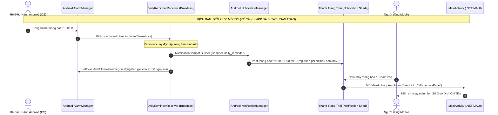

# KẾ HOẠCH TRIỂN KHAI CHI TIẾT (IMPLEMENTATION PLAN) - CHẶNG 2: PLAN-52
## HẠ TẦNG QUYỀN ANDROID 13+ & NATIVE ANDROID NOTIFICATION ENGINE (ALARMMANAGER KHI TẮT APP)

> [!IMPORTANT]
> **MỤC TIÊU CỐT LÕI CỦA CHẶNG 2:**
> 1. Chấm dứt hoàn toàn tình trạng thông báo bị "chết" khi người dùng vuốt tắt ứng dụng (Killed App / Background state).
> 2. Phát thông báo thực thụ (Native Android Notifications) lên thanh trạng thái (Status Bar / Notification Shade), hỗ trợ rung, âm thanh, icon kim cương 💎 và mở Deep Link vào app khi chạm.
> 3. Cấu hình quyền Android 13+ (`POST_NOTIFICATIONS`, `SCHEDULE_EXACT_ALARM`, `USE_EXACT_ALARM`) và bộ lắng nghe khởi động lại máy `BootReceiver`.
> 4. Gom nhóm thành **4 Cụm Task Logic Khép Kín** để triển khai gọn gàng, an toàn và đồng bộ cao.

---

## 1. KIẾN TRÚC VẬN HÀNH THÔNG BÁO NGOẠI TUYẾN (NATIVE ALARM ENGINE)



---

## 2. BẢNG PHÂN BỔ 4 CỤM TASK LIÊN HOÀN (4 INTEGRATED TASK BUNDLES)

| Cụm Task | Trọng Tâm Nghiệp Vụ | File Chịu Trách Nhiệm Chính | Kết Quả Nghiệm Thu (Quality Gate) |
| :---: | :--- | :--- | :--- |
| **Cụm 1** | **Hạ Tầng Quyền Android 13+ & AndroidManifest** | `Platforms/Android/AndroidManifest.xml`, `NotificationPermissionHelper.cs` | ✅ **PASSED (QĐ 174)**: Khai báo 5 permissions Android 13+, WAKE_LOCK, VIBRATE và helper kiểm tra runtime permission (0 Warning, 0 Error). |
| **Cụm 2** | **Native Notification Engine & 3 Kênh Chuyên Biệt** | `INativeNotificationService.cs`, `AndroidNativeNotificationService.cs`, `DesktopFallbackNotificationService.cs` | Tạo 3 Android Notification Channels (DSA Alerts, Balance, Reminder), phát Notification thực thụ lên Status Bar. |
| **Cụm 3** | **AlarmManager & BroadcastReceiver Khi Tắt App** | `DailyReminderReceiver.cs`, `BootReceiver.cs` | Đặt lịch báo thức chính xác bằng `SetExactAndAllowWhileIdle`, tự động phát thông báo lúc 21:00 khi app bị kill và phục hồi sau reboot. |
| **Cụm 4** | **Đăng Ký DI, Tích Hợp UI & Kiểm Thử Toàn Diện** | `MauiProgram.cs`, `NotificationHistoryViewModel.cs`, `NotificationHistoryPage.xaml`, `Tests` | Thêm nút test bắn Native Notification trên UI, 100% Unit Tests (333+ tests) Passed, Build Android thành công. |

---

## 3. CHI TIẾT KỸ THUẬT TỪNG CỤM TASK

### 🚀 Cụm 1: Hạ Tầng Quyền Android 13+ & AndroidManifest
1. **Cập nhật `Platforms/Android/AndroidManifest.xml`:**
   - `<uses-permission android:name="android.permission.POST_NOTIFICATIONS" />` (Bắt buộc cho Android 13 Tiramisu, API 33+)
   - `<uses-permission android:name="android.permission.SCHEDULE_EXACT_ALARM" />` (Cho phép hẹn giờ chính xác)
   - `<uses-permission android:name="android.permission.USE_EXACT_ALARM" />` (Tương thích Android 14+)
   - `<uses-permission android:name="android.permission.RECEIVE_BOOT_COMPLETED" />` (Lắng nghe sự kiện bật nguồn điện thoại)
   - `<uses-permission android:name="android.permission.WAKE_LOCK" />` (Đánh thức CPU trong tích tắc để phát thông báo)
   - `<uses-permission android:name="android.permission.VIBRATE" />` (Rung thiết bị khi có thông báo hạn mức đỏ)
2. **Khai báo Receiver trong `<application>`:**
   - Khai báo `DailyReminderReceiver` và `BootReceiver` với cờ `android:exported="true/false"` chuẩn bảo mật Google Play.
3. **Xây dựng `NotificationPermissionHelper.cs`:**
   - Kiểm tra `DeviceInfo.Platform == DevicePlatform.Android` và `DeviceInfo.Version.Major >= 13`.
   - Cung cấp hàm `Task<bool> EnsureNotificationPermissionAsync()` kích hoạt hộp thoại xin quyền Native của hệ điều hành.

---

### 🚀 Cụm 2: Native Android Notification Engine & 3 Kênh Chuyên Biệt
1. **Định nghĩa trừu tượng `INativeNotificationService.cs`:**
   ```csharp
   public interface INativeNotificationService
   {
       Task InitializeChannelsAsync();
       Task ShowNotificationAsync(string title, string message, string channelId, int notificationId = 0, string? targetRoute = null);
       Task ScheduleDailyReminderAsync(int targetHour = 21, int targetMinute = 0);
       Task CancelDailyReminderAsync();
       Task<bool> RequestPermissionAsync();
   }
   ```
2. **Hiện thực `AndroidNativeNotificationService.cs` trong `Platforms/Android/Services/`:**
   - **3 Kênh thông báo chuẩn Android 8.0+:**
     * `channel_dsa_alerts`: *"🚨 Cảnh Báo Hạn Mức DSA"* (High Importance, âm thanh báo động, rung kép).
     * `channel_balance_fluctuation`: *"💳 Biến Động Số Dư & Giao Dịch"* (High Importance, âm thanh thanh toán).
     * `channel_daily_reminder`: *"⏰ Nhắc Nhở Tài Chính 21:00"* (Default/High Importance, âm thanh chuông nhẹ).
   - **Xây dựng thông báo với `NotificationCompat.Builder`:**
     * Icon: icon kim cương foreground của ứng dụng.
     * ContentTitle, ContentText, BigTextStyle (cho phép mở rộng xem trọn văn bản).
     * PendingIntent trỏ về `MainActivity` với cờ `PendingIntentFlags.Immutable | PendingIntentFlags.UpdateCurrent`.
3. **Hiện thực `DesktopFallbackNotificationService.cs`:**
   - Dành cho môi trường Windows desktop runner và Unit test runner: Log output console hoặc in-app alert, đảm bảo không bị lỗi MissingPlatformReference.

---

### 🚀 Cụm 3: AlarmManager & BroadcastReceiver Khi Tắt App (Killed App)
1. **Hiện thực `DailyReminderReceiver.cs`:**
   - Kế thừa `BroadcastReceiver` với attribute:
     ```csharp
     [BroadcastReceiver(Enabled = true, Exported = false)]
     public class DailyReminderReceiver : BroadcastReceiver
     ```
   - Khi nhận `OnReceive`:
     * Bắn ngay Native Notification lên thanh trạng thái: *"⏰ Đã 21:00 rồi! Đừng quên ghi lại các khoản chi hôm nay để bảo vệ hạn mức an toàn DSA nhé!"*.
     * Tự động tính toán thời điểm 21:00 của ngày hôm sau và gọi `AlarmManager.SetExactAndAllowWhileIdle(...)` để chu kỳ tiếp tục mãi mãi.
2. **Hiện thực `BootReceiver.cs`:**
   - Kế thừa `BroadcastReceiver` với intent filter `ACTION_BOOT_COMPLETED`:
     ```csharp
     [BroadcastReceiver(Enabled = true, Exported = true)]
     [IntentFilter(new[] { Intent.ActionBootCompleted })]
     public class BootReceiver : BroadcastReceiver
     ```
   - Khi máy khởi động lại $\rightarrow$ Tự động đọc cài đặt từ `SharedPreferences` và lên lại lịch `AlarmManager` 21:00 mà người dùng không cần phải bấm mở app.

---

### 🚀 Cụm 4: Đăng Ký DI, Tích Hợp UI & Tổng Kiểm Thử Chất Lượng
1. **Cấu hình Dependency Injection trong `MauiProgram.cs`:**
   - Đăng ký `INativeNotificationService` singleton theo nền tảng:
     ```csharp
     #if ANDROID
     builder.Services.AddSingleton<INativeNotificationService, AndroidNativeNotificationService>();
     #else
     builder.Services.AddSingleton<INativeNotificationService, DesktopFallbackNotificationService>();
     #endif
     ```
2. **Cải tiến `NotificationHistoryViewModel.cs` & `NotificationHistoryPage.xaml`:**
   - Nối nút **"🔔 Bắn Native Test"** $\rightarrow$ Gọi `_nativeNotificationService.ShowNotificationAsync(...)` để sinh ngay một notification thật trên đỉnh màn hình điện thoại.
   - Nối nút **"⏰ Hẹn Báo Thức 21:00"** $\rightarrow$ Gọi `_nativeNotificationService.ScheduleDailyReminderAsync(21, 0)`.
3. **Tổng kiểm toán chất lượng:**
   - Chạy `dotnet test` toàn bộ các project UnitTests.
   - Biên dịch `ExpenseTracker.Maui` target `net10.0-android` thành công 100% (**0 Error, 0 Warning**).

---

## 4. TIÊU CHÍ NGHIỆM THU (ACCEPTANCE CRITERIA)
- [ ] 1. `AndroidManifest.xml` chứa đầy đủ 5 permissions Android 13+ và khai báo 2 BroadcastReceivers.
- [ ] 2. Ứng dụng tự động xin quyền hiển thị thông báo `POST_NOTIFICATIONS` trên Android 13+ khi người dùng tương tác.
- [ ] 3. Khởi tạo thành công 3 Notification Channels trên Android có tên tiếng Việt rõ ràng, biểu tượng và độ ưu tiên chuẩn.
- [ ] 4. Nút "🔔 Bắn Native Test" trên `NotificationHistoryPage` phát thông báo thật lên Status Bar ngay lập tức.
- [ ] 5. Khi người dùng vuốt tắt ứng dụng hoàn toàn (Kill app), `AlarmManager` đánh thức `DailyReminderReceiver` đúng giờ để phát thông báo.
- [ ] 6. Chạm vào thông báo từ Status Bar mở ứng dụng và điều hướng đúng trang.
- [ ] 7. Toàn bộ 333+ Unit Tests đều PASSED 100%, biên dịch Android APK thành công không lỗi.
