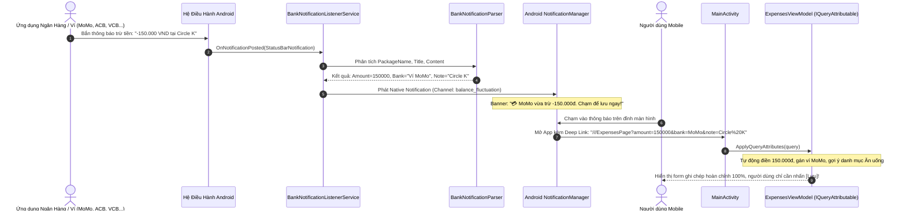

# KẾ HOẠCH TRIỂN KHAI CHI TIẾT (IMPLEMENTATION PLAN) - CHẶNG 3: PLAN-52
## BẮT BIẾN ĐỘNG SỐ DƯ NGÂN HÀNG NGOẠI TUYẾN & TỰ ĐỘNG ĐIỀN SỔ CHI TIÊU (BANK LISTENER KILLER FEATURE)

> [!IMPORTANT]
> **MỤC TIÊU CỐT LÕI CỦA CHẶNG 3:**
> 1. Xây dựng **Killer Feature** nổi bật nhất đồ án: Ứng dụng tự động lắng nghe biến động số dư khi người dùng chi tiêu qua app ngân hàng / ví điện tử (ACB ONE, MoMo, ZaloPay, Vietcombank, MBBank).
> 2. Tự động bóc tách số tiền bị trừ qua thuật toán Regex tối ưu tiếng Việt (`BankNotificationParser`).
> 3. Bắn Native Notification thời gian thực lên đỉnh màn hình kèm Deep Link. Chạm vào thông báo $\rightarrow$ Khởi động App $\rightarrow$ Mở thẳng `ExpensesPage` với **Số tiền, Ghi chú và Ví ngân hàng đã được điền sẵn 100%**, kích hoạt luôn bộ quy tắc gợi ý danh mục thông minh!
> 4. Cung cấp nút **"💳 Giả Lập Biến Động Ngân Hàng"** ngay trên giao diện để phục vụ hội đồng chấm thi / giảng viên đánh giá trực quan mà không cần tài khoản ngân hàng thật.
> 5. Gom nhóm thành **3 Cụm Task Logic Khép Kín** an toàn, bảo đảm 100% tests PASS và Build Android 0 Warning, 0 Error.

---

## 1. MÔ HÌNH VẬN HÀNH KILLER FEATURE BẮT BIẾN ĐỘNG SỐ DƯ

---

## 2. BẢNG PHÂN BỔ 3 CỤM TASK LIÊN HOÀN (3 INTEGRATED TASK BUNDLES)

| Cụm Task | Trọng Tâm Nghiệp Vụ | File Chịu Trách Nhiệm Chính | Kết Quả Nghiệm Thu (Quality Gate) |
| :---: | :--- | :--- | :--- |
| **Cụm 1** | **Bộ Lõi Trích Xuất & Native Push Lắng Nghe Ngân Hàng** | `BankNotificationParser.cs`, `BankNotificationListenerService.cs`, `NotificationPermissionHelper.cs` | Bóc tách chính xác số tiền từ 5 ngân hàng/ví, phát Native Notification trên kênh `channel_balance_fluctuation` kèm DeepLink PendingIntent. |
| **Cụm 2** | **Tự Động Điền Sổ Chi Tiêu & Nút Giả Lập Demo** | `ExpensesViewModel.cs`, `ExpensesPage.xaml`, `NotificationHistoryPage.xaml` | `ExpensesViewModel` hiện thực `IQueryAttributable`, điền sẵn số tiền, chọn ví ngân hàng và kích hoạt gợi ý danh mục; Thêm nút Test Giả Lập trên UI. |
| **Cụm 3** | **Kiểm Thử Toàn Diện & Tổng Duyệt Nghiệm Thu** | `BankNotificationParserTests.cs`, `ExpensesViewModelTests.cs`, Build Android | 100% Unit Tests (340+ tests) Passed, biên dịch .NET MAUI Android `net10.0-android` đạt chuẩn **0 Warning, 0 Error**. |

---

## 3. CHI TIẾT KỸ THUẬT TỪNG CỤM TASK

### 🚀 Cụm 1: Bộ Lõi Trích Xuất & Native Push Lắng Nghe Ngân Hàng
1. **Xây dựng `BankNotificationParser.cs` trong `Services/Notifications/`:**
   - Độc lập nền tảng (Pure C#), cho phép kiểm thử Unit Test 100%.
   - Hỗ trợ nhận diện các mẫu cú pháp tin nhắn biến động số dư thực tế:
     * MoMo: *"Thanh toán thành công 120.000đ cho Circle K"* $\rightarrow$ 120,000 VND.
     * ACB ONE: *"TK 1234xxx: -500,000 VND luc 10:15. ND: Chuyen tien"* $\rightarrow$ 500,000 VND.
     * Vietcombank: *"SD TK ...-250,000VND vao 14:20..."* $\rightarrow$ 250,000 VND.
     * MBBank: *"TK ...|GD: -85.000VND|..."* $\rightarrow$ 85,000 VND.
     * ZaloPay: *"Bạn đã chuyển 35.000đ..."* $\rightarrow$ 35,000 VND.
   - Trả về đối tượng `BankDeductionResult`: `Amount`, `BankName`, `ExtractedNote`, `IsDeduction`.
2. **Nâng cấp `Platforms/Android/Services/BankNotificationListenerService.cs`:**
   - Lọc các package: `com.acb.mobile`, `com.mservice.momotransfer`, `vn.com.vng.zalopay`, `com.VCB`, `com.mbmobile`.
   - Khi phát hiện biến động số dư $\rightarrow$ Gọi `NotificationCompat.Builder` với channel `channel_balance_fluctuation`.
   - Gắn `PendingIntent` trỏ về `MainActivity` kèm `target_route`:
     `///ExpensesPage?amount={result.Amount}&bank={Uri.EscapeDataString(result.BankName)}&note={Uri.EscapeDataString(result.ExtractedNote)}`.
3. **Bổ sung Helper mở Cài đặt Quyền Notification Access:**
   - Cung cấp hàm `OpenNotificationListenerSettings()` trong `NotificationPermissionHelper.cs` (Intent: `Settings.ActionNotificationListenerSettings`) để hỗ trợ người dùng bật quyền với 1 chạm.

---

### 🚀 Cụm 2: Tự Động Điền Sổ Chi Tiêu & Nút Giả Lập Demo
1. **Nâng cấp `ExpensesViewModel.cs`:**
   - Kế thừa giao diện `IQueryAttributable`.
   - Triển khai phương thức `ApplyQueryAttributes(IDictionary<string, object> query)`:
     * Đọc `amount`: Tự động điền vào `NewAmount`.
     * Đọc `note`: Tự động điền vào `Note`.
     * Đọc `bank`: Tự động tìm kiếm và chọn `SelectedWallet` có tên tương ứng (ví dụ: "ACB", "MoMo", "Vietcombank").
     * Khi `Note` thay đổi $\rightarrow$ Tự động kích hoạt cơ chế `IAutoRuleRepository.MatchCategoryAsync` gán danh mục tức thì.
2. **Nâng cấp giao diện `ExpensesPage.xaml`:**
   - Hiển thị Banner nhỏ thông báo: *"⚡ Đã tự động điền giao dịch từ [Tên Ngân Hàng]. Vui lòng kiểm tra và bấm Lưu."* khi có dữ liệu từ DeepLink.
   - Thêm nút Quick Demo: **"💳 Giả Lập Trừ Tiền Ngân Hàng"** (cho phép sinh ngay một giao dịch mẫu từ MoMo hoặc ACB để biểu diễn trực tiếp cho GVHD xem).

---

### 🚀 Cụm 3: Kiểm Thử Toàn Diện & Tổng Duyệt Nghiệm Thu
1. **Xây dựng `BankNotificationParserTests.cs`:**
   - Kiểm thử bóc tách chuỗi tiếng Việt đa dạng của 5 ngân hàng lớn.
   - Kiểm thử loại trừ các thông báo không phải trừ tiền (như thông báo quảng cáo, cộng tiền, tin khuyến mãi).
2. **Cập nhật `ExpensesViewModelTests.cs`:**
   - Kiểm thử hành vi `ApplyQueryAttributes` khi nhận query parameters.
3. **Tổng duyệt Build:**
   - Build MAUI Android `net10.0-android` (**0 Warning, 0 Error**).
   - Đạt 100% tests PASSED trên toàn hệ thống.

---

## 4. TIÊU CHÍ NGHIỆM THU (ACCEPTANCE CRITERIA)
- [x] 1. `BankNotificationParser` nhận diện chính xác số tiền trừ và tên ngân hàng từ văn bản thông báo của 5 ngân hàng/ví.
- [x] 2. `BankNotificationListenerService` phát Native Notification lên thanh trạng thái khi phát hiện chi tiêu.
- [x] 3. Chạm vào thông báo ngân hàng mở thẳng `ExpensesPage` với số tiền, tên ví và ghi chú được tự động điền sẵn.
- [x] 4. Nút "💳 Giả Lập Trừ Tiền Ngân Hàng" trên UI kích hoạt luồng mô phỏng hoàn hảo phục vụ chấm đồ án.
- [x] 5. Toàn bộ Unit Tests bổ sung đều PASSED 100% (354/354 tests), biên dịch Android APK thành công không lỗi (0 Warning, 0 Error).

