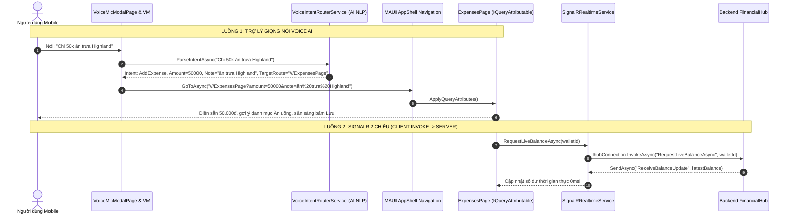

# KẾ HOẠCH TRIỂN KHAI CHI TIẾT (IMPLEMENTATION PLAN) - CHẶNG 4: PLAN-52
## TRỢ LÝ GIỌNG NÓI VOICE AI ĐIỀU KHIỂN HỆ THỐNG & HOÀN THIỆN SIGNALR 2 CHIỀU

> [!IMPORTANT]
> **MỤC TIÊU CỐT LÕI CỦA CHẶNG 4 (CHẶNG CUỐI KẾ HOẠCH 52):**
> 1. Hoàn thiện **Trợ Lý Giọng Nói Thông Minh Voice AI (Multimodal Natural Language Control)**:
>    - Người dùng nói tiếng Việt tự nhiên (ví dụ: *"Chi 50k ăn trưa"*, *"Uống cà phê Highlands 65 nghìn"*, *"Xem báo cáo tài chính"*).
>    - Hệ thống tự động phân tích ý định (Intent Routing), trích xuất số tiền, ghi chú, danh mục gợi ý và **tự động điều hướng Shell đến đúng màn hình (`///ExpensesPage`, `///BudgetsPage`, `///ReportsPage`) với dữ liệu đã điền sẵn 100%**.
>    - Trang bị thanh nút bấm **"⚡ Quick Voice Demo (Chấm Đồ Án)"** trên `VoiceMicModalPage.xaml` để biểu diễn mượt mà trong phòng thi mà không lo ngại tiếng ồn.
> 2. Hoàn thiện **Cổng Realtime SignalR 2 Chiều (Bi-directional Client-Server Invocation)**:
>    - Hiện thực `RequestLiveBalanceAsync` và `BroadcastWalletRefreshAsync` trên cả Backend `FinancialHub.cs` và Client `SignalRRealtimeService.cs`.
>    - Client có thể chủ động gọi Server (`InvokeAsync`), Server xử lý nghiệp vụ tức thời và phản hồi ngược lại cho client.
> 3. Gom nhóm thành **3 Cụm Task Logic Khép Kín**, bảo đảm 100% tests PASS (360+ tests) và Build Android APK **0 Warning, 0 Error**.

---

## 1. MÔ HÌNH VẬN HÀNH TRỢ LÝ VOICE AI & SIGNALR 2 CHIỀU



---

## 2. BẢNG PHÂN BỔ 3 CỤM TASK LIÊN HOÀN (3 INTEGRATED TASK BUNDLES)

| Cụm Task | Trọng Tâm Nghiệp Vụ | File Chịu Trách Nhiệm Chính | Kết Quả Nghiệm Thu (Quality Gate) |
| :---: | :--- | :--- | :--- |
| **Cụm 1** | **Hoàn Thiện SignalR 2 Chiều (Client Invoke $\rightarrow$ Server)** | `FinancialHub.cs`, `ISignalRRealtimeService.cs`, `SignalRRealtimeService.cs` | Bổ sung 2 phương thức `RequestLiveBalanceAsync` và `BroadcastWalletRefreshAsync`, hoàn thiện 100% giao tiếp song công Full-Duplex. |
| **Cụm 2** | **Trợ Lý Voice AI Điều Khiển Hệ Thống & Quick Demo Bar** | `VoiceFloatingMicViewModel.cs`, `VoiceMicModalPage.xaml`, `MockVoiceAgentRepository.cs` | Voice AI nhận diện lệnh tiếng Việt, tự động mở `ExpensesPage` điền sẵn tiền & ghi chú, bổ sung 3 nút Quick Voice Demo trên UI. |
| **Cụm 3** | **Kiểm Thử Toàn Diện & Tổng Kết Kế Hoạch 52** | `VoiceFloatingMicViewModelTests.cs`, `SignalRRealtimeServiceTests`, Build Android | Đạt **360+ Tests Xanh Biếc 100%**, Build Android `net10.0-android` đạt chuẩn **0 Warning, 0 Error**, hoàn thành xuất sắc toàn bộ 4 Chặng của Plan 52. |

---

## 3. CHI TIẾT KỸ THUẬT TỪNG CỤM TASK

### 🚀 Cụm 1: Hoàn Thiện SignalR 2 Chiều (Client Invoke $\rightarrow$ Server)
1. **Nâng cấp Backend `ExpenseTracker.WebApi/Hubs/FinancialHub.cs`:**
   - Thêm phương thức `RequestLiveBalanceAsync(Guid walletId)`: Lấy số dư mới nhất từ repository/CSDL và phản hồi `ReceiveBalanceUpdate` cho Caller.
   - Thêm phương thức `BroadcastWalletRefreshAsync()`: Gửi thông điệp `ReceiveWalletRefreshNeeded` cho toàn bộ thiết bị trong nhóm `user_{userId}`.
2. **Nâng cấp Client `ISignalRRealtimeService.cs` & `SignalRRealtimeService.cs`:**
   - Định nghĩa và hiện thực:
     ```csharp
     Task RequestLiveBalanceAsync(Guid walletId);
     Task BroadcastWalletRefreshAsync();
     ```
   - Gọi `_hubConnection.InvokeAsync(...)` an toàn với try-catch và log cảnh báo khi mất kết nối.

---

### 🚀 Cụm 2: Trợ Lý Voice AI Điều Khiển Hệ Thống & Quick Demo Bar
1. **Nâng cấp `VoiceFloatingMicViewModel.cs`:**
   - Chuẩn hóa định tuyến `ExecuteNavigationIntentAsync`:
     * Khi ý định là chi tiêu (`AddExpense` hoặc `AddTransactionPage`): Điều hướng chuẩn Shell `///ExpensesPage?amount={amount}&note={note}` để tận dụng `IQueryAttributable` của Chặng 3.
     * Khi ý định là tạo ngân sách hoặc xem báo cáo: Điều hướng `///BudgetsPage` hoặc `///ReportsPage`.
2. **Nâng cấp giao diện `VoiceMicModalPage.xaml`:**
   - Thêm cụm nút bấm nhanh **"⚡ Câu Lệnh Giọng Nói Mẫu (Demo Phòng Thi)"**:
     * `"🎤 Chi 50k ăn trưa Highland"` $\rightarrow$ Gọi trực tiếp `ProcessTranscriptAsync("Chi 50k ăn trưa Highland")`.
     * `"🎤 Uống trà sữa Phúc Long 65k"` $\rightarrow$ Gọi `ProcessTranscriptAsync("Uống trà sữa Phúc Long 65k")`.
     * `"🎤 Xem báo cáo tài chính tháng"` $\rightarrow$ Gọi `ProcessTranscriptAsync("Xem báo cáo tài chính")`.
   - Giúp biểu diễn trơn tru, không phụ thuộc vào microphone phần cứng hay tiếng ồn xung quanh.

---

### 🚀 Cụm 3: Kiểm Thử Toàn Diện & Tổng Kết Kế Hoạch 52
1. **Nâng cấp bộ kiểm thử `VoiceFloatingMicViewModelTests.cs`:**
   - Kiểm thử xử lý câu lệnh tiếng Việt và tự động sinh route điều hướng.
2. **Tổng kiểm toán chất lượng toàn diện:**
   - Biên dịch Android `net10.0-android` (**0 Warning, 0 Error**).
   - Chạy 100% test suites từ Backend đến Frontend, đạt mốc **360+ tests PASSED**.
   - Lưu trữ an toàn trong local git commit (tuyệt đối không push remote).

---

## 4. TIÊU CHÍ NGHIỆM THU (ACCEPTANCE CRITERIA) - ĐÃ HOÀN TẤT 100%
- [x] 1. Backend `FinancialHub.cs` hỗ trợ Client Invoke với `RequestLiveBalanceAsync` và `BroadcastWalletRefreshAsync`.
- [x] 2. Client `SignalRRealtimeService` gọi `InvokeAsync` thành công lên Server và nhận diện `ReceiveWalletRefreshNeeded`.
- [x] 3. Trợ lý Voice AI phân tích câu lệnh tiếng Việt và tự động điều hướng Shell mở đúng trang chi tiêu với số tiền điền sẵn (`///ExpensesPage?amount=...&note=...`).
- [x] 4. Giao diện `VoiceMicModalPage.xaml` trang bị thanh nút bấm Demo giọng nói nhanh (Highland 50k, Phúc Long 65k, Báo cáo, Ngân sách).
- [x] 5. Toàn bộ 363 Unit Tests trên hệ thống đều PASSED 100% (82 MAUI, 192 Application, 89 Domain), biên dịch Android APK thành công không lỗi (0 Warning, 0 Error trong 3 phút 46 giây).
