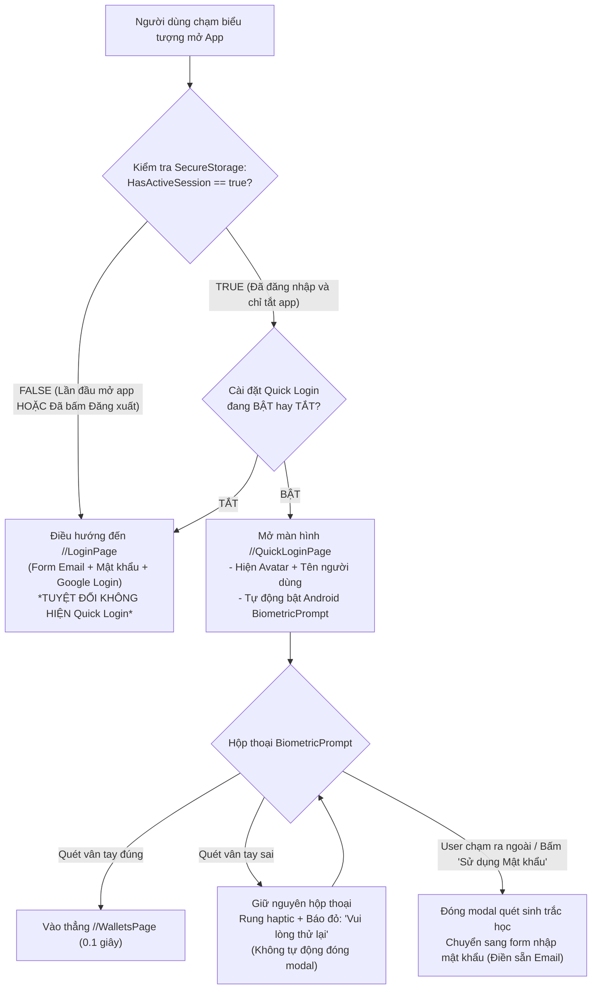

# KẾ HOẠCH TRIỂN KHAI KỸ THUẬT (IMPLEMENTATION PLAN)
## GIAI ĐOẠN MỚI 02: BẢO MẬT SINH TRẮC HỌC BIOMETRICS, SECURESTORAGE & ĐĂNG NHẬP NHANH QUICK LOGIN

> **Kế hoạch số:** `PLAN-61`  
> **Giai đoạn dự án:** Giai đoạn Mới 02 (Chương 2 - Lộ trình Tự chủ Khóa luận & PTTKHTTT)  
> **Use Cases phụ trách:** `UC-01.02` (Đăng nhập hệ thống), `UC-01.06` (Xác thực sinh trắc học & Lưu trữ phiên an toàn)  
> **Mục tiêu chính:** Nâng cấp trải nghiệm đăng nhập đạt chuẩn Fintech quốc tế: Cho phép người dùng chạm vân tay / FaceID để vào app trong 0.1 giây khi còn phiên; bảo mật token bằng phần cứng Android Keystore AES-256; đảm bảo quy tắc Đăng xuất (Logout) xóa sạch phiên và giữ nguyên modal sinh trắc học khi quét lỗi để người dùng tự quyết định thoát.

---

## 1. MỤC TIÊU CỐT LÕI & BỐI CẢNH (GOAL DESCRIPTION)

### 1.1. Bối Cảnh & Thực Trạng
- Hiện tại, ứng dụng MAUI đang lưu Access Token và Refresh Token đơn giản trong `SecureStorage`, nhưng:
  1. Chưa có phân tầng quản lý trạng thái phiên rõ ràng giữa **"Thoát app (Kill App)"** và **"Chủ động Đăng xuất (Logout)"**.
  2. Chưa có lớp xác thực phần cứng **Native Biometrics** (Cảm biến vân tay / Nhận diện khuôn mặt) của Android.
  3. Mỗi lần người dùng vào app, nếu token còn hạn thì tự vào thẳng, nếu hết hạn thì bắt gõ lại mật khẩu thủ công rất bất tiện và không đạt chuẩn bảo mật tài chính cá nhân.
  4. Người dùng đã chốt định hướng: **Không làm Auto-lock khi rời app (để tránh ức chế thường nhật)**; **chỉ kích hoạt Quick Login khi chưa Đăng xuất**; và **khi quét vân tay sai thì KHÔNG tự ý đóng modal mà để người dùng tự chạm ra ngoài hoặc bấm dùng mật khẩu để thoát**.

### 1.2. Mục Tiêu Đạt Được Sau Giai Đoạn 2
1. **Dịch Vụ Sinh Trắc Học Độc Lập (`IBiometricAuthService`):**
   - Tích hợp trực tiếp với API `AndroidX.Biometric.BiometricPrompt` chính quy của Google (không phụ thuộc package ngoài).
   - Kiểm tra trạng thái phần cứng thiết bị: Sẵn sàng (`Available`), Chưa cài vân tay (`NotEnrolled`), hoặc Không hỗ trợ (`Unsupported`).
   - Cung cấp chế độ mô phỏng / UserConsentVerifier mượt mà trên Windows Desktop để phục vụ việc code và test nhanh.
2. **Nâng Cấp `ISecureStorageService`:**
   - Quản lý đồng bộ: `AccessToken`, `RefreshToken`, `UserEmail`, `UserFullName`, `IsQuickLoginEnabled` (bool), `HasActiveSession` (bool).
   - Mã hóa chuẩn phần cứng Android Keystore + AES-256-GCM.
3. **Màn Hình Đăng Nhập Nhanh (`QuickLoginPage` & `QuickLoginViewModel`):**
   - Thiết kế giao diện hiện đại: Hiển thị Avatar + Tên người dùng + Nút cảm biến vân tay phát sáng nhịp thở.
   - Tự động gọi popup quét vân tay của Android khi vừa mở trang.
   - Khi quét sai: Modal giữ nguyên trên màn hình, rung nhẹ haptic, báo lỗi đỏ để người dùng thử lại.
   - Người dùng có thể chủ động thoát bằng cách chạm ra ngoài modal hoặc bấm nút *"Sử dụng Mật khẩu"* / *"Đổi tài khoản khác"* để chuyển về `LoginPage` truyền thống với Email được điền sẵn.
4. **Quy Tắc Đăng Xuất Triệt Để (Logout Purge):**
   - Bổ sung nút **"Đăng xuất"** nổi bật và an toàn trong `SettingsPage`.
   - Khi bấm Đăng xuất: Thu hồi Refresh Token trên máy chủ, xóa sạch toàn bộ token trong `SecureStorage`, đặt `HasActiveSession = false`.
   - Lần mở app tiếp theo: 100% bắt buộc vào `LoginPage` thường, **TUYỆT ĐỐI KHÔNG HIỆN** Quick Login.
5. **Cài Đặt Trong `SettingsPage`:**
   - Công tắc (Switch): *"Đăng nhập nhanh bằng Sinh trắc học"* (Bật/Tắt).
   - Nhãn hiển thị trạng thái cảm biến phần cứng của điện thoại.

---

## 2. QUY TRÌNH & SƠ ĐỒ ĐIỀU HƯỚNG PHIÊN (SESSION & NAVIGATION ARCHITECTURE)



---

## 3. THIẾT KẾ CHI TIẾT CÁC THÀNH PHẦN (PROPOSED CHANGES)

### 3.1. Phân Hệ Bảo Mật & Lưu Trữ Mã Hóa (Core Security Layer)

#### `[MODIFY]` [`ITokenStorageService.cs`](file:///d:/University%20Study%20Subjects/Information%20System%20Design%20Analysis/Project/Analyze%20System/mobile-project/dotnet-maui-ver/frontend/ExpenseTracker.Maui/Services/Security/SecureStorageTokenService.cs)
- Bổ sung các phương thức quản lý thông tin phiên và cài đặt sinh trắc học:
```csharp
public interface ITokenStorageService
{
    Task SaveTokensAsync(string accessToken, string refreshToken);
    Task<string?> GetAccessTokenAsync();
    Task<string?> GetRefreshTokenAsync();
    Task ClearTokensAsync();

    // Các phương thức bổ sung cho Quick Login & Session
    Task SaveUserSessionAsync(string email, string fullName, string? avatarUrl);
    Task<(string? Email, string? FullName, string? AvatarUrl)> GetUserSessionAsync();
    Task SetQuickLoginEnabledAsync(bool enabled);
    Task<bool> IsQuickLoginEnabledAsync();
    Task SetActiveSessionFlagAsync(bool hasActiveSession);
    Task<bool> HasActiveSessionAsync();
    Task PurgeSessionOnLogoutAsync();
}
```

#### `[MODIFY]` [`SecureStorageTokenService.cs`](file:///d:/University%20Study%20Subjects/Information%20System%20Design%20Analysis/Project/Analyze%20System/mobile-project/dotnet-maui-ver/frontend/ExpenseTracker.Maui/Services/Security/SecureStorageTokenService.cs)
- Cài đặt đầy đủ các hàm trên thông qua `SecureStorage.Default.SetAsync` / `GetAsync`.
- Trong hàm `PurgeSessionOnLogoutAsync()`:
  - Xóa `auth_access_token`, `auth_refresh_token`.
  - Đặt `has_active_session` thành `"false"`.
  - Giữ lại `user_email` (nếu cần điền sẵn ở form login thường), nhưng xóa triệt để session token.

---

### 3.2. Dịch Vụ Xác Thực Sinh Trắc Học Native Android & Windows Fallback

#### `[NEW]` [`IBiometricAuthService.cs`](file:///d:/University%20Study%20Subjects/Information%20System%20Design%20Analysis/Project/Analyze%20System/mobile-project/dotnet-maui-ver/frontend/ExpenseTracker.Maui/Services/Biometrics/IBiometricAuthService.cs)
```csharp
namespace ExpenseTracker.Maui.Services.Biometrics;

public enum BiometricCapabilityStatus
{
    Available,       // Thiết bị có phần cứng và đã cài vân tay/FaceID
    NotEnrolled,     // Có phần cứng nhưng người dùng chưa đăng ký vân tay trong máy
    Unsupported,     // Thiết bị không hỗ trợ sinh trắc học
    Denied           // Người dùng từ chối cấp quyền
}

public record BiometricAuthResult(
    bool IsSuccess, 
    string? ErrorMessage, 
    bool IsUserCanceled);

public interface IBiometricAuthService
{
    Task<BiometricCapabilityStatus> CheckCapabilityAsync();
    Task<BiometricAuthResult> AuthenticateAsync(string title, string subtitle, string negativeButtonText);
}
```

#### `[NEW]` [`BiometricAuthService.Android.cs`](file:///d:/University%20Study%20Subjects/Information%20System%20Design%20Analysis/Project/Analyze%20System/mobile-project/dotnet-maui-ver/frontend/ExpenseTracker.Maui/Platforms/Android/Biometrics/BiometricAuthService.Android.cs)
- Sử dụng trực tiếp `AndroidX.Biometric.BiometricPrompt` và `BiometricManager`:
  - `CanAuthenticate(BiometricManager.Authenticators.BiometricStrong | BiometricManager.Authenticators.BiometricWeak)`.
  - Triển khai `AuthenticationCallback`:
    - `OnAuthenticationSucceeded`: `tcs.TrySetResult(new BiometricAuthResult(true, null, false))`.
    - `OnAuthenticationFailed`: **Không hoàn thành Task**, cho phép Android tự hiển thị thông báo lỗi và giữ modal cho người dùng quét tiếp.
    - `OnAuthenticationError(int errorCode, ICharSequence errString)`:
      - Nếu `errorCode == BiometricPrompt.ErrorUserCanceled` hoặc `ErrorNegativeButton`: Trả về `IsUserCanceled = true`.
      - Các mã lỗi khác: Trả về thông báo lỗi chi tiết.

#### `[NEW]` [`BiometricAuthService.Windows.cs`](file:///d:/University%20Study%20Subjects/Information%20System%20Design%20Analysis/Project/Analyze%20System/mobile-project/dotnet-maui-ver/frontend/ExpenseTracker.Maui/Platforms/Windows/Biometrics/BiometricAuthService.Windows.cs)
- Trên Windows Desktop (phục vụ lúc dev / test): Sử dụng `Windows.Security.Credentials.UI.UserConsentVerifier` nếu có Windows Hello, hoặc cung cấp fallback mock hợp lệ để app biên dịch và chạy trơn tru mà không lỗi.

---

### 3.3. Màn Hình & ViewModel Đăng Nhập Nhanh (Quick Login UI/UX)

#### `[NEW]` [`QuickLoginPage.xaml`](file:///d:/University%20Study%20Subjects/Information%20System%20Design%20Analysis/Project/Analyze%20System/mobile-project/dotnet-maui-ver/frontend/ExpenseTracker.Maui/Views/Auth/QuickLoginPage.xaml)
- **Thiết kế giao diện:**
  - Nền Gradient Dark/Light sang trọng.
  - Khung Avatar tròn của người dùng (kèm icon ngân hàng/bảo mật).
  - Tên người dùng và Lời chào: *"Chào mừng bạn trở lại, [Tên Người Dùng]"*.
  - Biểu tượng vân tay lớn với hiệu ứng Border bo tròn, nút chạm *"Chạm để Quét Vân Tay"*.
  - Nhãn hiển thị trạng thái quét (nếu có lỗi hiển thị chữ đỏ dịu mắt).
  - Khối điều hướng phụ phía dưới:
    - Nút văn bản: *"Đăng nhập bằng Mật khẩu"* $\rightarrow$ chuyển sang `LoginPage`.
    - Nút văn bản: *"Đổi tài khoản khác"* $\rightarrow$ xóa phiên tạm thời và về `LoginPage`.

#### `[NEW]` [`QuickLoginViewModel.cs`](file:///d:/University%20Study%20Subjects/Information%20System%20Design%20Analysis/Project/Analyze%20System/mobile-project/dotnet-maui-ver/frontend/ExpenseTracker.Maui/ViewModels/Auth/QuickLoginViewModel.cs)
- Kế thừa `BaseViewModel`, tiêm phụ thuộc `IBiometricAuthService`, `ITokenStorageService`, `IClientAuthService`.
- Tự động gọi lệnh `TriggerBiometricScanCommand` khi trang xuất hiện (`OnAppearing`).
- Khi xác thực thành công: Kiểm tra hạn token qua `IClientAuthService.InitializeAsync()`, điều hướng thẳng vào `//WalletsPage`.
- Khi người dùng bấm *"Đăng nhập bằng Mật khẩu"*: Điều hướng về `//LoginPage`.

---

### 3.4. Cập Nhật Cài Đặt Settings & Cơ Chế Đăng Xuất An Toàn

#### `[MODIFY]` [`SettingsViewModel.cs`](file:///d:/University%20Study%20Subjects/Information%20System%20Design%20Analysis/Project/Analyze%20System/mobile-project/dotnet-maui-ver/frontend/ExpenseTracker.Maui/ViewModels/SettingsViewModel.cs)
- Bổ sung thuộc tính:
  - `bool IsBiometricQuickLoginEnabled` (gắn 2 chiều với `ITokenStorageService`).
  - `string BiometricStatusText` (Mô tả tình trạng cảm biến thiết bị).
  - `bool IsBiometricAvailableOnDevice` (chỉ cho phép bật switch nếu máy có cảm biến).
  - `IAsyncRelayCommand LogoutCommand` (Điều khiển luồng đăng xuất).
- Logic khi bấm Đăng xuất:
  - Hiển thị Dialog xác nhận: *"Bạn có chắc chắn muốn đăng xuất khỏi tài khoản?"*.
  - Xác nhận $\rightarrow$ Gọi `_authService.LogoutAsync()`.
  - `_tokenStorage.PurgeSessionOnLogoutAsync()`.
  - Điều hướng ngay lập tức về `//LoginPage`.

#### `[MODIFY]` [`SettingsPage.xaml`](file:///d:/University%20Study%20Subjects/Information%20System%20Design%20Analysis/Project/Analyze%20System/mobile-project/dotnet-maui-ver/frontend/ExpenseTracker.Maui/Views/SettingsPage.xaml)
- Bổ sung **CARD 5: BẢO MẬT & ĐĂNG NHẬP NHANH (BIOMETRICS)**:
  - Switch: *"Đăng nhập nhanh bằng Sinh trắc học"*.
  - Label nhỏ hiển thị tình trạng phần cứng.
- Bổ sung **NÚT ĐĂNG XUẤT TÀI KHOẢN (LOGOUT BUTTON)** ở cuối trang:
  - Nút màu đỏ viền mờ (Danger Button): *"Đăng Xuất Tài Khoản"*.

---

### 3.5. Kiểm Soát Điều Hướng Khởi Động Ứng Dụng (App Startup Flow)

#### `[MODIFY]` [`App.xaml.cs`](file:///d:/University%20Study%20Subjects/Information%20System%20Design%20Analysis/Project/Analyze%20System/mobile-project/dotnet-maui-ver/frontend/ExpenseTracker.Maui/App.xaml.cs)
- Cập nhật hàm `CheckAutoLoginAsync`:
```csharp
private async Task CheckAutoLoginAsync(AppShell shell)
{
    try
    {
        var hasActiveSession = await _tokenStorage.HasActiveSessionAsync();
        var isQuickLoginEnabled = await _tokenStorage.IsQuickLoginEnabledAsync();

        // NGUYÊN TẮC BẤT DI BẤT DỊCH:
        // Nếu người dùng đã chủ động bấm Đăng xuất (hasActiveSession == false),
        // TUYỆT ĐỐI KHÔNG HIỆN Quick Login, bắt buộc vào thẳng LoginPage!
        if (!hasActiveSession)
        {
            await shell.GoToAsync("//LoginPage");
            return;
        }

        // Nếu có phiên đang hoạt động VÀ người dùng BẬT Quick Login:
        if (isQuickLoginEnabled)
        {
            await shell.GoToAsync("//QuickLoginPage");
            return;
        }

        // Trường hợp phiên còn hiệu lực nhưng người dùng TẮT Quick Login:
        var isAuthenticated = await _authService.InitializeAsync();
        if (isAuthenticated)
        {
            await shell.GoToAsync("//WalletsPage");
        }
        else
        {
            await shell.GoToAsync("//LoginPage");
        }
    }
    catch
    {
        await shell.GoToAsync("//LoginPage");
    }
}
```

#### `[MODIFY]` [`AppShell.xaml`](file:///d:/University%20Study%20Subjects/Information%20System%20Design%20Analysis/Project/Analyze%20System/mobile-project/dotnet-maui-ver/frontend/ExpenseTracker.Maui/AppShell.xaml)
- Đăng ký Route cho `QuickLoginPage`:
```xml
<ShellContent Route="QuickLoginPage" ContentTemplate="{DataTemplate views:QuickLoginPage}" />
```

---

## 4. KẾ HOẠCH KIỂM THỬ & XÁC MINH (VERIFICATION PLAN)

### 4.1. Kiểm Thử Tự Động (Automated Unit Tests)
- **Vị trí bài test mới:** [`ExpenseTracker.Maui.UnitTests/Services/BiometricsAndQuickLoginTests.cs`](file:///d:/University%20Study%20Subjects/Information%20System%20Design%20Analysis/Project/Analyze%20System/mobile-project/dotnet-maui-ver/frontend/tests/ExpenseTracker.Maui.UnitTests/)
- **Kịch bản kiểm thử (100% Mock isolated):**
  1. `CheckAutoLogin_WhenUserLoggedOut_ShouldAlwaysNavigateToLoginPage`: Xác minh khi `hasActiveSession = false`, dù Quick Login đang bật thì app vẫn bắt buộc về `LoginPage`.
  2. `CheckAutoLogin_WhenActiveSessionAndQuickLoginEnabled_ShouldNavigateToQuickLoginPage`: Xác minh mở app khi tắt ngang sẽ vào `QuickLoginPage`.
  3. `QuickLoginViewModel_WhenBiometricSucceeds_ShouldNavigateToDashboard`: Xác minh quét vân tay đúng sẽ vào thẳng ví tiền.
  4. `QuickLoginViewModel_WhenBiometricFails_ShouldKeepModalAndAllowRetry`: Xác minh quét sai không làm văng app hoặc đóng modal.
  5. `QuickLoginViewModel_WhenUserChoosesPassword_ShouldFallbackToLoginPage`: Xác minh bấm "Sử dụng mật khẩu" sẽ chuyển sang `LoginPage`.
  6. `SettingsViewModel_WhenUserLogsOut_ShouldPurgeTokensAndActiveSession`: Xác minh lệnh Đăng xuất xóa sạch token và vô hiệu hóa Quick Login.
- **Lệnh chạy kiểm thử tự động:**
  ```powershell
  dotnet test "mobile-project\dotnet-maui-ver\frontend\tests\ExpenseTracker.Maui.UnitTests\ExpenseTracker.Maui.UnitTests.csproj" -m:1
  dotnet test "mobile-project\dotnet-maui-ver\backend\tests\ExpenseTracker.Application.UnitTests\ExpenseTracker.Application.UnitTests.csproj" -m:1
  ```
  **Mục tiêu:** 100% tests PASSED (Duy trì trọn vẹn 276 tests cũ + các tests mới).

### 4.2. Kiểm Thử Biên Dịch Đa Nền Tảng (Cross-Platform Compilation)
- Biên dịch Android:
  ```powershell
  dotnet build "mobile-project\dotnet-maui-ver\frontend\ExpenseTracker.Maui\ExpenseTracker.Maui.csproj" -f net10.0-android -m:1
  ```
- Biên dịch Windows Desktop:
  ```powershell
  dotnet build "mobile-project\dotnet-maui-ver\frontend\ExpenseTracker.Maui\ExpenseTracker.Maui.csproj" -f net10.0-windows10.0.19041.0 -m:1
  ```
  **Mục tiêu:** 0 Warning, 0 Error.

---

## 5. ĐÁNH GIÁ RỦI RO & PHÒNG NGỪA (RISK & MITIGATION)

| Rủi Ro Kỹ Thuật | Tác Động | Biện Pháp Phòng Ngừa Triệt Để |
| :--- | :--- | :--- |
| Thiết bị Android không có phần cứng vân tay (ví dụ máy giá rẻ cũ) | Gây lỗi Crash app khi gọi `BiometricPrompt` | Luôn gọi `CheckCapabilityAsync()` trước; nếu không hỗ trợ thì ẩn hoàn toàn tính năng và mặc định dùng Login mật khẩu. |
| Người dùng đổi vân tay trong cài đặt Android (Fingerprint Changed) | Rủi ro bảo mật tài khoản | `AndroidX.Biometric` tự động vô hiệu hóa khóa xác thực cũ nếu phát hiện dấu vân tay mới được thêm vào máy, yêu cầu người dùng đăng nhập lại bằng mật khẩu. |
| Người dùng bị kẹt ở màn hình Quick Login khi cảm biến vân tay bị ướt/hỏng | Không thể vào được ứng dụng | Luôn có sẵn nút lớn rõ ràng: *"Đăng nhập bằng Mật khẩu"* và *"Đổi tài khoản khác"* để người dùng luôn có đường thoát. |
| Lệnh Logout chỉ xóa bộ nhớ RAM mà quên xóa SecureStorage | Mở lại app vẫn bị coi là đã đăng nhập | Bọc trong khối `finally` của `LogoutAsync` và kiểm tra xác minh bằng Unit Test chuyên biệt. |

---

Bạn vui lòng xem kỹ bản kế hoạch trên. Nếu đồng ý với các bước thiết kế và quy trình kiểm thử này, bạn hãy bấm **Approved** để chúng ta bắt đầu triển khai ngay!
