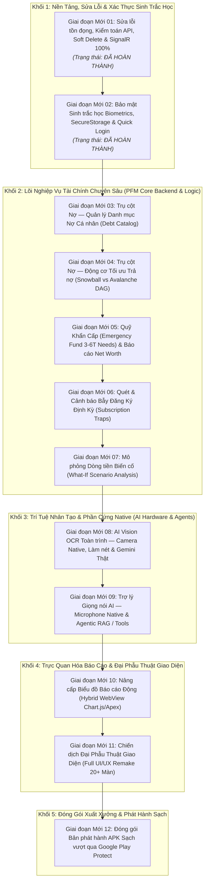

# 📋 KẾ HOẠCH TÁC CHIẾN PLAN-62: TÁI CẤU TRÚC MASTER ROADMAP CHƯƠNG 2 & CHUẨN BỊ KÍCH HOẠT GIAI ĐOẠN MỚI 03 (TRỤ CỘT NỢ)

> **Mã kế hoạch:** `PLAN-62`  
> **Ngày lập:** 29/10/2026  
> **Người chủ trì:** Council Orchestrator (Chủ tịch Hội đồng) & Alistair Cockburn (Lead BA)  
> **Căn cứ chỉ đạo:** Cuộc họp khẩn rà soát hiện trạng hệ thống và phê bình từ Chủ tọa (Quyết định 110)  
> **Trạng thái:** `PENDING_USER_APPROVAL (CHỜ CHỦ TỌA DUYỆT TRƯỚC KHI TRIỂN KHAI GIAI ĐOẠN 03)`

---

## 1. BỐI CẢNH & NGUYÊN NHÂN TÁI CẤU TRÚC

Trong phiên làm việc trước, Chủ tọa đã kịp thời phát hiện và chỉ trích sai lầm nghiêm trọng trong cách sắp xếp thứ tự các giai đoạn tại `MASTER_PROJECT_ROADMAP.md`:
* **Sai lầm nhận diện:** Hạng mục *"Đóng gói APK sạch vượt qua Google Play Protect"* bị xếp nhầm vào vị trí **Giai đoạn Mới 03**, ngay sau khi xong Biometrics.
* **Hậu quả nếu thực hiện:** Ứng dụng chưa có đầy đủ phân hệ CSDL và Backend (chưa có Quản lý Nợ, chưa có Quỹ khẩn cấp, chưa có Bẫy thuê bao, chưa có Mô phỏng What-If), giao diện chưa được tái thiết (Full UI Remake). Việc làm sạch Manifest và ký Keystore ở bước này là phi logic, lãng phí tài nguyên và buộc phải làm lại từ đầu khi thêm các tính năng sau.
* **Xác nhận từ Chủ tọa:** May mắn là 2 giai đoạn vừa rồi (Giai đoạn 01: API Audit, Soft Delete, SignalR; Giai đoạn 02: Biometrics, SecureStorage, Quick Login) là các hạng mục nền tảng xử lý vấn đề tồn đọng nên hoàn toàn hợp lệ và giữ nguyên kết quả nghiệm thu (283/283 Unit Tests Passed).

---

## 2. ĐỒ THỊ PHỤ THUỘC KỸ NGHỆ CHUẨN XÁC (5 KHỐI CÔNG VIỆC)

Toàn bộ 12 Giai đoạn của Chương 2 được tái cấu trúc thành 5 khối phụ thuộc tuần tự nghiêm ngặt:

### Giải trình tính tất yếu của từng Khối:
1. **Khối 1 (Giai đoạn 01 & 02 - ĐÃ XONG):** Dọn dẹp nợ kỹ thuật cũ, đảm bảo toàn bộ API chuẩn hóa, SignalR mượt mà và bảo mật sinh trắc học vân tay an toàn.
2. **Khối 2 (Giai đoạn 03 $\rightarrow$ 07 - CORE BACKEND & MATH):** Xây dựng toàn bộ các bảng CSDL PostgreSQL 3NF (`debts`, `debt_transactions`, `subscriptions`), giải thuật tối ưu nợ cá nhân (Snowball vs Avalanche), công thức tính Quỹ khẩn cấp theo chi phí thiết yếu Needs, quét bẫy đăng ký và kịch bản What-If. Khối này cung cấp đầy đủ API, Entity và Business Logic toán học.
3. **Khối 3 (Giai đoạn 08 & 09 - HARDWARE AI):** Kích hoạt Camera và Microphone native của điện thoại. Khi Backend Khối 2 đã có đủ API, AI Agentic Tool Calling mới có thể thao tác thật (ghi nhận nợ, tạo chi tiêu, tra cứu quỹ).
4. **Khối 4 (Giai đoạn 10 & 11 - CHART & REMAKE UI):** Khi toàn bộ dữ liệu, thuật toán và API đã sẵn sàng 100%, tích hợp WebView Chart.js để vẽ biểu đồ động trực quan (Donut, Waterfall, Net Worth), sau đó Bộ ba Frontend (Brad Frost, Julian Garnier, Dan Abramov) tiến hành đại phẫu thuật toàn bộ 20+ màn hình XAML.
5. **Khối 5 (Giai đoạn 12 - FINAL RELEASE GATE):** Bước cuối cùng trước khi bàn giao: Làm sạch Android Manifest, loại bỏ quyền thừa, cấu hình Release Keystore SHA-256 chính quy, vượt qua Google Play Protect và kiểm tra chạy mượt mà trên máy thật.

---

## 3. BẢNG ĐỐI CHIẾU TIẾN TRÌNH CHI TIẾT 12 GIAI ĐOẠN

| Giai Đoạn | Tên Giai Đoạn | Trọng Tâm Nghiệp Vụ & Kỹ Thuật | Trạng Thái |
| :---: | :--- | :--- | :---: |
| **Giai đoạn Mới 01** | Sửa lỗi tồn đọng, Kiểm toán API, Soft Delete & SignalR 100% | Xuất bản `API_CONTRACT_SPECIFICATION.md`, Soft Delete `ISoftDeletable` toàn diện, SignalR event realtime 0ms. | `HOÀN THÀNH 100% (276 tests)` |
| **Giai đoạn Mới 02** | Bảo mật Sinh trắc học Biometrics, SecureStorage & Quick Login | Android BiometricPrompt vân tay/FaceID, SecureStorage AES-256, Quick Login 0.1s, Logout Purge an toàn. | `HOÀN THÀNH 100% (283 tests)` |
| **Giai đoạn Mới 03** | Trụ cột Nợ — Quản lý Danh mục Nợ Cá nhân (Debt Catalog) | CSDL 3NF bảng `debts`, `debt_transactions`, lãi suất %/năm, kỳ hạn sao kê, khoản trả tối thiểu, hạch toán trả nợ tự động trừ ví. | `HOÀN THÀNH 100% (413 tests)` |
| **Giai đoạn Mới 04** | Trụ cột Nợ — Động cơ Tối ưu Trả nợ (Snowball vs Avalanche DAG) | Thuật toán Agent 06: Debt Snowball (tâm lý hưng phấn) vs Debt Avalanche (tối ưu tiền lãi toán học), biểu đồ ngày sạch nợ. | `HOÀN THÀNH 100% (430 tests)` |
| **Giai đoạn Mới 05** | Quỹ Khẩn Cấp (Emergency Fund) & Báo cáo Net Worth | Thuật toán Quỹ Khẩn Cấp 3 - 6 tháng Needs, khóa quỹ tách biệt chi tiêu, Báo cáo Net Worth (Tài sản - Nợ). | `HOÀN THÀNH 100% (448 tests)` |
| **Giai đoạn Mới 06** | Quét & Cảnh báo Bẫy Đăng Ký Định Kỳ (Subscription Traps) | Entity CSDL `subscriptions` độc lập, cơ chế phát hiện các khoản trừ tiền định kỳ (Netflix, Spotify, Cloud...), cảnh báo gia hạn ngầm. | `HOÀN THÀNH 100% (469 tests)` |
| **Giai đoạn Mới 07** | Mô phỏng Dòng tiền Biến cố (What-If Scenario Analysis) | Thuật toán mô phỏng kịch bản giả định: Giảm thu nhập, mất việc, mua sắm lớn, dự báo tác động tới Runway Date. | `HOÀN THÀNH 100% (475 tests)` |
| **Giai đoạn Mới 08** | AI Vision OCR Toàn trình — Camera Native & Gemini Thật | MediaPicker mở Camera native, cắt viền làm nét ảnh, Gemini 2.5 Flash Vision thật bóc tách hóa đơn siêu thị + điện nước. | `HOÀN THÀNH 100% (485 tests)` |
| **Giai đoạn Mới 09** | Trợ lý Giọng nói AI — Microphone Native & Agentic RAG / Tools | Thu âm native, Agentic Tool Calling & RAG truy vấn CSDL tài chính thực tế và tự hành ghi nhận giao dịch bằng giọng nói tiếng Việt. | `HOÀN THÀNH 100% (496 tests)` |
| **Giai đoạn Mới 10** | Android Native Push & Biến Động Số Dư (Action Inbox & Jev Protocol) | Lắng nghe thông báo ngân hàng native, NLP trích xuất 9 ngân hàng, Action Inbox Jev phân tầng xác suất, Demo Bar 5 ngân hàng. | `HOÀN THÀNH 100% (516 tests)` |
| **Giai đoạn Mới 11** | Chiến dịch Đại Phẫu Thuật Giao Diện (Full UI/UX Remake) | Đập đi xây lại toàn bộ 20+ màn hình MAUI chuẩn Design System Fintech cao cấp quốc tế khi dữ liệu và API đã sẵn sàng. | `CHỜ TRIỂN KHAI` |
| **Giai đoạn Mới 12** | Đóng Gói Bản Phát Hành APK Sạch Vượt Qua Google Play Protect | Làm sạch Android Manifest, Keystore Release SHA-256 chính quy, vượt qua Play Protect, kiểm tra trên thiết bị thật trước xuất xưởng. | `CHỜ TRIỂN KHAI` |

---

## 4. BẢN THẢO CHI TIẾT GIAI ĐOẠN MỚI 03 (SẼ TRIỂN KHAI KHI ĐƯỢC DUYỆT)

### 4.1. Mục tiêu Nghiệp vụ (Use Cases `UC-06.05`, `UC-06.07`):
1. **Thiết kế CSDL 3NF Phân Hệ Nợ:**
   - Bảng `debts`: `id`, `user_id`, `name`, `debt_type` (Vay cá nhân, Vay ngân hàng, Thẻ tín dụng, Mua trả góp), `creditor_name`, `principal_amount` (gốc ban đầu), `current_balance` (dư nợ hiện tại), `interest_rate_annual` (lãi suất %/năm), `minimum_payment` (trả tối thiểu/tháng), `due_date_monthly` (ngày đến hạn sao kê/thanh toán), `start_date`, `expected_payoff_date`, `status` (Active, PaidOff, Overdue), `is_deleted`.
   - Bảng `debt_transactions`: `id`, `debt_id`, `wallet_id` (trừ ví nào), `amount`, `payment_date`, `principal_paid` (tiền gốc trả được), `interest_paid` (tiền lãi bị trừ), `note`, `is_deleted`.
2. **Logic Kế toán & Ràng buộc ACID:**
   - Khi thanh toán nợ: Tự động trừ tiền ở Ví tương ứng (`Wallet.Balance`), ghi nhận `debt_transactions`, đồng thời giảm `debts.current_balance`.
   - Ràng buộc: Số tiền thanh toán không được vượt quá số dư nợ hiện tại cộng lãi phát sinh.
   - Khi `current_balance == 0`: Tự động chuyển trạng thái `status = PaidOff` và bắn thông báo chúc mừng.
3. **SignalR Realtime & API Contract:**
   - Bổ sung event `OnDebtUpdated`, `OnDebtTransactionCreated` qua SignalR.
   - Xuất bản hợp đồng API trong `DebtsController`:
     * `GET /api/debts`: Danh sách khoản nợ đang hoạt động kèm tiến độ thanh toán (%).
     * `POST /api/debts`: Tạo khoản nợ mới kèm lịch trả nợ ban đầu.
     * `POST /api/debts/{id}/payments`: Ghi nhận thanh toán nợ (trừ tiền ví liên kết).
     * `POST /api/debts/{id}/archive`: Soft delete khoản nợ.
4. **Kiểm thử TDD (Tối thiểu 15 bài Unit Tests mới):**
   - Đảm bảo kiểm thử toàn bộ các nhánh: Tính lãi, trừ ví, cập nhật số dư, ngăn chặn thanh toán âm, soft delete.

---

## 5. CAM KẾT & TIÊU CHÍ BÀN GIAO

1. **Tuyệt đối không tự ý chạm vào mã nguồn Giai đoạn Mới 03 trước khi có sự phê duyệt rõ ràng từ Chủ tọa.**
2. Sau khi Chủ tọa duyệt, Hội đồng sẽ kích hoạt phiên làm việc kỹ thuật Giai đoạn Mới 03 theo đúng chuẩn Vertical Slice:
   - Viết Migration CSDL & Entity Domain $\rightarrow$ Application Service $\rightarrow$ Controller $\rightarrow$ Unit Tests Backend $\rightarrow$ Client Refit & ViewModel Mobile.
3. Giữ vững 100% Unit Tests (hiện tại là 283 tests) không có bất kỳ regression nào.

