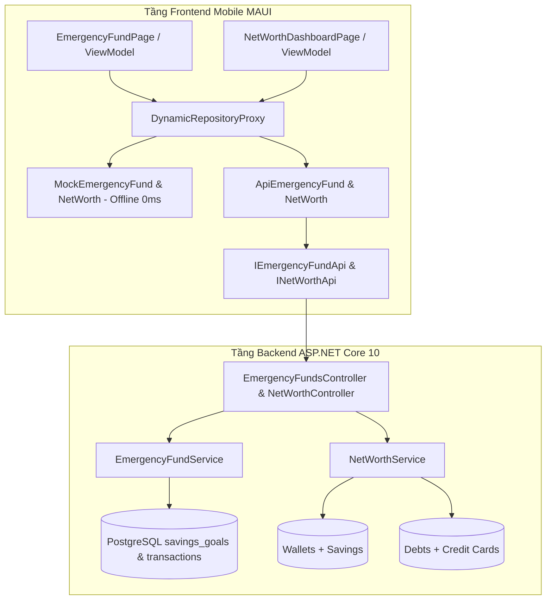

# KẾ HOẠCH TRIỂN KHAI GIAI ĐOẠN MỚI 05: QUỸ KHẨN CẤP (EMERGENCY FUND) & BÁO CÁO TÀI SẢN RÒNG (NET WORTH)

> **Mã Giai Đoạn:** `GIAI_DOAN_MOI_05`  
> **Use Cases Trọng Tâm:**  
> - `UC-06.04: Thiết Lập, Khóa & Quản Trị Quỹ Khẩn Cấp (Emergency Fund 3-6 Tháng Chi Phí Thiết Yếu)`  
> - `UC-07.02: Báo Cáo & Phân Tích Giá Trị Tài Sản Ròng Đa Chiều (Net Worth Breakdown: Assets - Liabilities)`  
> **Tác Tử Phụ Trách:** Agent 02 (Personal Budget Coach), Agent 06 (Debt & Cashflow Optimizer), Agent 01 (Richard Thaler - Nudge Friction), Agent 04 (Eric Evans - DDD), Agent 10 (Dan Abramov - Client State), Agent 12 (Kent Beck - QA)  
> **Định Vị Lộ Trình:** Nhiệm vụ kiểm toán API toàn diện và cập nhật `test_api_suite.ps1` đã được quy hoạch vào **Cổng Kiểm Toán Backend Toàn Hệ Thống** (nằm sau Giai đoạn 10 trên `MASTER_PROJECT_ROADMAP.md`). Giai đoạn 05 này tập trung 100% vào việc hiện thực hóa và kiểm thử trọn vẹn nghiệp vụ Quỹ Khẩn Cấp & Net Worth.  

---

## 1. Mục Tiêu Kỹ Thuật & Giá Trị Nghiệp Vụ (Goal Description)

Xây dựng hai trụ cột an sinh và sức khỏe tài chính cá nhân cốt lõi:

1. **Quỹ Khẩn Cấp Khoa Học & Cơ Chế Khóa Tiêu Lạm (Emergency Fund Protection — `UC-06.04`):**
   - *Tính toán tự động theo chuẩn mực tài chính:* Hệ thống phân tích chi tiêu lịch sử 30–90 ngày của các khoản chi thiết yếu (Needs: Ăn uống, thuê nhà, điện nước, y tế, tiền trả nợ tối thiểu) để đưa ra 3 mức khuyến nghị:
     - 🟢 **Mức Cơ bản (3 tháng Needs):** Dành cho người độc thân, công việc và nguồn thu nhập ổn định.
     - 🟡 **Mức Chuẩn An toàn (6 tháng Needs — Khuyên dùng):** Dành cho người có gia đình, nuôi con nhỏ hoặc người phụ thuộc.
     - 🔴 **Mức Pháo đài Vững chắc (12 tháng Needs):** Dành cho người làm nghề tự do (Freelancer), kinh doanh cá thể, thu nhập biến động lớn.
   - *Cơ chế Khóa Quỹ Chống Tiêu Lạm (Anti-Impulse Lock & Nudge Friction):*
     - Tiền tích lũy trong Quỹ Khẩn Cấp được phong tỏa riêng biệt, **không được tính vào "Số dư khả dụng để tiêu xài hàng ngày"** trên Dashboard.
     - Khi rút tiền từ Quỹ Khẩn Cấp: Kích hoạt màn hình ma sát tâm lý (Richard Thaler Nudge) yêu cầu xác nhận lý do khẩn cấp chính đáng (Cấp cứu y tế, Mất việc làm, Sự cố hư hỏng xe cộ/nhà cửa đột xuất) nhằm ngăn chặn việc rút tiền đem đi mua sắm bốc đồng.

2. **Báo Cáo Tài Sản Ròng Đa Chiều (Net Worth Dashboard & Health Metrics — `UC-07.02`):**
   - *Công thức kế toán cá nhân chuẩn mực:*
     $$\text{Net Worth (Tài sản ròng)} = \text{Tổng Tài Sản (Assets)} - \text{Tổng Nợ (Liabilities)}$$
   - *Tổng Tài Sản (Assets):* Tổng số dư trong các ví tiền mặt, ngân hàng, ví điện tử (`Wallet`) + Số tiền tích lũy trong Quỹ Khẩn Cấp và các hũ tiết kiệm (`SavingsGoal`).
   - *Tổng Nợ (Liabilities):* Toàn bộ dư nợ các khoản nợ cá nhân (`Debts` - Fe Credit, mượn bạn bè, ngân hàng) + Dư nợ âm thẻ tín dụng (`CreditCard`).
   - *Chỉ số Sức khỏe Tài chính (Financial Health Indicators):*
     - **Tỷ lệ Nợ trên Tài sản (Debt-to-Asset Ratio):** $\frac{\text{Tổng Nợ}}{\text{Tổng Tài Sản}} \times 100\%$. Phân loại 3 ngưỡng: $< 30\%$ (Lành mạnh 🟢), $30\% - 50\%$ (Cần lưu ý 🟡), $> 50\%$ (Báo động đỏ đòn bẩy cao 🔴).
     - **Số Tháng Sinh Tồn Khả Dụng (Runway / Survival Months):** $\frac{\text{Quỹ Khẩn Cấp + Tiền Mặt Khả Dụng}}{\text{Chi Phí Thiết Yếu 1 Tháng}}$. Giúp người dùng biết rõ mình có thể duy trì cuộc sống bao nhiêu tháng nếu ngày mai mất toàn bộ thu nhập.
     - **Xu hướng Tài sản ròng (Trend Analysis):** So sánh biến động theo thời gian.

---

## 2. Điểm Cần Người Dùng Duyệt (User Review Required)

> [!IMPORTANT]
> **Quy Chuẩn Tách Biệt Số Dư Quỹ Khẩn Cấp:**
> - Tiền trong Quỹ Khẩn Cấp được neo giữ an toàn. Trên màn hình Dashboard, con số "Tiền khả dụng hôm nay" sẽ không bao gồm quỹ này để người dùng luôn có cảm giác kỷ luật, không tiêu lạm vào tiền phòng thân.

> [!NOTE]
> **Quy Hoạch Kiểm Toán API Toàn Hệ Thống:**
> - Đã cập nhật `MASTER_PROJECT_ROADMAP.md`: Cổng Kiểm Toán Toàn Diện Backend API & Cập Nhật `test_api_suite.ps1` sẽ được thực thi tập trung sau khi hoàn tất toàn bộ các giai đoạn Backend (sau Giai đoạn 10), trước khi bước vào Giai đoạn 11 (Chiến dịch Đại Phẫu Thuật Giao Diện).

---

## 3. Câu Hỏi Mở (Open Questions)

- *Không có câu hỏi mở chặn tiến độ*: Thiết kế nghiệp vụ và kiến trúc phân lớp đã rõ ràng 100%.

---

## 4. Chi Tiết Đề Xuất Thay Đổi (Proposed Changes)



---

### Component 1: Application Layer — DTOs & Models

#### [NEW] `mobile-project/dotnet-maui-ver/backend/ExpenseTracker.Application/DTOs/EmergencyFund/EmergencyFundDtos.cs`
- `EmergencyFundRecommendationDto`:
  - `decimal MonthlyEssentialExpenses`: Chi phí thiết yếu 1 tháng tính từ lịch sử chi tiêu.
  - `decimal TargetBasicMonths3`: Mức 3 tháng.
  - `decimal TargetStandardMonths6`: Mức 6 tháng (Khuyên dùng).
  - `decimal TargetFortressMonths12`: Mức 12 tháng.
  - `int RecommendedMonths`: 3, 6 hoặc 12 tháng.
  - `string RecommendationReason`: Lời giải thích dễ hiểu.
- `EmergencyFundDto`:
  - `Guid GoalId`: ID mục tiêu quỹ khẩn cấp.
  - `decimal TargetAmount`: Mục tiêu số tiền quỹ.
  - `decimal CurrentAmount`: Số tiền hiện có trong quỹ.
  - `decimal ProgressPercent`: Tỷ lệ đạt được (%).
  - `int TargetMonths`: Số tháng được bảo vệ.
  - `decimal MonthlySurvivalRunway`: Số tháng có thể cầm cự với số dư hiện tại.
  - `bool IsFundLocked`: Cờ khóa quỹ chống tiêu lạm.
  - `Guid? SourceWalletId`: Ví liên kết trích nạp tiền.
  - `List<EmergencyFundActivityDto> RecentActivities`: Lịch sử nạp/rút quỹ.
- `SetupEmergencyFundDto`: Khởi tạo quỹ (`TargetMonths`, `InitialDepositAmount`, `SourceWalletId`).
- `DepositEmergencyFundDto`: Nạp thêm tiền vào quỹ (`Amount`, `WalletId`, `Note`).
- `WithdrawEmergencyFundDto`: Rút tiền khẩn cấp kèm lý do (`Amount`, `DestinationWalletId`, `EmergencyReason`, `EmergencyCategory`).

#### [NEW] `mobile-project/dotnet-maui-ver/backend/ExpenseTracker.Application/DTOs/Reports/NetWorthDtos.cs`
- `NetWorthReportDto`:
  - `decimal TotalNetWorth`: Giá trị tài sản ròng ($\text{Assets} - \text{Liabilities}$).
  - `decimal TotalAssets`: Tổng tài sản.
  - `decimal TotalLiabilities`: Tổng nợ.
  - `decimal DebtToAssetRatio`: Tỷ lệ Nợ/Tài sản (%).
  - `string DebtToAssetHealthStatus`: "HEALTHY", "WARNING", "CRITICAL".
  - `decimal SurvivalRunwayMonths`: Số tháng sinh tồn khả dụng.
  - `NetWorthAssetBreakdownDto AssetBreakdown`: Phân rã tài sản (Tiền mặt, Ngân hàng, Ví điện tử, Quỹ khẩn cấp, Tiết kiệm).
  - `NetWorthLiabilityBreakdownDto LiabilityBreakdown`: Phân rã nợ (Nợ thẻ tín dụng, Vay trả góp, Vay cá nhân, Vay thế chấp).
  - `string FinancialHealthAdvice`: Lời khuyên tài chính cá nhân hóa.

---

### Component 2: Application Layer — Services & Logic Nghiệp Vụ

#### [NEW] `mobile-project/dotnet-maui-ver/backend/ExpenseTracker.Application/Interfaces/IEmergencyFundService.cs`
```csharp
public interface IEmergencyFundService
{
    Task<EmergencyFundRecommendationDto> GetRecommendationAsync(Guid userId, CancellationToken ct = default);
    Task<EmergencyFundDto?> GetCurrentFundAsync(Guid userId, CancellationToken ct = default);
    Task<EmergencyFundDto> SetupFundAsync(Guid userId, SetupEmergencyFundDto dto, CancellationToken ct = default);
    Task<EmergencyFundDto> DepositAsync(Guid userId, DepositEmergencyFundDto dto, CancellationToken ct = default);
    Task<EmergencyFundDto> WithdrawAsync(Guid userId, WithdrawEmergencyFundDto dto, CancellationToken ct = default);
}
```

#### [NEW] `mobile-project/dotnet-maui-ver/backend/ExpenseTracker.Application/Services/EmergencyFundService.cs`
- Tự động phân tích lịch sử giao dịch 90 ngày (`TransactionType.Expense` và danh mục `IncomeGroup` hoặc `IsEssential == true`) để tính bình quân chi phí thiết yếu 1 tháng.
- Cơ chế ACID Transaction: Nạp tiền từ ví (`wallet.Debit`) &rarr; Tăng quỹ; Rút tiền từ quỹ &rarr; Cộng tiền vào ví đích (`wallet.Credit`) có lưu vết lý do khẩn cấp.
- Chặn rút tiền nếu số tiền rút lớn hơn số dư hiện tại của quỹ (Bắt lỗi `InvalidOperationException`).

#### [NEW] `mobile-project/dotnet-maui-ver/backend/ExpenseTracker.Application/Interfaces/INetWorthService.cs`
```csharp
public interface INetWorthService
{
    Task<NetWorthReportDto> GetNetWorthReportAsync(Guid userId, CancellationToken ct = default);
}
```

#### [NEW] `mobile-project/dotnet-maui-ver/backend/ExpenseTracker.Application/Services/NetWorthService.cs`
- Tổng hợp số dư từ `Wallets` (Active, !IsDeleted, !IsExcludedFromTotal) + `SavingsGoals` (CurrentAmount).
- Tổng hợp dư nợ từ `Debts` (Active, !IsDeleted, CurrentBalance > 0) + `Wallets` (CreditCard balance < 0).
- Tính `DebtToAssetRatio`, phân loại 3 mức cảnh báo xanh/vàng/đỏ.
- Tính `SurvivalRunwayMonths` bằng cách lấy tổng thanh khoản chia cho chi phí thiết yếu hàng tháng.

---

### Component 3: WebApi Layer — Controllers & Dependency Injection

#### [NEW] `mobile-project/dotnet-maui-ver/backend/ExpenseTracker.WebApi/Controllers/EmergencyFundsController.cs`
- `GET /api/emergency-fund/recommendation`: Lấy gợi ý 3-6-12 tháng chi phí thiết yếu.
- `GET /api/emergency-fund`: Lấy trạng thái quỹ hiện tại kèm số tháng cầm cự.
- `POST /api/emergency-fund/setup`: Khởi tạo quỹ khẩn cấp.
- `POST /api/emergency-fund/deposit`: Nạp thêm tiền vào quỹ từ ví.
- `POST /api/emergency-fund/withdraw`: Rút tiền khẩn cấp (yêu cầu lý do).

#### [NEW] `mobile-project/dotnet-maui-ver/backend/ExpenseTracker.WebApi/Controllers/NetWorthController.cs`
- `GET /api/net-worth`: Lấy báo cáo tài sản ròng, phân rã tài sản/nợ, chỉ số nợ và số tháng sinh tồn.

#### [MODIFY] `mobile-project/dotnet-maui-ver/backend/ExpenseTracker.Application/DependencyInjection.cs`
- Đăng ký `IEmergencyFundService` và `INetWorthService`.

---

### Component 4: Mobile MAUI — Models, Refit API, Repository & Offline Mode

#### [NEW] `mobile-project/dotnet-maui-ver/frontend/ExpenseTracker.Maui/Models/EmergencyFund/EmergencyFundModels.cs`
#### [NEW] `mobile-project/dotnet-maui-ver/frontend/ExpenseTracker.Maui/Models/Reports/NetWorthModels.cs`
#### [MODIFY] `mobile-project/dotnet-maui-ver/frontend/ExpenseTracker.Maui/Services/Api/IApiClients.cs`
- Bổ sung `IEmergencyFundApi` và `INetWorthApi`.
#### [NEW] `mobile-project/dotnet-maui-ver/frontend/ExpenseTracker.Maui/Repositories/IEmergencyFundRepository.cs` & `INetWorthRepository.cs`
- Triển khai `ApiEmergencyFundRepository`, `MockEmergencyFundRepository`, `ApiNetWorthRepository`, `MockNetWorthRepository`.
#### [NEW] `mobile-project/dotnet-maui-ver/frontend/ExpenseTracker.Maui/ViewModels/EmergencyFundViewModel.cs` & `NetWorthViewModel.cs`
- Quản lý tương tác nạp/rút quỹ, modal ma sát tâm lý Nudge xác nhận lý do khẩn cấp và hiển thị chỉ số sức khỏe tài sản ròng.

---

### Component 5: Kiểm Thử Đơn Vị Tự Động (Unit Tests)

#### [NEW] `mobile-project/dotnet-maui-ver/backend/tests/ExpenseTracker.Application.UnitTests/Services/EmergencyFundServiceTests.cs` (tối thiểu 8 tests)
1. `GetRecommendation_CalculatesValid3_6_12_MonthsFromHistory`: Tính đúng 3 mốc 3-6-12 tháng.
2. `SetupFund_CreatesGoalAndDebitsSourceWallet`: Khởi tạo quỹ và trừ tiền ví chuẩn ACID.
3. `Deposit_IncreasesFundAndDebitsWallet`: Nạp tiền thành công.
4. `Withdraw_WithReason_DecreasesFundAndCreditsWallet`: Rút tiền thành công có lý do.
5. `Withdraw_WhenAmountExceedsBalance_ThrowsInvalidOperationException`: Chặn rút quá số dư.
6. `Withdraw_WhenAmountNegative_ThrowsArgumentException`: Chặn rút số tiền âm.
7. `Withdraw_WithoutReason_ThrowsArgumentException`: Chặn rút không có lý do.
8. `Deposit_WhenWalletArchived_ThrowsInvalidOperationException`: Chặn trích tiền từ ví đã archive.

#### [NEW] `mobile-project/dotnet-maui-ver/backend/tests/ExpenseTracker.Application.UnitTests/Services/NetWorthServiceTests.cs` (tối thiểu 6 tests)
1. `GetNetWorthReport_CalculatesAssetsMinusLiabilities`: Đúng công thức Net Worth = Assets - Liabilities.
2. `GetNetWorthReport_CalculatesDebtToAssetRatioCorrectly`: Tính đúng tỷ lệ đòn bẩy %.
3. `GetNetWorthReport_WhenDebtExceedsFiftyPercent_ReportsCriticalStatus`: Gắn nhãn CRITICAL khi đòn bẩy $> 50\%$.
4. `GetNetWorthReport_CalculatesSurvivalRunwayMonths`: Tính đúng số tháng sinh tồn khả dụng.
5. `GetNetWorthReport_WhenNoDebts_ReturnsLiabilitiesZero`: Xử lý đúng khi sạch nợ.
6. `GetNetWorthReport_ExcludesArchivedAndExcludedWallets`: Bỏ qua các ví archive/excluded.

#### [NEW] `mobile-project/dotnet-maui-ver/frontend/tests/ExpenseTracker.Maui.UnitTests/Repositories/EmergencyFundAndNetWorthRepositoryTests.cs`
- Kiểm thử Mock Repository chạy offline 0ms trả về dữ liệu Quỹ Khẩn Cấp và Net Worth đầy đủ.

---

## 5. Kế Hoạch Xác Minh & Nghiệm Thu (Verification Plan)

### Automated Tests
1. **Kiểm thử đơn vị Backend:**
   ```powershell
   dotnet test mobile-project/dotnet-maui-ver/backend/ExpenseTracker.slnx
   ```
   *Mục tiêu:* Đạt tối thiểu **343/343 tests PASSED 100%** (104 Domain + 239 Application).

2. **Kiểm thử đơn vị Mobile MAUI:**
   ```powershell
   dotnet test mobile-project/dotnet-maui-ver/frontend/tests/ExpenseTracker.Maui.UnitTests/ExpenseTracker.Maui.UnitTests.csproj
   ```
   *Mục tiêu:* Đạt tối thiểu **105/105 tests PASSED 100%**.

3. **Tổng kiểm thử đơn vị toàn hệ sinh thái:** **448 / 448 tests PASSED (0 Error, 0 Warning phát sinh)**.
