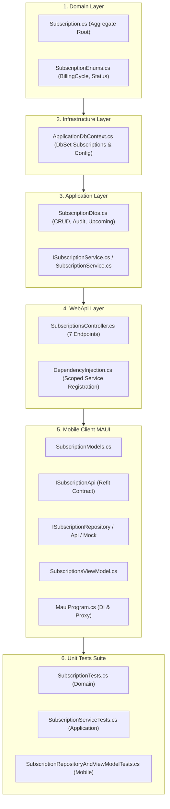

# KẾ HOẠCH TRIỂN KHAI GIAI ĐOẠN MỚI 06: QUÉT & CẢNH BÁO BẪY ĐĂNG KÝ ĐỊNH KỲ (SUBSCRIPTION TRAPS & RECURRING EXPENSES)

> **Mã Giai Đoạn:** `GIAI_DOAN_MOI_06`  
> **Use Case Trọng Tâm:** `UC-03.09: Quét, Quản Trị & Cảnh Báo Bẫy Thuê Bao Định Kỳ (Subscription Trap Detector & Auto-Renewal Alert)`  
> **Tác Tử Phụ Trách:** Agent 01 (Richard Thaler - Nudge Theory), Agent 02 (Personal Budget Coach), Agent 04 (Eric Evans - DDD), Agent 05 (Martin Kleppmann - CSDL), Agent 10 (Dan Abramov - Client State), Agent 12 (Kent Beck - QA)  
> **Định Vị Lộ Trình:** Giai đoạn 06 nằm trong Khối 2 (Lõi Nghiệp Vụ Tài Chính Chuyên Sâu). Tiếp tục duy trì cam kết: Cổng Kiểm Toán Toàn Diện Backend API và file `test_api_suite.ps1` sẽ thực thi tập trung sau Giai đoạn 10.

---

## 1. Mục Tiêu Kỹ Thuật & Giá Trị Nghiệp Vụ (Goal Description)

Trong quản lý tài chính cá nhân hiện đại, **Bẫy Thuê Bao Định Kỳ (Subscription Traps)** là nguyên nhân hàng đầu gây "chảy máu dòng tiền âm thầm" (Micro-drain leakage). Người dùng đăng ký gói xem phim, nghe nhạc, lưu trữ đám mây, ứng dụng AI hoặc tập Gym với chương trình "Dùng thử miễn phí 7 ngày" (Free Trial) hoặc "Thanh toán tự động hàng tháng" (Auto-debit), sau đó quên bẵng nhưng tiền vẫn đều đặn bị trừ vào thẻ tín dụng/ví mỗi tháng.

Giai đoạn 06 nâng cấp toàn diện phân hệ này từ một hàm kiểm tra đơn giản thành **Hệ thống Quản trị & Cảnh báo Thuê bao Độc lập Toàn trình**:

1. **Thực Thể CSDL Độc Lập (`Subscription`):**
   - Không chỉ quét giao dịch đơn thuần, người dùng có bảng dữ liệu riêng (`subscriptions`) để quản lý danh mục thuê bao: Tên dịch vụ, Số tiền mỗi kỳ, Chu kỳ thanh toán (Tuần, Tháng, Quý, Năm), Ngày gia hạn kế tiếp (`NextBillingDate`), Ví thanh toán liên kết, Trạng thái (`Active`, `Cancelled`, `Paused`, `FreeTrial`), Ngày hết hạn dùng thử, Cảnh báo trước hạn $N$ ngày.
2. **Động Cơ Kiểm Toán Bẫy Thuê Bao Đa Tầng (Multi-tier Audit Engine):**
   - **Tầng 1 (Catalog Match):** Nhận diện tức thì các dịch vụ số phổ biến tại Việt Nam & Quốc tế (Netflix, Spotify, Apple iCloud, YouTube Premium, OpenAI ChatGPT, Adobe CC, Canva Pro, Microsoft 365, VieON, FPT Play, Elsa Speak, California Gym...).
   - **Tầng 2 (Heuristic Pattern Match):** Quét toàn bộ lịch sử giao dịch chi tiêu (`Transactions`), tự động phát hiện các khoản chi lặp lại cùng số tiền và cùng chu kỳ thời gian (ví dụ: tiền mạng internet, tiền phòng trọ, gói cước di động).
   - **Tầng 3 (Free Trial Trap Warning):** Radar phát hiện và phát thông báo đỏ trước 2-3 ngày khi gói "Dùng thử miễn phí" sắp tự động chuyển sang trừ tiền thật.
3. **Cú Hích Hành Vi (Richard Thaler Nudge):**
   - Tính toán và hiển thị trực quan: **"Tổng số tiền hao mòn mỗi năm"** (Annual Drain) thay vì chỉ nhìn con số nhỏ hàng tháng. Khi người dùng thấy 260.000đ/tháng thực chất là **3.120.000đ/năm**, ma sát nhận thức sẽ kích thích họ hủy ngay các gói dịch vụ không thực sự dùng tới.
4. **Trải Nghiệm Mobile Offline-First 0ms:**
   - Quản lý danh mục thuê bao, bộ lọc trạng thái, tính toán ngày đếm ngược đến kỳ gia hạn (Countdown days) mượt mà không độ trễ.

---

## 2. Điểm Cần Người Dùng Duyệt (User Review Required)

> [!IMPORTANT]
> **1. Quy Chuẩn Trạng Thái Thuê Bao & Tự Động Gia Hạn (Auto-Renew):**
> - Khi người dùng bấm "Hủy theo dõi" (Archive), hệ thống sẽ chuyển sang trạng thái `Cancelled` (Soft delete) để bảo toàn lịch sử thống kê, không xóa vật lý.
> - Có 4 trạng thái:
>   * `Active` (Đang hoạt động, tự động tính vào dòng tiền hao mòn)
>   * `FreeTrial` (Đang dùng thử miễn phí, hiển thị đồng hồ đếm ngược báo động)
>   * `Paused` (Đang tạm ngưng dịch vụ)
>   * `Cancelled` (Đã hủy dịch vụ)

> [!NOTE]
> **2. Quy Hoạch Chốt Chặn Kiểm Toán API:**
> - Tiếp tục tuân thủ nghiêm ngặt chỉ đạo: Việc cập nhật tài liệu `API_CONTRACT_SPECIFICATION.md` và kịch bản `test_api_suite.ps1` sẽ dồn lại thực hiện tập trung tại **Cổng Kiểm Toán Backend Toàn Hệ Thống** (sau Giai đoạn 10). Giai đoạn 06 này tập trung hoàn thành sạch sẽ mã nguồn, API endpoints và đạt 100% tỷ lệ pass cho toàn bộ Unit Tests.

---

## 3. Câu Hỏi Mở (Open Questions)

- *Không có câu hỏi chặn:* Nghiệp vụ bẫy thuê bao đã được định nghĩa rõ ràng trong `UC-03.09`. Nếu người dùng không có yêu cầu đặc thù nào khác, hệ thống sẽ tự động áp dụng các chu kỳ thanh toán chuẩn (`Weekly`, `Monthly`, `Quarterly`, `Yearly`) và nhắc trước mặc định 3 ngày.

---

## 4. Kế Hoạch Thay Đổi Chi Tiết (Proposed Changes)



---

### Component 1: Domain Entities & Enums (Backend)
- `[NEW] ExpenseTracker.Domain/Enums/SubscriptionEnums.cs`:
  - `SubscriptionBillingCycle`: `Weekly = 1`, `Monthly = 2`, `Quarterly = 3`, `Yearly = 4`.
  - `SubscriptionStatus`: `Active = 1`, `Cancelled = 2`, `Paused = 3`, `FreeTrial = 4`.
- `[NEW] ExpenseTracker.Domain/Entities/Subscription.cs`:
  - Kế thừa `BaseEntity` (đã có sẵn `Id`, `CreatedAt`, `IsDeleted`, `DeletedAt`).
  - Thuộc tính: `UserId`, `Name`, `Amount`, `BillingCycle`, `NextBillingDate`, `WalletId`, `CategoryId`, `Status`, `TrialEndDate`, `AutoRenew`, `RemindDaysBefore`, `Notes`.
  - Phương thức Domain: `RenewToNextCycle()`, `Cancel()`, `Pause()`, `Activate()`, `UpdateDetails(...)`.

---

### Component 2: Infrastructure & Database Persistence
- `[MODIFY] ExpenseTracker.Application/Interfaces/IApplicationDbContext.cs`:
  - Thêm `DbSet<Subscription> Subscriptions { get; }`.
- `[MODIFY] ExpenseTracker.Infrastructure/Persistence/ApplicationDbContext.cs`:
  - Thêm `public DbSet<Subscription> Subscriptions => Set<Subscription>();`.

---

### Component 3: Application DTOs & Services
- `[MODIFY] ExpenseTracker.Application/DTOs/SmartUtilities/SubscriptionDtos.cs`:
  - Mở rộng thêm:
    - `SubscriptionDto`: DTO phản hồi chi tiết (kèm `AnnualCost`, `DaysUntilNextBilling`, `IsExpiringSoon`).
    - `CreateSubscriptionDto`: DTO tạo mới thuê bao thủ công.
    - `UpdateSubscriptionDto`: DTO chỉnh sửa thuê bao.
    - `SubscriptionAuditReportDto`: Báo cáo rà soát toàn diện (Tổng tiền hao mòn tháng/năm, danh sách bẫy Zombie Subscription ít dùng, cảnh báo Free Trial).
    - `UpcomingSubscriptionRenewalDto`: Danh sách các khoản sắp trừ tiền trong $N$ ngày.
- `[NEW] ExpenseTracker.Application/Interfaces/ISubscriptionService.cs`:
  - Khai báo các hợp đồng nghiệp vụ quản trị và kiểm toán bẫy thuê bao.
- `[NEW] ExpenseTracker.Application/Services/SubscriptionService.cs`:
  - Hiện thực hóa động cơ kiểm toán 2 tầng (Catalog Match + Periodic Transaction Clustering) và quản trị vòng đời thuê bao.
- `[MODIFY] ExpenseTracker.Application/DependencyInjection.cs`:
  - Đăng ký `services.AddScoped<ISubscriptionService, SubscriptionService>();`.

---

### Component 4: WebApi Controllers
- `[NEW] ExpenseTracker.WebApi/Controllers/SubscriptionsController.cs`:
  - `GET /api/subscriptions`: Lấy danh sách thuê bao đang quản lý.
  - `GET /api/subscriptions/{id}`: Xem chi tiết một thuê bao.
  - `POST /api/subscriptions`: Tạo mới thuê bao theo dõi.
  - `PUT /api/subscriptions/{id}`: Cập nhật thông tin thuê bao.
  - `POST /api/subscriptions/{id}/archive`: Hủy theo dõi / Xóa mềm thuê bao.
  - `GET /api/subscriptions/audit`: Quét toàn diện phát hiện bẫy thuê bao từ lịch sử giao dịch.
  - `POST /api/subscriptions/convert`: Chuyển đổi một ứng viên phát hiện thành thuê bao quản trị chính thức.
  - `GET /api/subscriptions/upcoming`: Lấy danh sách thuê bao sắp gia hạn trong $N$ ngày tới.

---

### Component 5: Mobile MAUI Client & Clean MVVM
- `[NEW] ExpenseTracker.Maui/Models/SmartUtilities/SubscriptionManagementModels.cs`:
  - Các model DTO tương ứng trên MAUI.
- `[MODIFY] ExpenseTracker.Maui/Services/Api/IApiClients.cs`:
  - Khai báo Refit Client `ISubscriptionApi`.
- `[NEW] ExpenseTracker.Maui/Repositories/ISubscriptionRepository.cs`:
  - Interface cho Repository.
- `[NEW] ExpenseTracker.Maui/Repositories/ApiSubscriptionRepository.cs`:
  - Gọi Refit Client khi Online.
- `[NEW] ExpenseTracker.Maui/Repositories/MockSubscriptionRepository.cs`:
  - Seed sẵn dữ liệu mẫu (Netflix, iCloud, Spotify, California Gym) cho chế độ Offline 0ms.
- `[NEW] ExpenseTracker.Maui/ViewModels/SubscriptionsViewModel.cs`:
  - ViewModel quản lý: Danh sách thuê bao active, kết quả kiểm toán bẫy chi tiêu, cảnh báo sắp gia hạn, thêm mới/sửa/hủy thuê bao.
- `[MODIFY] ExpenseTracker.Maui/MauiProgram.cs`:
  - Đăng ký Refit Client, Mock & Api Repository, DynamicRepositoryProxy, ViewModel.
- `[MODIFY] ExpenseTracker.Maui.UnitTests/ExpenseTracker.Maui.UnitTests.csproj`:
  - Thêm dòng link compile cho `SubscriptionsViewModel.cs`.

---

### Component 6: Unit Testing & Verification
- `[NEW] ExpenseTracker.Domain.UnitTests/Entities/SubscriptionTests.cs`:
  - 5+ unit tests kiểm thử Domain Invariants của `Subscription`.
- `[NEW] ExpenseTracker.Application.UnitTests/Services/SubscriptionServiceTests.cs`:
  - 8+ unit tests kiểm thử logic CRUD, thuật toán phát hiện bẫy thuê bao 2 tầng, cảnh báo Free Trial, và upcoming renewals.
- `[NEW] ExpenseTracker.Maui.UnitTests/Repositories/SubscriptionRepositoryAndViewModelTests.cs`:
  - 4+ unit tests kiểm thử Mock Repository và ViewModel trên MAUI.
- **Chỉ tiêu kiểm thử:** Nâng tổng số tests từ **448** lên **465+ tests PASSED 100%**.

---

## 5. Kế Hoạch Xác Minh (Verification Plan)

### Automated Tests
1. **Kiểm thử Backend Domain & Application:**
   ```powershell
   dotnet test "mobile-project\dotnet-maui-ver\backend\ExpenseTracker.slnx"
   ```
   *Kỳ vọng:* Toàn bộ Domain Tests và Application Tests đạt **356 / 356 PASSED 100%**.

2. **Kiểm thử Mobile MAUI:**
   ```powershell
   dotnet test "mobile-project\dotnet-maui-ver\frontend\tests\ExpenseTracker.Maui.UnitTests\ExpenseTracker.Maui.UnitTests.csproj"
   ```
   *Kỳ vọng:* Toàn bộ Mobile Tests đạt **109 / 109 PASSED 100%**.

3. **Tổng kiểm thử toàn hệ thống:**
   *Kỳ vọng:* Đạt tối thiểu **465 / 465 PASSED 100% (0 Lỗi, 0 Warning)**.
