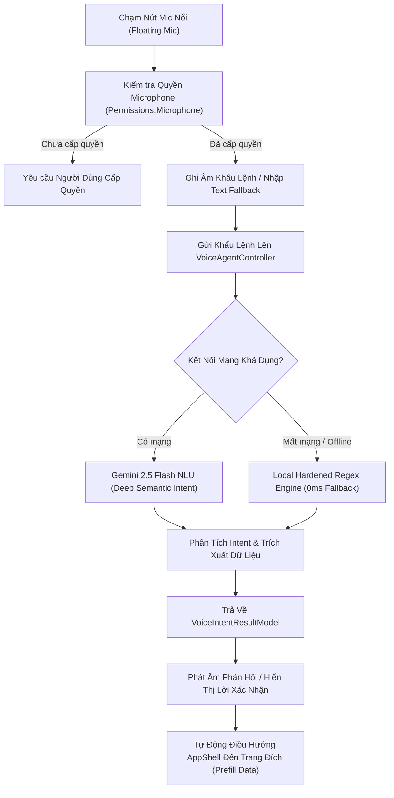

# KẾ HOẠCH TRIỂN KHAI GIAI ĐOẠN MỚI 09: TRỢ LÝ GIỌNG NÓI AI TOÀN TRÌNH (AI VOICE ASSISTANT — MICROPHONE NATIVE, AGENTIC TOOL ROUTING & OFFLINE FALLBACK)

> **Mã kế hoạch:** `PLAN-68`  
> **Phân hệ mục tiêu:** Phân hệ 3 & 9 (`UC-03.11` Voice Quick Input, `UC-08.06` XAI Financial Assistant)  
> **Chỉ tiêu kiểm thử:** $\ge 495$ Tests PASSED 100% (Domain + Application + Mobile)  
> **Cam kết bảo lưu:** Tuyệt đối không can thiệp cập nhật tài liệu API hay PostgreSQL EF Migration lúc này (toàn bộ gom về Cổng Kiểm Toán Backend sau Giai đoạn 10).

---

## 1. MỤC TIÊU & BỐI CẢNH (GOAL DESCRIPTION)

Sau khi hoàn thành xuất sắc Giai đoạn Mới 08 với năng lực AI Vision OCR bóc tách hóa đơn siêu thị thực tế, hệ thống tiếp tục bước vào hạng mục then chốt thứ hai của **Khối 3: Trí Tuệ Nhân Tạo & Phần Cứng Native**:
**Hiện thực hóa Trợ Lý Giọng Nói AI Toàn Trình (AI Voice Assistant)**.

### Mục Tiêu Trọng Tâm Của Giai Đoạn Mới 09:
1. **Microphone Native & Quyền Hệ Thống:**
   - Bổ sung quyền `<uses-permission android:name="android.permission.RECORD_AUDIO" />` và `MODIFY_AUDIO_SETTINGS` vào `AndroidManifest.xml`.
   - Cơ chế kiểm tra và xin cấp quyền động (`Permissions.RequestAsync<Permissions.Microphone>()`) khi người dùng chạm vào biểu tượng Micro.
2. **Nâng Cấp NLU & Định Tuyến Ý Định Thông Minh (Agentic Intent Routing):**
   - Mở rộng prompt Gemini 2.5 Flash NLU và bộ luật Heuristic Regex tiếng Việt đời thường ("50k", "2 củ", "năm xị", "hai trẹo") để bao quát toàn bộ các phân hệ mới vừa hoàn thành:
     * **Trả nợ cá nhân (`DebtPayment`):** "Tôi vừa trả 2 triệu nợ thẻ tín dụng", "Trả 500k tiền góp máy tính" $\rightarrow$ Điều hướng `DebtTrackerPage`.
     * **Quỹ khẩn cấp (`EmergencyFund`):** "Xem quỹ khẩn cấp", "Nạp 1 triệu vào quỹ dự phòng" $\rightarrow$ Điều hướng `EmergencyFundPage`.
     * **Bẫy thuê bao (`SubscriptionAudit`):** "Quét các dịch vụ đăng ký định kỳ", "Kiểm tra bẫy thuê bao" $\rightarrow$ Điều hướng `SubscriptionsPage`.
     * **Mô phỏng What-If (`WhatIfSimulation`):** "Thử mô phỏng mua xe máy 40 triệu", "Nếu bị giảm lương 30%" $\rightarrow$ Điều hướng `ForecastingPage`.
     * **AI Vision OCR (`ReceiptOcr`):** "Mở máy ảnh quét hóa đơn", "Chụp hóa đơn siêu thị" $\rightarrow$ Điều hướng `ReceiptOcrPage`.
     * **Hỏi đáp Trợ lý XAI (`AskAssistant`):** Giải trình lý do cảnh báo, tư vấn hạn mức chi tiêu mỗi ngày DSA.
3. **Trải Nghiệm Tương Tác Giọng Nói Đa Kênh (Multimodal Interactive Voice UX):**
   - Nâng cấp `VoiceMicModalPage.xaml` với bộ nút chip câu lệnh tương tác 1 chạm, ô nhập văn bản trực tiếp (Text Fallback khi ở môi trường ồn ào), và hiệu ứng sóng âm lắng nghe trực quan.
   - Câu phản hồi xác nhận (Confirmation Message) được chuẩn hóa theo phong cách tự nhiên, ngắn gọn, loại bỏ từ ngữ rập khuôn AI.
4. **Kiểm Thử Toàn Trình:**
   - Bổ sung các bài kiểm thử mới cho cả `VoiceIntentRouterServiceTests.cs` (Backend) và `VoiceFloatingMicViewModelTests.cs` (Mobile).
   - Đảm bảo 100% test suites PASSED (nâng tổng số lượng từ 485 lên **$\ge 495$ tests**).

---

## 2. USER REVIEW REQUIRED

> [!IMPORTANT]
> **1. Quyền Ghi Âm Native Android (`RECORD_AUDIO`):**
> Cần bổ sung vào `AndroidManifest.xml` để ứng dụng có quyền truy cập phần cứng microphone của thiết bị di động.
> 
> **2. Cơ Chế Chuyển Đổi Thoại (Voice Input vs Text Fallback):**
> Trên thiết bị di động thật, nếu người dùng ở môi trường nhiều tiếng ồn hoặc microphone không khả dụng, hệ thống cung cấp sẵn ô nhập văn bản khẩu lệnh trực tiếp (Direct Transcript Input) ngay trên Modal để trải nghiệm không bao giờ bị gián đoạn.
> 
> **3. Cam Kết Tuyệt Đối Về Cổng Kiểm Toán Backend:**
> Giữ đúng chỉ đạo của Chủ tọa: Không chạy script cập nhật tài liệu API và không chạy EF Core migration đơn lẻ trong giai đoạn này. Toàn bộ các công việc đó được dời về **Cổng Kiểm Toán Backend Toàn Hệ Thống** sau khi hoàn tất Giai đoạn 10.

---

## 3. OPEN QUESTIONS

> [!NOTE]
> - Có cần bổ sung thêm giọng đọc phát âm Text-To-Speech (TTS) đọc lại câu trả lời hay chỉ cần hiển thị văn bản phản hồi trực quan trên màn hình?  
>   *(Đề xuất: Sử dụng văn bản phản hồi thông minh trên giao diện modal kết hợp hệ thống Text-To-Speech native `TextToSpeech.Default.SpeakAsync` nếu thiết bị hỗ trợ, có tùy chọn bật/tắt để không làm phiền người dùng ở nơi công cộng).*

---

## 4. CHI TIẾT CÁC BƯỚC THỰC HIỆN (PROPOSED CHANGES)



---

### Bước 1: Cấu Hình Quyền Android Native Microphone

#### `[MODIFY]` `mobile-project/dotnet-maui-ver/frontend/ExpenseTracker.Maui/Platforms/Android/AndroidManifest.xml`
- Bổ sung các quyền phần cứng âm thanh:
  ```xml
  <!-- Native Microphone Permissions for Voice Assistant (UC-03.11) -->
  <uses-permission android:name="android.permission.RECORD_AUDIO" />
  <uses-permission android:name="android.permission.MODIFY_AUDIO_SETTINGS" />
  <uses-feature android:name="android.hardware.microphone" android:required="false" />
  ```

---

### Bước 2: Nâng Cấp NLU & Định Tuyến Ý Định Backend

#### `[MODIFY]` `mobile-project/dotnet-maui-ver/backend/ExpenseTracker.Application/DTOs/AiAgent/VoiceIntentDtos.cs`
- Bổ sung các hằng số Intent mới:
  * `VoiceIntents.DebtPayment` = `"DebtPayment"`
  * `VoiceIntents.EmergencyFund` = `"EmergencyFund"`
  * `VoiceIntents.SubscriptionAudit` = `"SubscriptionAudit"`
  * `VoiceIntents.WhatIfSimulation` = `"WhatIfSimulation"`
  * `VoiceIntents.ReceiptOcr` = `"ReceiptOcr"`

#### `[MODIFY]` `mobile-project/dotnet-maui-ver/backend/ExpenseTracker.Application/Services/VoiceIntentRouterService.cs`
- Nâng cấp `TryProcessWithGeminiNluAsync`: Mở rộng schema và system prompt nhận diện sâu các thực thể nợ (`Debts`), quỹ khẩn cấp (`EmergencyFund`), gói thuê bao định kỳ (`Subscriptions`), và mô phỏng What-If (`WhatIfScenario`).
- Nâng cấp `ProcessWithHardenedRegexEngineAsync`:
  * Mở rộng nhận diện regex các mẫu câu:
    - `trả nợ|thanh toán nợ|trả góp|thẻ tín dụng` $\rightarrow$ TargetRoute: `"DebtTrackerPage"`
    - `quỹ khẩn cấp|quỹ dự phòng|tiền dự phòng` $\rightarrow$ TargetRoute: `"EmergencyFundPage"`
    - `bẫy thuê bao|dịch vụ đăng ký|gói cước|netflix|spotify` $\rightarrow$ TargetRoute: `"SubscriptionsPage"`
    - `mô phỏng|kịch bản|thử mua|what-if|giảm lương` $\rightarrow$ TargetRoute: `"ForecastingPage"`
    - `quét hóa đơn|chụp hóa đơn|bóc tách hóa đơn|camera hóa đơn` $\rightarrow$ TargetRoute: `"ReceiptOcrPage"`
  * Tạo văn bản phản hồi tự nhiên, giải thích rõ hành động tiếp theo của hệ thống.

---

### Bước 3: Nâng Cấp Client Mobile MAUI & Trải Nghiệm Tương Tác

#### `[MODIFY]` `mobile-project/dotnet-maui-ver/frontend/ExpenseTracker.Maui/ViewModels/AiAgent/VoiceFloatingMicViewModel.cs`
- Bổ sung lệnh `RequestMicrophonePermissionAndListenAsync`:
  * Kiểm tra quyền `Permissions.CheckStatusAsync<Permissions.Microphone>()`.
  * Nếu chưa cấp, gọi `Permissions.RequestAsync<Permissions.Microphone>()`.
  * Nếu người dùng từ chối, hiển thị hướng dẫn nhập khẩu lệnh bằng ô nhập văn bản.
- Mở rộng phương thức `ExecuteNavigationIntentAsync`:
  * Hỗ trợ điều hướng đến `DebtTrackerPage`, `EmergencyFundPage`, `SubscriptionsPage`, `ForecastingPage`, `ReceiptOcrPage`.
  * Truyền tham số dữ liệu đi kèm (`amount`, `note`, `category`) để điền sẵn vào trang đích (Prefill data).
- Bổ sung hỗ trợ đọc phản hồi Text-To-Speech native: `TextToSpeech.Default.SpeakAsync(confirmationMessage)`.

#### `[MODIFY]` `mobile-project/dotnet-maui-ver/frontend/ExpenseTracker.Maui/Views/AiAgent/VoiceMicModalPage.xaml`
- Bổ sung ô nhập văn bản khẩu lệnh trực tiếp (Direct Input Text Box & Nút Gửi) bên dưới hộp nhận diện giọng nói.
- Cập nhật thêm các Chip câu lệnh mẫu phong phú:
  * "Trả nợ 2 triệu thẻ tín dụng" (Xanh dương)
  * "Xem quỹ khẩn cấp" (Tím)
  * "Quét bẫy thuê bao" (Cam)
  * "Mô phỏng mua xe 30 triệu" (Xanh ngọc)
  * "Quét hóa đơn mua sắm" (Hồng)
- Hiển thị hiệu ứng trạng thái lắng nghe trực quan, bắt mắt.

---

### Bước 4: Viết Unit Tests Tự Động Toàn Trình

#### `[MODIFY]` `mobile-project/dotnet-maui-ver/backend/tests/ExpenseTracker.Application.UnitTests/Services/VoiceIntentRouterServiceTests.cs`
- Bổ sung 5-6 test cases mới:
  1. `RouteVoiceCommandAsync_WithDebtPaymentCommand_ShouldRouteToDebtTracker`
  2. `RouteVoiceCommandAsync_WithEmergencyFundCommand_ShouldRouteToEmergencyFundPage`
  3. `RouteVoiceCommandAsync_WithSubscriptionAuditCommand_ShouldRouteToSubscriptionsPage`
  4. `RouteVoiceCommandAsync_WithWhatIfSimulationCommand_ShouldRouteToForecastingPage`
  5. `RouteVoiceCommandAsync_WithReceiptOcrCommand_ShouldRouteToReceiptOcrPage`
  6. `RouteVoiceCommandAsync_WithOfflineRegexFallback_ShouldExtractVietnameseSlangAccurately`

#### `[MODIFY]` `mobile-project/dotnet-maui-ver/frontend/tests/ExpenseTracker.Maui.UnitTests/VoiceFloatingMicViewModelTests.cs`
- Bổ sung 4-5 test cases mới:
  1. `ProcessTranscriptAsync_WithDebtPaymentIntent_ShouldSetCorrectResultAndFeedback`
  2. `ProcessTranscriptAsync_WithEmergencyFundIntent_ShouldSetCorrectRoute`
  3. `ProcessTranscriptAsync_WithSubscriptionIntent_ShouldSetCorrectRoute`
  4. `ProcessTranscriptAsync_WithWhatIfIntent_ShouldSetCorrectRoute`
  5. `ExecuteNavigationIntentAsync_WithPrefillData_ShouldFormatNavigationUriCorrectly`

---

## 5. KẾ HOẠCH XÁC MINH & NGHIỆM THU (VERIFICATION PLAN)

### 5.1. Kiểm Thử Tự Động (Automated Tests)
Chạy toàn bộ 3 bộ kiểm thử của hệ thống với cờ `--no-restore` (hoặc bypass sandbox khi cần):
1. `dotnet test mobile-project/dotnet-maui-ver/backend/tests/ExpenseTracker.Domain.UnitTests/ExpenseTracker.Domain.UnitTests.csproj`
2. `dotnet test mobile-project/dotnet-maui-ver/backend/tests/ExpenseTracker.Application.UnitTests/ExpenseTracker.Application.UnitTests.csproj`
3. `dotnet test mobile-project/dotnet-maui-ver/frontend/tests/ExpenseTracker.Maui.UnitTests/ExpenseTracker.Maui.UnitTests.csproj`
- **Chỉ tiêu:** 100% tests PASSED, số lượng tối thiểu **$\ge 495$ tests**.

### 5.2. Hồ Sơ Quyết Định & Cập Nhật Lộ Trình
- Ghi nhận **Quyết Định 198** vào `project_context/decisions_and_changes_log.md`.
- Cập nhật mục 4I trong `MASTER_PROJECT_ROADMAP.md` chuyển Giai đoạn Mới 09 sang trạng thái `HOÀN THÀNH 100% (VERIFIED)`.
- Cập nhật tài liệu Artifact `walkthrough.md`.

