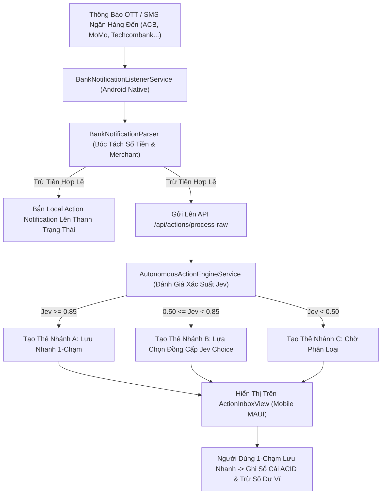

# KẾ HOẠCH TRIỂN KHAI GIAI ĐOẠN MỚI 10: ANDROID NATIVE PUSH & TỰ ĐỘNG PHÂN TÍCH THÔNG BÁO BIẾN ĐỘNG SỐ DƯ NGÂN HÀNG TOÀN TRÌNH (ANDROID NOTIFICATION LISTENER, BANKING NLP PARSER & ACTION INBOX)

> **Mã kế hoạch:** `PLAN-69`  
> **Phân hệ mục tiêu:** Phân hệ 3 (`UC-03.09` Automatic Expense Extraction from SMS/OTT Notifications, `UC-03.10` Bank Push Notification Integration & Server-Driven Action Protocol)  
> **Chỉ tiêu kiểm thử:** $\ge 508$ Tests PASSED 100% (Domain + Application + Mobile)  
> **Cam kết bảo lưu:** Tuyệt đối không can thiệp cập nhật tài liệu API hay PostgreSQL EF Migration lúc này (toàn bộ gom về thực hiện tập trung tại Cổng Kiểm Toán Backend ngay sau Giai đoạn 10).

---

## 1. MỤC TIÊU & BỐI CẢNH (GOAL DESCRIPTION)

Sau khi hoàn thiện Trợ Lý Giọng Nói AI ở Giai đoạn Mới 09, hệ thống bước vào giai đoạn khép lại **Khối 3: Trí Tuệ Nhân Tạo & Phần Cứng Native**:
**Hiện thực hóa Năng lực Tự Động Bắt & Phân Tích Thông Báo Biến Động Số Dư Ngân Hàng Toàn Trình (Bank Notification Listener & Action Inbox)**.

Đây là tính năng "sát thủ" (Killer Feature) trong quản lý tài chính cá nhân hiện đại: Người dùng chỉ cần quẹt thẻ hoặc chuyển khoản ngân hàng, ứng dụng sẽ ngay lập tức bắt thông báo OTT/SMS của ngân hàng ở chế độ nền (Background Service), tự động phân tích số tiền và cửa hàng, đưa vào Khay Hành Động Thông Minh (Action Inbox) với giao diện 1-chạm lưu nhanh hoặc tự động điền sẵn (Auto-Fill Expense) mà không đòi hỏi người dùng phải ghi chép thủ công.

### Mục Tiêu Trọng Tâm Của Giai Đoạn Mới 10:
1. **Bật Mở Android Native NotificationListenerService:**
   - Kích hoạt đầy đủ các thuộc tính Service Android trên [`BankNotificationListenerService.cs`](file:///mobile-project/dotnet-maui-ver/frontend/ExpenseTracker.Maui/Platforms/Android/Services/BankNotificationListenerService.cs) với `BIND_NOTIFICATION_LISTENER_SERVICE`.
   - Cấu hình quyền và hướng dẫn người dùng bật quyền cấp phép truy cập thông báo (Notification Access Setting Intent `Settings.ActionNotificationListenerSettings`).
2. **Mở Rộng Bộ Phân Tải Thông Báo Ngân Hàng Việt Nam (`BankNotificationParser`):**
   - Bổ sung nhận diện 4 ngân hàng lớn: **Techcombank Mobile**, **BIDV SmartBanking**, **VPBank NEO**, và **TPBank Mobile** (bên cạnh ACB ONE, MoMo, ZaloPay, Vietcombank, MBBank).
   - Hoàn thiện thuật toán bóc tách regex loại trừ thông báo cộng tiền/quảng cáo, trích xuất chuẩn xác số tiền bị trừ (`-150.000 VND`), tên ngân hàng và nội dung chi tiêu (Merchant/Note).
3. **Cầu Nối Native Service $\rightarrow$ Action Inbox & Push Realtime:**
   - Khi phát hiện biến động số dư:
     * Phát Local Notification có âm thanh và rung lên thanh thông báo hệ thống (Android Notification Bar) với Deep Link kèm query parameters (`amount`, `bank`, `note`).
     * Đẩy sự kiện vào `IAutonomousActionRepository.ProcessRawNotificationAsync` tạo ra thẻ hành động thông minh (`SmartActionCard`) trong khay `ActionInbox`.
4. **Thanh Thử Nghiệm Giả Lập Ngân Hàng (Simulation Bar) Cho Demo Đồ Án:**
   - Tích hợp thanh công cụ thử nghiệm (Simulation Test Bar) trên giao diện `ActionInboxView.xaml` cho phép người dùng/giám khảo bấm 1-chạm giả lập nhận thông báo từ ACB, MoMo, Vietcombank, Techcombank, MBBank để kiểm thử và chấm điểm ngay cả khi thiết bị không cài app ngân hàng thật.
5. **Hoàn Thiện Server-Driven Action Protocol & Phân Tầng Xác Suất Jev:**
   - Nhánh A ($\text{Confidence} \ge 0.85$): Nút "Lưu nhanh" 1-chạm.
   - Nhánh B ($0.50 \le \text{Confidence} < 0.85$): Khối lựa chọn đồng cấp Jev Choice.
   - Nhánh C ($\text{Confidence} < 0.50$): Thẻ thông báo chờ phân loại kèm nút "Sửa chi tiết".
   - Bổ sung lệnh Loại bỏ thẻ (`DismissCommand`) và hạch toán trực tiếp vào sổ cái.
6. **Kiểm Thử Tự Động Toàn Trình:**
   - Bổ sung test cases mới cho cả `BankNotificationParserTests.cs`, `ActionInboxViewModelTests.cs` và `AutonomousActionEngineServiceTests.cs`.
   - Đảm bảo 100% test suites PASSED (đạt chỉ tiêu **$\ge 508$ tests**).

---

## 2. USER REVIEW REQUIRED

> [!IMPORTANT]
> **1. Quyền Truy Cập Thông Báo Android (`BIND_NOTIFICATION_LISTENER_SERVICE`):**
> Android yêu cầu người dùng phải chủ động vào phần Cài đặt Hệ thống (Settings $\rightarrow$ Special App Access $\rightarrow$ Notification Access) để cấp quyền cho ExpenseTracker lắng nghe thông báo. Ứng dụng sẽ cung cấp nút bấm điều hướng trực tiếp đến màn hình này.
> 
> **2. Thanh Nút Thử Nghiệm Giả Lập (Simulation Test Bar):**
> Cực kỳ thiết thực cho buổi bảo vệ đồ án KLTN: Giám khảo có thể bấm trực tiếp các nút "Giả lập ACB -350k", "Giả lập MoMo -85k Circle K", "Giả lập Techcombank -120k Highlands" để xem ngay lập tức thẻ SmartActionCard xuất hiện và thực hiện Lưu Nhanh 1-Chạm!
> 
> **3. Cam Kết Cổng Kiểm Toán Backend:**
> Sau khi hoàn tất và nghiệm thu Giai đoạn Mới 10 này, chúng ta sẽ bước ngay vào **Cổng Kiểm Toán Backend Toàn Hệ Thống**: Cập nhật tài liệu API, chạy test API toàn diện và EF Migration PostgreSQL.

---

## 3. OPEN QUESTIONS

> [!NOTE]
> - Khi lưu nhanh 1-chạm từ Action Inbox, hệ thống sẽ tự động gán vào Ví ngân hàng tương ứng (nếu có ví ACB/MoMo/Techcombank) hay mặc định dùng Ví chính hiện tại?  
>   *(Đề xuất: Hệ thống tự động tìm kiếm ví có tên chứa tên ngân hàng/ví điện tử đó, nếu không tìm thấy sẽ trích từ Ví mặc định đang được chọn).*

---

## 4. CHI TIẾT CÁC BƯỚC THỰC HIỆN (PROPOSED CHANGES)



---

### Bước 1: Cấu Hình Quyền & Bật Mở Native Android Listener Service

#### `[MODIFY]` `mobile-project/dotnet-maui-ver/frontend/ExpenseTracker.Maui/Platforms/Android/AndroidManifest.xml`
- Bổ sung khai báo dịch vụ `BankNotificationListenerService` trong thẻ `<application>`:
  ```xml
  <service android:name=".Platforms.Android.Services.BankNotificationListenerService"
           android:label="ExpenseTracker Bank Notification Listener"
           android:permission="android.permission.BIND_NOTIFICATION_LISTENER_SERVICE"
           android:exported="true">
      <intent-filter>
          <action android:name="android.service.notification.NotificationListenerService" />
      </intent-filter>
  </service>
  ```

#### `[MODIFY]` `mobile-project/dotnet-maui-ver/frontend/ExpenseTracker.Maui/Platforms/Android/Services/BankNotificationListenerService.cs`
- Bỏ comment các attributes:
  ```csharp
  [Service(Label = "BankNotificationListenerService",
      Permission = "android.permission.BIND_NOTIFICATION_LISTENER_SERVICE",
      Exported = true)]
  [IntentFilter(new[] { "android.service.notification.NotificationListenerService" })]
  public class BankNotificationListenerService : NotificationListenerService
  ```
- Hoàn thiện xử lý Notification Channel và Intent Deep Link.

---

### Bước 2: Mở Rộng Parser Nhận Diện Đa Ngân Hàng Việt Nam

#### `[MODIFY]` `mobile-project/dotnet-maui-ver/frontend/ExpenseTracker.Maui/Services/Notifications/BankNotificationParser.cs`
- Bổ sung các package ngân hàng mới vào `KnownBankPackages`:
  * `nhan.techcombank.mobile`, `com.techcombank.mobile`, `vn.com.techcombank.bb.app` (Techcombank)
  * `com.vnpay.bidv` (BIDV SmartBanking)
  * `com.vpb.vpbankneo` (VPBank NEO)
  * `com.tpb.mb.gprsandroid` (TPBank)
- Bổ sung hàm ánh xạ tên ngân hàng `ResolveBankName`:
  * Techcombank, BIDV, VPBank, TPBank
- Nâng cấp Regex bóc tách số tiền và nội dung trừ tiền:
  * Hỗ trợ cú pháp `-150,000 VND`, `sodu: ... gd: -200.000d`, `thanh toan the ... tai ...`

#### `[MODIFY]` `mobile-project/dotnet-maui-ver/backend/ExpenseTracker.Application/Services/AutonomousActionEngineService.cs`
- Đồng bộ hàm `ResolveBankName` trên Backend để nhận diện đúng Techcombank, BIDV, VPBank, TPBank.
- Gia cố hàm `ExtractCleanMerchantTitle` bóc tách tên đơn vị bán lẻ sạch sẽ (Highlands, Circle K, Shopee, Grab, WinMart, Emart).

---

### Bước 3: Nâng Cấp Mobile Action Inbox & Thanh Thử Nghiệm Giả Lập

#### `[MODIFY]` `mobile-project/dotnet-maui-ver/frontend/ExpenseTracker.Maui/ViewModels/Autonomous/ActionInboxViewModel.cs`
- Bổ sung lệnh `SimulateBankNotificationAsync(string bankCode)`:
  * Cho phép bấm nút giả lập thông báo từ 5 ngân hàng:
    1. ACB: -350,000 đ tại Emart Gò Vấp (Nhánh A: Lưu nhanh Mua sắm)
    2. MoMo: -85,000 đ tại Circle K (Nhánh A: Lưu nhanh Ăn uống)
    3. Techcombank: -120,000 đ tại Highlands Coffee (Nhánh A: Lưu nhanh Ăn uống)
    4. Vietcombank: -500,000 đ tại ShopeePay (Nhánh A: Lưu nhanh Mua sắm)
    5. MBBank: -200,000 đ chuyển tiền cho bạn (Nhánh B: Jev Choice Ăn uống vs Cho vay vs Chi tiêu khác)
- Bổ sung lệnh `DismissActionAsync(AutonomousActionModel action)`: Loại bỏ thẻ khỏi danh sách.
- Hỗ trợ hạch toán trực tiếp vào sổ cái khi bấm `QuickCommitAsync`.

#### `[MODIFY]` `mobile-project/dotnet-maui-ver/frontend/ExpenseTracker.Maui/Views/Autonomous/ActionInboxView.xaml`
- Bổ sung thanh công cụ thử nghiệm (Simulation Test Bar) ở đầu trang với 5 nút chip màu sắc trực quan (ACB, MoMo, Techcombank, Vietcombank, MBBank).
- Cải tiến thẻ `SmartActionCardView.xaml` hiển thị huy hiệu xác suất Jev rõ ràng, nút "Lưu nhanh" 1-chạm nổi bật và các nút lựa chọn đồng cấp Jev Choice.

---

### Bước 4: Viết Unit Tests Tự Động Toàn Trình

#### `[MODIFY]` `mobile-project/dotnet-maui-ver/frontend/tests/ExpenseTracker.Maui.UnitTests/BankNotificationParserTests.cs`
- Bổ sung 4-5 test cases mới:
  1. `Parse_WithTechcombankNotification_ShouldExtractAmountAndMerchant`
  2. `Parse_WithBidvSmartBankingNotification_ShouldExtractAmount`
  3. `Parse_WithVpBankNeoNotification_ShouldExtractAmount`
  4. `Parse_WithTpBankNotification_ShouldExtractAmount`
  5. `IsSupportedPackage_WithNewBanks_ShouldReturnTrue`

#### `[MODIFY]` `mobile-project/dotnet-maui-ver/frontend/tests/ExpenseTracker.Maui.UnitTests/ActionInboxViewModelTests.cs`
- Bổ sung 3-4 test cases mới:
  1. `SimulateBankNotificationAsync_WhenAcbInvoked_ShouldCreateSmartActionCard`
  2. `SimulateBankNotificationAsync_WhenMbBankInvoked_ShouldCreateJevChoiceCard`
  3. `DismissActionAsync_WhenInvoked_ShouldRemoveCardFromPendingActions`

#### `[MODIFY]` `mobile-project/dotnet-maui-ver/backend/tests/ExpenseTracker.Application.UnitTests/Services/AutonomousActionEngineServiceTests.cs`
- Bổ sung 2-3 test cases mới:
  1. `ProcessRawBankNotification_WithTechcombankHighlands_ShouldReturnHighConfidenceFood`
  2. `ProcessRawBankNotification_WithBidvShopping_ShouldReturnHighConfidenceShopping`
  3. `ProcessRawBankNotification_WithAmbiguousTransfer_ShouldReturnMediumConfidenceJevChoices`

---

## 5. KẾ HOẠCH XÁC MINH & NGHIỆM THU (VERIFICATION PLAN)

### 5.1. Kiểm Thử Tự Động (Automated Tests)
Chạy toàn bộ 3 bộ kiểm thử của hệ thống với cờ `--no-restore` (hoặc bypass sandbox khi cần):
1. `dotnet test mobile-project/dotnet-maui-ver/backend/tests/ExpenseTracker.Domain.UnitTests/ExpenseTracker.Domain.UnitTests.csproj`
2. `dotnet test mobile-project/dotnet-maui-ver/backend/tests/ExpenseTracker.Application.UnitTests/ExpenseTracker.Application.UnitTests.csproj`
3. `dotnet test mobile-project/dotnet-maui-ver/frontend/tests/ExpenseTracker.Maui.UnitTests/ExpenseTracker.Maui.UnitTests.csproj`
- **Chỉ tiêu:** 100% tests PASSED, số lượng tối thiểu **$\ge 508$ tests**.

### 5.2. Hồ Sơ Quyết Định & Cập Nhật Lộ Trình
- Ghi nhận **Quyết Định 199** vào `project_context/decisions_and_changes_log.md`.
- Cập nhật mục 4J trong `MASTER_PROJECT_ROADMAP.md` chuyển Giai đoạn Mới 10 sang trạng thái `HOÀN THÀNH 100% (VERIFIED)`.
- Cập nhật tài liệu Artifact `walkthrough.md`.
- Mở đường kích hoạt **Cổng Kiểm Toán Backend Toàn Hệ Thống**.

