# BÁO CÁO THỰC HÀNH LAB 3: PHÂN TÍCH & XÂY DỰNG CLASS DIAGRAM
## HỆ THỐNG QUẢN LÝ CHI TIÊU VÀ HOẠCH ĐỊNH TÀI CHÍNH CÁ NHÂN THÔNG MINH (PFM)
### Môn học: Phân tích và Thiết kế Hệ thống Thông tin — Khoa Công nghệ Thông tin, Đại học Công nghệ Đồng Nai (DNTU)

---

> **THÔNG TIN HỒ SƠ BÁO CÁO:**
> * **Trường:** Đại học Công nghệ Đồng Nai (DNTU)
> * **Khoa:** Công nghệ Thông tin
> * **Bộ môn:** Hệ thống Thông tin / Công nghệ Phần mềm
> * **Đề tài Khóa luận:** Nghiên cứu, thiết kế và xây dựng Hệ thống Quản lý Chi tiêu và Hoạch định Tài chính Cá nhân Thông minh (Tích hợp AI) — *Smart Expense & Budget Manager*
> * **Nhóm sinh viên thực hiện:**
>   - Trịnh Thành Đạt — MSSV: 1923050149 (Lớp: 23DTH1)
>   - Trần Trọng Đại — MSSV: 1923050745 (Lớp: 23DTH1)
> * **Giảng viên hướng dẫn:** ThS. [Tên Giảng Viên]
> * **Thời gian hoàn thành:** Tháng 09/2026

---

## MỤC LỤC BÁO CÁO LAB 3

1. [TỔNG QUAN & CƠ SỞ PHƯƠNG PHÁP LUẬN](#1-tổng-quan--cơ-sở-phương-pháp-luận)
2. [GIAI ĐOẠN 1: TÌM LỚP DỰ KIẾN (CANDIDATE CLASSES IDENTIFICATION)](#2-giai-đoạn-1-tìm-lớp-dự-kiến-candidate-classes-identification)
3. [GIAI ĐOẠN 2: LOẠI BỎ LỚP KHÔNG PHÙ HỢP THEO 6 TIÊU CHÍ HỌC THUẬT](#3-giai-đoạn-2-loại-bỏ-lớp-không-phù-hợp-theo-6-tiêu-chí-học-thuật)
4. [GIAI ĐOẠN 3: TÌM THUỘC TÍNH, KIỂU DỮ LIỆU & BẢNG ÁNH XẠ CHUẨN MSSQL](#4-giai-đoạn-3-tìm-thuộc-tính-kiểu-dữ-liệu--bảng-ánh-xạ-chuẩn-mssql)
5. [GIAI ĐOẠN 4: TÌM PHƯƠNG THỨC NGHIỆP VỤ CHO LỚP (RICH DOMAIN METHODS)](#5-giai-đoạn-4-tìm-phương-thức-nghiệp-vụ-cho-lớp-rich-domain-methods)
6. [GIAI ĐOẠN 5: XÁC ĐỊNH QUAN HỆ & CÁC LỚP PHÁT SINH](#6-giai-đoạn-5-xác-định-quan-hệ--các-lớp-phát-sinh)
7. [GIAI ĐOẠN 6: SƠ ĐỒ LỚP TỔNG THỂ (MERMAID & DRAW.IO)](#7-giai-đoạn-6-sơ-đồ-lớp-tổng-thể-mermaid--drawio)
8. [KẾT LUẬN & ĐỊNH HƯỚNG TÍCH HỢP VÀO KHÓA LUẬN TỐT NGHIỆP](#8-kết-luận--định-hướng-tích-hợp-vào-khóa-luận-tốt-nghiệp)

---

## 1. TỔNG QUAN & CƠ SỞ PHƯƠNG PHÁP LUẬN

### 1.1. Mục tiêu bài thực hành Lab 3
Mục tiêu trọng tâm của bài thực hành Lab 3 là vận dụng phương pháp luận Phân tích và Thiết kế Hướng đối tượng (Object-Oriented Analysis and Design - OOAD) theo chuẩn ngôn ngữ mô hình hóa UML 2.5 để chuyển hóa các yêu cầu chức năng từ **Phát biểu bài toán Mục 1.7 (Mô hình I-P-O)** và **Bản đặc tả 50 Use Case hợp nhất** thành một **Sơ đồ Lớp (Class Diagram - CD)** hoàn chỉnh, chuẩn mực và có tính khả thi cao khi ánh xạ sang cơ sở dữ liệu vật lý.

### 1.2. Căn cứ tài liệu và định hướng kỹ thuật
Quá trình phân tích và xây dựng Sơ đồ Lớp tuân thủ các nguyên tắc bất biến:
1. **100% Quản lý Tài chính Cá nhân (Personal Finance Management - PFM):** Hệ thống loại bỏ hoàn toàn các thực thể chi tiêu nhóm (Split-bill), quỹ bạn cùng phòng hay nợ chung nhằm giải quyết triệt để bài toán kỷ luật dòng tiền và tâm lý chi tiêu cá nhân.
2. **Nguyên lý Thiết kế Hướng miền nghiệp vụ (Domain-Driven Design - DDD):**
   - Phân chia 6 Bounded Contexts độc lập để tránh cấu trúc lộn xộn (Big Ball of Mud).
   - Mô hình hóa thực thể giàu hành vi (Rich Domain Model), xóa bỏ hoàn toàn lớp Anemic (lớp chỉ có getter/setter rỗng).
   - Chuẩn hóa Value Object bất biến `Money` để loại trừ hoàn toàn lỗi sai số làm tròn số thực.
3. **Chuẩn hóa CSDL Microsoft SQL Server (MSSQL):** Ánh xạ hệ thống kiểu dữ liệu thuộc tính sang chuẩn T-SQL (`UNIQUEIDENTIFIER`, `NVARCHAR`, `DECIMAL(18, 2)`, `DATETIME2`, `BIT`, `DATE`), đồng thời bảo đảm tính khả chuyển cao để dễ dàng chuyển sang PostgreSQL khi cần thiết.
4. **Tiêu chuẩn công cụ trực quan hóa:** Sử dụng **Draw.io (`.drawio`)** làm công cụ chuẩn hóa duy nhất nhằm bảo đảm sự thống nhất thị giác (Visual Consistency) về typography, tỷ lệ và màu sắc khi đưa vào Báo cáo Khóa luận tốt nghiệp.

---

## 2. GIAI ĐOẠN 1: TÌM LỚP DỰ KIẾN (CANDIDATE CLASSES IDENTIFICATION)

Theo quy trình phân tích của Giảng viên, bước đầu tiên là thu thập toàn bộ các danh từ và ngữ danh từ tiềm năng từ 5 nguồn thông tin khác nhau của hệ thống:

```text
┌──────────────────────────────────────────────────────────────────────────────────┐
│ 5 NGUỒN PHÁT HIỆN LỚP DỰ KIẾN:                                                   │
│ 1. Danh từ trong Phát biểu bài toán Mục 1.7 (Mô hình Inputs - Process - Outputs).│
│ 2. Danh từ từ 50 Use Case trong DanhSach_UseCase_HopNhat.md (UC-01 đến UC-09).   │
│ 3. Nhóm thực thể có nhu cầu LƯU TRỮ TRẠNG THÁI hoặc PHÂN TÍCH TÍNH TOÁN.         │
│ 4. Nhóm tác tử hoặc thành phần GIAO TIẾP VỚI HỆ THỐNG NGOẠI VI.                 │
│ 5. Tham khảo các lớp, thư viện lớp mẫu từ các hệ thống PFM chuẩn mực quốc tế.    │
└──────────────────────────────────────────────────────────────────────────────────┘
```

### Danh sách các danh từ / khái niệm ứng viên được phát hiện:
1. **Nhóm Định danh & Tài khoản:** Người dùng (*User* / *PersonalUser*), Hồ sơ người dùng (*UserProfile*), Khẩu vị rủi ro (*RiskProfile*), Tài khoản (*Account*), Mật khẩu (*Password*), Mã phiên đăng nhập (*JWT Token* / *Session*).
2. **Nhóm Quản trị Đa Ví & Tài sản:** Ví tài chính (*Wallet*), Ví tiền mặt (*CashWallet*), Tài khoản thanh toán ngân hàng (*BankAccountWallet*), Thẻ tín dụng (*CreditCardWallet*), Ví điện tử (*EWallet* / *MoMo*), Giao dịch chuyển tiền nội bộ (*InternalTransfer*), Cân chỉnh đối soát số dư (*BalanceAdjustment*).
3. **Nhóm Giao dịch Thu - Chi:** Giao dịch (*Transaction*), Giao dịch thu nhập (*IncomeTransaction*), Giao dịch chi tiêu (*ExpenseTransaction*), Nguồn thu nhập (*IncomeSource*), Thu nhập định kỳ (*RecurringIncome*), Số tiền (*Amount*), Tiền tệ (*Currency*), Ngày giao dịch (*Date* / *Timestamp*).
4. **Nhóm Hóa đơn Bán lẻ & Bóc tách AI:** Hóa đơn (*Receipt* / *Invoice*), Ảnh chụp hóa đơn (*ReceiptImage*), Dòng mặt hàng bán lẻ (*ReceiptItem* / *ItemizedLine*), Thuế giá trị gia tăng (*TaxVAT*), Chiết khấu giảm giá (*Discount*), Quy trình kiểm toán số học (*MathematicalAudit*), Bẫy dịch vụ định kỳ (*Subscription* / *SubscriptionTrap*), Giao dịch thanh toán VietQR (*VietQRPayment*).
5. **Nhóm Danh mục & Phân loại Thông minh:** Danh mục thu chi (*Category*), Cây phân cấp Cha - Con (*CategoryTree*), Quy tắc tự động phân loại (*AutoCategorizationRule*), Nhóm ngân sách 50/30/20 (*BudgetPillar503020*), Cột trụ Kakeibo (*KakeiboPillar*).
6. **Nhóm Ngân sách Động & Hạn mức ngày:** Ngân sách chu kỳ (*Budget*), Phân bổ hạn mức danh mục (*BudgetAllocation*), Hạn mức chi tiêu mỗi ngày (*DailySpendingAllowance - DSA*), Tốc độ tiêu tiền (*SpendingVelocityMetric*), Cảnh báo ngân sách (*BudgetAlert*).
7. **Nhóm Mục tiêu Tài chính & Quản lý Nợ:** Mục tiêu tài chính (*FinancialGoal*), Quỹ dự phòng khẩn cấp (*EmergencyFundGoal*), Khoản đóng góp mục tiêu (*GoalContribution*), Khoản nợ cá nhân (*DebtAccount* / *PersonalDebt*), Chủ nợ (*Creditor*), Kế hoạch trả nợ (*DebtPaymentPlan*), Lịch trình trả nợ chi tiết (*DebtRepaymentScheduleItem*), Giao dịch thanh toán nợ (*DebtPaymentTransaction*), Chiến lược Snowball (*SnowballStrategy*), Chiến lược Avalanche (*AvalancheStrategy*).
8. **Nhóm Báo cáo & Phân tích Đa chiều:** Báo cáo Thu - Chi (*IncomeExpenseReport*), Báo cáo Tài sản ròng (*NetWorthReport*), Báo cáo Dòng tiền ròng (*NetCashflowReport*), Dự báo chi tiêu (*ExpenseForecast*), Dự phóng ngày cạn tiền (*OutOfMoneyDateForecast*), Kịch bản What-If (*WhatIfSimulationScenario*).
9. **Nhóm Hỗ trợ Quyết định & Tâm lý Hành vi:** Cú hích tài chính (*FinancialNudge*), Căn cứ giải trình (*ExplainableRationale*), Khoảng trễ tâm lý (*CoolingOffPeriodTimer*), Hành động phê duyệt (*HumanApprovalAction*).
10. **Nhóm Dịch vụ Ngoại vi & Hạ tầng Kỹ thuật:** Dịch vụ AI OCR (*AIVisionOCRService*), Dịch vụ Khuyến nghị AI (*AIRecommendationService*), Dịch vụ Thông báo (*NotificationService*), Cổng VietQR (*VietQRGateway*), Cơ sở dữ liệu (*PostgreSQLDatabase* / *MSSQLDatabase*), Bộ nhớ đệm (*RedisCache*).

---

## 3. GIAI ĐOẠN 2: LOẠI BỎ LỚP KHÔNG PHÙ HỢP THEO 6 TIÊU CHÍ HỌC THUẬT

Để tinh lọc danh sách ứng viên thành các lớp thực thể miền nghiệp vụ (Domain Entities) chuẩn mực, nhóm thực hiện đối soát dựa trên đúng **6 tiêu chí sàng lọc loại trừ** do Giảng viên quy định:
- **[Tiêu chí 1 - C1]:** Có hơn 1 lớp cùng định nghĩa 1 đối tượng $\rightarrow$ Giữ lại lớp tốt nhất, loại bỏ các lớp dư thừa/đồng nghĩa.
- **[Tiêu chí 2 - C2]:** Lớp định nghĩa những đối tượng không liên quan đến thực tại hệ thống hoặc nằm ngoài phạm vi ranh giới.
- **[Tiêu chí 3 - C3]:** Lớp không có chức năng lưu trữ cụ thể $\rightarrow$ Định nghĩa lại hoặc loại bỏ.
- **[Tiêu chí 4 - C4]:** Lớp này thực chất chỉ là vai trò, chức năng hoặc thuộc tính của một lớp khác.
- **[Tiêu chí 5 - C5]:** Một lớp mang tính ĐỘNG TỪ $\rightarrow$ Chuyển thành PHƯƠNG THỨC của một lớp phù hợp.
- **[Tiêu chí 6 - C6]:** Lớp không có phương thức (Anemic model) $\rightarrow$ Định nghĩa bổ sung phương thức hoặc gom thành thuộc tính/Value Object.

### Bảng Ma Trận Đối Soát Sàng Lọc Lớp Chi Tiết:

| STT | Tên Lớp Ứng Viên | Trạng Thái | Tiêu Chí Loại Trừ Của GV | Phân Tích & Lý Giải Học Thuật Chi Tiết |
| :---: | :--- | :---: | :---: | :--- |
| 1 | **PersonalUser** | **LOẠI** | **[C1] Trùng lặp đối tượng** | Cùng định nghĩa đối tượng người dùng với `User`. `PersonalUser` là tác nhân con người vật lý ngoài ranh giới phần mềm; hệ thống chỉ lưu thông tin trong lớp thực thể `User`. |
| 2 | **User** | **GIỮ** | *Đạt chuẩn* | Thực thể cốt lõi lưu trữ danh tính, hồ sơ, khẩu vị rủi ro và các cấu hình cá nhân. |
| 3 | **Account** | **LOẠI** | **[C1] Trùng lặp đối tượng** | Trùng lặp ngữ nghĩa với `User` (tài khoản đăng nhập) và `Wallet` (tài khoản tài chính). Tích hợp thông tin đăng nhập vào `User`. |
| 4 | **Password**, **JWTToken**, **Session** | **LOẠI** | **[C4] Chỉ là thuộc tính/vai trò** | Không phải thực thể nghiệp vụ độc lập; mật khẩu chuyển thành thuộc tính `passwordHash` trong `User`, Token/Session thuộc cơ chế hạ tầng xác thực của API Gateway. |
| 5 | **UserProfile**, **RiskProfile** | **LOẠI** | **[C4] Chỉ là thuộc tính của lớp khác** | Là các nhóm thông tin hồ sơ của `User`. Tích hợp thành các thuộc tính `fullName`, `riskTolerance: RiskLevel`, `salaryDay` trong thực thể `User`. |
| 6 | **Wallet** | **GIỮ** | *Đạt chuẩn* | Lớp cha trừu tượng (`<<Abstract>>`) quản lý số dư và tính toàn vẹn ACID của tài sản cá nhân. |
| 7 | **CashWallet**, **BankAccountWallet**, **CreditCardWallet**, **EWallet** | **GIỮ** | *Đạt chuẩn* | 4 lớp con kế thừa `Wallet` định nghĩa các loại ví có thuộc tính và hành vi nghiệp vụ đặc thù (hạn mức tín dụng, chu kỳ sao kê, STK ngân hàng...). |
| 8 | **InternalTransfer** | **GIỮ** | *Đạt chuẩn* | Thực thể liên kết giữa 2 ví, quản lý giao dịch luân chuyển dòng tiền nội bộ nguyên tử ACID. |
| 9 | **BalanceAdjustment** | **GIỮ** | *Đạt chuẩn* | Thực thể quản lý biên bản đối soát và cân chỉnh sai lệch giữa số dư thực tế và số dư sổ sách. |
| 10 | **Transaction** | **GIỮ** | *Đạt chuẩn* | Lớp cha trừu tượng (`<<Abstract>>`) của mọi biến động dòng tiền vào và ra. |
| 11 | **IncomeTransaction**, **ExpenseTransaction** | **GIỮ** | *Đạt chuẩn* | Kế thừa `Transaction`: Chứa thuộc tính và hành vi chuyên biệt cho dòng tiền thu và dòng tiền chi. |
| 12 | **Amount**, **Currency** | **LOẠI (lớp đơn)** | **[C6] Không có phương thức nếu đứng đơn lẻ** | Nếu để tách rời chỉ là kiểu dữ liệu cơ bản. Áp dụng DDD chuẩn hóa thành Value Object bất biến `Money` có đầy đủ phương thức tính toán chính xác cao. |
| 13 | **Money** | **GIỮ** | *Đạt chuẩn* | Value Object bất biến (`<<Value Object>>`) chứa `amount: BigDecimal` và `currency: String` kèm các phương thức số học an toàn. |
| 14 | **DateRange** | **GIỮ** | *Đạt chuẩn* | Value Object bất biến biểu diễn chu kỳ thời gian (`startDate`, `endDate`). |
| 15 | **Receipt** | **GIỮ** | *Đạt chuẩn* | Thực thể Aggregate Root quản lý ảnh chụp hóa đơn, siêu dữ liệu cửa hàng, tổng tiền và trạng thái kiểm toán. |
| 16 | **ReceiptItem** | **GIỮ** | *Đạt chuẩn* | Thành phần cấu thành (Composition) của `Receipt`, lưu chi tiết từng dòng hàng hóa, đơn giá, thuế VAT. |
| 17 | **MathematicalAudit** | **LOẠI** | **[C5] Mang tính ĐỘNG TỪ** | Kiểm toán số học là một hành động/quy trình tính toán, không phải thực thể lưu trữ; chuyển thành phương thức `verifyMathematicalAudit(): Boolean` trên thực thể `Receipt`. |
| 18 | **Subscription** | **GIỮ** | *Đạt chuẩn* | Thực thể quản lý các cam kết dịch vụ trả phí định kỳ, phát hiện bẫy gia hạn ngầm và zombie subscriptions. |
| 19 | **VietQRPayment** | **LOẠI** | **[C4] Chỉ là chức năng của lớp khác** | Là phương thức hỗ trợ thanh toán cho chi tiêu; chuyển thành trường `vietQRReference` và hành vi mở rộng trên `ExpenseTransaction`. |
| 20 | **Category** | **GIỮ** | *Đạt chuẩn* | Thực thể quản lý cây phân cấp danh mục Cha - Con và ánh xạ các trường phái ngân sách (50/30/20, Kakeibo). |
| 21 | **AutoCategorizationRule** | **GIỮ** | *Đạt chuẩn* | Thực thể quản lý quy tắc từ khóa tự động gán giao dịch vào danh mục. |
| 22 | **AutoCategorization** | **LOẠI** | **[C5] Mang tính ĐỘNG TỪ** | Là hành động phân loại; chuyển thành phương thức `matches(text): Boolean` trên `AutoCategorizationRule`. |
| 23 | **Budget** | **GIỮ** | *Đạt chuẩn* | Thực thể Aggregate Root quản lý kế hoạch ngân sách theo chu kỳ. |
| 24 | **BudgetAllocation** | **GIỮ** | *Đạt chuẩn* | Thực thể liên kết phát sinh giữa `Budget` và `Category`, lưu hạn mức phân bổ và tiến độ chi. |
| 25 | **DailySpendingAllowance (DSA)** | **GIỮ** | *Đạt chuẩn* | Thực thể tính toán hạn mức chi tiêu khả dụng an toàn mỗi ngày và giám sát Spending Velocity. |
| 26 | **FinancialGoal** | **GIỮ** | *Đạt chuẩn* | Lớp cha quản lý mục tiêu tích lũy tài chính. |
| 27 | **EmergencyFundGoal** | **GIỮ** | *Đạt chuẩn* | Kế thừa `FinancialGoal`: Quỹ khẩn cấp chuyên biệt (3 - 6 tháng sinh hoạt phí). |
| 28 | **GoalContribution** | **GIỮ** | *Đạt chuẩn* | Thực thể liên kết phát sinh giữa `FinancialGoal` và `Wallet` lưu vết các lần nạp tiền mục tiêu. |
| 29 | **DebtAccount** | **GIỮ** | *Đạt chuẩn* | Thực thể quản lý hồ sơ nghĩa vụ nợ cá nhân (gốc, lãi suất, ngày đến hạn, khoản trả tối thiểu). |
| 30 | **DebtPaymentPlan** | **GIỮ** | *Đạt chuẩn* | Thực thể quản lý kế hoạch mô phỏng lộ trình tất toán nợ theo chiến lược Snowball hoặc Avalanche. |
| 31 | **DebtRepaymentScheduleItem** | **GIỮ** | *Đạt chuẩn* | Thành phần cấu thành của `DebtPaymentPlan`, lưu chi tiết phân bổ trả nợ từng tháng. |
| 32 | **DebtPaymentTransaction** | **GIỮ** | *Đạt chuẩn* | Thực thể liên kết phát sinh giữa `DebtAccount` và `Wallet` lưu lịch sử thanh toán nợ thực tế. |
| 33 | **SnowballStrategy**, **AvalancheStrategy** | **LOẠI** | **[C3] Không có chức năng lưu trữ độc lập** | Chuyển thành kiểu liệt kê `DebtStrategyType: Enum` và các phương thức thuật toán mô phỏng trong `DebtPaymentPlan`. |
| 34 | **FinancialNudge** | **GIỮ** | *Đạt chuẩn* | Thực thể lưu trữ các cú hích tài chính, căn cứ giải trình và kiểm soát khoảng trễ Cooling-off. |
| 35 | **ExplainableRationale**, **CoolingOffPeriodTimer** | **LOẠI** | **[C4] Chỉ là thuộc tính của lớp khác** | Chuyển thành các thuộc tính `rationaleExplanation: String` và `coolingOffUntil: DateTime` trong thực thể `FinancialNudge`. |
| 36 | **IncomeExpenseReport**, **NetWorthReport**, **NetCashflowReport**, **OutOfMoneyDateForecast**, **WhatIfSimulationScenario** | **LOẠI** | **[C2] Không phải thực thể trạng thái gốc** | Là các mô hình hiển thị báo cáo (Query/Read Models / DTOs) được sinh ra từ các phép tính tổng hợp, không quản lý trạng thái giao dịch gốc. |
| 37 | **AIVisionOCRService**, **AIRecommendationService**, **NotificationService**, **VietQRGateway** | **LOẠI** | **[C2] Tác nhân ngoài ranh giới hệ thống** | Là các dịch vụ đám mây bên ngoài (External Services), được tích hợp qua tầng Service Client/Adapter, không phải Domain Class nội bộ. |
| 38 | **PostgreSQLDatabase**, **RedisCache**, **MessageQueue** | **LOẠI** | **[C2] Thành phần hạ tầng kỹ thuật** | Thuộc tầng cơ sở hạ tầng (Infrastructure Layer), không thuộc miền nghiệp vụ phân tích thiết kế hướng đối tượng. |
| 39 | **GroupExpense**, **RoommateSplitBill**, **SharedFlatFund** | **LOẠI** | **[C2] Không liên quan đến thực tại hệ thống** | Bị loại bỏ triệt để theo quyết định khóa phạm vi 100% Quản lý Tài chính Cá nhân (PLAN-09). |

**Kết luận Giai đoạn 2:** Sau quá trình sàng lọc học thuật nghiêm ngặt, hệ thống giữ lại chính xác **18 Lớp Thực thể Miền nghiệp vụ (Domain Entities) + 2 Lớp Giá trị (Value Objects)**, bảo đảm tính tinh gọn, không dư thừa và phủ kín 100% yêu cầu bài toán.

---

## 4. GIAI ĐOẠN 3: TÌM THUỘC TÍNH, KIỂU DỮ LIỆU & BẢNG ÁNH XẠ CHUẨN MSSQL

### 4.1. Bảng ánh xạ kiểu dữ liệu Domain sang Microsoft SQL Server (T-SQL)
Nhằm bảo đảm tính sẵn sàng cho khâu thiết kế vật lý và cài đặt CSDL, hệ thống kiểu dữ liệu được ánh xạ tương thích trực tiếp với chuẩn MSSQL:

| Kiểu dữ liệu OOAD | Kiểu dữ liệu MSSQL (T-SQL) | Mô tả nghiệp vụ & Ghi chú chuyển đổi sang PostgreSQL |
| :--- | :--- | :--- |
| `UUID` | `UNIQUEIDENTIFIER` | Khóa chính chuẩn toàn cầu; sinh tự động bằng `NEWSEQUENTIALID()`. Tương đương `UUID` bên Postgres. |
| `String` (Ngắn) | `NVARCHAR(50)` / `NVARCHAR(100)` | Lưu tên, mã ngân hàng, danh mục; hỗ trợ tiếng Việt Unicode. Tương đương `VARCHAR(n)` bên Postgres. |
| `String` (Trung bình) | `NVARCHAR(255)` / `NVARCHAR(500)` | Lưu mật khẩu băm bcrypt, đường dẫn ảnh hóa đơn URL, ghi chú giao dịch. Tương đương `VARCHAR(n)` bên Postgres. |
| `String` (Văn bản dài) | `NVARCHAR(MAX)` | Lưu nội dung giải trình lý do AI Nudge, cấu hình kịch bản. Tương đương `TEXT` bên Postgres. |
| `Money` (Số tiền) | `DECIMAL(18, 2)` | Lưu số tiền với 2 chữ số thập phân, triệt tiêu lỗi làm tròn. Tương đương `NUMERIC(18, 2)` bên Postgres. |
| `BigDecimal` (Tỷ lệ) | `DECIMAL(5, 4)` / `DECIMAL(5, 2)` | Lưu lãi suất vay (0.1250 = 12.5%/năm), tỷ lệ thuế VAT (0.0800), ngưỡng cảnh báo (80.00%). |
| `LocalDate` | `DATE` | Lưu ngày không kèm thời gian (`YYYY-MM-DD`). Tương đương `DATE` bên Postgres. |
| `DateTime` | `DATETIME2(3)` | Lưu dấu mốc thời gian chính xác mili-giây. Tương đương `TIMESTAMPTZ` bên Postgres. |
| `Boolean` | `BIT` | Cờ logic nhị phân (`0`: False, `1`: True). Tương đương `BOOLEAN` bên Postgres. |
| `Integer` / `Enum` | `INT` / `TINYINT` | Lưu số nguyên, ngày trong tháng (1-31) hoặc mã số trạng thái Enum (1 byte: 0-255). |

### 4.2. Đặc tả chi tiết thuộc tính của 18 Lớp Domain và 2 Value Objects

#### 1. Value Object: `Money` (Bất biến)
* Không gian dữ liệu tiền tệ chính xác cao.
- `- amount: BigDecimal` [MSSQL: `DECIMAL(18, 2)`] — Giá trị định lượng của khoản tiền.
- `- currency: String` [MSSQL: `NVARCHAR(10)`] — Mã đồng tiền chuẩn ISO (mặc định: "VND", "USD").

#### 2. Value Object: `DateRange` (Bất biến)
* Biểu diễn một khoảng thời gian chu kỳ đóng.
- `- startDate: LocalDate` [MSSQL: `DATE`] — Ngày bắt đầu chu kỳ.
- `- endDate: LocalDate` [MSSQL: `DATE`] — Ngày kết thúc chu kỳ (ràng buộc: `startDate <= endDate`).

#### 3. Thực thể: `User`
* Aggregate Root quản lý danh tính và hồ sơ tài chính cá nhân.
- `- userId: UUID` [MSSQL: `UNIQUEIDENTIFIER`, PK] — Khóa chính định danh duy nhất người dùng.
- `- email: String` [MSSQL: `NVARCHAR(100)`, UNIQUE] — Email đăng nhập hệ thống.
- `- passwordHash: String` [MSSQL: `NVARCHAR(255)`] — Mật khẩu đã được băm an toàn bằng bcrypt/Argon2.
- `- fullName: String` [MSSQL: `NVARCHAR(100)`] — Họ và tên người dùng.
- `- defaultCurrency: String` [MSSQL: `NVARCHAR(10)`] — Đồng tiền hiển thị mặc định.
- `- salaryDay: Integer` [MSSQL: `TINYINT`] — Ngày nhận lương hàng tháng (1 - 31) để tính chu kỳ tài chính.
- `- riskTolerance: RiskLevel` [MSSQL: `TINYINT`] — Khẩu vị rủi ro (Enum: 1: LOW, 2: MODERATE, 3: HIGH).
- `- isActive: Boolean` [MSSQL: `BIT`] — Cờ trạng thái tài khoản đang hoạt động.
- `- createdAt: DateTime` [MSSQL: `DATETIME2(3)`] — Thời điểm khởi tạo tài khoản.

#### 4. Lớp trừu tượng: `Wallet` (`<<Abstract>>`)
* Lớp cha định nghĩa tính toàn vẹn số dư ACID của mọi nguồn tiền.
- `# walletId: UUID` [MSSQL: `UNIQUEIDENTIFIER`, PK] — Khóa chính ví.
- `# userId: UUID` [MSSQL: `UNIQUEIDENTIFIER`, FK $\rightarrow$ `User`] — Khóa ngoại trỏ đến người sở hữu.
- `# walletName: String` [MSSQL: `NVARCHAR(100)`] — Tên gợi nhớ của ví (Ví dụ: "Ví chi tiêu hàng ngày").
- `# balance: Money` [MSSQL: `DECIMAL(18, 2)`] — Số dư khả dụng hiện tại trong ví.
- `# walletType: WalletType` [MSSQL: `TINYINT`] — Phân loại ví (Enum: CASH, BANK, CREDIT, EWALLET).
- `# isActive: Boolean` [MSSQL: `BIT`] — Trạng thái ví đang sử dụng.
- `# createdAt: DateTime` [MSSQL: `DATETIME2(3)`] — Thời điểm mở ví.

#### 5. Lớp con: `CashWallet` (kế thừa `Wallet`)
- `- isSafeDeposit: Boolean` [MSSQL: `BIT`] — Đánh dấu tiền mặt cất giữ trong két sắt/tủ tiết kiệm.

#### 6. Lớp con: `BankAccountWallet` (kế thừa `Wallet`)
- `- bankCode: String` [MSSQL: `NVARCHAR(20)`] — Mã định danh ngân hàng (VCB, TCB, MB, ACB...).
- `- accountNumber: String` [MSSQL: `NVARCHAR(50)`] — Số tài khoản ngân hàng.
- `- branch: String` [MSSQL: `NVARCHAR(100)`] — Chi nhánh mở tài khoản.

#### 7. Lớp con: `CreditCardWallet` (kế thừa `Wallet`)
- `- creditLimit: Money` [MSSQL: `DECIMAL(18, 2)`] — Hạn mức tín dụng tối đa được cấp.
- `- statementDay: Integer` [MSSQL: `TINYINT`] — Ngày chốt sao kê hàng tháng (1 - 31).
- `- paymentDueDay: Integer` [MSSQL: `TINYINT`] — Ngày hạn chót thanh toán dư nợ miễn lãi.
- `- currentUtilized: Money` [MSSQL: `DECIMAL(18, 2)`] — Dư nợ thẻ đã quẹt trong kỳ sao kê hiện tại.

#### 8. Lớp con: `EWallet` (kế thừa `Wallet`)
- `- providerName: EWalletProvider` [MSSQL: `TINYINT`] — Nhà cung cấp ví (Enum: MOMO, ZALOPAY, VNPAY).
- `- linkedPhoneNumber: String` [MSSQL: `NVARCHAR(20)`] — Số điện thoại đăng ký liên kết ví.

#### 9. Thực thể: `InternalTransfer`
* Quản lý giao dịch luân chuyển tiền nội bộ giữa hai ví tuân thủ ACID.
- `- transferId: UUID` [MSSQL: `UNIQUEIDENTIFIER`, PK] — Khóa chính giao dịch chuyển khoản.
- `- fromWalletId: UUID` [MSSQL: `UNIQUEIDENTIFIER`, FK $\rightarrow$ `Wallet`] — Ví nguồn bị trừ tiền.
- `- toWalletId: UUID` [MSSQL: `UNIQUEIDENTIFIER`, FK $\rightarrow$ `Wallet`] — Ví đích được cộng tiền.
- `- amount: Money` [MSSQL: `DECIMAL(18, 2)`] — Số tiền luân chuyển.
- `- fee: Money` [MSSQL: `DECIMAL(18, 2)`] — Phí giao dịch (nếu có).
- `- timestamp: DateTime` [MSSQL: `DATETIME2(3)`] — Thời điểm thực hiện chuyển khoản.
- `- note: String` [MSSQL: `NVARCHAR(255)`] — Ghi chú lý do chuyển tiền.

#### 10. Thực thể: `BalanceAdjustment`
* Biên bản kiểm đếm và điều chỉnh số dư thực tế so với sổ sách.
- `- adjustmentId: UUID` [MSSQL: `UNIQUEIDENTIFIER`, PK] — Khóa chính biên bản điều chỉnh.
- `- walletId: UUID` [MSSQL: `UNIQUEIDENTIFIER`, FK $\rightarrow$ `Wallet`] — Ví được cân chỉnh.
- `- recordedBalance: Money` [MSSQL: `DECIMAL(18, 2)`] — Số dư trên hệ thống trước điều chỉnh.
- `- actualBalance: Money` [MSSQL: `DECIMAL(18, 2)`] — Số dư thực tế người dùng vừa kiểm đếm.
- `- differenceAmount: Money` [MSSQL: `DECIMAL(18, 2)`] — Chênh lệch (`actualBalance - recordedBalance`).
- `- reason: String` [MSSQL: `NVARCHAR(255)`] — Lý do sai lệch (Ví dụ: "Quên ghi tiền gửi xe").
- `- timestamp: DateTime` [MSSQL: `DATETIME2(3)`] — Thời điểm ghi nhận điều chỉnh.

#### 11. Lớp trừu tượng: `Transaction` (`<<Abstract>>`)
* Lớp cha của các biến động dòng tiền.
- `# transactionId: UUID` [MSSQL: `UNIQUEIDENTIFIER`, PK] — Khóa chính giao dịch.
- `# walletId: UUID` [MSSQL: `UNIQUEIDENTIFIER`, FK $\rightarrow$ `Wallet`] — Ví chịu biến động số dư.
- `# categoryId: UUID` [MSSQL: `UNIQUEIDENTIFIER`, FK $\rightarrow$ `Category`] — Danh mục phân loại giao dịch.
- `# amount: Money` [MSSQL: `DECIMAL(18, 2)`] — Giá trị khoản thu hoặc chi.
- `# transactionDate: DateTime` [MSSQL: `DATETIME2(3)`] — Ngày giờ phát sinh giao dịch.
- `# note: String` [MSSQL: `NVARCHAR(500)`] — Ghi chú chi tiết giao dịch.
- `# transactionType: TransactionType` [MSSQL: `TINYINT`] — Phân loại (Enum: 1: INCOME, 2: EXPENSE).

#### 12. Lớp con: `IncomeTransaction` (kế thừa `Transaction`)
- `- sourceType: IncomeSourceType` [MSSQL: `TINYINT`] — Nguồn thu (Enum: SALARY, FREELANCE, BONUS, INVESTMENT, GIFT).
- `- isRecurring: Boolean` [MSSQL: `BIT`] — Cờ đánh dấu khoản thu lặp lại định kỳ.
- `- recurringInterval: IntervalType` [MSSQL: `TINYINT`] — Chu kỳ lặp (Enum: NONE, WEEKLY, MONTHLY).

#### 13. Lớp con: `ExpenseTransaction` (kế thừa `Transaction`)
- `- receiptId: UUID` [MSSQL: `UNIQUEIDENTIFIER`, NULL, FK $\rightarrow$ `Receipt`] — Khóa ngoại tới hóa đơn (nếu có).
- `- goalId: UUID` [MSSQL: `UNIQUEIDENTIFIER`, NULL, FK $\rightarrow$ `FinancialGoal`] — Khóa ngoại tới mục tiêu (nếu chi cho mục tiêu).
- `- isRecurring: Boolean` [MSSQL: `BIT`] — Cờ đánh dấu khoản chi định kỳ.
- `- coolingOffApplied: Boolean` [MSSQL: `BIT`] — Đánh dấu khoản chi đã trải qua thời gian chờ tâm lý.
- `- vietQRReference: String` [MSSQL: `NVARCHAR(100)`, NULL] — Mã giao dịch thanh toán VietQR (nếu có).

#### 14. Thực thể: `Category`
* Quản lý cây danh mục thu chi phân cấp Cha - Con và ánh xạ ngân sách.
- `- categoryId: UUID` [MSSQL: `UNIQUEIDENTIFIER`, PK] — Khóa chính danh mục.
- `- userId: UUID` [MSSQL: `UNIQUEIDENTIFIER`, NULL, FK $\rightarrow$ `User`] — Null nếu là danh mục hệ thống mặc định.
- `- parentCategoryId: UUID` [MSSQL: `UNIQUEIDENTIFIER`, NULL, FK $\rightarrow$ `Category`] — Tự tham chiếu tạo cây Cha - Con.
- `- categoryName: String` [MSSQL: `NVARCHAR(100)`] — Tên danh mục (Ví dụ: "Ăn uống", "Đi chợ siêu thị").
- `- icon: String` [MSSQL: `NVARCHAR(50)`] — Tên biểu tượng hiển thị.
- `- colorCode: String` [MSSQL: `NVARCHAR(20)`] — Mã màu nhận diện giao diện hex code.
- `- budgetPillar503020: Pillar503020` [MSSQL: `TINYINT`] — Nhóm chuẩn 50/30/20 (NEEDS, WANTS, SAVINGS_DEBT).
- `- kakeiboPillar: PillarKakeibo` [MSSQL: `TINYINT`] — Cột trụ Kakeibo (SURVIVAL, OPTIONAL, CULTURE, EXTRA).
- `- isDefault: Boolean` [MSSQL: `BIT`] — Cờ phân biệt danh mục hệ thống định sẵn hay người dùng tạo.

#### 15. Thực thể: `AutoCategorizationRule`
* Quy tắc gán tự động danh mục bằng từ khóa.
- `- ruleId: UUID` [MSSQL: `UNIQUEIDENTIFIER`, PK] — Khóa chính quy tắc.
- `- userId: UUID` [MSSQL: `UNIQUEIDENTIFIER`, FK $\rightarrow$ `User`] — Người thiết lập quy tắc.
- `- keywordPattern: String` [MSSQL: `NVARCHAR(100)`] — Từ khóa khớp (Ví dụ: "WinMart", "Grab", "Starbucks").
- `- targetCategoryId: UUID` [MSSQL: `UNIQUEIDENTIFIER`, FK $\rightarrow$ `Category`] — Danh mục tự động gán tới.
- `- priorityOrder: Integer` [MSSQL: `INT`] — Độ ưu tiên áp dụng quy tắc.

#### 16. Thực thể: `Receipt` (Aggregate Root)
* Quản lý thông tin hóa đơn bán lẻ và kết quả bóc tách AI OCR.
- `- receiptId: UUID` [MSSQL: `UNIQUEIDENTIFIER`, PK] — Khóa chính hóa đơn.
- `- transactionId: UUID` [MSSQL: `UNIQUEIDENTIFIER`, NULL, FK $\rightarrow$ `ExpenseTransaction`] — Giao dịch chi liên kết.
- `- imageStorageUrl: String` [MSSQL: `NVARCHAR(500)`] — Đường dẫn ảnh gốc lưu trữ trên Cloud Storage.
- `- merchantName: String` [MSSQL: `NVARCHAR(150)`] — Tên đơn vị bán hàng / siêu thị.
- `- merchantTaxCode: String` [MSSQL: `NVARCHAR(50)`] — Mã số thuế đơn vị bán hàng.
- `- purchaseDate: DateTime` [MSSQL: `DATETIME2(3)`] — Ngày giờ in trên hóa đơn.
- `- subTotal: Money` [MSSQL: `DECIMAL(18, 2)`] — Tổng tiền hàng trước thuế.
- `- taxAmount: Money` [MSSQL: `DECIMAL(18, 2)`] — Tổng tiền thuế VAT.
- `- discountAmount: Money` [MSSQL: `DECIMAL(18, 2)`] — Tổng tiền chiết khấu khuyến mãi.
- `- grandTotal: Money` [MSSQL: `DECIMAL(18, 2)`] — Tổng tiền thanh toán cuối cùng.
- `- auditStatus: MathematicalAuditStatus` [MSSQL: `TINYINT`] — Trạng thái kiểm toán số học (PENDING, MATCHED, DISCREPANCY, VERIFIED).
- `- scannedAt: DateTime` [MSSQL: `DATETIME2(3)`] — Thời điểm chụp và tải ảnh lên hệ thống.

#### 17. Thực thể: `ReceiptItem` (Composition với `Receipt`)
* Chi tiết từng dòng hàng hóa bóc tách được từ hóa đơn.
- `- itemId: UUID` [MSSQL: `UNIQUEIDENTIFIER`, PK] — Khóa chính dòng mặt hàng.
- `- receiptId: UUID` [MSSQL: `UNIQUEIDENTIFIER`, FK $\rightarrow$ `Receipt`] — Khóa ngoại gắn chặt với hóa đơn cha (`CASCADE DELETE`).
- `- itemName: String` [MSSQL: `NVARCHAR(200)`] — Tên mặt hàng (Ví dụ: "Sữa tươi Vinamilk 1L").
- `- quantity: BigDecimal` [MSSQL: `DECIMAL(10, 3)`] — Số lượng mua (hỗ trợ số thập phân như 1.25 kg).
- `- unitPrice: Money` [MSSQL: `DECIMAL(18, 2)`] — Đơn giá một đơn vị mặt hàng.
- `- totalPrice: Money` [MSSQL: `DECIMAL(18, 2)`] — Thành tiền của dòng hàng (`quantity * unitPrice`).
- `- vatRate: BigDecimal` [MSSQL: `DECIMAL(5, 4)`] — Thuế suất VAT của mặt hàng (Ví dụ: 0.0800 tương đương 8%).
- `- matchedCategoryId: UUID` [MSSQL: `UNIQUEIDENTIFIER`, NULL, FK $\rightarrow$ `Category`] — Danh mục tương ứng của mặt hàng.

#### 18. Thực thể: `Subscription`
* Quản lý các khoản phí định kỳ và cảnh báo bẫy rò rỉ dòng tiền.
- `- subscriptionId: UUID` [MSSQL: `UNIQUEIDENTIFIER`, PK] — Khóa chính dịch vụ thuê bao.
- `- userId: UUID` [MSSQL: `UNIQUEIDENTIFIER`, FK $\rightarrow$ `User`] — Người dùng đăng ký dịch vụ.
- `- walletId: UUID` [MSSQL: `UNIQUEIDENTIFIER`, FK $\rightarrow$ `Wallet`] — Ví tự động trích nợ định kỳ.
- `- serviceName: String` [MSSQL: `NVARCHAR(150)`] — Tên dịch vụ (Netflix, Spotify, iCloud, ChatGPT Plus...).
- `- billingCycle: BillingCycle` [MSSQL: `TINYINT`] — Chu kỳ thanh toán (Enum: MONTHLY, QUARTERLY, YEARLY).
- `- recurringAmount: Money` [MSSQL: `DECIMAL(18, 2)`] — Số tiền trừ mỗi kỳ.
- `- nextBillingDate: LocalDate` [MSSQL: `DATE`] — Ngày gia hạn kỳ tiếp theo.
- `- lastUsedDate: LocalDate` [MSSQL: `DATE`, NULL] — Ngày cuối cùng người dùng thực sự sử dụng dịch vụ.
- `- isZombieDetected: Boolean` [MSSQL: `BIT`] — Cờ cảnh báo thuê bao ngủ quên lãng phí tiền.
- `- status: SubscriptionStatus` [MSSQL: `TINYINT`] — Trạng thái (Enum: ACTIVE, PAUSED, CANCELLED).

#### 19. Thực thể: `Budget` (Aggregate Root)
* Quản lý kế hoạch ngân sách chu kỳ.
- `- budgetId: UUID` [MSSQL: `UNIQUEIDENTIFIER`, PK] — Khóa chính ngân sách.
- `- userId: UUID` [MSSQL: `UNIQUEIDENTIFIER`, FK $\rightarrow$ `User`] — Người lập ngân sách.
- `- budgetName: String` [MSSQL: `NVARCHAR(100)`] — Tên kế hoạch (Ví dụ: "Ngân sách sinh hoạt Tháng 10/2026").
- `- periodType: PeriodType` [MSSQL: `TINYINT`] — Chu kỳ ngân sách (Enum: MONTHLY, WEEKLY).
- `- dateRange: DateRange` [MSSQL: `startDate DATE, endDate DATE`] — Khoảng thời gian áp dụng ngân sách.
- `- totalBudgetAmount: Money` [MSSQL: `DECIMAL(18, 2)`] — Tổng hạn mức ngân sách cấp phát cho toàn chu kỳ.
- `- budgetMethod: BudgetMethod` [MSSQL: `TINYINT`] — Phương pháp áp dụng (Enum: 50/30/20, ZBB, KAKEIBO).
- `- status: BudgetStatus` [MSSQL: `TINYINT`] — Trạng thái ngân sách (Enum: ACTIVE, CLOSED).

#### 20. Thực thể: `BudgetAllocation` (Composition với `Budget`)
* Phân bổ hạn mức chi tiết cho từng danh mục con.
- `- allocationId: UUID` [MSSQL: `UNIQUEIDENTIFIER`, PK] — Khóa chính dòng phân bổ.
- `- budgetId: UUID` [MSSQL: `UNIQUEIDENTIFIER`, FK $\rightarrow$ `Budget`] — Khóa ngoại trỏ đến ngân sách cha (`CASCADE DELETE`).
- `- categoryId: UUID` [MSSQL: `UNIQUEIDENTIFIER`, FK $\rightarrow$ `Category`] — Danh mục được cấp ngân sách.
- `- allocatedAmount: Money` [MSSQL: `DECIMAL(18, 2)`] — Hạn mức tối đa được chi cho danh mục này.
- `- currentSpent: Money` [MSSQL: `DECIMAL(18, 2)`] — Số tiền lũy kế đã tiêu trong chu kỳ hiện tại.
- `- alertThresholdPercent: BigDecimal` [MSSQL: `DECIMAL(5, 2)`] — Ngưỡng phần trăm kích hoạt cảnh báo (mặc định 80.00%).

#### 21. Thực thể: `DailySpendingAllowance` (DSA)
* Hạn mức chi tiêu an toàn thích ứng mỗi ngày và giám sát tốc độ tiêu tiền.
- `- dsaId: UUID` [MSSQL: `UNIQUEIDENTIFIER`, PK] — Khóa chính bản ghi DSA ngày.
- `- budgetId: UUID` [MSSQL: `UNIQUEIDENTIFIER`, FK $\rightarrow$ `Budget`] — Thuộc về ngân sách nào.
- `- calculationDate: LocalDate` [MSSQL: `DATE`] — Ngày tính toán hạn mức.
- `- dailyAllowanceAmount: Money` [MSSQL: `DECIMAL(18, 2)`] — Hạn mức an toàn được phép tiêu trong ngày hôm nay.
- `- actualSpentToday: Money` [MSSQL: `DECIMAL(18, 2)`] — Số tiền thực tế đã tiêu trong ngày hôm nay.
- `- remainingAllowanceToday: Money` [MSSQL: `DECIMAL(18, 2)`] — Hạn mức còn lại trong ngày (`dailyAllowanceAmount - actualSpentToday`).
- `- spendingVelocity: BigDecimal` [MSSQL: `DECIMAL(5, 4)`] — Chỉ số tốc độ tiêu tiền ($V_{\text{actual}} / V_{\text{target}}$).
- `- outOfMoneyDateForecast: LocalDate` [MSSQL: `DATE`, NULL] — Ngày dự phóng cạn sạch tiền nếu giữ nguyên tốc độ tiêu hiện tại.

#### 22. Thực thể: `FinancialGoal`
* Lớp cha quản lý các mục tiêu tích lũy tài chính dài hạn.
- `# goalId: UUID` [MSSQL: `UNIQUEIDENTIFIER`, PK] — Khóa chính mục tiêu.
- `# userId: UUID` [MSSQL: `UNIQUEIDENTIFIER`, FK $\rightarrow$ `User`] — Người thiết lập mục tiêu.
- `# goalName: String` [MSSQL: `NVARCHAR(100)`] — Tên mục tiêu (Ví dụ: "Mua xe máy mới", "Học thạc sĩ").
- `# targetAmount: Money` [MSSQL: `DECIMAL(18, 2)`] — Số tiền cần tích lũy.
- `# currentAccumulated: Money` [MSSQL: `DECIMAL(18, 2)`] — Số tiền hiện đã nạp vào quỹ.
- `# targetDate: LocalDate` [MSSQL: `DATE`] — Hạn chót dự kiến hoàn thành.
- `# priority: Integer` [MSSQL: `INT`] — Thứ tự ưu tiên của mục tiêu.
- `# status: GoalStatus` [MSSQL: `TINYINT`] — Trạng thái (Enum: IN_PROGRESS, COMPLETED, CANCELLED).

#### 23. Lớp con: `EmergencyFundGoal` (kế thừa `FinancialGoal`)
* Quỹ dự phòng khẩn cấp chuyên biệt.
- `- targetLivingMonths: Integer` [MSSQL: `TINYINT`] — Số tháng sinh hoạt phí dự phòng (chuẩn: 3 đến 6 tháng).
- `- monthlyEssentialNeedAmount: Money` [MSSQL: `DECIMAL(18, 2)`] — Chi phí sinh hoạt tối thiểu bắt buộc một tháng (*Needs*).

#### 24. Thực thể: `GoalContribution`
* Ghi nhận mỗi lần trích tiền từ ví nạp vào quỹ mục tiêu.
- `- contributionId: UUID` [MSSQL: `UNIQUEIDENTIFIER`, PK] — Khóa chính lần đóng góp.
- `- goalId: UUID` [MSSQL: `UNIQUEIDENTIFIER`, FK $\rightarrow$ `FinancialGoal`] — Mục tiêu được tiếp vốn.
- `- walletId: UUID` [MSSQL: `UNIQUEIDENTIFIER`, FK $\rightarrow$ `Wallet`] — Ví trích tiền nạp.
- `- amount: Money` [MSSQL: `DECIMAL(18, 2)`] — Số tiền trích nạp.
- `- contributionDate: DateTime` [MSSQL: `DATETIME2(3)`] — Thời điểm nạp tiền.
- `- note: String` [MSSQL: `NVARCHAR(255)`] — Ghi chú động lực tiết kiệm.

#### 25. Thực thể: `DebtAccount`
* Quản lý hồ sơ chi tiết từng nghĩa vụ nợ cá nhân.
- `- debtId: UUID` [MSSQL: `UNIQUEIDENTIFIER`, PK] — Khóa chính khoản nợ.
- `- userId: UUID` [MSSQL: `UNIQUEIDENTIFIER`, FK $\rightarrow$ `User`] — Người chịu trách nhiệm trả nợ.
- `- creditorName: String` [MSSQL: `NVARCHAR(150)`] — Tên chủ nợ / Ngân hàng cho vay (FE Credit, Home Credit, VIB...).
- `- initialPrincipal: Money` [MSSQL: `DECIMAL(18, 2)`] — Số tiền nợ gốc ban đầu khi vay.
- `- remainingPrincipal: Money` [MSSQL: `DECIMAL(18, 2)`] — Dư nợ gốc thực tế còn lại cần trả.
- `- nominalAnnualRate: BigDecimal` [MSSQL: `DECIMAL(6, 4)`] — Lãi suất danh nghĩa hàng năm (Ví dụ: 0.1850 tương đương 18.5%/năm).
- `- minimumMonthlyPayment: Money` [MSSQL: `DECIMAL(18, 2)`] — Khoản trả tối thiểu bắt buộc hàng tháng theo hợp đồng.
- `- dueDayOfMonth: Integer` [MSSQL: `TINYINT`] — Ngày hạn chót đóng tiền nợ hàng tháng (1 - 31).
- `- status: DebtStatus` [MSSQL: `TINYINT`] — Trạng thái nợ (Enum: ACTIVE, PAID_OFF, DEFAULTED).

#### 26. Thực thể: `DebtPaymentPlan`
* Kế hoạch mô phỏng lộ trình trả nợ tối ưu theo thuật toán.
- `- planId: UUID` [MSSQL: `UNIQUEIDENTIFIER`, PK] — Khóa chính kế hoạch trả nợ.
- `- userId: UUID` [MSSQL: `UNIQUEIDENTIFIER`, FK $\rightarrow$ `User`] — Người lập kế hoạch.
- `- strategyType: DebtStrategyType` [MSSQL: `TINYINT`] — Chiến lược tối ưu (Enum: 1: SNOWBALL, 2: AVALANCHE).
- `- monthlyExtraCashflow: Money` [MSSQL: `DECIMAL(18, 2)`] — Khoản tiền dôi dư hàng tháng sẵn sàng đập thêm vào nợ.
- `- estimatedTotalInterest: Money` [MSSQL: `DECIMAL(18, 2)`] — Tổng tiền lãi dự kiến phải trả trong suốt lộ trình.
- `- estimatedPayoffMonths: Integer` [MSSQL: `INT`] — Tổng số tháng dự kiến để sạch nợ hoàn toàn.
- `- generatedAt: DateTime` [MSSQL: `DATETIME2(3)`] — Thời điểm chạy mô phỏng.

#### 27. Thực thể: `DebtRepaymentScheduleItem` (Composition với `DebtPaymentPlan`)
* Chi tiết từng kỳ thanh toán nợ theo kế hoạch mô phỏng.
- `- scheduleItemId: UUID` [MSSQL: `UNIQUEIDENTIFIER`, PK] — Khóa chính dòng lịch trình.
- `- planId: UUID` [MSSQL: `UNIQUEIDENTIFIER`, FK $\rightarrow$ `DebtPaymentPlan`] — Gắn với kế hoạch trả nợ (`CASCADE DELETE`).
- `- debtId: UUID` [MSSQL: `UNIQUEIDENTIFIER`, FK $\rightarrow$ `DebtAccount`] — Khoản nợ được thanh toán trong kỳ.
- `- monthIndex: Integer` [MSSQL: `INT`] — Kỳ thanh toán thứ mấy (Tháng 1, 2, 3...).
- `- paymentDate: LocalDate` [MSSQL: `DATE`] — Ngày thực hiện thanh toán kỳ đó.
- `- principalPortion: Money` [MSSQL: `DECIMAL(18, 2)`] — Số tiền dùng để trừ trực tiếp vào nợ gốc.
- `- interestPortion: Money` [MSSQL: `DECIMAL(18, 2)`] — Số tiền lãi phải trả trong kỳ.
- `- totalPaymentAmount: Money` [MSSQL: `DECIMAL(18, 2)`] — Tổng số tiền phải chi trong kỳ (`principalPortion + interestPortion`).
- `- remainingBalanceAfterPayment: Money` [MSSQL: `DECIMAL(18, 2)`] — Dư nợ gốc còn lại sau kỳ trả này.

#### 28. Thực thể: `DebtPaymentTransaction`
* Ghi nhận một lần thanh toán nợ thực tế giữa ví và khoản nợ.
- `- paymentTransactionId: UUID` [MSSQL: `UNIQUEIDENTIFIER`, PK] — Khóa chính giao dịch trả nợ.
- `- debtId: UUID` [MSSQL: `UNIQUEIDENTIFIER`, FK $\rightarrow$ `DebtAccount`] — Khoản nợ được giảm dư nợ.
- `- walletId: UUID` [MSSQL: `UNIQUEIDENTIFIER`, FK $\rightarrow$ `Wallet`] — Ví bị trừ tiền thanh toán.
- `- paymentAmount: Money` [MSSQL: `DECIMAL(18, 2)`] — Tổng số tiền đã thanh toán.
- `- principalDeducted: Money` [MSSQL: `DECIMAL(18, 2)`] — Phần tiền trừ vào gốc nợ.
- `- interestPaid: Money` [MSSQL: `DECIMAL(18, 2)`] — Phần tiền trả lãi cho chủ nợ.
- `- paymentDate: DateTime` [MSSQL: `DATETIME2(3)`] — Thời điểm chuyển tiền trả nợ.

#### 29. Thực thể: `FinancialNudge`
* Cú hích hành vi thông minh, giải trình AI và kiểm soát ma sát tâm lý.
- `- nudgeId: UUID` [MSSQL: `UNIQUEIDENTIFIER`, PK] — Khóa chính thông điệp cú hích.
- `- userId: UUID` [MSSQL: `UNIQUEIDENTIFIER`, FK $\rightarrow$ `User`] — Người nhận cú hích.
- `- nudgeType: NudgeType` [MSSQL: `TINYINT`] — Phân loại cú hích (Enum: OVERSPEND, ZOMBIE_SUB, REBALANCE, COOLING_OFF).
- `- title: String` [MSSQL: `NVARCHAR(150)`] — Tiêu đề thông điệp cảnh báo.
- `- message: String` [MSSQL: `NVARCHAR(MAX)`] — Nội dung lời nhắc ngắn gọn, không phán xét.
- `- rationaleExplanation: String` [MSSQL: `NVARCHAR(MAX)`] — Căn cứ giải trình minh bạch (Explainable AI Rationale).
- `- triggerEvent: String` [MSSQL: `NVARCHAR(100)`] — Sự kiện kích hoạt (Ví dụ: "Chi tiêu ăn ngoài vượt 85% hạn mức").
- `- isApprovedByUser: Boolean` [MSSQL: `BIT`] — Cờ xác nhận người dùng đồng thuận với đề xuất điều chỉnh.
- `- coolingOffUntil: DateTime` [MSSQL: `DATETIME2(3)`, NULL] — Mốc thời gian kết thúc thời gian chờ tâm lý (24h - 48h).
- `- status: NudgeStatus` [MSSQL: `TINYINT`] — Trạng thái cú hích (Enum: UNREAD, READ, DISMISSED, ACTION_TAKEN).

---

## 5. GIAI ĐOẠN 4: TÌM PHƯƠNG THỨC NGHIỆP VỤ CHO LỚP (RICH DOMAIN METHODS)

Nhằm xóa bỏ hoàn toàn mô hình phi thực thể (Anemic Domain Model), 100% các lớp trong hệ thống đều được trang bị các phương thức nghiệp vụ giàu tính toán, kiểm soát toàn vẹn các quy tắc Invariants:

### Đặc tả danh mục phương thức nghiệp vụ:

1. **`Money` (Value Object):**
   - `+ add(Money other): Money` — Phép cộng tiền an toàn (kiểm tra cùng đồng tiền, ném lỗi nếu khác currency).
   - `+ subtract(Money other): Money` — Phép trừ tiền an toàn.
   - `+ multiply(BigDecimal factor): Money` — Phép nhân tiền với hệ số số thực kèm chế độ làm tròn `ROUND_HALF_EVEN`.
   - `+ isGreaterThan(Money other): Boolean` — So sánh lớn hơn.
   - `+ isNegative(): Boolean` — Kiểm tra số tiền có mang giá trị âm hay không.

2. **`DateRange` (Value Object):**
   - `+ contains(LocalDate date): Boolean` — Kiểm tra một ngày cụ thể có nằm trong khoảng thời gian chu kỳ hay không.
   - `+ getDaysCount(): Integer` — Tính tổng số ngày trong chu kỳ.

3. **`User`:**
   - `+ calculateTotalNetWorth(): Money` — Tính tổng tài sản ròng = Tổng số dư các ví trừ đi Tổng dư nợ cá nhân hiện tại.
   - `+ updateRiskProfile(RiskLevel level): Void` — Cập nhật khẩu vị rủi ro tài chính của người dùng.
   - `+ changePassword(String oldPwd, String newPwd): Boolean` — Đổi mật khẩu có xác thực mật khẩu cũ.

4. **`Wallet` & Lớp con:**
   - `+ deposit(Money amount): Void` — Nạp tiền vào ví, tăng số dư khả dụng (`balance += amount`).
   - `+ withdraw(Money amount): Void` — Rút/chi tiền khỏi ví (`balance -= amount`).
   - `+ canWithdraw(Money amount): Boolean` — Kiểm tra ví có đủ tiền chi trả không, ngăn chặn thấu chi trái phép.
   - `+ getAvailableBalance(): Money` — Lấy số dư khả dụng thực tế.
   - *Phương thức đặc thù của `CreditCardWallet`:*
     - `+ charge(Money amount): Void` — Quẹt thẻ tiêu dùng, tăng dư nợ sử dụng (`currentUtilized += amount`).
     - `+ payStatement(Money amount): Void` — Thanh toán sao kê thẻ tín dụng, giảm dư nợ `currentUtilized`.
     - `+ getRemainingCreditLimit(): Money` — Hạn mức khả dụng còn lại = `creditLimit - currentUtilized`.

5. **`InternalTransfer`:**
   - `+ executeTransfer(): Boolean` — Thực hiện chuyển khoản nội bộ nguyên tử ACID (trừ ví nguồn, cộng ví đích).
   - `+ rollbackTransfer(): Void` — Hoàn tác giao dịch luân chuyển nếu có sự cố xảy ra.

6. **`BalanceAdjustment`:**
   - `+ calculateDiscrepancy(): Money` — Tính số tiền sai lệch giữa số đếm thực tế và số liệu sổ sách.
   - `+ applyAdjustment(): Void` — Cập nhật số dư ví khớp với số thực tế và lưu lịch sử kiểm đếm.

7. **`ExpenseTransaction`:**
   - `+ attachReceipt(Receipt receipt): Void` — Đính kèm hóa đơn bóc tách AI vào giao dịch chi.
   - `+ assignToGoal(FinancialGoal goal): Void` — Trừ khoản chi này vào ngân sách quỹ mục tiêu tương ứng.
   - `+ triggerCoolingOffCheck(): Boolean` — Kiểm tra xem giá trị giao dịch có vượt hạn mức ngày DSA để kích hoạt thời gian trễ tâm lý hay không.

8. **`Receipt`:**
   - `+ calculateItemSum(): Money` — Tính tổng tiền các dòng mặt hàng: $\sum (\text{quantity} \times \text{unitPrice})$.
   - `+ verifyMathematicalAudit(): Boolean` — **Quy tắc Kiểm toán Số học cốt lõi:** Xác thực đẳng thức:
     $$\text{subTotal} + \text{taxAmount} - \text{discountAmount} \stackrel{?}{=} \text{grandTotal}$$
     Chỉ khi sai số bằng 0, hóa đơn mới được gắn trạng thái `MATCHED`. Nếu lệch, gắn cờ `DISCREPANCY_FLAGGED` để chuyển sang cơ chế Human-in-the-loop.
   - `+ markAsHumanVerified(): Void` — Người dùng kiểm tra trực tiếp ảnh chụp và xác nhận số liệu thủ công.

9. **`ReceiptItem`:**
   - `+ computeLineTotal(): Money` — Tính thành tiền của dòng hàng = `quantity * unitPrice`.

10. **`Subscription`:**
    - `+ evaluateZombieRisk(Integer inactivityDaysThreshold): Boolean` — Phát hiện bẫy thuê bao lãng phí: Nếu số ngày kể từ lần cuối sử dụng (`lastUsedDate`) vượt quá ngưỡng (ví dụ 45 ngày), kích hoạt cảnh báo Zombie Subscription.
    - `+ advanceBillingDate(): LocalDate` — Tự động cộng chu kỳ gia hạn sang kỳ tiếp theo sau khi đã trừ tiền.
    - `+ cancel(): Void` — Hủy bỏ theo dõi gói đăng ký dịch vụ.

11. **`Category`:**
    - `+ isRootCategory(): Boolean` — Kiểm tra xem danh mục có phải là danh mục gốc cao nhất (không có cha) hay không.
    - `+ getSubCategories(): List<Category>` — Lấy toàn bộ danh mục con trực thuộc cây phân nhánh.

12. **`Budget`:**
    - `+ addCategoryAllocation(Category cat, Money limit): BudgetAllocation` — Cấp phát hạn mức cho một danh mục.
    - `+ rebalanceBudget(UUID fromCat, UUID toCat, Money amount): Boolean` — **Tái cân đối động:** Trích hạn mức dư thừa từ danh mục `fromCat` (như Wants) sang bù đắp cho danh mục `toCat` (như Needs) đang bị bội chi.
    - `+ computeTotalSpent(): Money` — Tính tổng số tiền đã tiêu trên toàn bộ các danh mục trực thuộc.
    - `+ getBudgetHealthStatus(): BudgetHealthEnum` — Trả về trạng thái tiến độ ngân sách (Xanh: an toàn, Vàng: chạm ngưỡng, Đỏ: vỡ ngân sách).

13. **`BudgetAllocation`:**
    - `+ recordExpense(Money amount): Void` — Ghi nhận khoản chi mới vào danh mục, lũy kế `currentSpent += amount`.
    - `+ isThresholdExceeded(): Boolean` — Kiểm tra xem tỷ lệ tiêu đã vượt quá ngưỡng cảnh báo `alertThresholdPercent` (80%) chưa.
    - `+ getUtilizationPercentage(): BigDecimal` — Trả về tỷ lệ phần trăm đã tiêu so với hạn mức (`currentSpent / allocatedAmount * 100%`).

14. **`DailySpendingAllowance` (DSA):**
    - `+ calculateDSA(Money remainingBudget, Integer daysLeftInCycle): Money` — **Thuật toán DSA thích ứng thời gian thực:**
      $$\text{DSA} = \frac{\text{Ngân sách chi tiêu khả dụng còn lại}}{\text{Số ngày còn lại trong chu kỳ}}$$
    - `+ computeSpendingVelocity(): BigDecimal` — Tính tốc độ tiêu tiền thực tế so với đường chuẩn chi tiêu dự kiến:
      $$V = \frac{\text{Chi tiêu thực tế lũy kế} / \text{Số ngày đã qua}}{\text{Tổng ngân sách chu kỳ} / \text{Tổng số ngày chu kỳ}}$$
    - `+ estimateOutOfMoneyDate(Money availableFunds, BigDecimal velocity): LocalDate` — Dự phóng chính xác ngày người dùng sẽ cạn sạch tiền nếu không điều chỉnh tốc độ tiêu.

15. **`FinancialGoal` & `EmergencyFundGoal`:**
    - `+ recordContribution(Money amount, Wallet source): Void` — Ghi nhận nạp tiền vào mục tiêu và trừ tiền từ ví nguồn.
    - `+ getProgressPercentage(): BigDecimal` — Tính tỷ lệ % hoàn thành mục tiêu (`currentAccumulated / targetAmount * 100%`).
    - `+ estimateCompletionDate(): LocalDate` — Dự phóng ngày hoàn thành mục tiêu dựa trên tốc độ đóng góp trung bình.
    - *EmergencyFundGoal bổ sung:*
      - `+ calculateRequiredFund(): Money` — Tính toán quy mô quỹ khẩn cấp khuyến nghị = `monthlyEssentialNeedAmount * targetLivingMonths` (3 - 6 tháng sinh hoạt phí).

16. **`DebtAccount`:**
    - `+ accrueInterest(): Money` — Tính toán tiền lãi phát sinh trong kỳ theo công thức lãi suất danh nghĩa hàng năm.
    - `+ applyPayment(Money principal, Money interest): Void` — Ghi nhận thanh toán: trừ dư nợ gốc `remainingPrincipal -= principal`.
    - `+ isFullyPaid(): Boolean` — Kiểm tra khoản nợ đã được tất toán hoàn toàn hay chưa (`remainingPrincipal <= 0`).

17. **`DebtPaymentPlan`:**
    - `+ simulateSchedule(): List<DebtRepaymentScheduleItem>` — **Thuật toán Định tuyến Trả nợ Tối ưu:** Chạy mô phỏng phân bổ dòng tiền dôi dư hàng tháng vào danh mục nợ theo chiến lược Tuyết lở (Debt Avalanche - ưu tiên lãi suất cao nhất) hoặc Quả cầu tuyết (Debt Snowball - ưu tiên dư nợ nhỏ nhất).
    - `+ compareStrategies(): ComparisonResult` — So sánh chi tiết chênh lệch tổng tiền lãi và thời gian sạch nợ giữa 2 chiến lược để người dùng lựa chọn.

18. **`FinancialNudge`:**
    - `+ evaluateTrigger(FinancialContext ctx): Boolean` — Kiểm tra các điều kiện kích hoạt cú hích (vượt chi, bẫy thuê bao, mua sắm bốc đồng).
    - `+ applyCoolingOff(Integer hours): Void` — Thiết lập khoảng thời gian chờ tâm lý (24h đến 48h) cho các quyết định mua sắm lớn.
    - `+ confirmHumanAction(Boolean approved): Void` — Người dùng bấm phê duyệt hoặc từ chối đề xuất điều chỉnh ngân sách của AI (Human-in-the-loop).

---

## 6. GIAI ĐOẠN 5: XÁC ĐỊNH QUAN HỆ & CÁC LỚP PHÁT SINH

Hệ thống quan hệ liên kết giữa các lớp được xây dựng tuân thủ nghiêm ngặt các quy tắc ngữ nghĩa của UML 2.5:

```text
┌──────────────────────────────────────────────────────────────────────────────────┐
│ HỆ THỐNG CÁC LOẠI QUAN HỆ UML 2.5:                                               │
│ 1. GENERALIZATION (Kế thừa - Tam giác rỗng): Wallet -> Con, Transaction -> Con.  │
│ 2. COMPOSITION (Hợp thành - Thoi đen đặc): Receipt -> Item, Budget -> Allocation.│
│ 3. AGGREGATION (Thu nạp - Thoi trắng rỗng): User -> Wallet, User -> Budget...   │
│ 4. ASSOCIATION (Liên kết ngữ nghĩa - Nét liền có mũi tên): Wallet -> Transaction.│
│ 5. DEPENDENCY (Phụ thuộc - Nét đứt có mũi tên): Expense -> Goal, Plan -> Debt.   │
│ 6. ASSOCIATIVE CLASSES (Lớp liên kết phát sinh mang thuộc tính quan hệ nhiều-nhiều)│
└──────────────────────────────────────────────────────────────────────────────────┘
```

### 6.1. Quan hệ Kế thừa (Generalization $\triangle \text{---}$)
* Thể hiện mối quan hệ "is-a" (là một loại của):
- `Wallet` $\leftarrow$ {`CashWallet`, `BankAccountWallet`, `CreditCardWallet`, `EWallet`}: Các loại ví cụ thể kế thừa thuộc tính và phương thức quản lý số dư từ lớp cha trừu tượng `Wallet`.
- `Transaction` $\leftarrow$ {`IncomeTransaction`, `ExpenseTransaction`}: Giao dịch thu và giao dịch chi kế thừa các thuộc tính định danh, số tiền, ví và ngày giao dịch từ lớp trừu tượng `Transaction`.
- `FinancialGoal` $\leftarrow$ `EmergencyFundGoal`: Quỹ khẩn cấp là một dạng mục tiêu tài chính chuyên biệt có thêm tham số số tháng sinh hoạt phí.

### 6.2. Quan hệ Hợp thành (Composition $\blacklozenge \text{---}$)
* Thể hiện mối quan hệ sở hữu chặt chẽ phụ thuộc vòng đời (Cha mất $\rightarrow$ Con mất theo - `CASCADE DELETE`):
- `Receipt` $1 \blacklozenge\longrightarrow 1..*$ `ReceiptItem`: Một hóa đơn bao gồm một hoặc nhiều dòng mặt hàng chi tiết. Nếu hóa đơn bị xóa, toàn bộ các dòng mặt hàng bóc tách của hóa đơn đó phải bị xóa hoàn toàn khỏi cơ sở dữ liệu.
- `Budget` $1 \blacklozenge\longrightarrow 1..*$ `BudgetAllocation`: Một kế hoạch ngân sách chu kỳ sở hữu các phân bổ danh mục. Nếu kế hoạch ngân sách bị xóa, các dòng cấp phát hạn mức danh mục trực thuộc sẽ bị hủy theo.
- `DebtPaymentPlan` $1 \blacklozenge\longrightarrow 1..*$ `DebtRepaymentScheduleItem`: Kế hoạch trả nợ sở hữu toàn bộ các kỳ thanh toán mô phỏng. Nếu kế hoạch bị hủy hoặc chạy lại mô phỏng mới, các dòng lịch trình cũ bị xóa bỏ hoàn toàn.

### 6.3. Quan hệ Thu nạp (Aggregation $\lozenge \text{---}$)
* Thể hiện mối quan hệ sở hữu toàn thể - bộ phận độc lập (Cha mất thì Con vẫn tồn tại độc lập):
- `User` $1 \lozenge\longrightarrow 1..*$ `Wallet`: Người dùng sở hữu một danh mục các ví độc lập.
- `User` $1 \lozenge\longrightarrow 0..*$ `Budget`: Người dùng tạo và sở hữu các kế hoạch ngân sách.
- `User` $1 \lozenge\longrightarrow 0..*$ `FinancialGoal`: Người dùng theo đuổi các mục tiêu tài chính.
- `User` $1 \lozenge\longrightarrow 0..*$ `DebtAccount`: Người dùng chịu trách nhiệm với các khoản nợ cá nhân.
- `User` $1 \lozenge\longrightarrow 0..*$ `Subscription`: Người dùng quản lý các dịch vụ trả phí định kỳ.
- `User` $1 \lozenge\longrightarrow 0..*$ `FinancialNudge`: Người dùng tiếp nhận các thông điệp cú hích.
- `Category` $0..1 \lozenge\longrightarrow 0..*$ `Category`: Cây danh mục phân cấp Cha - Con đệ quy (Danh mục con có thể chuyển sang trực thuộc danh mục cha khác mà không bị hủy).

### 6.4. Quan hệ Liên kết & Bội số (Association $\longrightarrow$)
* Thể hiện mối quan hệ ngữ nghĩa hai chiều hoặc một chiều kèm bội số:
- `Wallet` $1 \longleftrightarrow 0..*$ `Transaction`: Một ví ghi nhận từ 0 đến nhiều giao dịch; mỗi giao dịch gắn liền với đúng 1 ví xác định.
- `Category` $1 \longleftrightarrow 0..*$ `Transaction`: Một danh mục phân loại cho 0 đến nhiều giao dịch; mỗi giao dịch thuộc về 1 danh mục.
- `ExpenseTransaction` $0..1 \longleftrightarrow 0..1$ `Receipt`: Một khoản chi tiêu có thể đính kèm tối đa 1 hóa đơn bóc tách; một hóa đơn sau khi kiểm toán thành công có thể liên kết vào 1 giao dịch chi tiêu tương ứng.
- `Subscription` $\longrightarrow 1$ `Wallet`: Dịch vụ thuê bao định kỳ tự động trích nợ từ 1 ví thanh toán xác định.
- `AutoCategorizationRule` $\longrightarrow 1$ `Category`: Quy tắc từ khóa ánh xạ tới 1 danh mục đích.
- `DailySpendingAllowance` $\longrightarrow 1$ `Budget`: Mỗi chỉ số DSA ngày thuộc về một kế hoạch ngân sách chu kỳ.

### 6.5. Quan hệ Phụ thuộc (Dependency $\dashrightarrow$)
* Thể hiện một lớp sử dụng dịch vụ hoặc tham chiếu tạm thời tới lớp khác:
- `ExpenseTransaction` $\dashrightarrow$ `FinancialGoal`: Một khoản chi có thể tham chiếu trừ ngân sách của mục tiêu tích lũy mà không sở hữu mục tiêu.
- `DebtPaymentPlan` $\dashrightarrow$ `DebtAccount`: Kế hoạch mô phỏng trả nợ tham chiếu và tính toán trên danh sách các khoản nợ hiện hữu.

### 6.6. Các Lớp Phát Sinh / Lớp Liên Kết (Associative Entities)
* Các thực thể sinh ra để giải quyết quan hệ nhiều - nhiều ($N - M$) và lưu trữ thuộc tính giao dịch:
1. **`BudgetAllocation`:** Lớp liên kết giữa `Budget` và `Category`, mang thuộc tính `allocatedAmount`, `currentSpent`, `alertThresholdPercent`.
2. **`GoalContribution`:** Lớp liên kết giữa `FinancialGoal` và `Wallet`, lưu trữ lịch sử các lần trích tiền từ ví nạp vào quỹ mục tiêu (`amount`, `contributionDate`, `note`).
3. **`DebtPaymentTransaction`:** Lớp liên kết giữa `DebtAccount` và `Wallet`, ghi nhận biến động một lần trả nợ thực tế (`paymentAmount`, `principalDeducted`, `interestPaid`, `paymentDate`).
4. **`InternalTransfer`:** Lớp liên kết giữa 2 thực thể `Wallet` (*fromWallet* và *toWallet*), lưu vết giao dịch chuyển tiền nội bộ nguyên tử.

---

## 7. GIAI ĐOẠN 6: SƠ ĐỒ LỚP TỔNG THỂ (MERMAID & DRAW.IO)

### 7.1. Sơ đồ Lớp Tổng thể biểu diễn bằng cú pháp Mermaid UML:

```mermaid
classDiagram
    %% ========================================================
    %% BOUNDED CONTEXT 1: IDENTITY & PROFILE (SLATE)
    %% ========================================================
    class User {
        -UUID userId
        -String email
        -String passwordHash
        -String fullName
        -String defaultCurrency
        -Integer salaryDay
        -RiskLevel riskTolerance
        -Boolean isActive
        -DateTime createdAt
        +calculateTotalNetWorth() Money
        +updateRiskProfile(RiskLevel level) Void
        +changePassword(String oldPwd, String newPwd) Boolean
    }

    class Money {
        <<Value Object>>
        -BigDecimal amount
        -String currency
        +add(Money other) Money
        +subtract(Money other) Money
        +multiply(BigDecimal factor) Money
        +isGreaterThan(Money other) Boolean
        +isNegative() Boolean
    }

    class DateRange {
        <<Value Object>>
        -LocalDate startDate
        -LocalDate endDate
        +contains(LocalDate date) Boolean
        +getDaysCount() Integer
    }

    %% ========================================================
    %% BOUNDED CONTEXT 2: ACCOUNT & MULTI-WALLET (ACID)
    %% ========================================================
    class Wallet {
        <<Abstract>>
        #UUID walletId
        #UUID userId
        #String walletName
        #Money balance
        #WalletType walletType
        #Boolean isActive
        #DateTime createdAt
        +deposit(Money amount) Void
        +withdraw(Money amount) Void
        +canWithdraw(Money amount) Boolean
        +getAvailableBalance() Money
    }

    class CashWallet {
        -Boolean isSafeDeposit
    }

    class BankAccountWallet {
        -String bankCode
        -String accountNumber
        -String branch
    }

    class CreditCardWallet {
        -Money creditLimit
        -Integer statementDay
        -Integer paymentDueDay
        -Money currentUtilized
        +charge(Money amount) Void
        +payStatement(Money amount) Void
        +getRemainingCreditLimit() Money
    }

    class EWallet {
        -EWalletProvider providerName
        -String linkedPhoneNumber
    }

    class InternalTransfer {
        -UUID transferId
        -UUID fromWalletId
        -UUID toWalletId
        -Money amount
        -Money fee
        -DateTime timestamp
        -String note
        +executeTransfer() Boolean
        +rollbackTransfer() Void
    }

    class BalanceAdjustment {
        -UUID adjustmentId
        -UUID walletId
        -Money recordedBalance
        -Money actualBalance
        -Money differenceAmount
        -String reason
        -DateTime timestamp
        +applyAdjustment() Void
    }

    Wallet <|-- CashWallet
    Wallet <|-- BankAccountWallet
    Wallet <|-- CreditCardWallet
    Wallet <|-- EWallet

    User "1" o-- "1..*" Wallet : owns
    InternalTransfer --> "1" Wallet : fromWallet
    InternalTransfer --> "1" Wallet : toWallet
    BalanceAdjustment --> "1" Wallet : adjusts

    %% ========================================================
    %% BOUNDED CONTEXT 3: TRANSACTIONS, AI OCR & CATEGORIES
    %% ========================================================
    class Transaction {
        <<Abstract>>
        #UUID transactionId
        #UUID walletId
        #UUID categoryId
        #Money amount
        #DateTime transactionDate
        #String note
        #TransactionType transactionType
    }

    class IncomeTransaction {
        -IncomeSourceType sourceType
        -Boolean isRecurring
        -IntervalType recurringInterval
    }

    class ExpenseTransaction {
        -UUID receiptId
        -UUID goalId
        -Boolean isRecurring
        -Boolean coolingOffApplied
        -String vietQRReference
        +attachReceipt(Receipt receipt) Void
        +assignToGoal(FinancialGoal goal) Void
        +triggerCoolingOffCheck() Boolean
    }

    class Category {
        -UUID categoryId
        -UUID userId
        -UUID parentCategoryId
        -String categoryName
        -String icon
        -String colorCode
        -Pillar503020 budgetPillar503020
        -PillarKakeibo kakeiboPillar
        -Boolean isDefault
        +isRootCategory() Boolean
        +getSubCategories() List~Category~
    }

    class AutoCategorizationRule {
        -UUID ruleId
        -UUID userId
        -String keywordPattern
        -UUID targetCategoryId
        -Integer priorityOrder
        +matches(String note) Boolean
    }

    class Receipt {
        -UUID receiptId
        -UUID transactionId
        -String imageStorageUrl
        -String merchantName
        -String merchantTaxCode
        -DateTime purchaseDate
        -Money subTotal
        -Money taxAmount
        -Money discountAmount
        -Money grandTotal
        -MathematicalAuditStatus auditStatus
        -DateTime scannedAt
        +verifyMathematicalAudit() Boolean
        +markAsHumanVerified() Void
    }

    class ReceiptItem {
        -UUID itemId
        -UUID receiptId
        -String itemName
        -BigDecimal quantity
        -Money unitPrice
        -Money totalPrice
        -BigDecimal vatRate
        -UUID matchedCategoryId
        +computeLineTotal() Money
    }

    class Subscription {
        -UUID subscriptionId
        -UUID userId
        -UUID walletId
        -String serviceName
        -BillingCycle billingCycle
        -Money recurringAmount
        -LocalDate nextBillingDate
        -LocalDate lastUsedDate
        -Boolean isZombieDetected
        -SubscriptionStatus status
        +evaluateZombieRisk(Integer days) Boolean
        +advanceBillingDate() LocalDate
        +cancel() Void
    }

    Transaction <|-- IncomeTransaction
    Transaction <|-- ExpenseTransaction

    Wallet "1" --> "0..*" Transaction : logs
    Category "1" --> "0..*" Transaction : classifies
    Category "0..1" o-- "0..*" Category : parent-child
    AutoCategorizationRule --> "1" Category : assignsTo
    User "1" o-- "0..*" AutoCategorizationRule : configures
    User "1" o-- "0..*" Subscription : tracks
    Subscription --> "1" Wallet : autoDebits

    ExpenseTransaction "0..1" <--> "0..1" Receipt : verifiedBy
    Receipt "1" *-- "1..*" ReceiptItem : contains

    %% ========================================================
    %% BOUNDED CONTEXT 4: BUDGETING & ADAPTIVE DSA
    %% ========================================================
    class Budget {
        -UUID budgetId
        -UUID userId
        -String budgetName
        -PeriodType periodType
        -DateRange dateRange
        -Money totalBudgetAmount
        -BudgetMethod budgetMethod
        -BudgetStatus status
        +addCategoryAllocation(Category cat, Money limit) BudgetAllocation
        +rebalanceBudget(UUID fromCat, UUID toCat, Money amount) Boolean
        +computeTotalSpent() Money
        +getBudgetHealthStatus() BudgetHealthEnum
    }

    class BudgetAllocation {
        -UUID allocationId
        -UUID budgetId
        -UUID categoryId
        -Money allocatedAmount
        -Money currentSpent
        -BigDecimal alertThresholdPercent
        +recordExpense(Money amount) Void
        +isThresholdExceeded() Boolean
        +getUtilizationPercentage() BigDecimal
    }

    class DailySpendingAllowance {
        -UUID dsaId
        -UUID budgetId
        -LocalDate calculationDate
        -Money dailyAllowanceAmount
        -Money actualSpentToday
        -Money remainingAllowanceToday
        -BigDecimal spendingVelocity
        -LocalDate outOfMoneyDateForecast
        +calculateDSA(Money remaining, Integer daysLeft) Money
        +computeSpendingVelocity() BigDecimal
        +estimateOutOfMoneyDate(Money funds, BigDecimal velocity) LocalDate
    }

    User "1" o-- "0..*" Budget : creates
    Budget "1" *-- "1..*" BudgetAllocation : allocates
    BudgetAllocation --> "1" Category : targetsCategory
    DailySpendingAllowance --> "1" Budget : monitors

    %% ========================================================
    %% BOUNDED CONTEXT 5: PERSONAL DEBT & FINANCIAL GOALS
    %% ========================================================
    class FinancialGoal {
        #UUID goalId
        #UUID userId
        #String goalName
        #Money targetAmount
        #Money currentAccumulated
        #LocalDate targetDate
        #Integer priority
        #GoalStatus status
        +recordContribution(Money amount, Wallet source) Void
        +getProgressPercentage() BigDecimal
        +estimateCompletionDate() LocalDate
    }

    class EmergencyFundGoal {
        -Integer targetLivingMonths
        -Money monthlyEssentialNeedAmount
        +calculateRequiredFund() Money
    }

    class GoalContribution {
        -UUID contributionId
        -UUID goalId
        -UUID walletId
        -Money amount
        -DateTime contributionDate
        -String note
    }

    class DebtAccount {
        -UUID debtId
        -UUID userId
        -String creditorName
        -Money initialPrincipal
        -Money remainingPrincipal
        -BigDecimal nominalAnnualRate
        -Money minimumMonthlyPayment
        -Integer dueDayOfMonth
        -DebtStatus status
        +accrueInterest() Money
        +applyPayment(Money principal, Money interest) Void
        +isFullyPaid() Boolean
    }

    class DebtPaymentPlan {
        -UUID planId
        -UUID userId
        -DebtStrategyType strategyType
        -Money monthlyExtraCashflow
        -Money estimatedTotalInterest
        -Integer estimatedPayoffMonths
        -DateTime generatedAt
        +simulateSchedule() List~DebtRepaymentScheduleItem~
        +compareStrategies() ComparisonResult
    }

    class DebtRepaymentScheduleItem {
        -UUID scheduleItemId
        -UUID planId
        -UUID debtId
        -Integer monthIndex
        -LocalDate paymentDate
        -Money principalPortion
        -Money interestPortion
        -Money totalPaymentAmount
        -Money remainingBalanceAfterPayment
    }

    class DebtPaymentTransaction {
        -UUID paymentTransactionId
        -UUID debtId
        -UUID walletId
        -Money paymentAmount
        -Money principalDeducted
        -Money interestPaid
        -DateTime paymentDate
    }

    FinancialGoal <|-- EmergencyFundGoal
    User "1" o-- "0..*" FinancialGoal : pursues
    FinancialGoal "1" o-- "0..*" GoalContribution : fundedBy
    GoalContribution --> "1" Wallet : debitedFrom
    ExpenseTransaction ..> FinancialGoal : contributesTo

    User "1" o-- "0..*" DebtAccount : owes
    User "1" o-- "0..*" DebtPaymentPlan : formulates
    DebtPaymentPlan "1" *-- "1..*" DebtRepaymentScheduleItem : schedules
    DebtPaymentPlan ..> DebtAccount : targetsDebts
    DebtRepaymentScheduleItem --> "1" DebtAccount : forDebt
    DebtPaymentTransaction --> "1" DebtAccount : settlesDebt
    DebtPaymentTransaction --> "1" Wallet : paidFrom

    %% ========================================================
    %% BOUNDED CONTEXT 6: DECISION SUPPORT & NUDGE ENGINE
    %% ========================================================
    class FinancialNudge {
        -UUID nudgeId
        -UUID userId
        -NudgeType nudgeType
        -String title
        -String message
        -String rationaleExplanation
        -String triggerEvent
        -Boolean isApprovedByUser
        -DateTime coolingOffUntil
        -NudgeStatus status
        +applyCoolingOff(Integer hours) Void
        +confirmHumanAction(Boolean approved) Void
    }

    User "1" o-- "0..*" FinancialNudge : receives
```



### 7.2. Đặc tả tệp bản vẽ kỹ thuật Draw.io (`files/class_diagram_pfm_lab3.drawio`)
Nhằm phục vụ xuất ảnh độ phân giải cao đưa vào Khóa luận tốt nghiệp và nộp bài Lab 3 theo yêu cầu của Giảng viên, bản vẽ Draw.io kỹ thuật được khởi tạo độc lập tại đường dẫn:
`files/class_diagram_pfm_lab3.drawio`

Bản vẽ được tổ chức không gian tối ưu thành 6 phân vùng tương ứng với 6 Bounded Contexts:
1. **Phân vùng 1 (Góc Tây Bắc):** *Identity & Value Objects* (`User`, `Money`, `DateRange`) — Bảng màu: Xám bạc thanh lịch (Slate Gray).
2. **Phân vùng 2 (Góc Tây Nam):** *Account & Multi-Wallet ACID* (`Wallet` và 4 lớp con, `InternalTransfer`, `BalanceAdjustment`) — Bảng màu: Xanh dương nhã nhặn (Soft Blue / Sky).
3. **Phân vùng 3 (Khu vực Trung tâm):** *Transactions, AI OCR & Categories* (`Transaction`, 2 lớp con, `Receipt`, `ReceiptItem`, `Subscription`, `Category`, `AutoCategorizationRule`) — Bảng màu: Xanh ngọc dịu mát (Mint Emerald).
4. **Phân vùng 4 (Góc Đông Bắc):** *Budgeting & Adaptive DSA* (`Budget`, `BudgetAllocation`, `DailySpendingAllowance`) — Bảng màu: Vàng hổ phách ấm áp (Warm Amber).
5. **Phân vùng 5 (Góc Đông Nam):** *Personal Debt & Financial Goals* (`DebtAccount`, `DebtPaymentPlan`, `DebtRepaymentScheduleItem`, `DebtPaymentTransaction`, `FinancialGoal`, `EmergencyFundGoal`, `GoalContribution`) — Bảng màu: Tím oải hương trang nhã (Soft Lavender).
6. **Phân vùng 6 (Phía trên Trung tâm):** *Decision Support & Nudge Engine* (`FinancialNudge`) — Bảng màu: Cam san hô nổi bật (Soft Coral).

---

## 8. KẾT LUẬN & ĐỊNH HƯỚNG TÍCH HỢP VÀO KHÓA LUẬN TỐT NGHIỆP

### 8.1. Đánh giá kết quả bài thực hành Lab 3
1. **Tính hoàn thiện về mặt học thuật:** Bài làm đã thực thi chuẩn xác, trọn vẹn và bài bản 5 giai đoạn thiết kế hướng đối tượng theo gợi ý của Giảng viên; áp dụng đầy đủ 6 tiêu chí sàng lọc loại trừ để bảo vệ tính tinh gọn và chính xác của mô hình lớp.
2. **Tính phong phú về nghiệp vụ tài chính (Rich Domain Model):** Mô hình không chỉ dừng lại ở các thuộc tính lưu trữ mà đã tích hợp sâu sắc các giải thuật cốt lõi của đề tài:
   - Cơ chế kiểm toán số học hóa đơn OCR $\sum \text{Item} + \text{VAT} - \text{Discount} = \text{Total}$.
   - Thuật toán Hạn mức ngày thích ứng DSA và Tốc độ tiêu tiền Spending Velocity.
   - Bộ giải tối ưu hóa chiến lược trả nợ cá nhân (Debt Snowball vs Debt Avalanche).
   - Cơ chế Cú hích hành vi Nudge có giải trình minh bạch và Khoảng trễ tâm lý Cooling-off.
3. **Tính chuẩn hóa về mặt kỹ thuật:**
   - Hệ thống kiểu dữ liệu được thiết kế tương thích 100% chuẩn Microsoft SQL Server (T-SQL), sẵn sàng chuyển thành DDL scripts và dễ dàng porting sang PostgreSQL.
   - Toàn bộ sơ đồ được trực quan hóa trên Draw.io chuẩn nét, bảo đảm tính đồng bộ thị giác với hệ thống sơ đồ Use Case 10 tabs trước đó.

### 8.2. Định hướng tích hợp vào Khóa luận tốt nghiệp
Nội dung của bản báo cáo này và tệp bản vẽ `files/class_diagram_pfm_lab3.drawio` sẽ được chuyển giao trực tiếp để điền vào **Mục 3.4 (Thiết kế các lớp đối tượng)** trong Chương 3 của tài liệu Khóa luận tốt nghiệp (`KhoaLuanTotNghiep.docx`), bảo đảm tuân thủ 100% quy chuẩn trình bày văn bản DNTU (`01_dntu_kltn_format_rules.md` và `02_dntu_kltn_structure_and_toc_rules.md`).
