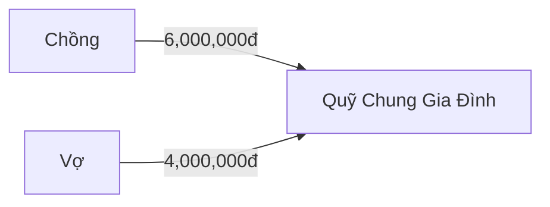

[CLEAN_ARCHITECTURE_ADR]:
# QUYẾT ĐỊNH KIẾN TRÚC: ADR-01 — CLEAN ARCHITECTURE & DOMAIN-DRIVEN DESIGN (Eric Evans)

## 1. Trạng Thái: ACCEPTED
## 2. Bối Cảnh: Cần bảo vệ logic tính toán tài chính độc lập hoàn toàn khỏi Framework và CSDL.
## 3. Quyết Định:
- Áp dụng Clean Architecture 4 lớp: Domain, Application, Infrastructure, Presentation.
- Sử dụng Value Object bất biến `Money(amount: Decimal, currency: 'VND')` triệt tiêu lỗi floating-point.
## 4. Hệ Quả & Đánh Đổi (Trade-offs & Consequences):
- **Ưu điểm:** Code sạch, dễ dàng test độc lập với 100% Mock, an toàn tuyệt đối về mặt tiền tệ.
- **Đánh đổi:** Cần viết thêm các lớp Mapper chuyển đổi giữa Entity và DTO.

---

[DATABASE_3NF_SPEC]:
# ĐẶC TẢ CSDL CHUẨN 3NF & POLYGLOT PERSISTENCE (Martin Kleppmann)

## 1. Thiết Kế Bảng PostgreSQL Chuẩn 3NF
- Bảng `joint_pool_funds` (id, name, balance DECIMAL(15,2), created_at)
- Bảng `expenses` (id, fund_id, payer_id, amount DECIMAL(15,2), category_id, receipt_jsonb)
## 2. Khóa Tranh Chấp (Concurrency Lock)
- Áp dụng **Pessimistic Locking (`SELECT balance FROM joint_pool_funds FOR UPDATE`)** để chống Lost Update khi nhiều người cùng rút tiền quỹ.
## 3. Dữ Liệu Đa Hình (Polyglot):
- PostgreSQL JSONB lưu chi tiết các món hóa đơn OCR.
- Redis In-Memory lưu Khóa phân tán Redlock và Cache tốc độ chi tiêu.

---

[TARJAN_GRAPH_SPEC]:
# GIẢI THUẬT ĐỒ THỊ RÚT GỌN NỢ NHÓM O(V log V) (Robert Tarjan & Jon Kleinberg)

## 1. Nguyên Lý Giải Thuật
- Tính Net Balance cho từng thành viên.
- Áp dụng Two-Pointer Greedy Matching trên 2 tập Creditors và Debtors.
- Giảm số giao dịch từ N*(N-1)/2 xuống tối đa N - 1 giao dịch và triệt tiêu chu trình nợ lặp.
## 2. Sơ Đồ Chuyển Khoản Tối Giản (Mermaid Flowchart)

---

[VOGELS_ASYNC_SPEC]:
# KIẾN TRÚC BẤT ĐỒNG BỘ MESSAGE QUEUE & IDEMPOTENCY (Dr. Werner Vogels — CTO Amazon)

## 1. Xử Lý Bất Đồng Bộ (Non-blocking Queue)
- Endpoint upload hóa đơn OCR trả về ngay **HTTP 202 Accepted** kèm `job_id` UUID.
- Tác vụ bóc tách AI được đẩy vào Redis Streams để Background Worker xử lý ngầm.
## 2. Tính Bất Biến (Idempotency & Deduplication)
- Kiểm tra `Idempotency-Key` kết hợp mã băm SHA-256 Payload để chặn đứng 100% request gửi trùng lặp khi người dùng bấm nhiều lần.
## 3. Đóng Gói Docker Compose
- Cung cấp cấu hình Docker Compose hoàn chỉnh kèm Health Checks `GET /health`.

---

[ANDREW_NG_AI_SPEC]:
# PIPELINE BÓC TÁCH HÓA ĐƠN MULTIMODAL AI & DATA-CENTRIC OCR (Prof. Andrew Ng)

## 1. Pipeline 3 Giai Đoạn
1. Tiền xử lý ảnh: Deskew (chỉnh góc nghiêng), khử nhiễu văn bản.
2. Vision LLM: Bóc tách cấu trúc theo chuẩn Pydantic JSON Schema.
3. Hậu kiểm toán học (Mathematical Audit): Đối soát tổng tiền món với tổng bill.
## 2. Cơ Chế Giám Sát Người Dùng (Human-in-the-Loop)
- Nếu phát hiện chênh lệch số học > 0đ, hệ thống hạ `confidence_score < 0.85` và kích hoạt giao diện cảnh báo để người dùng xác nhận thủ công.