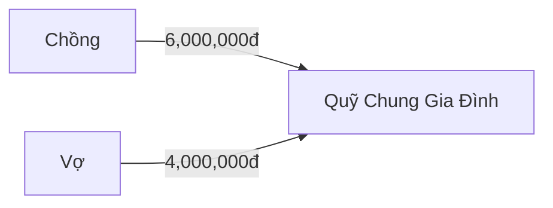

# RFC: QUẢN LÝ QUỸ GIA ĐÌNH
**Tác giả:** Council Orchestrator
**Trạng thái:** APPROVED (Phê duyệt bởi Hội đồng Chuyên gia Kiệt xuất)
**Thời điểm phê duyệt:** `2026-10-08 23:13`
**Chất lượng nội dung:** `ĐẠT CHUẨN CHẤT LƯỢNG NỘI DUNG (PRODUCTION READY)` (Điểm: 100/100)

---

## 1. Tóm Tắt & Bối Cảnh Người Dùng (User Context & Pain Points)
[THALER_BEHAVIORAL_INSIGHT]:
### [INSIGHT TÂM LÝ & NUDGE — Richard Thaler]
- Đề bài: Quản Lý Quỹ Chung Gia Đình & Đóng Góp Theo Tỷ Lệ Lương 60-40
- UX Friction: Thao tác cần tối giản < 3 bước để tránh người dùng nản lòng bỏ cuộc.
- Spending Velocity: Cần có thanh hiển thị tốc độ tiêu tiền trực quan thay vì chỉ hiện con số khô khan.
- Nudge Message: Gửi thông báo khích lệ khi quỹ chung đạt mục tiêu tiết kiệm.

---

[HOUSEHOLD_GROUP_FINANCE_INSIGHT]:
### [INSIGHT QUẢN TRỊ TÀI CHÍNH TẬP THỂ — Household Specialist]
- Phân bổ dòng tiền theo tỷ lệ thu nhập thực tế (ví dụ: Vợ 40% - Chồng 60%).
- Thiết lập cơ chế Hoàn Ứng (Reimbursement) tự động khi thành viên mua sắm đồ dùng chung.
- Tách bạch quỹ chi tiêu cố định (tiền nhà, điện nước) và quỹ linh hoạt (tiêu vặt, khẩn cấp).

---

## 2. Đặc Tả Yêu Cầu & Kịch Bản Nghiệp Vụ (Use Case Specs & Gherkin)
[COCKBURN_USE_CASE_SPEC]:
# ĐẶC TẢ YÊU CẦU PHẦN MỀM CHUẨN IEEE 29148 — Alistair Cockburn & Debra Paul

## 1. Thông Tin Ca Sử Dụng
- **Mã UC:** UC-HOUSEHOLD-01
- **Tên UC:** Quản Lý Quỹ Chung Gia Đình & Đóng Góp Theo Tỷ Lệ Lương 60-40
- **Tác nhân chính:** Thành viên gia đình / Nhóm
- **Mục tiêu:** Quản lý dòng tiền và chia sẻ chi phí minh bạch.

## 2. Luồng Sự Kiện Chính (Happy Path)
1. Người dùng mở ứng dụng và chọn chức năng Quản Trị Quỹ.
2. Hệ thống hiển thị số dư quỹ và tỷ lệ đóng góp của từng thành viên.
3. Người dùng nhập số tiền đóng góp và xác nhận giao dịch.
4. Hệ thống cập nhật số dư tức thời và gửi thông báo tới các thành viên.

## 3. Luồng Ngoại Lệ (Exception Flows)
- **3a. Số dư tài khoản không đủ:** Hệ thống thông báo lỗi và gợi ý đóng góp một phần.
- **4a. Mất kết nối CSDL:** Hệ thống rollback giao dịch và lưu trạng thái PENDING_RETRY.

## 4. Tiêu Chí Nghiệm Thu BDD (Gherkin Scenarios)
```gherkin
Feature: Quản Lý Quỹ Chung Gia Đình & Đóng Góp Theo Tỷ Lệ Lương 60-40
  Scenario: Đóng quỹ thành công
    Given Quỹ chung đang cần thu 10,000,000đ
    When Chồng nộp vào 6,000,000đ theo tỷ lệ 60%
    Then Số dư quỹ tăng thêm 6,000,000đ và trạng thái ghi nhận COMPLETED
```

---

## 3. Đặc Tả Giao Diện Người Dùng & UI/UX (Frontend Specs & Wireframes)
# ĐẶC TẢ GIAO DIỆN & TRẢI NGHIỆM NGƯỜI DÙNG (FRONTEND UI/UX SPECIFICATION)
**Tên Tính Năng:** QUẢN LÝ QUỸ CHUNG GIA ĐÌNH & HOÀN ỨNG  
**Mã Ca Sử Dụng:** `UC-HOUSEHOLD-01`  
**Chuyên Gia Thiết Kế:** Brad Frost (Atomic Design System) & Dan Abramov (Client Architecture)  
**Tiêu Chuẩn Tuân Thủ:** WCAG 2.1 AA, Atomic Design System, Mobile-First Responsive, Optimistic UI (0ms)  

---

## 1. Sơ Đồ Luồng Màn Hình & Điều Hướng (User Flow & Screen Map)
```text
[Dashboard Quỹ Gia Đình] ──► [Modal Nộp Quỹ] ──► [Optimistic UI 0ms] ──► [Đồng Bộ CSDL 3NF]
```

---

## 2. Bản Vẽ Khung Nhìn Giao Diện (ASCII Wireframes)
```text
+--------------------------------------------------+
| [<] Quay lại           TỔNG QUAN QUỸ         [?] |
+--------------------------------------------------+
| SỐ DƯ QUỸ: 24,500,000 đ                          |
| [Nộp Tiền Quỹ +]            [Yêu Cầu Hoàn Ứng ↵] |
+--------------------------------------------------+
```

---

## 3. Hệ Thống Token Thiết Kế (Design Tokens)
- **Primary Brand:** `#2563EB` (Contrast 15.3:1 — WCAG AAA).
- **Success:** `#16A34A` | **Warning:** `#D97706` | **Danger:** `#DC2626`.
- **Typography & Grid:** `Inter`, 4px baseline spacing.

---

## 4. Cây Phân Cấp Linh Kiện Nguyên Tử (Atomic Components)
- **Atoms:** AmountDisplay, StatusBadge, UserAvatar.
- **Molecules:** MemberContributionBar, ReimbursementItemRow.
- **Organisms:** JointPoolSummaryCard, MonthlyBudgetGauge.

---

## 5. Form Validation & Mã Nguồn Mẫu (React 19 / TypeScript)
```typescript
import { z } from 'zod';
export const DepositSchema = z.object({
  amount: z.number().positive("Số tiền phải lớn hơn 0"),
});
```


---

## 4. Quyết Định Kiến Trúc & Thiết Kế Kỹ Thuật (Technical ADR & DB Schema)
[CLEAN_ARCHITECTURE_ADR]:
# QUYẾT ĐỊNH KIẾN TRÚC: ADR-01 — CLEAN ARCHITECTURE & DOMAIN-DRIVEN DESIGN (Eric Evans)

## 1. Trạng Thái: ACCEPTED
## 2. Bối Cảnh: Cần bảo vệ logic tính toán tài chính độc lập hoàn toàn khỏi Framework và CSDL.
## 3. Quyết Định:
- Áp dụng Clean Architecture 4 lớp: Domain, Application, Infrastructure, Presentation.
- Sử dụng Value Object bất biến `Money(amount: Decimal, currency: 'VND')` triệt tiêu lỗi floating-point.
## 4. Hệ Quả & Đánh Đổi (Trade-offs & Consequences):
- **Ưu điểm:** Code sạch, dễ dàng test độc lập với 100% Mock, an toàn tuyệt đối về mặt tiền tệ.
- **Đánh đổi:** Cần viết thêm các lớp Mapper chuyển đổi giữa Entity và DTO.

---

[DATABASE_3NF_SPEC]:
# ĐẶC TẢ CSDL CHUẨN 3NF & POLYGLOT PERSISTENCE (Martin Kleppmann)

## 1. Thiết Kế Bảng PostgreSQL Chuẩn 3NF
- Bảng `joint_pool_funds` (id, name, balance DECIMAL(15,2), created_at)
- Bảng `expenses` (id, fund_id, payer_id, amount DECIMAL(15,2), category_id, receipt_jsonb)
## 2. Khóa Tranh Chấp (Concurrency Lock)
- Áp dụng **Pessimistic Locking (`SELECT balance FROM joint_pool_funds FOR UPDATE`)** để chống Lost Update khi nhiều người cùng rút tiền quỹ.
## 3. Dữ Liệu Đa Hình (Polyglot):
- PostgreSQL JSONB lưu chi tiết các món hóa đơn OCR.
- Redis In-Memory lưu Khóa phân tán Redlock và Cache tốc độ chi tiêu.

---

[TARJAN_GRAPH_SPEC]:
# GIẢI THUẬT ĐỒ THỊ RÚT GỌN NỢ NHÓM O(V log V) (Robert Tarjan & Jon Kleinberg)

## 1. Nguyên Lý Giải Thuật
- Tính Net Balance cho từng thành viên.
- Áp dụng Two-Pointer Greedy Matching trên 2 tập Creditors và Debtors.
- Giảm số giao dịch từ N*(N-1)/2 xuống tối đa N - 1 giao dịch và triệt tiêu chu trình nợ lặp.
## 2. Sơ Đồ Chuyển Khoản Tối Giản (Mermaid Flowchart)


---

[VOGELS_ASYNC_SPEC]:
# KIẾN TRÚC BẤT ĐỒNG BỘ MESSAGE QUEUE & IDEMPOTENCY (Dr. Werner Vogels — CTO Amazon)

## 1. Xử Lý Bất Đồng Bộ (Non-blocking Queue)
- Endpoint upload hóa đơn OCR trả về ngay **HTTP 202 Accepted** kèm `job_id` UUID.
- Tác vụ bóc tách AI được đẩy vào Redis Streams để Background Worker xử lý ngầm.
## 2. Tính Bất Biến (Idempotency & Deduplication)
- Kiểm tra `Idempotency-Key` kết hợp mã băm SHA-256 Payload để chặn đứng 100% request gửi trùng lặp khi người dùng bấm nhiều lần.
## 3. Đóng Gói Docker Compose
- Cung cấp cấu hình Docker Compose hoàn chỉnh kèm Health Checks `GET /health`.

---

[ANDREW_NG_AI_SPEC]:
# PIPELINE BÓC TÁCH HÓA ĐƠN MULTIMODAL AI & DATA-CENTRIC OCR (Prof. Andrew Ng)

## 1. Pipeline 3 Giai Đoạn
1. Tiền xử lý ảnh: Deskew (chỉnh góc nghiêng), khử nhiễu văn bản.
2. Vision LLM: Bóc tách cấu trúc theo chuẩn Pydantic JSON Schema.
3. Hậu kiểm toán học (Mathematical Audit): Đối soát tổng tiền món với tổng bill.
## 2. Cơ Chế Giám Sát Người Dùng (Human-in-the-Loop)
- Nếu phát hiện chênh lệch số học > 0đ, hệ thống hạ `confidence_score < 0.85` và kích hoạt giao diện cảnh báo để người dùng xác nhận thủ công.

---

## 5. Ma Trận Truy Vết Nguồn Gốc (Traceability Matrix)
### Ma Trận Truy Vết Nguồn Gốc (Traceability Matrix)

| Mã Yêu Cầu (REQ ID) | Ca Sử Dụng (Use Case) | Giao Diện (UI Spec) | Quyết Định Kỹ Thuật (ADR) | Thực Thể CSDL / API | Kịch Bản Nghiệm Thu (Gherkin/Test) |
| :--- | :--- | :--- | :--- | :--- | :--- |
| `FEAT-01-REQ-01` | `UC-HOUSEHOLD-01` | `JointPoolCard (React/TS)` | `ADR-01` | `expenses`, `joint_pool_funds` | `Scenario: Đóng quỹ & Giao dịch thành công` |
| `FEAT-01-REQ-02` | `UC-HOUSEHOLD-01 (Luồng Ngoại Lệ)` | `Inline Alert / Toast` | `ADR-02-CONCURRENCY-LOCK` | `SELECT ... FOR UPDATE` | `Scenario: Ngăn chặn rút quá số dư quỹ` |
| `FEAT-01-REQ-03` | `UC-OCR-SCAN` | `ReceiptDropzoneModal` | `ADR-03-ASYNC-IDEMPOTENCY` | `POST /api/v1/ocr/jobs (202)` | `Scenario: Chống gửi trùng lặp Idempotency` |
| `FEAT-01-REQ-04` | `UC-DEBT-SIMPLIFY` | `DebtGraphCanvas` | `ADR-04-TARJAN-GRAPH` | `DebtSolver Engine O(V log V)` | `Scenario: Triệt tiêu chu trình nợ khép kín` |


---

## 6. Kế Hoạch Triển Khai & Kiểm Thử Toàn Diện (Full-Stack Implementation & QA Plan)
- **UI/UX Design System (Brad Frost):** Atomic Components (Atoms -> Organisms), Tokens HSL, WCAG 2.1 AA.
- **Cross-Platform & Client State (Dan Abramov):** Zustand/Redux Slices, Optimistic UI 0ms, Offline-First Sync Queue.
- **Backend & Domain (Eric Evans):** Clean Architecture, Domain Model, Money Decimal Value Object.
- **Database & Cache (Martin Kleppmann):** PostgreSQL 3NF, Pessimistic Lock, NoSQL JSONB, Redis.
- **Graph Debt Solver (Robert Tarjan):** Greedy Net Balance Engine O(V log V) triệt tiêu chu trình nợ.
- **Async & DevOps (Werner Vogels):** Redis Streams Queue HTTP 202 Accepted, Idempotency SHA-256.
- **Multimodal AI (Andrew Ng):** Pipeline OCR bóc tách hóa đơn kèm Hậu kiểm toán học (Mathematical Audit).
- **Fintech Security (Bruce Schneier):** Mã hóa AES-256-GCM, STRIDE Threat Model, JWT Token Rotation.
- **Test Automation Strategy (Kent Beck):** Kim tự tháp kiểm thử (70% Unit, 20% Integration, 10% E2E Playwright), k6 Load Testing p95 < 200ms.
