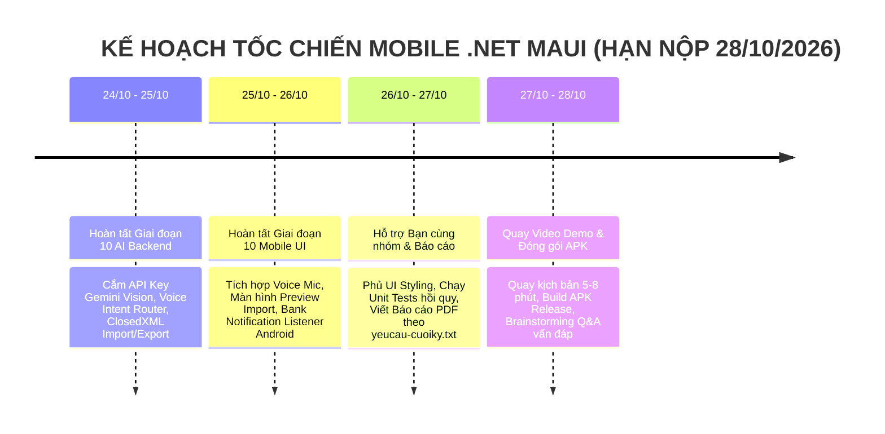

# 🏛️ TOÀN VĂN BIÊN BẢN PHIÊN HỌP HỘI ĐỒNG TOÀN DIỆN VỀ HỆ THỐNG AI (COMPREHENSIVE SPECIAL AI COUNCIL SESSION MINUTES)
## GIAI ĐOẠN 10: TINH CHỈNH, KIỂM ĐỊNH HÀNH VI & HOÀN THIỆN TOÀN DIỆN HỆ THỐNG AI
### DỰ ÁN: HỆ THỐNG QUẢN LÝ CHI TIÊU & HOẠCH ĐỊNH TÀI CHÍNH CÁ NHÂN THÔNG MINH (PFM)
**Thời gian bắt đầu:** 2026-10-23 23:46 (Giờ hệ thống)  
**Thời gian kết thúc & Khóa biên bản:** 2026-10-24 20:15 (Giờ hệ thống)  
**Tọa độ lưu trữ:** `sessions/session_giai_doan_10_ai_comprehensive_audit/00_bien_ban_hop_hoi_dong_toan_dien_ai.md`  
**Căn cứ pháp lý & kỹ thuật:** 
- Quy chế bắt buộc tại [Quyết định 122](../../project_context/decisions_and_changes_log.md#L2764) và [Quyết định 127](../../project_context/decisions_and_changes_log.md#L2899);
- Quy ước điều phối Hội đồng Đa tác tử [`AGENTS.md`](../../AGENTS.md);
- Bản đồ lộ trình tổng thể [`MASTER_PROJECT_ROADMAP.md`](../../mobile-project/dotnet-maui-ver/MASTER_PROJECT_ROADMAP.md);
- Tiêu chuẩn đặc tả công nghệ phần mềm IEEE 29148:2018 và Phương pháp luận Alistair Cockburn BA.

---

## MỤC LỤC BIÊN BẢN TOÀN VĂN

1. [THÀNH PHẦN THAM DỰ & QUY CHẾ VẬN HÀNH PHIÊN HỌP](#i-thành-phần-tham-dự--quy-chế-vận-hành-phiên-họp)
2. [BỐI CẢNH KÍCH HOẠT & HIỆN TRẠNG TOÀN DỰ ÁN TRƯỚC PHIÊN HỌP](#ii-bối-cảnh-kích-hoạt--hiện-trạng-toàn-dự-án-trước-phiên-họp)
3. [LƯỢC THUẬT CHI TIẾT 100% CÁC NỘI DUNG TRAO ĐỔI & PHẢN BIỆN (CHRONOLOGICAL DIALOGUE RECORD)](#iii-lược-thuật-chi-tiết-100-các-nội-dung-trao-đổi--phản-biện-chronological-dialogue-record)
   - [3.1. Phản hồi của Người dùng về 5 Trụ cột AI Cốt lõi](#31-phản-hồi-của-người-dùng-về-5-trụ-cột-ai-cốt-lõi)
   - [3.2. Giải trình chuyên sâu 6 Câu hỏi Hiện sinh & Kỹ thuật của Người dùng](#32-giải-trình-chuyên-sâu-6-câu-hỏi-hiện-sinh--kỹ-thuật-của-người-dùng)
   - [3.3. Chuỗi tư duy mở rộng (Chain of Thought) của Người dùng: Dữ liệu thực tế, Import Hybrid & Xuất báo cáo AI](#33-chuỗi-tư-duy-mở-rộng-chain-of-thought-của-người-dùng-dữ-liệu-thực-tế-import-hybrid--xuất-báo-cáo-ai)
   - [3.4. Chuỗi tư duy mở rộng: Bắt Push Notification Ngân hàng & Mục tiêu tối thượng của Voice AI](#34-chuỗi-tư-duy-mở-rộng-bắt-push-notification-ngân-hàng--mục-tiêu-tối-thượng-của-voice-ai)
   - [3.5. Chuỗi tư duy mở rộng: Định vị Nền tảng Android, Rà soát Tài liệu Thiết kế & Chiến lược Hai Deadline](#35-chuỗi-tư-duy-mở-rộng-định-vị-nền-tảng-android-rà-soát-tài-liệu-thiết-kế--chiến-lược-hai-deadline)
4. [HỆ THỐNG HÓA TOÀN DIỆN CÁC QUYẾT ĐỊNH CHIẾN LƯỢC & KIẾN TRÚC ĐỘT PHÁ](#iv-hệ-thống-hóa-toàn-diện-các-quyết-định-chiến-lược--kiến-trúc-đột-phá)
5. [PHÂN ĐỊNH RANH GIỚI VÀ KẾ HOẠCH BÀN GIAO CHO PHIÊN PTTKHTTT](#v-phân-định-ranh-giới-và-kế-hoạch-bàn-giao-cho-phiên-pttkhttt)
6. [LỘ TRÌNH THỰC THI GIAI ĐOẠN 10 HƯỚNG TỚI DEADLINE 28/10 CHO MOBILE](#vi-lộ-trình-thực-thi-giai-đoạn-10-hướng-tới-deadline-2810-cho-mobile)
7. [NGHIỆM THU & QUYẾT ĐỊNH CHỐT BIÊN BẢN (DECISION 128)](#vii-nghiệm-thu--quyết-định-chốt-biên-bản-decision-128)

---

## I. THÀNH PHẦN THAM DỰ & QUY CHẾ VẬN HÀNH PHIÊN HỌP

### 1. Thành phần Hội đồng
* **Chủ tọa & Chủ sở hữu Đề tài (Project Owner / Lead Developer):** **Người dùng**.
* **Chủ tịch Hội đồng Điều phối:** **Agent 00 (Council Orchestrator)** — Điều phối 4 pha, bảo đảm quy chế Durable Context.
* **Chuyên gia Trí tuệ Nhân tạo & Multimodal AI Lead:** **Agent 08 (Prof. Andrew Ng)** — Phụ trách Vision OCR, Prompt Engineering, Evaluation Harness, Function Calling.
* **Chuyên gia Kinh tế Hành vi & Cú Hích Tài Chính:** **Agent 01 (Richard Thaler - Giải Nobel Kinh Tế 2017)** — Phụ trách Empathetic Finance, Nudge Theory, Khoảng trễ tâm lý 24h Cooling-off, Mental Accounting.
* **Chuyên gia Phân tích Nghiệp vụ Lead BA:** **Agent 03 (Alistair Cockburn & Debra Paul)** — Phụ trách chuẩn hóa Use Cases IEEE 29148, ranh giới yêu cầu, kiểm định toán học Z-Score.
* **Chuyên gia Kiến trúc Domain-Driven Design:** **Agent 04 (Eric Evans)** — Phụ trách Clean Architecture, Decoupled Backend-First, Bounded Contexts, Domain Services.
* **Chuyên gia Cơ sở Dữ liệu Toàn diện:** **Agent 05 (Martin Kleppmann)** — Phụ trách ACID Transactions, CQRS Projections, cấu trúc Hybrid Data, Caching SHA-256.
* **Chuyên gia Bất đồng bộ & DevOps:** **Agent 07 (Dr. Werner Vogels - CTO Amazon)** — Phụ trách SignalR Realtime Hubs, Rate Limiting, Android Background Listener Service.
* **Chuyên gia Kiến trúc Giao diện & Trải nghiệm Client:** **Agent 10 (Dan Abramov & Christopher Chedeau)** — Phụ trách Clean MVVM, AppShell Intent Routing, Haptics & UI Feedback.
* **Chuyên gia An ninh Bảo mật Fintech:** **Agent 11 (Bruce Schneier & OWASP)** — Phụ trách FIDO2 Biometrics, Windows Hello, Android Keystore, API Gateway Security.
* **Chuyên gia Đảm bảo Chất lượng & Kiểm thử:** **Agent 12 (Kent Beck & Martin Fowler)** — Phụ trách Kim tự tháp TDD Unit Testing.

### 2. Tôn chỉ Vận hành Phiên họp
1. **Trung thực triệt để (Brutal Honesty):** Không né tránh khó khăn, không "vẽ vời" công nghệ, chỉ rõ các điểm yếu chí tử của bài toán PFM và giới hạn hạ tầng thực tế.
2. **Bảo tồn ngữ cảnh vĩnh viễn (Durable Context):** Toàn bộ câu hỏi, sự băn khoăn, câu chuyện thực tế và quyết định của Người dùng được ghi chép trung thực 100%, không lược bỏ bất kỳ chi tiết nào dù là nhỏ nhất.

---

## II. BỐI CẢNH KÍCH HOẠT & HIỆN TRẠNG TOÀN DỰ ÁN TRƯỚC PHIÊN HỌP

1. **Hoàn tất 9/9 Phân hệ Nghiệp vụ Cốt lõi (Khép kín từ Giai đoạn 0 đến Giai đoạn 8):**
   - Đã hiện thực hóa toàn bộ 63 Use Cases đặc tả bằng mô hình Full-Stack Vertical Slice.
   - Backend ASP.NET Core 10 hoàn thiện 100% tầng Domain, Application, Infrastructure và WebApi Controllers.
   - Frontend .NET MAUI 10 hoàn thiện 20 màn hình Wireframe Pages kết nối 100% Data Binding và phân tầng Repositories Mock/Real.
   - Hệ thống đạt **233 / 233 Unit Tests PASSED (100%)** (83 Domain + 118 Application + 32 Mobile Tests), toàn bộ Solution biên dịch đạt `0 Warning, 0 Error`.
2. **Hoàn tất bàn giao kỹ thuật Giai đoạn 9:**
   - Đã xuất bản và bàn giao tài liệu kỹ thuật [`HUONG_DAN_FE.md`](../../mobile-project/dotnet-maui-ver/HUONG_DAN_FE.md) cho người bạn cùng nhóm phụ trách thiết kế giao diện (UI/UX Styling, Design System, Charts, Animations) một cách độc lập trên Mock Repositories.
3. **Kích hoạt quy chế họp Giai đoạn 10:**
   - Thực hiện đúng cam kết chỉ đạo của Người dùng tại [Quyết định 122](../../project_context/decisions_and_changes_log.md#L2764): *"riêng giai đoạn 10, khi đến giai đoạn đó, hội đồng cùng tôi họp lại và bàn bạc kỹ hơn"*.
   - Hội đồng chính thức triệu tập phiên họp toàn diện này.

---

## III. LƯỢC THUẬT CHI TIẾT 100% CÁC NỘI DUNG TRAO ĐỔI & PHẢN BIỆN (CHRONOLOGICAL DIALOGUE RECORD)

---

### 3.1. Phản hồi của Người dùng về 5 Trụ cột AI Cốt lõi

Hội đồng đã đưa ra 5 trụ cột AI mấu chốt để xin ý kiến định hướng. Người dùng đã cân nhắc kỹ lưỡng và đưa ra các quyết định:

* **Trụ cột 1: Tâm lý Hành vi & Văn phong AI Nudge (Empathetic Finance):**
  - *Câu hỏi của Hội đồng:* Lựa chọn văn phong khích lệ, đồng cảm (Lựa chọn A) hay kỷ luật thép, cảnh báo nghiêm khắc (Lựa chọn B)?
  - *Ý kiến của Người dùng:* *"Tôi chưa chắc, tôi nghĩ ta phải nên theo lựa chọn A, nhắc nhở mang tính triết lý và đồng cảm hơn là thúc ép."*
  - *Quyết định khóa:* Chốt 100% **Lựa chọn A**. AI đóng vai trò như một người cố vấn triết lý, thấu cảm, nhẹ nhàng phân tích hệ quả dựa trên số liệu khách quan, tuyệt đối không dùng ngôn từ chỉ trích hay tạo cảm giác tội lỗi cho người dùng.

* **Trụ cột 2: Dữ liệu Huấn luyện Vision OCR & Module Xử lý Ảnh:**
  - *Câu hỏi của Hội đồng:* Chuẩn bị các tập mẫu ảnh thực tế và xử lý sai lệch số học ra sao?
  - *Ý kiến của Người dùng:* 
    + *"Các vấn đề này đặt ra ngay điểm yếu chí tử của tôi, tôi không có dữ liệu training nên khá là khó để biết nó có hoạt động chính xác không."*
    + *"Nếu có thể tích hợp được (module làm nét ảnh) thì tốt."*
  - *Quyết định khóa:* Khẳng định không cần training data từ đầu vì ta dùng **Foundation Multimodal Model (Gemini 2.5 Flash)**. Tích hợp thêm module xử lý tiền kỳ ảnh (tăng tương phản, xoay thẳng góc) trước khi gửi vào LLM.

* **Trụ cột 3: Khép kín Vòng lặp Học tập Quy tắc Danh mục (Continuous Learning):**
  - *Câu hỏi của Hội đồng:* Cơ chế tự động ghi nhớ quy tắc và áp dụng hồi tố (retroactive) lịch sử ra sao?
  - *Ý kiến của Người dùng:* 
    + *"Đương nhiên phải có HITL rồi, tự động ghi nhớ nhưng note cá nhân này có khả năng gây ảo giác cao."*
    + *"Không nhé làm vậy vừa kém hiệu quả vừa dễ lỗi dữ liệu. Các thao tác quan trọng như vậy đều phải thông qua user prompt hỏi trước mới được làm."*
  - *Quyết định khóa:* Bắt buộc **Human-In-The-Loop (HITL)**: Khi người dùng đổi danh mục, hệ thống sẽ hiện popup hỏi xác nhận: *"Bạn có muốn lưu quy tắc này cho các lần sau không?"*. **Tuyệt đối KHÔNG áp dụng hồi tố** lên các giao dịch cũ để bảo vệ tính toàn vẹn dữ liệu sổ cái.

* **Trụ cột 4: Độ nhạy Thuật toán Thống kê Z-Score:**
  - *Ý kiến của Người dùng:* 
    + *"Tạm thời cứ xử lý như vậy đi, tôi chưa trực tiếp test nên chưa rõ hiệu quả."*
    + *"Tôi cần bạn giải thích rõ hơn về cơ chế z-score này và giải thích rõ hơn về ví dụ này muốn nói về điều gì."*
  - *Quyết định khóa:* Giữ nguyên cơ chế bảo vệ tài khoản mới. Bổ sung cờ ngoại lệ *"Khoản chi đột biến có chủ đích"* để loại trừ khỏi tập mẫu tính toán. (Chi tiết giải thích ở Mục 3.2).

* **Trụ cột 5: UX Tiến trình Bất đồng bộ & Âm thanh:**
  - *Ý kiến của Người dùng:* *"Nếu có sound effect phù hợp và hiệu ứng thì cũng tốt."*
  - *Quyết định khóa:* Chuẩn hóa tiến trình 3 bước theo Đề tài 23: `Đã nhận ảnh` $\rightarrow$ `Đang xử lý` $\rightarrow$ `Có kết quả`; bổ sung rung Haptics và âm thanh phản hồi nhẹ nhàng khi bóc tách xong.

---

### 3.2. Giải trình chuyên sâu 6 Câu hỏi Hiện sinh & Kỹ thuật của Người dùng

Người dùng đã đặt ra 6 câu hỏi lớn, đi thẳng vào bản chất kỹ thuật và giá trị thực tế của sản phẩm. Hội đồng đã giải trình chi tiết:

#### Câu 1: AI Key và cách kết nối AI của dự án làm như thế nào?
* **Rủi ro:** Nếu lưu API Key ở ứng dụng Mobile MAUI, kẻ xấu có thể decompile file APK hoặc DLL để đánh cắp key.
* **Giải pháp chuẩn mực:**
  - Backend ASP.NET Core đóng vai trò là **AI Gateway**.
  - Khóa `GEMINI_API_KEY` được lưu trữ an toàn trong `appsettings.json` hoặc Biến môi trường máy chủ.
  - Client Mobile chỉ tải ảnh hóa đơn lên endpoint nội bộ của Backend (`POST /api/receipts/ocr`). Backend dùng `HttpClient` gọi sang REST endpoint của Google Gemini kèm Strict JSON Schema (`response_mime_type: "application/json"`).

#### Câu 2: Phương pháp sử dụng AI trong dự án là gì? RAG, OCR...?
* **Phân định rạch ròi phương pháp luận:**
  1. **Multimodal Vision OCR (Không phải Tesseract OCR truyền thống):** Mô hình đa phương thức vừa đọc ký tự vừa hiểu ngữ nghĩa bố cục hóa đơn (phân biệt tên quán, dòng giảm giá, thuế VAT và tổng tiền).
  2. **Rule-Based NLP & Hybrid Speech-to-Text:** Nhận diện giọng nói on-device thành văn bản; Backend dùng Regex tiếng Việt bóc tách số tiền và AutoCategorization khớp danh mục.
  3. **Không dùng RAG (Retrieval-Augmented Generation) nặng nề:** Vì dữ liệu tài chính cá nhân là dữ liệu có cấu trúc (Structured Data trong PostgreSQL: số dư, hạn mức, ngày cạn tiền). Ta dùng **In-Context Prompting** nạp tóm tắt chỉ số vào prompt, không cần Vector Database cồng kềnh gây tốn chi phí và tăng độ trễ.
  4. **Classical Statistical Machine Learning:** Mô hình chuỗi thời gian ngoại suy vận tốc chi tiêu Weekday/Weekend và kiểm định Z-Score Outlier chạy 0ms trong bộ nhớ.

#### Câu 3: Voice-to-Action can thiệp hệ thống cao, làm sao đảm bảo .NET MAUI chạy mượt hơn hoặc bằng Node/React hay Nest/NextJS?
* **Luồng xử lý 2 bước:**
  - *Bước 1 (Voice $\rightarrow$ Text):* MAUI gọi trực tiếp Native Speech API của Android (`Android.Speech.SpeechRecognizer`), nhận diện tiếng Việt on-device cực nhanh, miễn phí, không tốn server.
  - *Bước 2 (Text $\rightarrow$ Structured Action):* C# .NET 10 có tốc độ xử lý CPU/Memory cao gấp 3-4 lần Node.js (theo TechEmpower Benchmarks), xử lý cú pháp bằng Regex Compiled Source Generator và Type-Safety mạnh mẽ, loại bỏ hoàn toàn các lỗi ép kiểu ngầm hay runtime crash (`undefined is not a function`) thường gặp trong JavaScript/Node.js.

#### Câu 3b: Làm sao đảm bảo không vượt giới hạn API và giữ chi phí 100% MIỄN PHÍ?
* **Hạ tầng 0 đồng:**
  - Khai thác gói **Free Tier của Google AI Studio (Gemini 2.5 Flash)**: Cung cấp **15 RPM (lượt/phút)**, **1.500 RPD (lượt/ngày)** và **1.000.000 Tokens/phút hoàn toàn MIỄN PHÍ**. Với quy mô đồ án sinh viên (vài chục đến vài trăm lượt/ngày), hạn mức 1.500 lượt/ngày là dư dả.
  - **Rate Limiting:** Backend tích hợp `System.Threading.RateLimiting` giới hạn mỗi user tối đa 5 hóa đơn/phút.
  - **Deduplication Cache bằng mã băm SHA-256:** Gửi lại cùng một ảnh sẽ trả về ngay kết quả từ Cache mà không gọi lại LLM (0 token).
  - **Mock Fallback Harness:** Khi mất mạng hoặc hết quota, hệ thống tự động fallback về Mock Service để buổi bảo vệ trước Hội đồng luôn trơn tru 100%.

#### Câu 4: Giải thích SignalR là gì? Cơ chế cập nhật dữ liệu động có ý nghĩa thế nào?
* **Bản chất SignalR:** Là thư viện của Microsoft ASP.NET Core thiết lập kết nối liên tục 2 chiều thời gian thực (qua giao thức WebSockets) giữa Client Mobile và Server Backend.
* **Ý nghĩa trong dự án:**
  - *Cập nhật số dư 0ms:* Chi tiêu ở màn hình này thì thẻ số dư ở màn hình Ví (`WalletsPage.xaml`) tự động nhảy số tiền mới ngay lập tức mà không cần vuốt reload trang.
  - *Tiến trình AI bất đồng bộ:* Khi chụp hóa đơn cần 3-4 giây xử lý, người dùng có thể lướt trang khác; khi AI xử lý xong, Server dùng SignalR bắn tín hiệu làm nổ popup thông báo ngay lập tức. Đây là tiêu chí đạt **Điểm cộng B2 (+1.0đ)** trong barem chấm thi Mobile.

#### Câu 5: Tính khả thi của AI Giọng nói & AI Vision: Nhìn thẳng vào các bất cập thực tế
* **Tính khả thi:** 100% Khả thi vì dựa trên nền tảng Gemini Vision API và Android Speech.
* **Những bất cập thực tế (Nói thẳng, không giấu giếm):**
  1. *Hóa đơn Việt Nam bị mờ, nhòe, viết tay:* AI có thể đọc sai số tiền $\rightarrow$ Bắt buộc phải có màn hình Review (HITL) để người dùng xác nhận trước khi lưu.
  2. *Độ trễ mạng:* Gửi ảnh lên Cloud mất từ 2-4 giây $\rightarrow$ Phải có thanh tiến trình 3 bước rõ ràng.
  3. *Giọng nói địa phương & tiếng ồn:* Có thể nhận diện sai từ nói tắt $\rightarrow$ Phải có form điền sẵn để chạm sửa nhanh trong 1 giây.

#### Câu 6: CÂU HỎI HIỆN SINH QUAN TRỌNG NHẤT VỀ ỨNG DỤNG PFM
> Người dùng chia sẻ sự trăn trở: *"Tôi thật sự không mong đợi lắm về dự án này. Nó có thật sự tốt hơn các ứng dụng sẵn có trên thị trường không, vì tôi thấy họ bố trí, thiết kế và build rất bài bản hệ thống quản lý chi tiêu cá nhân cho người dùng, đánh vào đúng cái họ cần. Và bạn tôi có 1 câu hỏi khiến tôi khá trăn trở: 'Nếu ứng dụng này chỉ sử dụng hệ thống tiền ảo do người dùng khởi tạo và khai báo, trên lý thuyết nó vẫn cần sự trung thực của người dùng. Vậy làm sao 1 app có thể THỰC SỰ quản lý dòng tiền của tôi được, đâu thể lúc nào tôi chi tiêu 1 thứ gì đó thì đều nhớ mở app lên ghi chép đâu? Và đặc biệt là với các dòng tiền điện tử, ngân hàng, nó mới là cái tôi cần quản lý, vậy lúc đó app này có ý nghĩa gì khi không thể thực sự quản lý tiền của tôi?'"*

* **3 Sự thật khách quan do Hội đồng giải trình:**
  1. **Tại sao các app PFM tại VN không thể kết nối ngân hàng tự động (Open Banking)?** Ngân hàng Nhà nước và các ngân hàng thương mại Việt Nam không cấp Open Banking API công khai cho bên thứ ba vì an ninh tài chính và quy định sinh trắc học. Các thủ thuật cào dữ liệu (Web Scraping / đọc trộm OTP) trước đây đã bị cấm và chặn hoàn toàn. Do đó, mọi app PFM độc lập tại VN đều phải dựa trên sự chủ động ghi chép của người dùng.
  2. **Tại sao 90% người dùng bỏ cuộc sau 2 tuần dùng Money Lover hay MISA?** Vì hội chứng "Manual Logging Fatigue" (Kiệt sức vì ghi chép thủ công). Mua cốc trà đá 5k cũng phải bấm 6 bước để ghi chép khiến người dùng nản lòng. Hơn nữa các app đó là "Kế toán thụ động sau sự việc", chỉ ghi lại tiền đã mất chứ không giúp ngăn chặn bội chi.
  3. **Giá trị khác biệt sống còn của dự án này:**
     - *Triệt tiêu ma sát bằng AI đa phương thức:* Chụp 1 tấm ảnh hóa đơn hoặc bấm giữ mic nói 2 giây là xong, giảm 80% ma sát nhập liệu.
     - *Can thiệp hành vi chủ động (Thaler Behavioral Nudge):* Hạn mức chi tiêu mỗi ngày đàn hồi (**Adaptive DSA**) chỉ cho người dùng một con số duy nhất được tiêu hôm nay; Khoảng trễ tâm lý 24h (**Cooling-off Period**) phong tỏa giao dịch mua sắm bốc đồng lúc nửa đêm và quy đổi ra số giờ lao động thực tế.
     - *Giá trị học thuật và kỹ nghệ xuất sắc:* Dự án chứng minh năng lực phân tích thiết kế hệ thống chuẩn mực (IEEE 29148, 63 UCs, Clean Architecture, DDD, CQRS, Database 3NF ACID, SignalR, .NET 10 MAUI) và ứng dụng khoa học đạt giải Nobel thực sự.

---

### 3.3. Chuỗi tư duy mở rộng (Chain of Thought) của Người dùng: Dữ liệu thực tế, Import Hybrid & Xuất báo cáo AI

Người dùng tiếp tục chia sẻ chuỗi tư duy thực tế về dữ liệu và báo cáo:

* **Về Dữ liệu Hóa đơn Nước & File Excel Điện Nước:**
  - *Người dùng phát biểu:* *"À về dữ liệu, thì tôi có rất nhiều hóa đơn tiền nước, và tôi có hẳn 1 file excel quản lý hóa đơn điện nước, liệu cái gọi là AI đa phương thức có hỗ trợ đọc dữ liệu quản lý tài chính từ nguồn khác của người dùng không nhỉ?"*
  - *Hội đồng giải đáp:* Hóa đơn nước/điện tại VN là **Hóa đơn điện tử (E-Invoice)** theo chuẩn Bộ Tài chính, chữ in sắc nét và có kẻ bảng rõ ràng. AI Vision đọc chính xác 99%, tự động bóc tách số tiền, gán danh mục "Hóa đơn & Tiện ích" (thuộc nhóm 50% thiết yếu) và lưu sản lượng tiêu thụ ($m^3, kWh$) vào ghi chú.

* **Về Tính năng Xuất File Số Liệu (Export):**
  - *Người dùng phát biểu:* *"À phải có chức năng xuất file số liệu nữa chứ nhỉ? Cái này tôi nhớ không nhầm là tài liệu chưa có thì phải?"*
  - *Hội đồng rà soát:* Trong tài liệu đặc tả chuẩn IEEE 29148 ([`BaoCao_TongHop_DacTa_UseCase_PFM.md`](../../project_context/reports/BaoCao_TongHop_DacTa_UseCase_PFM.md)), Use Case **`UC-07.01` (Luồng phụ A1)** đã quy định: *"Xuất báo cáo sang định dạng tệp tin Excel / PDF kèm biểu đồ và bảng số liệu chuẩn hóa, cho phép tải về máy cá nhân"*.
  - *Đề xuất sáng tạo của Người dùng:* *"trong đặc tả không ghi rõ việc triển khai xuất file như thế nào thì tôi cũng đề xuất luôn phương án (nếu khả thi) là có AI can thiệp vào đầu ra trước khi xuất file vì AI có thể decorate nội dung tốt hơn là chỉ dùng 1 thư viện đơn giản (hoặc simple output with no AI usage)."*
  - *Quyết định Hội đồng:* Thống nhất triển khai **Báo cáo Tài chính Điều hành Thông minh (AI-Enhanced Executive Export)**: Backend gửi chỉ số tháng vào Gemini; AI đóng vai Cố vấn Richard Thaler viết Thư nhận định điều hành (Executive Commentary) 3-5 câu trang trọng ở đầu trang PDF hoặc Sheet đầu file Excel. Đồng thời có tùy chọn Xuất thô nhanh (Raw Data) không dùng AI.

* **Về Kiến trúc Nhập Khẩu Dữ Liệu Đa Nguồn Hybrid (Import):**
  - *Người dùng phát biểu:* *"Rồi để trả lời cho vấn đề về import file quản lý tài chính thủ công ấy, tôi thật ra rất muốn chọn phương án 1 là sử dụng thư viện rồi bulk import nhưng ngặt nghèo là không phải ai cũng dùng tệp excel, có thể chỉ là các ghi chép trên note vụn vặt và không phải ai cũng ghi chép có khoa học, việc đọc dữ liệu file buộc phải cần 1 trí thông minh có khả năng hiểu ngữ cảnh để không lấy sai nội dung, nhưng nếu có thể kết hợp hybrid 2 phương án để tối đa hóa chi phí thì càng tuyệt vời hơn."*
  - *Quyết định Hội đồng:* Xây dựng **Kiến trúc Hybrid Import**:
    - File Excel/CSV chuẩn $\rightarrow$ Thư viện `ClosedXML` đọc trong 0.1s (0đ, 0 token).
    - File Note .txt / Ảnh chụp ghi chú tự do $\rightarrow$ Gemini NLP bóc tách ngữ cảnh ra mảng JSON.
    - Cả 2 luồng đều đổ về **Màn hình Preview HITL** để người dùng kiểm tra trước khi lưu vào CSDL.

* **Về Hệ Thống Bảo Mật Sinh Trắc Học (Biometrics Login):**
  - *Người dùng hỏi:* *"Và ngoài ra là về hệ thống bảo mật, lúc trước ở giai đoạn 0 bạn có nói với tôi là có cả login sinh trắc học, vậy khi nào ta làm cái này, và nếu test trên máy tính thì sao mà test được?"*
  - *Hội đồng giải đáp:*
    - Triển khai vào **Giai đoạn 11** bằng `Plugin.Fingerprint` và `SecureStorage` (lưu JWT Token vào phần cứng an toàn).
    - Test trên máy tính: Windows Desktop tự động gọi API **Windows Hello** (quét vân tay, nhận diện mặt hoặc nhập **Mã PIN máy tính**). Đồng thời có nút công tắc giả lập (Dev Mock Toggle) để phục vụ chấm thi trên mọi loại máy.

---

### 3.4. Chuỗi tư duy mở rộng: Bắt Push Notification Ngân hàng & Mục tiêu tối thượng của Voice AI

Người dùng đã chia sẻ câu chuyện thực tế từ thầy cô, bạn bè và đặt ra mục tiêu tối thượng cho tính năng AI Voice:

* **Về Bắt Push Notification Ngân Hàng (Bank Notification Tracking):**
  - *Người dùng hỏi:* *"Ngoài ra liệu 1 app mobile có thể tracking push notification của app khác không, Ví dụ tôi đang dùng ngân hàng ACB, mỗi khi tài khoản tôi có biến động thì sẽ có 1 tin nhắn pop up ở thanh trên màn hình, trong nội dung sẽ có khoảng +/- tiền trong tài khoản, liệu ứng dụng của chúng ta có thể đọc được cái đó và push notify 1 tin nhắn khác với thông báo tựa tựa phát hiện biến động số dư blabla không?"*
  - *Hội đồng phân tích:*
    - **Trên Android:** Hoàn toàn làm được qua `NotificationListenerService`. App lắng nghe sự kiện, bóc tách số tiền trừ và phát Local Notification nhắc nhở ghi chép.
    - **Trên iOS:** Apple Sandbox chặn tuyệt đối 100%, không app nào đọc được.
  - *Người dùng chốt phạm vi Prototype:* *"À cái bank notification tôi nghĩ nếu buộc phải làm prototype thì tôi nghĩ ta nên làm cho ACB, momo, ZaloPay, và 1 vài ngân hàng thông dụng (VCB, MBBank)."*

* **Về Mục Tiêu Tối Thượng Của Voice AI:**
  - *Người dùng chia sẻ tâm huyết:* *"À và về vấn đề mà đa phần người dùng bỏ vì vấn đề nhập liệu thủ công, đó là cái mà cô tôi và 1 anh trong lớp đã đề xuất với tôi nên có AI Voice Recognition - cái mà ở giai đoạn thiết kế hệ thống trước đó tôi chưa làm, và lí do tôi phải hỏi đi hỏi lại việc triển khai nó có khả thi không vì tôi không chỉ muốn 1 AI nhận diện giọng nói xong chuyển thành text hay data, cái tôi thật sự cần là 1 AI nghe và hiểu yêu cầu, và được cấp quyền hệ thống app và thao tác ở 1 mức nào đó. Ví dụ khi vừa mở app (hoặc giống shazam có 1 tiện ích trên bars của điện thoại luôn, ấn vô nó nhận diện giọng nói kiểu: Tôi muốn thêm 1 khoản chi tiêu A, với số tiền xxx; hay là 'Tôi vừa tiêu 50k (đọc là 50 ka, đọc tắt ấy) cho việc đi chợ, tôi muốn bạn ghi chép vào lịch sử chi tiêu cho tôi' Thì hệ thống phải ghi nhận ngay kể cả khi người dùng không trực tiếp mở app. Hoặc là khi mở app tôi nói 'Tôi muốn bạn tạo 1 mục chi tiêu mới về bla bla...' thì hệ thống phải cho tôi sang giao diện tạo danh mục chi tiêu và HITL confirmation. Nó mới là mục tiêu tối thượng tôi nhắm tới. Còn nếu bạn thấy nó hoang đường, hay quá mức phức tạp hoặc overpriced - tức là khả thi thì có nhưng tốn phí, thì thôi ta phải chuyển về phương thức đơn giản hơn vậy."*
  - *Hội đồng khẳng định:* **HOÀN TOÀN KHÔNG HOANG ĐƯỜNG, CỰC KỲ KHẢ THI VÀ HOÀN TOÀN 0 ĐỒNG!**
    - Sử dụng **On-device Speech Recognition + Gemini Function Calling**.
    - Gemini nhận diện từ nói tắt ("50 ka", "năm xị", "2 trẹo rưỡi") và trả về cấu trúc Tool Call:
      + `add_transaction`: Lưu chi tiêu hoặc mở popup xác nhận.
      + `navigate_to`: Lệnh `Shell.Current.GoToAsync("CreateCategoryPage?name=Nuôi mèo")` chuyển ngay sang trang tạo danh mục điền sẵn dữ liệu.
    - Tiện ích ngoài màn hình: Android Quick Settings Tile hoặc App Shortcuts cho phép bấm mic nói ngay từ thanh trạng thái.

---

### 3.5. Chuỗi tư duy mở rộng: Định vị Nền tảng Android, Rà soát Tài liệu Thiết kế & Chiến lược Hai Deadline

Người dùng đã định hình rõ nét toàn bộ bức tranh chiến lược về nền tảng và lịch trình:

* **Về Định Vị Nền Tảng:**
  - *Người dùng tuyên bố:* *"Để làm rõ luôn, main platform tôi hướng tới là mobile trên hđh Android - hệ điều hành nổi tiếng vì khả năng tùy biến tuyệt vời của nó, kệ bà IOS đi cho nó ra chuồng gà. Và web platform - cái mà sau này tôi sẽ phát triển lên sau khi mobile hoàn tất, và .NET MAUI cũng có hỗ trợ đa nền tảng, cross platform và MS phát triển nó và loại bỏ môi trường phát triển mobile / web riêng lẻ chính là vì điểm này mà đúng không?"*
  - *Hội đồng nhất trí:* Android là môi trường lý tưởng nhất để phô diễn toàn bộ sức mạnh hệ thống. Kiến trúc Decoupled Backend-First hiện tại bảo đảm sau này viết Frontend Web không cần sửa Backend.

* **Về Rà Soát Tài Liệu Thiết Kế Hiện Tại:**
  - *Người dùng hỏi:* *"hầu như những ý tưởng mới của tôi đưa ra xuyên suốt cuộc họp trao đổi đều là AI-involved, và AI đóng vai trò rất quan trọng trong dự án chứ không còn đơn giản như lúc ban đầu, bạn nhận xét thẳng thắn giúp tôi là tài liệu thiết kế hiện tại có bao quát nổi nó không hay cần bổ sung, chỉnh lý nhiều nội dung quan trọng hơn, việc xác định actor có còn đúng không và quan trọng nhất, độ khả thi cho đến hiện tại."*
  - *Hội đồng trả lời:* Tài liệu hiện tại bao quát 75-80%. Cần nâng cấp Actor AI thành `Trợ lý AI Thông minh (Intelligent AI Agent / Co-Pilot)`, thêm Actor `Banking Notification Provider`, tinh chỉnh 3 UCs (`UC-03.07`, `UC-03.11`, `UC-07.01 A1`) và bổ sung 2 UCs mới (`UC-03.12` bắt thông báo ngân hàng và `UC-07.06` Import đa nguồn Hybrid).

* **Về Chiến Lược Hai Deadline & Tách Biệt Tài Liệu Báo Cáo:**
  - *Người dùng làm rõ:* *"thiết kế của 2 tài liệu báo cáo của môn mobile và pttkht là khác nhau cách trình bày cũng hơi khác, báo cáo mobile thì như yeucau-cuoiky.txt và huongdanvietbaocao.txt ghi là tôi phải giải thích về công nghệ, cách dùng và triển khai trong backend, frontend, phân chia công việc và phải giải thích code nên sau này tôi cần bạn brainstorming, Q&A và giải thích source code và sửa báo cáo cho tôi, còn về môn pttkhttt thì tôi có 1 phiên trò chuyện riêng chuyên giải quyết vấn đề về tài liệu phân tích rồi nên việc của bạn chỉ cần tạo 1 file markdown note chi tiết các nội dung mới và phạm vi cần sửa đổi cho các biểu đồ, tài liệu khóa luận và tôi sẽ bàn giao cho agent ở phiên bên đó xử lý."*
  - *Hai mốc Deadline sống còn:*
    + ⏰ **Deadline 1 (Thứ Tư, 28/10/2026):** Nộp Video Demo 5-8 phút, Báo cáo PDF, File APK môn Lập trình Di động (.NET MAUI).
    + ⏰ **Deadline 2 (Thứ Tư, 04/11/2026):** Báo cáo và nộp Tài liệu PTTKHTTT / Khóa luận Tốt nghiệp.
  - *Yêu cầu chốt của Người dùng:* *"Đến đây là kết thúc chain of thought của tôi, bạn hãy tổng hợp tài liệu cuộc họp cho tôi nhé (file tôi vừa nói ở trên tách riêng ra bỏ vào folder project_context/reports), nhớ kỹ yêu cầu của tôi, không bỏ sót bất kỳ nội dung nào, dù là nhỏ nhất."*

---

## IV. HỆ THỐNG HÓA TOÀN DIỆN CÁC QUYẾT ĐỊNH CHIẾN LƯỢC & KIẾN TRÚC ĐỘT PHÁ

Dưới sự chủ trì của Hội đồng, toàn bộ các ý kiến của Người dùng đã được kết tinh thành **6 Quyết định Kiến trúc Bất biến cho Giai đoạn 10**:

| STT | Trọng Tâm Kiến Trúc | Quyết Định Kỹ Thuật Chính Thức | Phạm Vi Áp Dụng |
| :---: | :--- | :--- | :--- |
| **1** | **Văn phong Trợ lý AI** | Khóa phong cách **Empathetic Finance**: Đồng cảm, triết lý, giải thích số liệu khách quan, không phán xét. | Toàn bộ Nudges và XAI Explanation. |
| **2** | **Vision OCR Hóa đơn** | Hỗ trợ Hóa đơn siêu thị + Hóa đơn Điện nước điện tử (E-Invoice); tích hợp Image Pre-processing; kiểm toán số học $\Delta \le 1.000$ đ. | `ReceiptOcrService.cs`, `api/receipts/ocr`. |
| **3** | **Hybrid Multi-source Import** | File Excel/CSV chuẩn dùng `ClosedXML` (0đ, 0.1s); File Note/ảnh ghi chú vụn vặt dùng Gemini NLP; đổ về màn hình Preview HITL trước khi lưu CSDL. | `HybridImportService.cs`, `api/transactions/import`. |
| **4** | **AI-Enhanced Executive Export** | Hỗ trợ 2 chế độ xuất file (Raw Data không AI vs Smart Executive Report có đoạn nhận định Cố vấn AI Richard Thaler ở đầu trang). | `ReportExportService.cs`, `api/reports/export`. |
| **5** | **Voice-Driven Intent Agent** | Nhận diện giọng nói tiếng Việt on-device (từ nói tắt "50k", "năm xị") $\rightarrow$ Gemini Function Calling điều hướng AppShell mở màn hình tạo danh mục điền sẵn. | `VoiceIntentRouterService.cs`, Shell Navigation. |
| **6** | **Android Bank Notification Listener** | Prototype Native Android Service lắng nghe biến động số dư từ **ACB, MoMo, ZaloPay, Vietcombank, MBBank** và bắn Local Notification. | `Platforms/Android/Services/BankNotificationListenerService.cs`. |

---

## V. PHÂN ĐỊNH RANH GIỚI VÀ KẾ HOẠCH BÀN GIAO CHO PHIÊN PTTKHTTT

Thực hiện đúng chỉ đạo của Người dùng, Hội đồng đã biên soạn và xuất bản riêng tệp tài liệu:  
📁 [`project_context/reports/HuongDan_BanGiao_SuaDoi_TaiLieu_PTTKHTTT_AI_MoRong.md`](../../project_context/reports/HuongDan_BanGiao_SuaDoi_TaiLieu_PTTKHTTT_AI_MoRong.md)

* **Nội dung bàn giao gồm:**
  1. *Cập nhật Mục 3.1:* Bảng đặc tả Tác nhân (nâng cấp AI Agent và thêm Banking Notification Provider).
  2. *Tinh chỉnh 3 Use Cases:* `UC-03.07` (Hóa đơn điện nước), `UC-03.11` (Voice Intent Agent), `UC-07.01 A1` (Xuất báo cáo điều hành AI).
  3. *Toàn văn đặc tả chuẩn Bảng Dọc 2xN IEEE 29148 cho 2 Use Cases mới:*
     - **`UC-03.12`**: *Tự động phát hiện biến động số dư qua Thông báo Hệ thống Android (Bank Notification Listener)*.
     - **`UC-07.06`**: *Nhập khẩu dữ liệu tài chính đa nguồn Hybrid (Hybrid Multi-Source Financial Data Import)*.
  4. *Phạm vi cập nhật Sơ đồ UML:* Chỉ dẫn cập nhật `files/UCD-DuoNoPro.drawio` và `files/ClassDiagram.drawio`.
* **Quy trình bàn giao:** Người dùng chỉ cần copy toàn văn tệp tài liệu trên gửi sang phiên trò chuyện PTTKHTTT để Agent bên đó tiến hành cập nhật phục vụ Deadline ngày 04/11/2026.

---

## VI. LỘ TRÌNH THỰC THI GIAI ĐOẠN 10 HƯỚNG TỚI DEADLINE 28/10 CHO MOBILE

Toàn bộ phiên làm việc này sẽ tập trung tối đa cho Deadline môn Mobile vào ngày 28/10/2026:

---

## VII. NGHIỆM THU & QUYẾT ĐỊNH CHỐT BIÊN BẢN (DECISION 128)

* Biên bản này được tuyên bố là **Tài Liệu Căn Cứ Tối Cao (Single Source of Truth)** cho toàn bộ Giai đoạn 10.
* Đã ghi nhận chính thức **Quyết định 128** vào [`project_context/decisions_and_changes_log.md`](../../project_context/decisions_and_changes_log.md).
* Hội đồng cam kết tuân thủ tuyệt đối mọi quy định, sẵn sàng ban hành Kế hoạch PLAN-45 để bắt tay vào thi công.

---
*Biên bản được lập hoàn tất và thông qua bởi Chủ tọa (Người dùng) cùng Toàn thể 14 Tác tử Hội đồng.*
