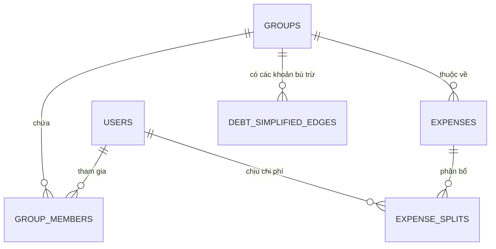

# Bản Đặc Tả Thiết Kế CSDL Chuẩn Hóa 3NF (Database Schema Spec)

**Module:** `[Tên phân hệ, vd: Phân hệ Quản lý Nhóm & Chia tiền]`  
**Hệ quản trị CSDL mục tiêu:** `[PostgreSQL / SQL Server]`  
**Mức độ chuẩn hóa:** `3NF (Third Normal Form)`  
**Chuyên gia thiết kế:** `Backend & Data Specialist`  

---

## 1. Sơ Đồ Quan Hệ Thực Thể (ERD - Entity Relationship Diagram)

---

## 2. Từ Điển Dữ Liệu (Data Dictionary)

### Bảng 1: `[Tên bảng, vd: expenses]`
*Mô tả: Lưu trữ thông tin từng khoản chi tiêu phát sinh trong nhóm hoặc cá nhân.*

| Tên Cột (Column) | Kiểu Dữ Liệu (Data Type) | Nullable | Khóa (Key) | Mô Tả & Ràng Buộc (Description & Constraints) |
| :--- | :--- | :--- | :--- | :--- |
| `id` | `UUID / BIGINT` | NO | PK | Định danh duy nhất |
| `group_id` | `UUID / BIGINT` | YES | FK | Tham chiếu `groups(id)`, NULL nếu là chi tiêu cá nhân |
| `payer_id` | `UUID / BIGINT` | NO | FK | Tham chiếu `users(id)` - Người đứng ra trả tiền trước |
| `amount` | `DECIMAL(18, 2)` | NO | | Số tiền giao dịch, CHECK (amount > 0) |
| `currency` | `VARCHAR(3)` | NO | | Mã tiền tệ (VND, USD), Default 'VND' |
| `category_id` | `INT` | NO | FK | Tham chiếu danh mục chi tiêu |
| `created_at` | `TIMESTAMP WITH TZ` | NO | | Thời điểm tạo bản ghi, Default NOW() |

---

## 3. Đánh Giá Chuẩn Hóa (Normalization Check 1NF - 2NF - 3NF)
- **1NF:** Tất cả các thuộc tính đều nguyên tố (Atomic), không chứa mảng hay dữ liệu lồng ghép trong 1 trường.
- **2NF:** Mọi thuộc tính không khóa đều phụ thuộc hàm đầy đủ vào khóa chính toàn phần (không phụ thuộc một phần).
- **3NF:** Không tồn tại phụ thuộc bắc cầu (Transitive Dependency) giữa các thuộc tính không khóa.

---

## 4. Chiến Lược Đánh Index & Xử Lý Concurrency
- **Chỉ mục (Indexes):**
  - `CREATE INDEX idx_expenses_group_created ON expenses (group_id, created_at DESC);`
- **Concurrency & Khóa (Locking):**
  - Sử dụng `SELECT ... FOR UPDATE` hoặc `Optimistic Locking (version int)` khi chốt sổ nhóm để ngăn chặn tình trạng cập nhật đè (Lost Update).
